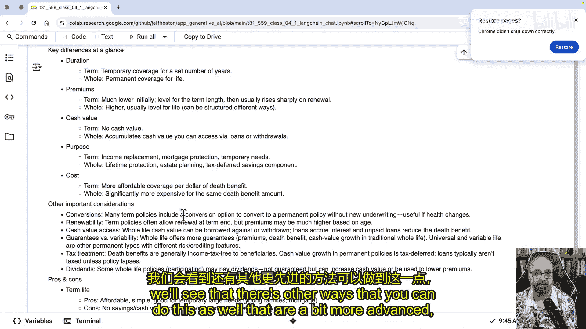

# 016：LangChain对话

在本节课中，我们将学习如何使用LangChain构建能够记住对话历史的聊天应用。我们将从基础的对话构建开始，逐步探索更高级的记忆管理方法，并最终创建一个自动化的代码生成与审查应用。

---

## 概述

LangChain中的对话本质上是一个由消息组成的数组。每次与模型交互时，都需要将完整的对话历史（包括系统指令、用户提问和AI的回复）传递给模型，这样模型才能“记住”之前的交流内容。我们将首先学习如何手动管理这个数组，然后介绍LangChain提供的更便捷的记忆管理工具。

---


## 基础对话构建

上一节我们介绍了对话的基本概念。本节中，我们来看看如何通过代码手动构建一个简单的对话流程。

首先，我们需要设置一个系统提示词来定义AI助手的角色和行为。

```python
system_prompt = "你是一个乐于助人的助手。请使用Markdown格式回答问题。"
```

接着，我们创建一个函数来初始化对话。这个函数会返回一个以系统消息开头的消息数组。

```python
def start_conversation(system_prompt):
    return [{"role": "system", "content": system_prompt}]
```

然后，我们创建另一个函数来处理用户输入并获取AI的回复。这个函数会将用户的新消息和AI的回复都添加到对话历史中。

```python
def converse(prompt, llm, conversation_history):
    # 添加用户消息
    conversation_history.append({"role": "user", "content": prompt})
    # 调用模型获取回复
    response = llm.invoke(conversation_history)
    # 添加AI回复
    conversation_history.append({"role": "assistant", "content": response.content})
    return response.content
```

以下是使用这些函数进行对话的完整步骤：

1.  初始化模型和对话。
2.  通过循环或多次调用，不断添加用户输入和AI回复。

```python
# 1. 初始化模型（例如使用GPT-4）
from langchain.llms import OpenAI
llm = OpenAI(model="gpt-4", temperature=0.3)

# 2. 开始对话
conversation = start_conversation("你是一个乐于助人的助手。")

# 3. 进行多轮对话
user_input_1 = "你好，我的名字是什么？"
reply_1 = converse(user_input_1, llm, conversation)
print(f"AI: {reply_1}")

user_input_2 = "我的名字是杰夫。"
reply_2 = converse(user_input_2, llm, conversation)
print(f"AI: {reply_2}")
```

通过这种方式，AI能够在后续的回复中引用之前对话中提到的信息，例如用户的名字。

---

## 使用系统提示词约束对话

上一节我们构建了一个通用助手。本节中，我们来看看如何通过系统提示词来限制AI的对话范围，使其专注于特定领域。

我们可以修改系统提示词，明确AI的职责范围。例如，将其限定为只回答关于人寿保险的问题。

```python
system_prompt = "你是一个乐于助人的代理人，但只回答关于人寿保险的问题。我在人寿保险行业工作。"
conversation = start_conversation(system_prompt)
```

当用户提出超出范围的问题时，AI会礼貌地提醒用户其职责。

```python
# 提问超出范围的问题
reply = converse("你最喜欢的编程语言是什么？", llm, conversation)
# AI可能会回复：“我只能帮助您解答与人寿保险相关的问题。”
```

当用户提出领域内的问题时，AI则能正常回答。

```python
# 提问领域内的问题
reply = converse("定期寿险和终身寿险有什么区别？", llm, conversation)
# AI会给出关于人寿保险的详细解释。
```

这种方法可以有效地引导对话，确保AI的输出符合应用场景的需求。

---

## 总结



本节课中，我们一起学习了LangChain对话的基础。我们了解了对话的核心是一个不断增长的消息数组，并通过编写函数实现了对话的初始化与交互。我们还探索了如何使用系统提示词来约束AI的对话主题，使其专注于特定任务。在接下来的课程中，我们将介绍LangChain中更高级的记忆管理组件，如`BufferMemory`，它们能更优雅地处理长对话历史。