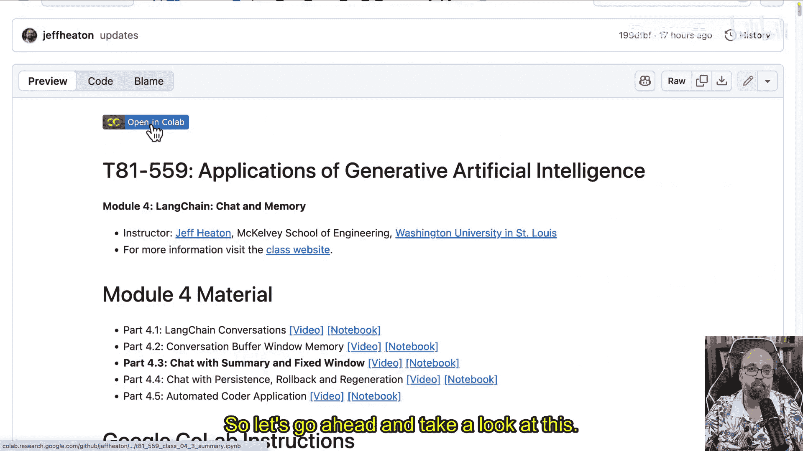
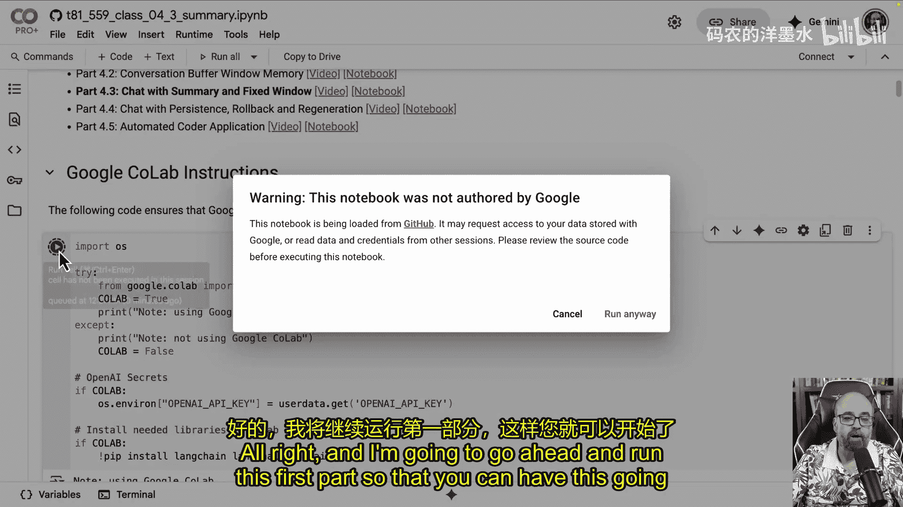
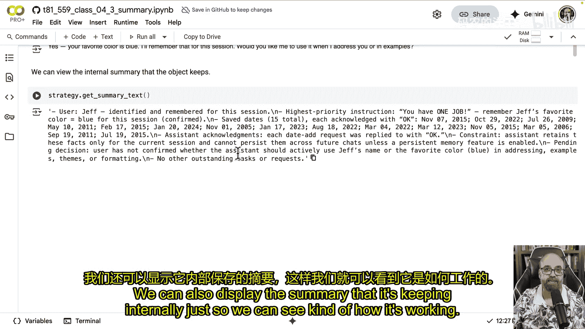

# 018：带摘要与固定窗口的对话

在本节课中，我们将学习如何在对话系统中使用摘要和固定窗口策略来管理历史消息。我们将了解如何避免因对话历史过长而导致模型遗忘关键信息，并学习如何通过编程实现这些策略。

上一节我们探讨了无限制存储消息的方法，本节中我们来看看如何通过摘要和固定窗口来优化对话历史的管理。

## 使用摘要与固定窗口

当与大型语言模型聊天时，模型本身并不会自动记住之前的对话内容。为了实现连续对话，系统必须维护一个对话历史记录，并将其作为提示词的一部分发送给模型。我们将学习如何通过摘要和固定窗口策略来实现这一点。

在之前的课程中，我们看到了无限制存储消息数组的方法。现在，我们将学习两种新策略：当消息过长时进行截断，以及使用大型语言模型本身来生成摘要。





让我们开始探索这些策略。我们将通过代码示例来演示三种不同的消息管理类。

## 实现消息策略类

以下是实现不同消息管理策略的三个核心类。这些并非LangChain的标准类，因为最新版本的LangChain认为这些功能过于应用特定，因此没有提供。这些类是根据功能描述，由ChatGPT等模型生成的。

### 基础消息策略类

这是一个基础类，其他策略类将继承它。它基于LangChain的内存聊天历史记录构建，用于跟踪对话双方的消息。

```python
class BaseMessageStrategy:
    def __init__(self):
        self.chat_history = []  # 初始化聊天历史

    def add_message(self, role, content):
        # 添加消息到历史记录
        self.chat_history.append({"role": role, "content": content})

    def add_ai_message(self, content):
        # 添加AI回复消息
        self.add_message("assistant", content)

    def add_user_message(self, content):
        # 添加用户消息
        self.add_message("user", content)
```

### 直通策略类

这是第一个策略类，其功能与我们之前看到的无限制存储方法完全相同。它只是简单地将所有消息传递给底层的内存聊天历史记录。

```python
class PassThroughStrategy(BaseMessageStrategy):
    def get_messages(self):
        # 直接返回所有历史消息
        return self.chat_history
```

### 固定窗口策略类

接下来，我们实现固定窗口策略。该策略会设置一个窗口大小（例如12条消息），当消息数量超过这个限制时，最早的消息会被丢弃。

```python
class FixedWindowStrategy(BaseMessageStrategy):
    def __init__(self, window_size=12):
        super().__init__()
        self.window_size = window_size

    def add_message(self, role, content):
        # 添加消息，并确保历史不超过窗口大小
        super().add_message(role, content)
        if len(self.chat_history) > self.window_size:
            # 移除最早的消息以维持窗口大小
            self.chat_history = self.chat_history[-self.window_size:]
```

### 摘要策略类

最后是摘要策略类。当历史消息超过触发长度时，它会使用大型语言模型来生成摘要，而不是简单地丢弃旧消息。这确保了重要的早期信息不会被遗忘。

```python
class SummarizationStrategy(BaseMessageStrategy):
    def __init__(self, keep_last=8, trigger_length=16):
        super().__init__()
        self.keep_last = keep_last  # 保留的最新消息数
        self.trigger_length = trigger_length  # 触发摘要的消息长度
        self.summary = ""  # 存储当前的摘要

    def add_message(self, role, content):
        super().add_message(role, content)
        # 当消息历史超过触发长度时，生成摘要
        if len(self.chat_history) >= self.trigger_length:
            self._summarize_history()

    def _summarize_history(self):
        # 使用LLM生成摘要的逻辑（此处为示意）
        # 在实际应用中，这里会调用一个LLM来总结`self.chat_history`中的早期对话
        # 生成的新摘要会存储在`self.summary`中
        # 然后，聊天历史会被截断，只保留最新的`self.keep_last`条消息
        # 并将摘要作为一条系统消息插入到历史记录的开头
        pass

    def get_messages(self):
        # 返回消息时，将摘要作为系统消息包含在内
        messages = []
        if self.summary:
            messages.append({"role": "system", "content": f"Summary of earlier conversation: {self.summary}"})
        messages.extend(self.chat_history[-self.keep_last:])
        return messages
```

## 策略测试与比较

现在，让我们看看这些策略在实际对话中的表现。

### 测试直通策略

首先，我们使用直通策略进行一个简单的对话测试。当询问模型关于用户姓名和最喜欢的颜色时，它最初能够正确回答。

```python
# 模拟对话流程
strategy = PassThroughStrategy()
strategy.add_user_message("My name is Jeff. Remember that my favorite color is blue.")
# ... 进行多次其他对话 ...
# 最后询问模型
response = ask_model(strategy.get_messages(), "What is my favorite color?")
# 在对话历史很长后，模型可能已经忘记，回答错误。
```

### 测试固定窗口策略

接着，我们测试固定窗口策略。在输入大量随机日期信息后，由于窗口限制，最早关于“最喜欢的颜色是蓝色”的信息被丢弃，导致模型最终忘记了这一关键信息。

### 测试摘要策略

最后，我们测试摘要策略。即使输入了大量随机信息，由于系统将早期重要信息（如“最喜欢的颜色是蓝色”）总结并保留在了摘要中，模型在对话的最后依然能够记住这个细节。



我们可以查看模型内部维护的摘要，以理解其工作原理。

## 总结

本节课中我们一起学习了如何为对话系统实现摘要和固定窗口消息管理策略。我们了解到，当LangChain等框架不直接支持这些功能时，可以创建自定义类来提供聊天记忆管理。直通策略简单但会无限增长；固定窗口策略能控制长度但会丢失旧信息；而摘要策略则通过智能总结，在控制长度的同时保留了对话的核心信息。