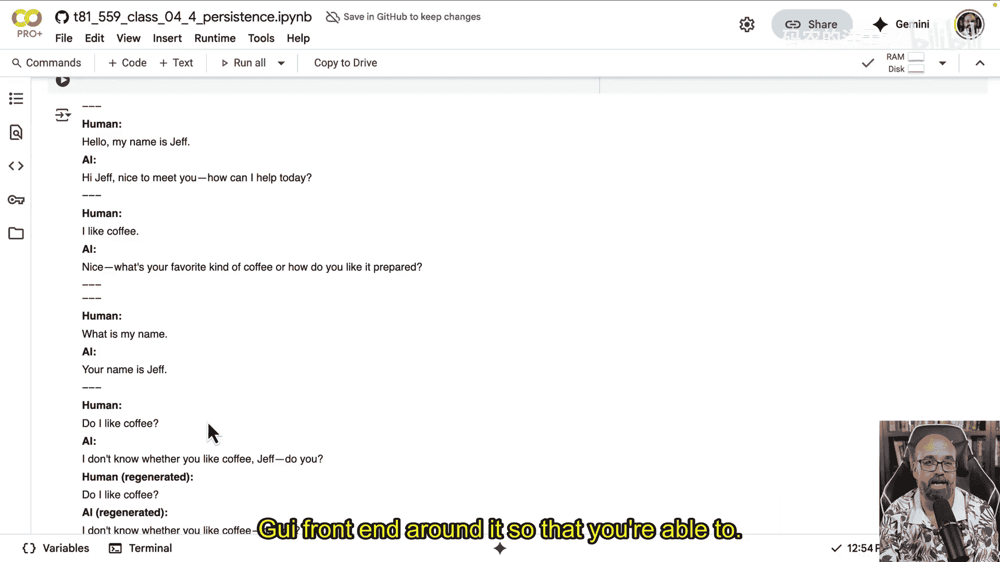

# 019：带持久化、回滚与再生的LangChain对话 🧠💾

在本节课中，我们将继续构建LangChain聊天机器人，并为其添加更强大的记忆功能。我们将学习如何实现对话的持久化存储、回滚操作以及内容再生功能。

---

上一节我们介绍了基础的聊天机器人记忆机制。本节中，我们将在此基础上，通过一个功能更全面的聊天工具类，为机器人添加持久化、回滚和再生能力。

我创建了一个更长的聊天工具类，并将其导入到当前环境中。这个工具类包含了完整的聊天对象。虽然代码量不小，但功能丰富。值得一提的是，这个工具类是利用ChatGPT根据我的需求描述生成的。它支持三种不同的记忆类型：简单的数组、基于固定窗口的消息截断以及总结性记忆。

现在，这个工具已经完全安装并可以导入使用了。

```python
# 导入聊天工具类
from utility import chat
```

---


### 使用固定窗口缓冲记忆

以下是使用固定窗口缓冲记忆的一个示例。我们使用 `chat.ChatConversation` 来创建一个完整的聊天会话，这取代了我们之前使用的简单会话对象。

```python
# 创建一个聊天会话实例
conversation = chat.ChatConversation(memory_type='fixed_window')
```

接着，我们创建第二个会话实例，并将第一个会话的状态加载进去，以演示持久化功能。


```python
# 创建第二个会话并加载之前的状态
new_conversation = chat.ChatConversation()
new_conversation.load_state(conversation.save_state())
```


加载后，第二个会话能记住第一个会话中提到的信息，例如我最喜欢的颜色。我们也可以查看历史记录来验证这一点。


---


### 使用总结性记忆

我们也可以将这个工具与总结性记忆一起使用。创建两个会话的方式与之前类似，但这里我们使用的是总结性记忆。


```python
# 创建使用总结性记忆的会话
summary_conversation = chat.ChatConversation(memory_type='summarization')
```


我们向会话提供各种信息，例如我告诉它我的狗的名字。即使在我加载会话状态后，它仍然记得我的狗叫Hickory，尽管中间穿插了许多无关的信息。我们同样可以查看被截断和总结后的历史记录。


---


### 回滚与再生功能

回滚和再生功能相当实用。以下是它们的工作方式：


首先，我告诉机器人我的名字是Jeff，并且我喜欢咖啡。


```python
conversation.tell("My name is Jeff.")
conversation.tell("I like coffee.")
```

然后，我执行一次回滚操作，让它“忘记”我喜欢咖啡这件事。

```python
conversation.undo()  # 回滚上一条消息
```

之后，如果我问它“我喜欢咖啡吗？”，它将表示不知道，尽管我刚刚告诉过它。

如果我想要机器人重新生成上一次的回复（例如，想要一个不同表述的问候），可以使用再生功能。

```python
conversation.regenerate()  # 重新生成上一条AI回复
```



---

本节课介绍了一个通用的、与LangChain兼容的聊天机器人工具。它为对话提供了持久化存储、状态回滚和内容再生等高级功能。在后续课程中，我们将学习如何为它添加图形用户界面，以便通过网页浏览器使用，并探索其他结合记忆功能的扩展应用。

感谢观看本视频，如果您觉得内容有用，请订阅并点赞，非常感谢。