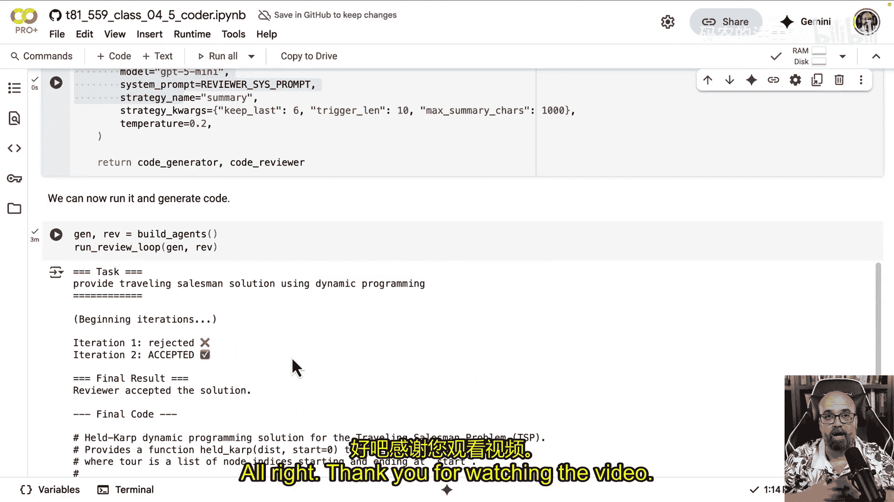

# 020：自动化编码应用 🧑‍💻

在本节课中，我们将综合运用之前学习的聊天和聊天记忆功能，创建一个具体的应用。我们将构建一个代码生成器，但特别之处在于，这个生成器由两个协同工作的智能体（Bot）组成。第一个智能体负责生成代码，第二个智能体则作为代码审查员。它们将反复协作，直到双方都认为生成的代码质量达到标准。

## 概述

我们将创建一个双智能体协作的代码生成系统。该系统会接受一个编程任务，由生成器智能体生成初始代码，然后由审查员智能体进行评估。如果代码未通过审查，审查员会提供修改建议，生成器将据此改进代码。这个过程会循环进行，直到代码被接受或达到最大尝试次数。


## 准备工作与工具导入


首先，我们需要导入必要的工具。与上一节类似，这里使用了一个自定义的聊天工具，它负责管理对话记忆，并允许我们撤销、回滚部分聊天历史或重新生成其他部分。


```python
# 导入自定义聊天工具，用于管理记忆和对话流程
from chat_utility import ChatManager
```


## 定义配置与任务

接下来，我们定义一些控制程序行为的常量和具体的编程任务。

以下是代码生成器的主要配置参数：


*   **`VERBOSE`**： 控制是否显示详细输出。如果设置为 `True`，程序会在每次迭代时显示生成的代码，这有助于调试，但会占用大量屏幕空间。
*   **`MIN_CODE_LENGTH`**： 定义被视为有效代码的最小字符数，这里设置为 `120`。如果生成的代码长度小于此值，程序会认为生成过程出错并重新尝试。
*   **`SAVE_MEMORY`**： 决定是否保存两个智能体的对话记忆。虽然并非必需，但保留记忆有助于分析和回溯。

我们为系统设定一个具体的编程任务：

```python
TASK = "提供一个使用动态规划解决旅行商问题（TSP）的方案。"
```

旅行商问题是指：给定一系列城市和每对城市之间的距离，求解访问每一座城市一次并回到起始城市的最短回路。虽然听起来简单，但随着城市数量增加，问题会变得异常复杂（NP难问题）。动态规划是一种用于高效处理这种复杂搜索空间的算法策略。


## 审查标准与代码提取

我们还需要定义审查员评估代码的标准，并编写从模型输出中提取纯代码的函数。


审查员将根据以下标准评估代码：
*   正确实现动态规划算法以解决TSP问题。
*   代码需包含清晰的注释。
*   代码应高效且可读性强。

当大型语言模型生成代码时，通常会用“```python”和“```”这样的标记（称为“围栏”）将代码块包裹起来。我们的辅助函数需要识别这些标记并提取其中的纯代码内容。


```python
def extract_code_from_response(response_text):
    """
    从模型返回的文本中提取被围栏标记包裹的代码。
    例如，识别 ```python 和 ``` 之间的内容。
    """
    # 实现代码提取逻辑
    start = response_text.find("```python")
    if start == -1:
        start = response_text.find("```")
        if start != -1:
            start += 3
    else:
        start += 9

    end = response_text.find("```", start)
    if start != -1 and end != -1:
        return response_text[start:end].strip()
    return ""
```

## 构建协作循环

现在，我们来构建两个智能体协作的核心循环。这个循环将运行指定的最大轮数（例如5次）。


以下是循环的主要步骤：


1.  **生成代码**： 代码生成器智能体根据当前任务生成初始代码。
2.  **审查代码**： 代码审查员智能体评估生成的代码，判断其是否合格。
3.  **处理反馈**： 如果代码被拒绝，审查员会提供具体的修改建议。生成器则根据这些建议改进代码，进入下一轮迭代。
4.  **达成一致或终止**： 当审查员接受代码，或达到最大迭代次数时，循环结束。

```python
max_rounds = 5
for current_round in range(1, max_rounds + 1):
    # 步骤1: 生成代码
    generated_code = code_generator_agent.generate(TASK)
    # 步骤2: 审查代码
    review_result, feedback = code_reviewer_agent.review(generated_code)
    # 步骤3: 判断结果
    if review_result == "ACCEPTED":
        print(f"第 {current_round} 轮：代码被接受！")
        final_code = generated_code
        break
    else:
        print(f"第 {current_round} 轮：代码被拒绝。反馈：{feedback}")
        # 将反馈整合为新的任务要求，供下一轮生成使用
        TASK = f"{TASK} 请根据以下反馈进行修改：{feedback}"
else:
    print("达到最大迭代次数，未生成可接受的代码。")
```


## 实例化智能体并运行

最后，我们创建两个智能体实例并启动整个协作流程。

我们首先实例化代码生成器智能体，然后实例化代码审查员智能体。每个智能体都可以配置不同的系统提示（System Prompt）来定义其角色和行为。配置完成后，调用上述的协作循环即可开始运行。


程序运行后，你会在输出中看到类似的过程：
1.  系统接收到旅行商问题的任务。
2.  生成器创建初始代码。
3.  开始迭代。通常第一轮代码会被拒绝，审查员会给出改进建议。
4.  生成器根据建议修改代码，在第二轮或第三轮迭代中，代码通常会被接受。
5.  最终，输出双方都认可的、解决旅行商问题的动态规划代码。

## 总结



本节课中，我们一起学习并构建了一个自动化编码应用。我们利用两个分工明确的智能体——生成器与审查员——通过多轮对话与协作，共同完成了一个复杂的编程任务（动态规划解决TSP）。这个例子展示了如何将聊天记忆、任务分解和迭代反馈等概念结合起来，创建出能够产出高质量、可审查结果的智能系统。