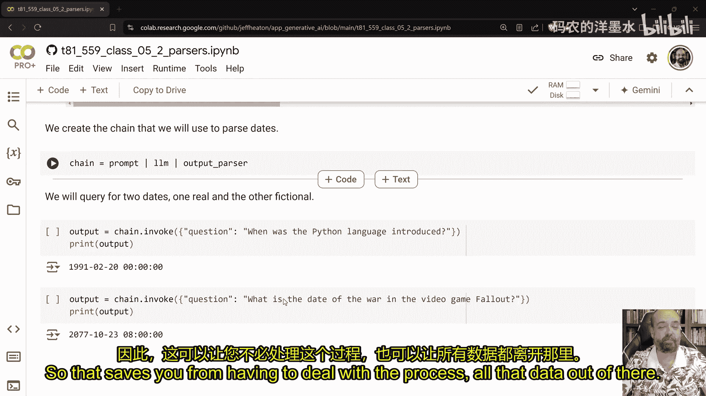

# 022：CSV、JSON、Pandas、日期时间

## 概述

在本节课中，我们将学习如何使用LangChain库中的几种特定解析器来处理不同格式的数据。我们将重点介绍用于处理逗号分隔值列表、JSON数据、Pandas数据框以及日期时间信息的解析器。掌握这些工具能帮助你更有效地从大语言模型生成的非结构化文本中提取和格式化信息。

## 环境设置与认证


上一节我们介绍了LangChain的基础概念，本节中我们来看看如何设置环境并开始使用这些解析器。首先，你需要配置大语言模型的访问权限。


假设你将使用OpenAI提供的大型语言模型，例如GPT-4或更高版本。以下代码从环境变量中读取认证密钥。如果你在协作环境（如Google Colab）中工作，也可以从平台提供的密钥管理工具中获取。


```python
import os
from google.colab import userdata
# 从环境变量或Colab Secrets获取API密钥
api_key = os.getenv("OPENAI_API_KEY") or userdata.get('OPENAI_API_KEY')
```


接下来，安装所有必需的依赖库。


```bash
!pip install langchain openai pandas
```


完成安装后，我们就可以开始研究具体的解析器了。

## 逗号分隔列表响应解析器

当你想让模型返回一个值列表时，逗号分隔列表解析器非常有用。这是一种常见的请求格式。


以下是使用该解析器的示例。我们创建一个提示模板，要求模型生成最多10个项目的列表。


```python
from langchain.output_parsers import CommaSeparatedListOutputParser
from langchain.prompts import PromptTemplate
from langchain.llms import OpenAI
# 初始化解析器和模型
output_parser = CommaSeparatedListOutputParser()
llm = OpenAI(api_key=api_key)

# 创建提示模板
template = "列出最多10个{subject}。\n{format_instructions}"
prompt = PromptTemplate(
    template=template,
    input_variables=["subject"],
    partial_variables={"format_instructions": output_parser.get_format_instructions()}
)
```


现在，我们可以向模型提问。例如，要求列出一些城市。


```python
# 构建问题链
chain = prompt | llm | output_parser
result = chain.invoke({"subject": "城市"})
print(result)
# 输出示例: ['北京', '上海', '广州', '深圳', ...]
```

模型会返回一个用逗号分隔的值列表。如果模型没有按照指定格式响应，可能会引发错误，但通常提示词已被设计为能稳定地引导模型输出正确格式。


你可以询问几乎任何主题的集合，前提是该主题在模型的基础知识范围内。

```python
# 请求列出编程语言
result = chain.invoke({"subject": "编程语言"})
print(result)
# 输出示例: ['Python', 'JavaScript', 'Java', 'C++', ...]
```


## JSON结果解析器

有时你可能希望模型以JSON格式返回数据。实现这一目标有多种方法。

以下是一个解析JSON结果的示例。我们要求模型将输入的单词翻译成三种语言，并以JSON格式返回。


```python
from langchain.output_parsers import StructuredOutputParser, ResponseSchema
from langchain.prompts import PromptTemplate
# 定义期望的JSON响应结构
response_schemas = [
    ResponseSchema(name="language", description="用户输入的语言"),
    ResponseSchema(name="french", description="法语翻译"),
    ResponseSchema(name="spanish", description="西班牙语翻译"),
    ResponseSchema(name="chinese", description="中文翻译")
]
output_parser = StructuredOutputParser.from_response_schemas(response_schemas)

# 创建提示模板，包含格式指令
template = """
将以下单词翻译成法语、西班牙语和中文。
单词: {word}
{format_instructions}
"""
prompt = PromptTemplate(
    template=template,
    input_variables=["word"],
    partial_variables={"format_instructions": output_parser.get_format_instructions()}
)

# 执行链
chain = prompt | llm | output_parser
result = chain.invoke({"word": "hello"})
print(result)
# 输出示例: {'language': 'hello', 'french': 'bonjour', 'spanish': 'hola', 'chinese': '你好'}
```


可以看到，返回的结果是结构良好的JSON格式。使用提示模板可以让我们精确控制提示词的样式。

## 查询Pandas数据框


LangChain还提供了查询Pandas DataFrame的功能。理论上，你可以直接向模型提问，例如“计算美国各州的平均人口增长率”，并期望它能生成复杂的类SQL查询来汇总数据并给出答案。


然而，我必须承认，我在使用LangChain的这个特定功能时并未取得完全的成功。虽然其结构设计支持此类操作，但模型常常无法找到合适的函数来执行你试图对数据进行的更改或查询。

以下是一个使用经典鸢尾花数据集的示例。


```python
import pandas as pd
from langchain.agents import create_pandas_dataframe_agent

# 加载数据集
df = pd.read_csv('https://raw.githubusercontent.com/mwaskom/seaborn-data/master/iris.csv')
print(df.head())
# 创建Pandas代理
agent = create_pandas_dataframe_agent(llm, df, verbose=True)

# 向代理提问
response = agent.run("获取花萼长度列的平均值。")
print(response)
```


通常，像计算平均值这样的简单操作可以成功。但你必须谨慎，因为模型了解的Pandas函数范围有限，很容易因为使用了它不理解的函数而导致错误。


## 日期时间解析器

最后，我们来看日期时间解析器。LangChain内置的提示词确保你以期望的格式提供日期，这样它才能正确解析，因为日期的格式有无数种。


```python
from langchain.output_parsers import DatetimeOutputParser
from langchain.prompts import PromptTemplate
output_parser = DatetimeOutputParser()
# 创建提示模板
template = "回答用户的问题：\n{question}\n{format_instructions}"
prompt = PromptTemplate.from_template(
    template,
    partial_variables={"format_instructions": output_parser.get_format_instructions()}
)

# 打印完整的提示词以查看格式
print(prompt.format(question="某个事件发生在何时？"))
# 构建链
chain = prompt | llm | output_parser
```


现在我们可以进行提问。

```python
# 询问Python语言的诞生日期
result = chain.invoke({"question": "Python语言是何时推出的？"})
print(result)
# 输出示例: 1991-02-20 00:00:00

# 甚至可以询问虚构作品的日期
result = chain.invoke({"question": "电子游戏《辐射》中的战争发生在哪一天？"})
print(result)
# 输出示例: 2077-10-23 00:00:00
```



这使你无需手动处理提示词并从中提取和解析日期数据。

## 总结

本节课中，我们一起学习了如何使用LangChain库内置的几种解析器来处理不同格式的数据输出。我们探讨了如何解析逗号分隔的列表、结构化的JSON数据、如何尝试查询Pandas DataFrame，以及如何可靠地解析日期时间信息。这些工具能够帮助你更高效地将大语言模型生成的非结构化文本转化为程序可直接使用的结构化数据，是构建复杂AI应用流水线中的重要一环。