# 023：Pydantic解析器 🐍

在本节课中，我们将学习如何结合使用Pydantic库与LangChain，来定义和验证从大型语言模型返回的数据结构。Pydantic是一个基于Python类型注解的数据验证和设置管理库，它能帮助我们确保数据的结构符合预期。

---

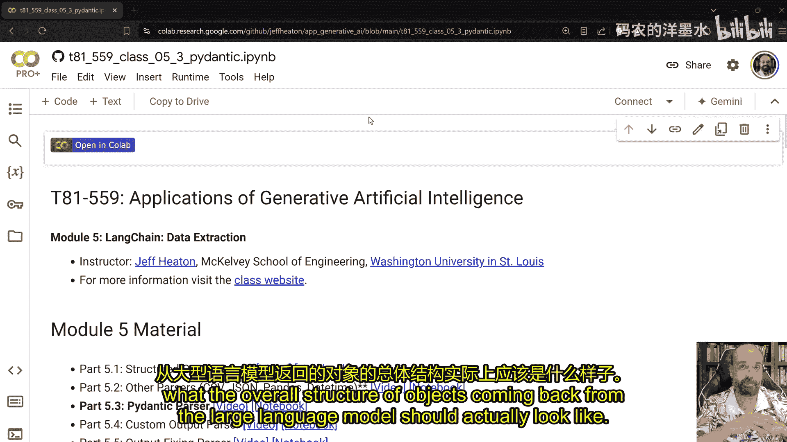

你可能听说过Pydantic库，它是Python编程语言的一个功能。LangChain对此提供了广泛的支持。这是一种在Python中定义对象时，引入验证和通用结构规范的方法。

我们将看到如何结合使用它们，让你能够用Pydantic来精确定义从大型语言模型返回的对象应具备的整体结构。

这里你可以看到我们设置了OpenAI的API密钥。

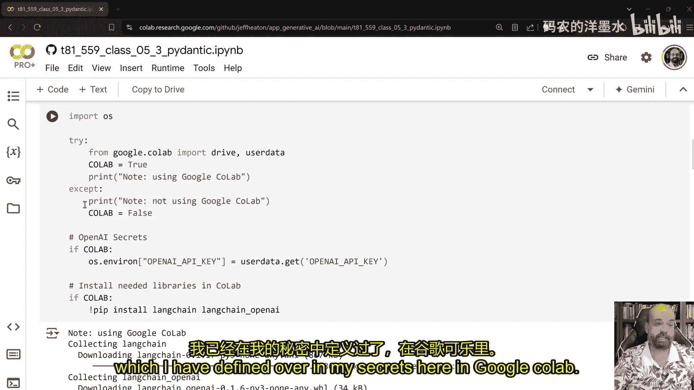

你可以将其定义为环境变量。这里假设你使用OpenAI，但你当然也可以使用其他模型，因为LangChain提供了LLM驱动器的概念。这里我们仅使用OpenAI的驱动器，而OpenAI要求你提供身份验证密钥，我已将其定义在Google Colab的“secrets”中。

Pydantic是一个通过类型注解在Python中使用的数据验证和设置管理库。它对我们进行数据验证非常有用。它支持某些能识别带有Pydantic注解代码的编辑器，并具备错误处理和设置管理功能。如果你想将其用于配置文件，这正是我广泛使用它的场景。此外，它是可扩展的，你可以超越其现有功能进行扩展，并且它能与许多其他库（如LangChain）集成。

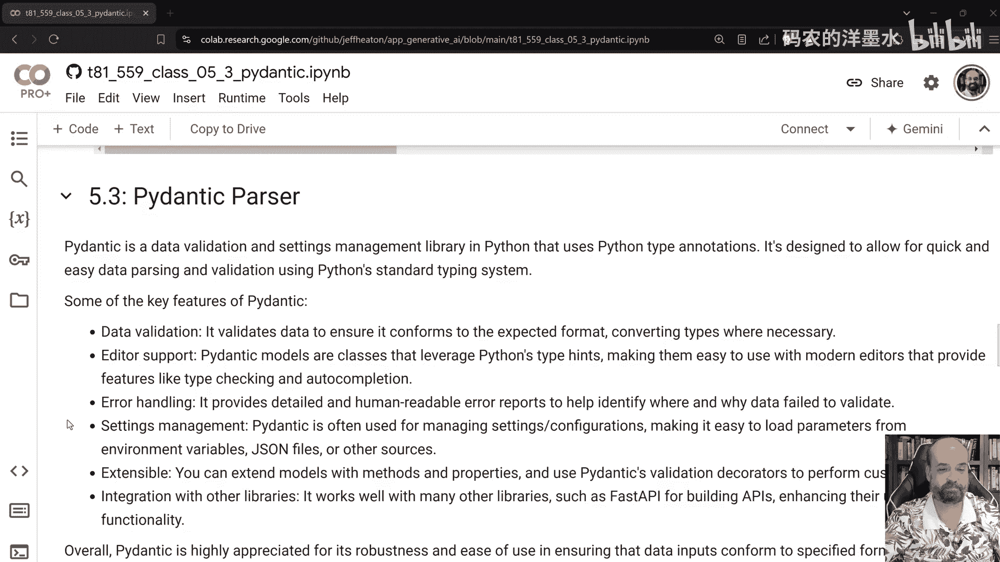

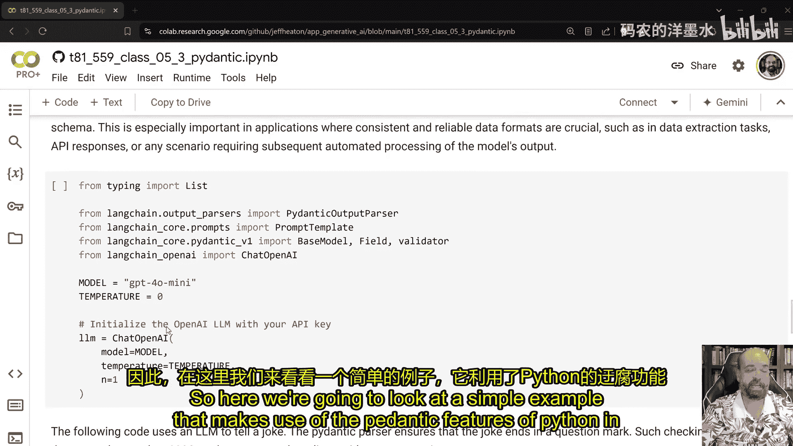

接下来，我们将看一个简单的例子，它利用了Python的Pydantic特性，并结合了Pydantic库和LangChain。

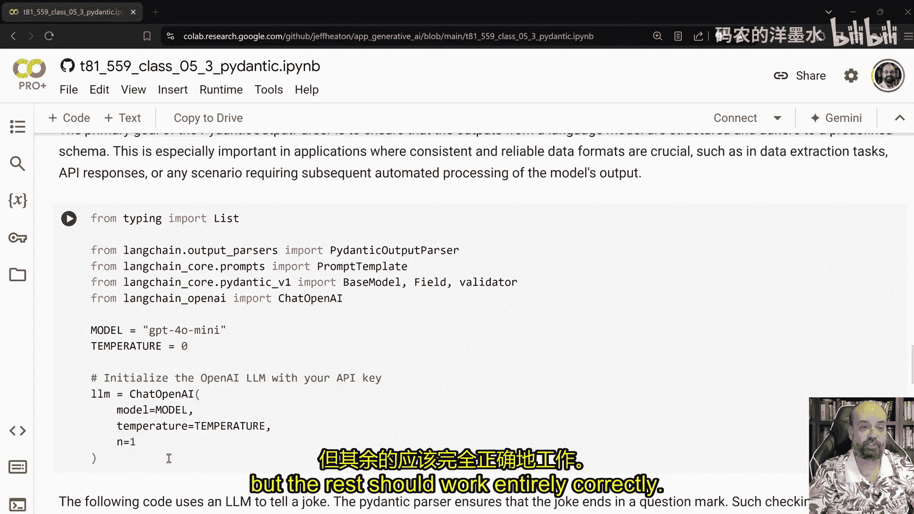

这里我们可以看到，我们导入了`PydanticOutputParser`。这样，输出将被该解析器解析。我们使用的是`gpt-3.5-turbo`模型，你可以将其更改为OpenAI支持的其他模型。如果你不想使用OpenAI，你需要更改这里的代码部分，但其余部分应该完全正常工作。

现在，我们将让它讲一个笑话。我们通过扩展`BaseModel`来创建`Joke`类。为Pydantic定义的两个字段是`setup`（笑话的铺垫问题）和`punchline`（笑话的解答妙语）。

为了验证这些字段的正确性，我们确保`setup`确实以问号结尾。我们通过`@validator('setup')`装饰器来实现这一点。我们所做的只是确保`setup`以问号结尾，否则，就不知道你试图提出什么样的问题或笑话，因为在这种情况下，笑话通常以问题开始。

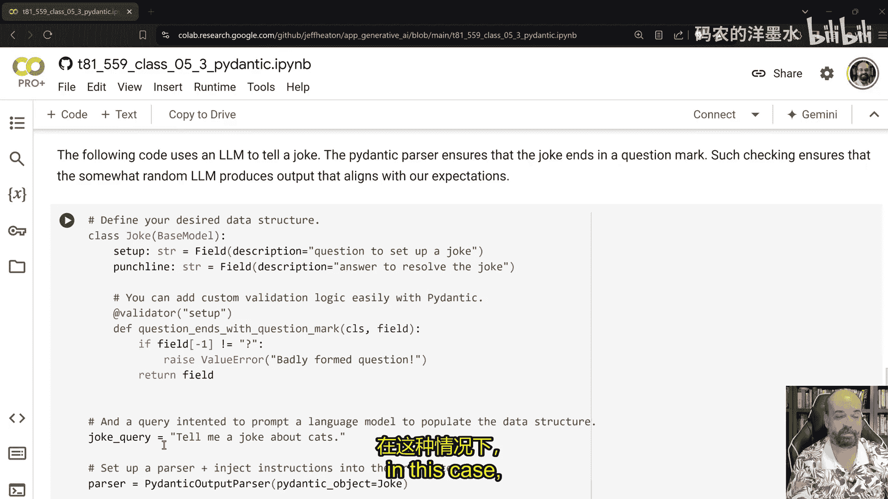

我将输入“Tell me a joke about cats”。它给出了回答：“为什么猫坐在电脑上？因为它想盯着鼠标。”这确实是一个关于猫和鼠标的经典笑话，并且巧妙地关联了电脑鼠标。

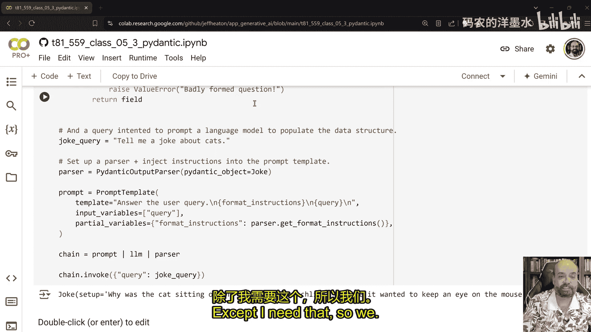

我们可以看到，如果`setup`没有以问号结尾，它会抛出一个错误，因为那不是一个正确格式化的铺垫句。

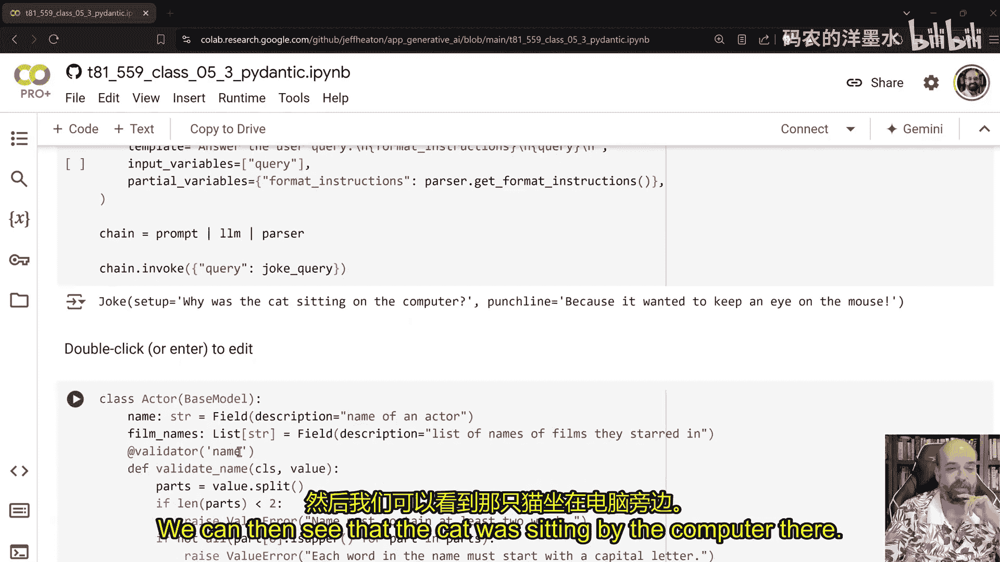
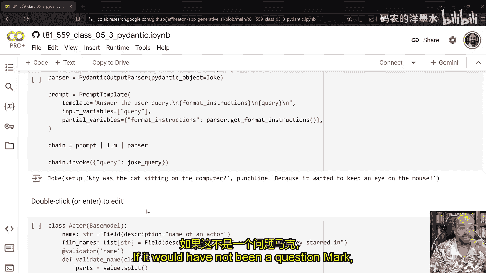

接下来，我们将为演员和女演员设置一个类。`name`将是一个字段，`film_names`（他们主演的电影列表）也将是一个字符串列表字段。

使用`Field`并提供描述，可以给大型语言模型一些关于如何获取这些值的提示。在验证部分，我们规定名字必须至少包含两个单词，并且每个单词必须以大写字母开头，这些要求看起来是合理的。

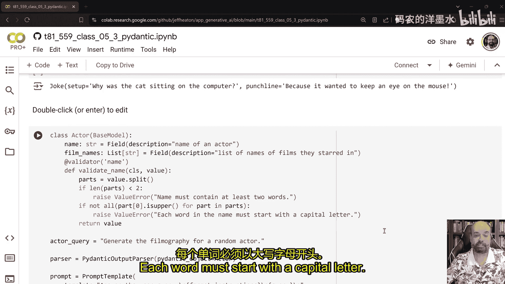

当我们要求“生成一个随机演员的电影作品列表”时，它选择了汤姆·汉克斯，并给出了他的电影列表。这是一种定义用于保存电影列表的对象并同时为其添加验证的方法。

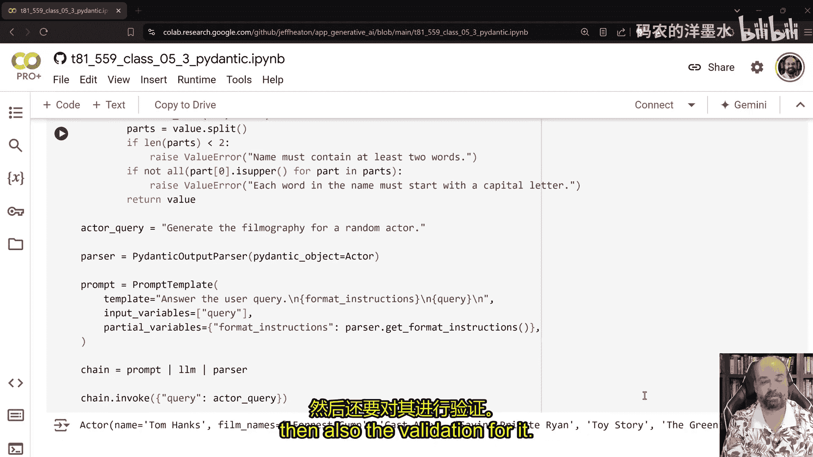

---

本节课中，我们一起学习了如何利用Pydantic为LangChain中的大型语言模型输出定义结构化模式并进行数据验证。我们通过创建`Joke`和`Actor`类，演示了如何确保返回的数据符合特定的格式和规则，从而增强了应用的可靠性和可预测性。