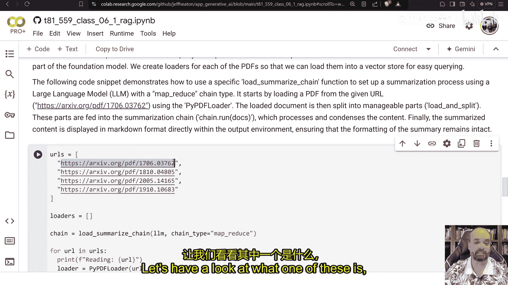
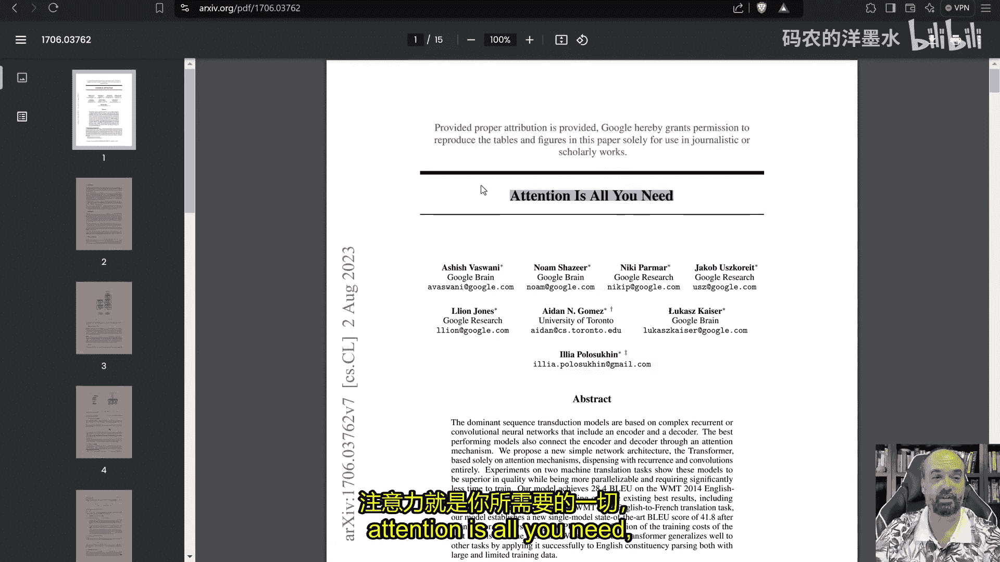
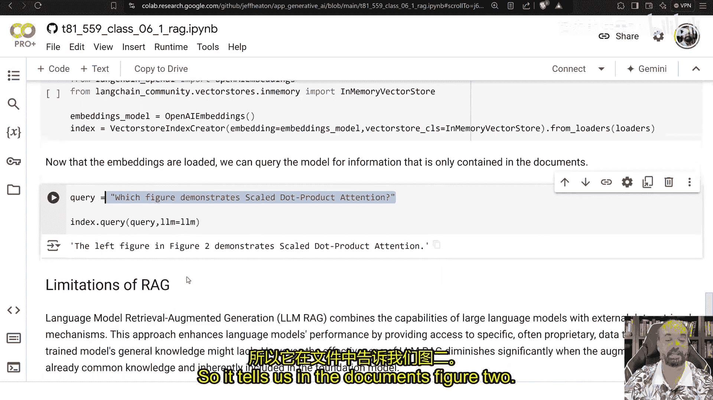

# 026：RAG入门 🧠

在本节课中，我们将学习检索增强生成（RAG）技术。RAG是一种用于大型语言模型的技术，它能有效解决使用大模型时遇到的两个主要问题：信息溯源和获取最新、相关的专有信息。我们将通过代码示例，学习如何利用RAG来总结多份PDF文档。

## RAG的工作原理

上一节我们介绍了RAG要解决的核心问题，本节中我们来看看RAG具体是如何工作的。

你有一个基础模型，它知道一些通用知识，但不知道你可能想额外添加的专有信息。大型语言模型所拥有的全部输入就是**提示词**。提示词是你给它的内容，可以是一个问题，也可以很长，例如“请帮我校对这份文档”，而提示词的其余部分就是你要校对的文档本身。

在与模型进行聊天会话时，你们会来回对话，模型会记住对话的流程。所有这些对话内容或对话摘要都会被构建到提示词中。

除了记忆，我们还可以在提示词中构建另一种能力：**信息查找**。具体做法是，模型会处理一份可能超出其上下文窗口容量的大型文档，并将其**分块**。这些块非常重要。

分块策略可以很复杂。例如，你可能不希望一个块横跨两个章节。这在处理法律文件等场景时尤为重要。

然后，系统会为你创建的每个块建立索引或查找表。当收到你的提示词时，它会计算一个称为**嵌入向量**的东西。这是一个以可搜索方式描述你段落的向量。系统会对比这个向量与所有文档块对应的向量，找出最相似的那些（通常会设定一个相似度阈值）。

最后，这些最相关的信息块会作为参考数据被加载到提示词中，帮助LLM回答你提出的问题，或者像我们接下来要做的那样，生成摘要。

## 实践：使用RAG总结PDF

以下是使用RAG总结多份PDF文档的步骤。

首先，我们需要加载API密钥并导入必要的库。本示例使用OpenAI和LangChain。

```python
# 加载OpenAI API密钥
import os
os.environ["OPENAI_API_KEY"] = "你的-api-key-放在这里"

# 导入必要的库
from langchain.document_loaders import PyPDFLoader
from langchain.embeddings import OpenAIEmbeddings
from langchain.vectorstores import Chroma
from langchain.chains import RetrievalQA
from langchain.llms import OpenAI
```

接下来，我们加载PDF文档。这里使用了四篇与生成式AI相关的学术论文。

```python
# 指定PDF文件路径
pdf_paths = [“paper1.pdf”, “paper2.pdf”, “paper3.pdf”, “paper4.pdf”]

# 使用PDF加载器读取所有文档
loaders = [PyPDFLoader(path) for path in pdf_paths]
documents = []
for loader in loaders:
    documents.extend(loader.load())
```

然后，我们创建嵌入模型和向量索引。这一步完成了文档的分块和向量化，以便后续检索。

```python
# 创建嵌入模型（使用OpenAI默认模型）
embeddings = OpenAIEmbeddings()

# 为文档创建向量存储索引
vectorstore = Chroma.from_documents(documents, embeddings)
```

现在，我们可以创建一个检索增强的问答链，并向它提问。

```python
# 创建检索式QA链
qa_chain = RetrievalQA.from_chain_type(
    llm=OpenAI(model_name=“gpt-4”), # 使用GPT-4
    chain_type=“stuff”,
    retriever=vectorstore.as_retriever()
)





# 提出一个具体问题
question = “哪些图表展示了可缩放的点积注意力机制？”
answer = qa_chain.run(question)
print(answer)
```
运行上述代码，模型将基于PDF文档中的内容进行回答。例如，它可能会指出：“在文档中，图2展示了可缩放的点积注意力机制。”

## RAG的注意事项与局限性

在使用RAG时，有几个重要的注意事项需要了解。



首先，你需要确认基础模型是否已经知晓你提供的专有信息。如果它已经知道，那么RAG的帮助可能就不大。

其次，RAG本质上只是用额外信息增强模型，并不改变模型输出的基本风格。如果你想改变输出风格，通常需要进行**微调**。

此外，所有通过RAG输入模型的数据，你必须确保使用该LLM的用户也有权访问这些数据。你需要控制从RAG到这些数据的访问权限，这是在此类模型中实施安全控制的一种方式。

尽管如此，RAG仍然是大型语言模型的一项重大技术。与我们在聊天记忆中学到的内容不同，RAG建立的连接是持久化的。一旦你重建RAG连接，它仍然会记得之前的信息，而不像聊天机器人中的记忆那样，在新会话开始时就消失。

## 总结

本节课中我们一起学习了检索增强生成（RAG）技术。我们了解了RAG如何通过**检索、增强、生成**三个阶段，解决大模型的信息溯源和知识更新问题。我们通过代码实践了如何使用RAG加载、分块、索引PDF文档，并基于文档内容进行问答和总结。最后，我们讨论了RAG的适用场景、局限性以及相关的安全考量。RAG是将专有、最新业务数据融入大模型应用的一种高效且经济的方法。