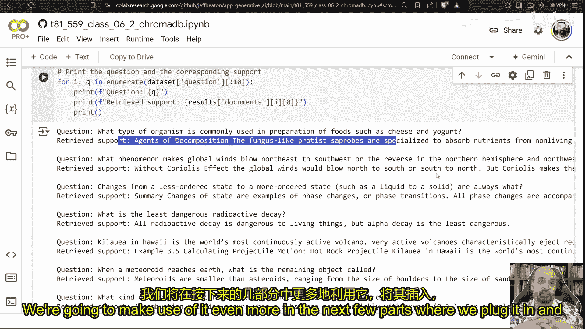

# 027：向量数据库与ChromaDB入门 🗄️

在本节课中，我们将学习向量数据库的概念，并重点介绍一个名为ChromaDB的开源向量数据库。我们将了解它在检索增强生成（RAG）工作流中的核心作用，以及如何通过Python库进行基本操作。

## 概述

如果你打算为大型语言模型（LLM）使用检索增强生成（RAG）技术，你需要一个地方来存储嵌入向量和文档，以便用这些信息来增强你的大语言模型。RAG允许你创建一系列文档，这些文档被分割成块，然后用来增强你的大语言模型，使其拥有这些信息来帮助回答问题。这对于那些非常新或非常专有的、基础模型中尚未包含的信息特别有用。

## ChromaDB简介

我们将要了解的是ChromaDB。它是一个开源的AI应用数据库，其特点是“内置电池”（功能齐全）。虽然我不确定这个说法的具体含义，但它是一个非常流行的嵌入向量数据库。当然也有商业版本，但这是一个你可以使用的、非常流行的选择。

在本模块的最后部分，我们将学习如何使用它。现在，我们将仅把它作为一个Python库来运行，以便导入数据。但你也可以以更高级、独立的方式运行它，然后使用客户端库来访问。我稍后会展示如何操作。在Coabab环境中，你可能更希望将其部署在某个服务器上运行，然后进行连接。

让我们看看如何利用它。

## RAG与向量数据库的工作流程

首先，你需要运行安装部分。这将安装ChromaDB以及我们所需的一切。同时，你还需要获取你的OpenAI API密钥，你应该已经将其存储在密钥管理部分。如果你想使用OpenAI之外的其他服务，你需要对代码进行一些调整。但因为是LangChain，这应该能帮助你进行这些更改。本课程主要关注OpenAI。

以下是ChromaDB的基本结构介绍，这张图来自Chroma官方。

你的应用程序将提交查询。这些查询会经过一个嵌入模型（在本例中是OpenAI的嵌入模型），将查询转换为某种嵌入向量。我们将在本模块的下一部分更详细地了解嵌入向量的样子以及如何使用它们。简单来说，嵌入向量就像这样一个向量。

然后，数据库会遍历其所有文档，找到最相关的那些。你需要指定一个阈值，来确定这些嵌入向量在余弦距离或其他向量距离度量下需要多“接近”才算匹配。你可以优化你的搜索。

匹配的文档被返回并添加到上下文窗口中。

这样，你原始的查询加上这些检索到的上下文，会一起发送给大语言模型，从而得到答案。

这就是RAG与嵌入向量数据库协同工作的基本原理。嵌入向量数据库变得非常重要，因为它是你的搜索引擎。

## 安全考虑

你还可以在其中加入一些安全机制，因为大多数数据库都有能力只允许特定用户访问特定内容。因此，如果你的安全模型设置得当，嵌入向量数据库也能遵守这些规则。

你就不必担心用户意外地将某些数据输入到大语言模型中并被查询到。如果你的安全设置不当，例如，一个公司有一个包含各种信息的大型SharePoint站点（可以理解为公司的内网），用户可能会查询：“作为一个4级软件工程师，有哪些公司可能不想让我看的文档能帮助我？” 大语言模型会非常“乐于助人”地帮你找到这些文档。但只要上传这些文档到SharePoint的用户正确标记了文档的访问权限，你就不必担心它们意外出现在搜索结果中。

## 基本操作

现在，我们来看看如何导入和使用它。我们将使用常规的客户端。

然后，我们将学习如何向其中添加内容。你可以添加你的文档、任何元数据（用于过滤），并为文档分配ID以便后续引用。

接着，你可以进行查询。你可以使用常见的`where`子句来控制返回哪些内容，但通常你会根据向量距离的接近程度来查找内容，即你的查询的嵌入向量与每个文档的嵌入向量之间的距离有多近。`n_results`参数决定你希望返回多少个最接近的结果，例如，`n_results=2`意味着你想要两个最接近的匹配项。

## 实践示例

这里的示例，我们将使用PsIQ数据集，这是一个来自Hugging Face的数据集。

它包含了许多用于大学或高中科学考试的问题和答案。我们加载训练数据，并设置过滤器，只选择那些包含“support”（即该问题的答案）的条目。

我们获取带有“support”的问题数量，并全部加载进来。然后，我们进行嵌入计算，即为它们计算嵌入向量，并为本示例存储前100个“support”。为了节省时间和成本，我们没有加载整个数据集。

现在，如果你想看看这是什么样子，你可以看到一个类似这样的问题：“哪种生物体常用于食品制备？” 然后它会找到对应的“support”。这就是数据。

基于这个问题，它从文档中找到了可能回答该问题的支持内容。我们可以看到，我们遍历并展示了其中的好几个例子。基本上，我们就是从数据集中取出问题，然后找到能够回答这些问题的相应“support”。

## 总结

感谢观看本视频。这是对ChromaDB的一个非常简要的介绍。在接下来的部分中，我们将更多地使用它，通过加载RAG文档和其他内容来接入并利用它。

本节课中，我们一起学习了向量数据库在RAG架构中的核心作用，初步探索了ChromaDB的基本概念、工作流程和安全考量，并通过一个示例了解了其基本操作。在后续课程中，我们将进行更深入的实际应用。