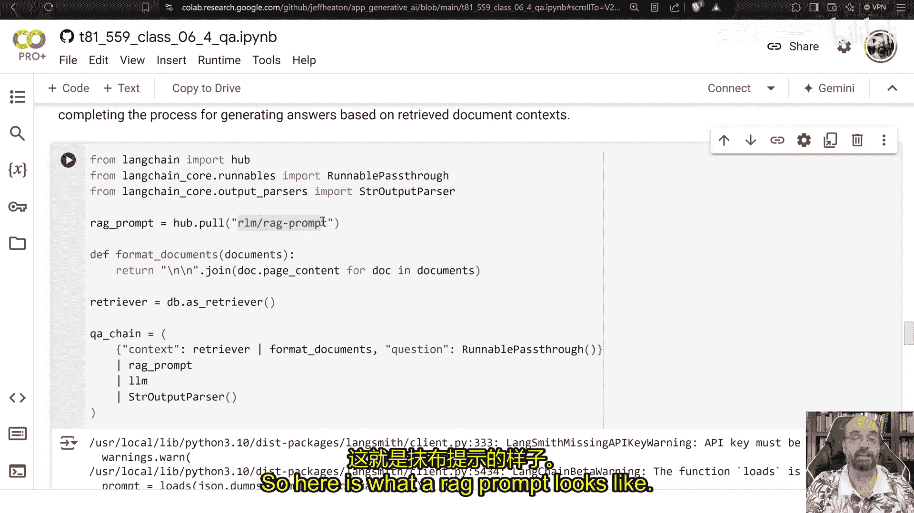
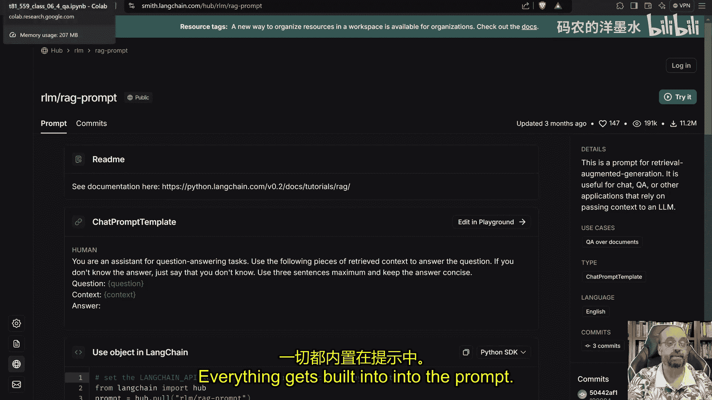
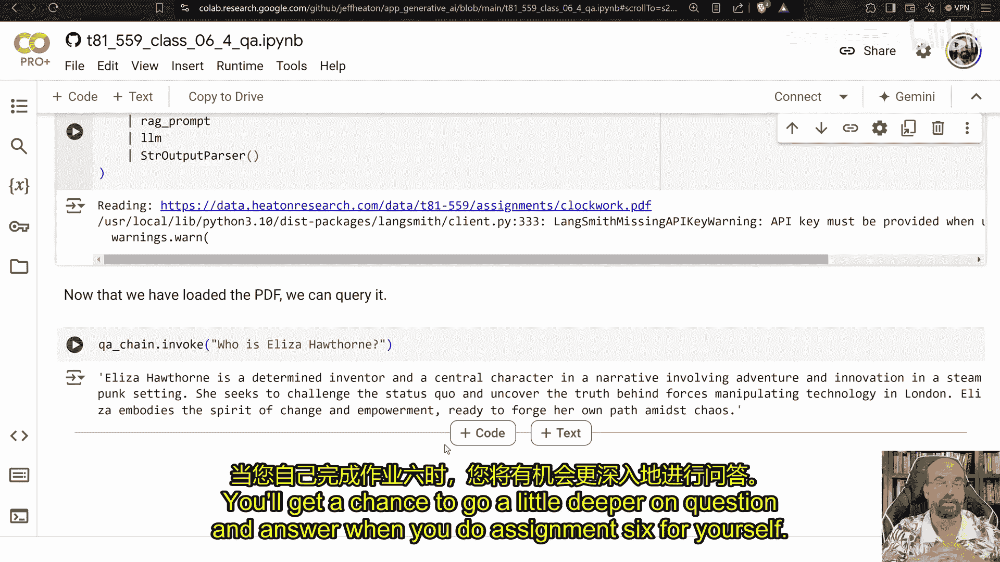

# 029：基于RAG的文档问答 📄

在本节课中，我们将学习如何使用检索增强生成技术，基于您提供的文档来构建一个问答系统。我们将涵盖从文本文件和PDF文件中加载文档、创建嵌入数据库，以及最终构建一个能够回答特定问题的AI链的完整流程。

---

## 概述

检索增强生成允许您使用自己的文档来增强基础模型的能力。所有传入的提示都会扫描您提供的文档数据库，并用其中的信息来增强回答。RAG最常见的用途之一就是针对这些文档进行问答。我们将学习如何对文本文件和PDF文件实现这一功能。

## 代码准备与依赖安装

首先，我们需要设置环境并安装必要的库。与课程中的其他部分一样，代码会从安全的位置获取API密钥，并安装处理PDF文件所需的库。

以下是关键步骤：
1.  安全地配置您的OpenAI API密钥。
2.  安装 `PyPDF` 等必要的Python库，以便处理PDF文件。

```python
# 示例：安装所需库
!pip install pypdf chromadb langchain
```

## 构建基于文本文件的RAG问答系统

上一节我们介绍了环境设置，本节中我们来看看如何为文本文件构建一个RAG系统。其核心思想是将文档分割成块，转换为向量嵌入，并存储到向量数据库中，以便检索。

### 准备样本数据

为了使RAG有效，所使用的数据应为基础模型训练时未包含的新数据或专有数据。例如，我们可以使用生成式AI创建一些虚构人物的传记作为样本数据。

以下是我们将使用的样本数据描述：
*   **Eleena Martinez**: 一位在Future Tech公司任职的经验丰富的机器人工程师，拥有麻省理工学院的机械工程硕士学位，在硅谷从事人工智能和机器人技术创新超过十年。

我们有一系列包含此类虚构人物传记的文本文件。

### 文档加载与分块

以下是处理文档的核心步骤：

1.  **指定分块参数**：我们将文档分割成重叠的文本块。例如，设置块大小为900个标记，重叠步长为300个标记。
2.  **加载与分块**：循环读取每个文本文件的URL，获取内容，并使用指定的参数将其分割成块。
3.  **生成嵌入**：使用一个嵌入模型（如默认的`text-embedding-ada-002`）将每个文本块转换为向量表示。
4.  **存储到向量数据库**：使用ChromaDB存储这些文本块及其对应的向量嵌入。

```python
# 示例：文档分块与加载到ChromaDB
from langchain.text_splitter import RecursiveCharacterTextSplitter
from langchain.vectorstores import Chroma
from langchain.embeddings import OpenAIEmbeddings

text_splitter = RecursiveCharacterTextSplitter(chunk_size=900, chunk_overlap=300)
documents = text_splitter.split_documents(loaded_docs)

vectorstore = Chroma.from_documents(documents, OpenAIEmbeddings())
```

### 构建问答链



现在，我们有了一个存储文档的向量数据库，接下来需要构建一个链来查询它。这涉及到一个特定的RAG提示模板和检索器。

以下是构建问答链的步骤：

1.  **使用RAG提示模板**：我们采用一个标准的提示模板来指导模型如何利用检索到的上下文回答问题。该模板指示模型使用提供的相关信息，如果不知道答案则如实说明，并保持回答简洁。
2.  **设置检索器**：检索器会查询ChromaDB，找到与问题最相关的文档块。
3.  **组合成链**：将问题、检索到的上下文和RAG提示模板组合起来，输入给大型语言模型，最终生成回答。



**核心的RAG提示模板内容如下：**
> 你是一个用于问答任务的助手。请使用以下相关的上下文信息来回答问题。如果你不知道答案，请说“我不知道”。请用最多三句话回答，并保持答案简洁。
> 上下文：{context}
> 问题：{question}

```python
# 示例：构建RAG链
from langchain.chains import RetrievalQA
from langchain.llms import OpenAI

qa_chain = RetrievalQA.from_chain_type(
    llm=OpenAI(),
    chain_type="stuff",
    retriever=vectorstore.as_retriever(),
    chain_type_kwargs={"prompt": RAG_PROMPT}
)
```

构建完成后，我们可以通过调用这个链来提问，例如：“Eleena Martinez的爱好是什么？”，系统将从传记中检索相关信息并生成答案。

## 处理PDF文档

上一节我们介绍了如何处理文本文件，本节中我们来看看如何将相同的流程应用于PDF文档。这在处理报告、书籍或论文时非常有用。

处理PDF与处理文本文件的主要区别在于文档加载器。我们使用`PyPDFLoader`来读取PDF文件并提取文本内容。

以下是处理PDF文档的步骤：

1.  **加载PDF**：使用专门的PDF加载器读取文件。
2.  **提取文本**：从PDF页面中提取出纯文本。
3.  **后续流程相同**：提取文本后，其余步骤（分块、嵌入、存储、构建问答链）与处理文本文件完全一致。

```python
# 示例：加载PDF文档
from langchain.document_loaders import PyPDFLoader

loader = PyPDFLoader("path/to/your/steampunk_novel.pdf")
documents = loader.load()
# 之后的分块、嵌入、存储步骤与文本文件相同
```

例如，我们可以加载一本由AI生成的蒸汽朋克风格的小说PDF，然后提问：“谁是Eliza Hawthorne？”。系统将从小说文本中检索信息，回答诸如“她是一位坚定的发明家，是故事的核心角色……”等内容。



## 总结

本节课中我们一起学习了基于RAG的文档问答系统的构建方法。我们掌握了如何为文本文件和PDF文件准备数据、进行文档分块、创建向量数据库，以及最终构建一个能够利用特定文档信息来回答问题的AI链。关键在于理解RAG如何通过检索外部文档来增强基础模型的知识，从而回答关于新信息或专有内容的问题。在接下来的作业中，你将有机会亲自实践这一流程。