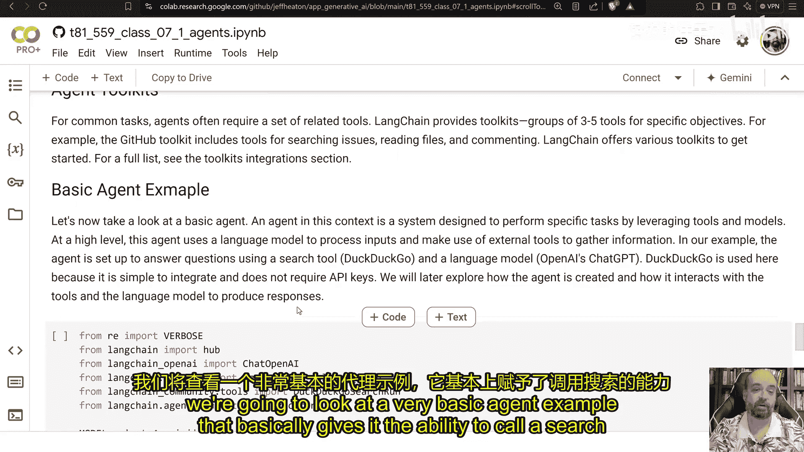
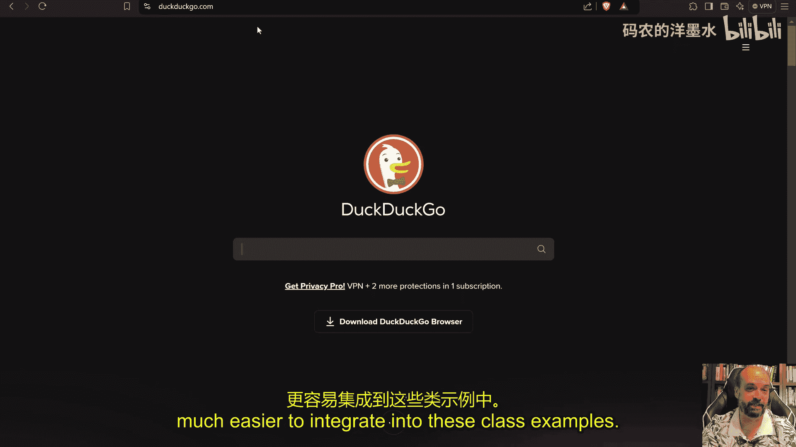
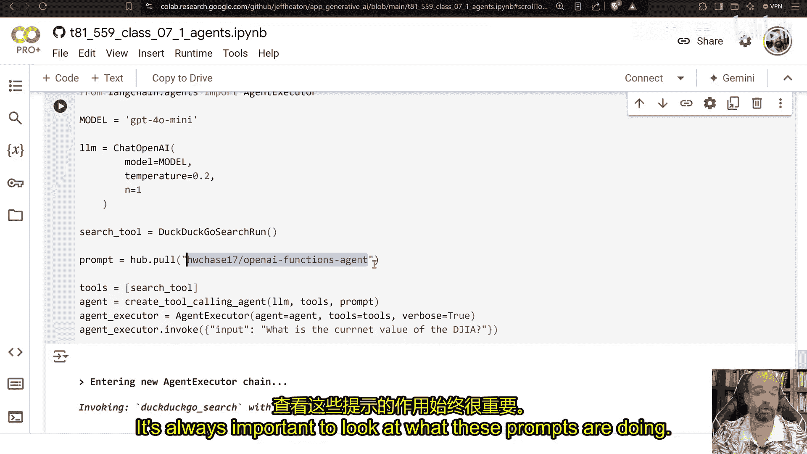
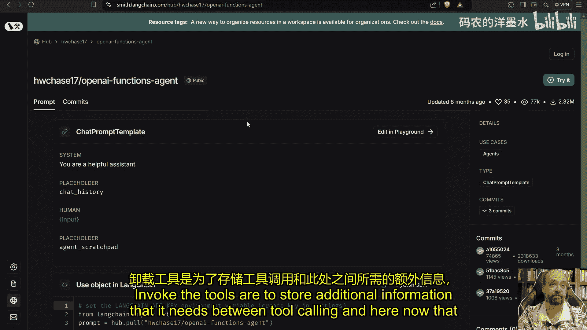
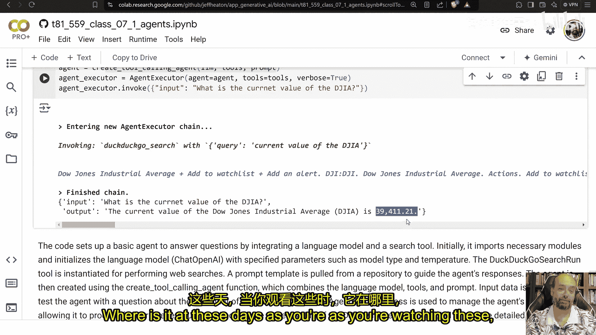

# 030：LangChain智能体 🧠

在本节课中，我们将学习LangChain智能体的核心概念与使用方法。智能体允许大型语言模型进行多轮交互、调用外部工具，从而完成更复杂的任务。

到目前为止，我们使用大型语言模型时，都是发送一个提示词，然后得到一个结果。如果基础模型中没有回答该提示所需的信息，那就无法得到答案。或者，信息可能来自检索增强来源，我们会从数据库中检索并增强信息。但这仍然只是一个提示对应一个答案。

现在，我们将了解智能体。这些智能体主要能实现两个关键功能。首先，正如“智能体”这个名字所暗示的，你可以使用多个提示。你可以发送一个提示，然后可能发送一封邮件，再发送另一个提示做其他事情。这是智能体完全支持的功能之一。

其次，智能体可以执行多个步骤。也许一个提示能获取一些关键信息，然后你需要通过额外的提示来充实它。

另一个通常更令人兴奋、或者至少我发现更有用的功能是**工具**。你可以为你的大型语言模型提供工具。有很多它可能希望拥有的工具。大型语言模型不太擅长数学计算，它们必须在“脑中”进行，所以你可以让它访问计算器或Python解释器。它们没有最新的信息，因此大型语言模型可能希望使用谷歌搜索。

在本课程中，我们会经常使用DuckDuckGo，主要是因为访问它不需要额外的API密钥。你可以直接提交查询，它能提供相对无偏见的搜索结果。因此，尽管我不认为DuckDuckGo是主流搜索引擎，但它仍然很有用。

接下来，我们将看看如何使用这两项功能。

## 环境设置与准备 🔧

我们将要展示的内容主要针对OpenAI。智能体在Bedrock和其他平台上也通用，但我们会遇到一些OpenAI特有的细节。我们使用LangChain，这至少提供了一层抽象。但如果你想在OpenAI以外的平台上使用，这里的一些内容需要进行修改。

对于OpenAI，正如我们在本课程早期所学，你需要获取一个API密钥，并将其存储在密钥中。如果你使用Colab（我目前运行Python的环境），当然也可以使用其他环境。然后，我们安装所有必要的库。你可以看到我正在安装`duckduckgo-search`和其他一些我们需要的库。所有安装完成后，就可以开始了。

## LangChain智能体类型 📚

LangChain智能体有多种类型。我提供了一个链接，你可以在LangChain文档中获取更多信息。

我们主要处理的两类智能体是聊天模型。如果你主要进行流畅的对话，你会更多地使用聊天模型。而LLM（大语言模型）特定类型，则更偏向于“一个问题，一个回答”的模式，而不是连续的对话流。

一些额外的功能包括聊天历史记录（当然，如果你使用聊天模型），以及支持多输入工具。很多工具只有一个输入，比如你给它一个数学问题，它返回一个结果；你给它一个谷歌搜索词，它返回一些东西。但在企业环境中，有些工具可能需要多个输入。例如，你可能需要一个计算房屋分期偿还表的工具，这会有多个输入：利率、本金、首付款等所有其他考虑因素。

因此，我们可以处理不同类型的智能体。我们会大量使用工具调用智能体。它们有些具有聊天界面，可以发送多条消息；有些则是大语言模型界面，只发送一条消息。这些展示了不同的功能。我们主要使用工具调用，但还有其他类型，例如，如果你特别处理XML，Tropic有一些非常有趣的功能；结构化聊天、JSON聊天等。如果你进行特别复杂的推理，ReAct（Reasoning + Acting）是一个值得关注的类型。正如我所说，在本课程中，我们将主要处理工具调用智能体。

## 智能体的关键组件 ⚙️

智能体将包含一个**动作**。这只是定义它可以采取的各种行动，工具与此密切相关。

**智能体完成**是它知道自己已完成时所处的最终状态。

然后是**中间步骤**。这些是智能体之前做过的事情，之前采取的行动。这有助于它逐步推进。这些步骤存储在一个列表中。

智能体结构的变化当然包括**智能体的输入和输出**，因为每个步骤都可以进入下一步，你需要当前步骤的输入和输出到下一步。

最后是**智能体执行器**。一旦你用各种中间步骤和动作构建了你的智能体，执行器就是让你运行整个流程的东西。

## 基础智能体示例：调用搜索引擎 🔍

我们将看一个非常基础的智能体示例，它基本上赋予了调用搜索引擎的能力。在这个例子中，我们使用DuckDuckGo。我使用这个总和，它声称提供非常公正的信息，因为相信我，大型科技公司肯定也有自己的偏见，几乎每个人都有某种偏见，DuckDuckGo可能也有。但它们也非常注重隐私，所以它们不一定用你的数据来对付你。但这里真正的吸引力在于它们不需要API密钥，这意味着将这些例子整合到课堂中要容易得多。

以下是我们要使用的代码。我们使用一个特定的提示模板。这是OpenAI函数智能体。查看这些提示在做什么总是很重要的。你可以完全创建自己的提示，只是它们喜欢在这里提供一些有用的模板。

这个提示并不复杂：“你是一个有用的智能体。”然后是聊天历史记录的占位符，以便与记忆和聊天兼容。我不确定“草稿本”是用来做什么的，我想这是它知道如何调用工具或在工具调用之间存储所需额外信息的方式。

现在我已经设置好了，我将创建一个智能体。我给它提供了搜索工具，那就是DuckDuckGo。然后我创建工具。这是一个工具调用链，所以这是一个能够调用工具的智能体。

我们将使用智能体执行器。它没有使用智能体所具有的多步骤功能，它只是在需要时使用搜索。我问它：“道琼斯工业平均指数的当前价值是多少？”然后我们运行它。幸运的是，道琼斯工业平均指数现在比我构建这个示例时（仅仅一两个月前）要高一些。在你观看这些内容时，它在哪里呢？我希望在4万点左右，但我们肯定会看到。

以上就是展示如何使用一个简单的工具调用智能体的全部内容，该智能体调用DuckDuckGo搜索引擎，使其能够利用从搜索引擎返回的最新信息来帮助你回答问题。

## 总结 📝

本节课中，我们一起学习了LangChain智能体的核心概念。我们了解了智能体如何通过多轮交互和调用外部工具（如搜索引擎）来扩展大型语言模型的能力，从而处理更复杂、需要最新信息的任务。我们通过一个调用DuckDuckGo搜索的基础示例，演示了智能体的基本构建和使用流程。