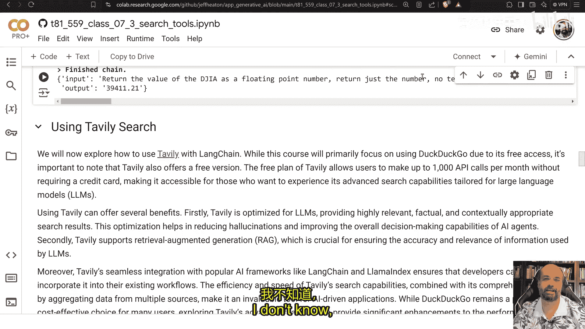
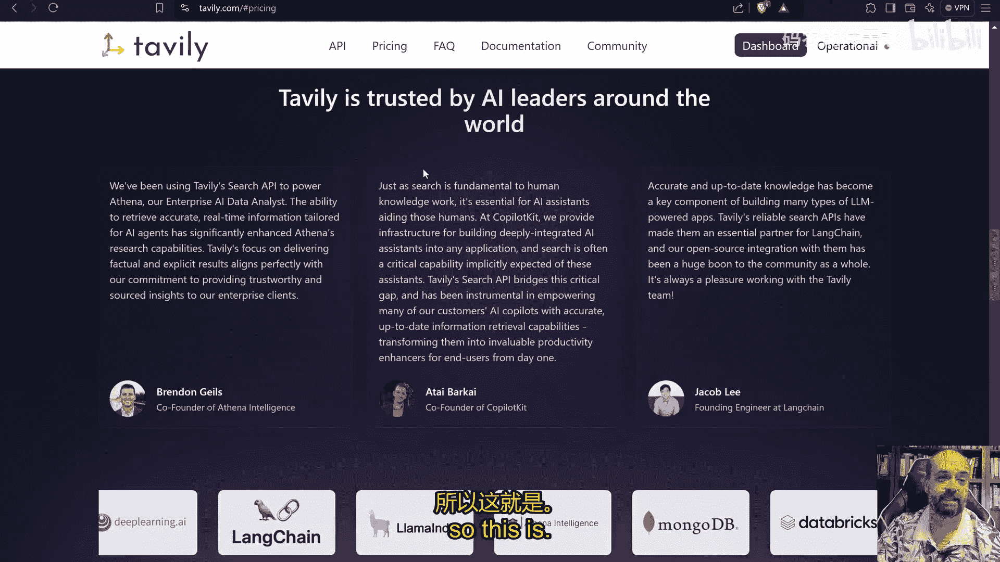
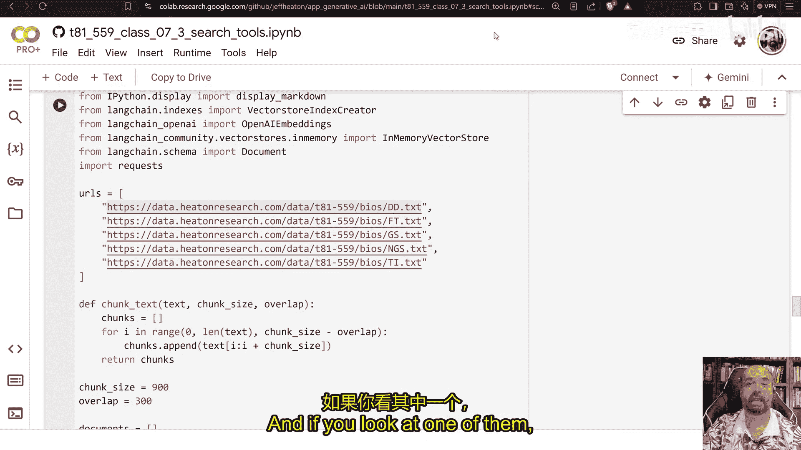
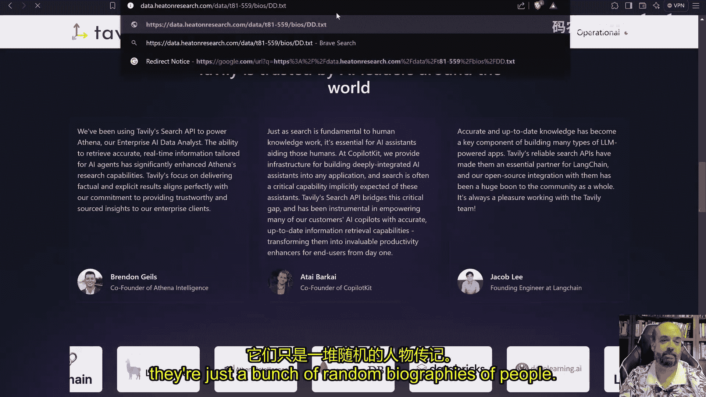
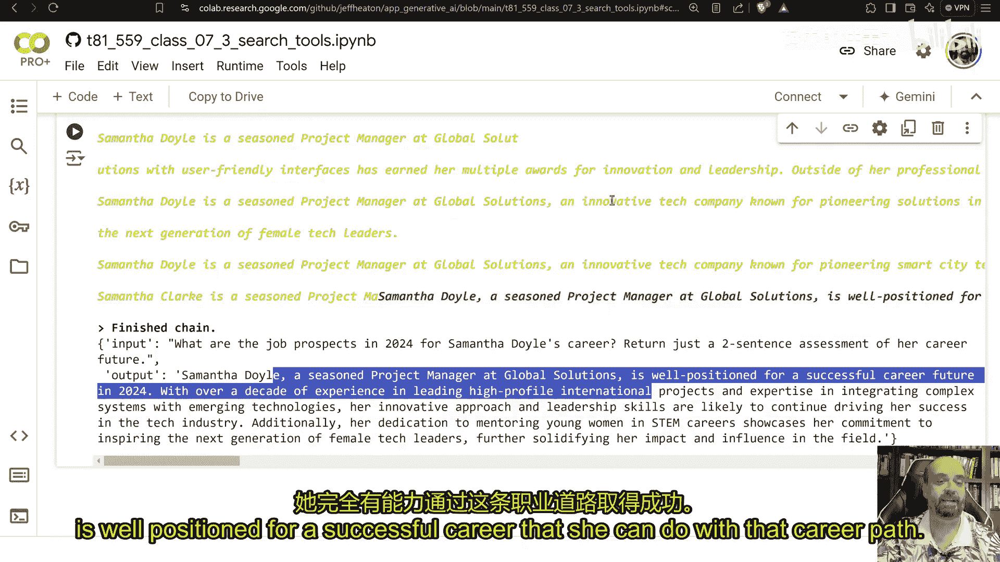

# 031：LangChain智能体搜索工具 🔍

在本节课中，我们将继续探讨如何让大型语言模型使用工具，特别是通过LangChain智能体。本节我们将重点关注**搜索工具**。搜索功能是大型语言模型作为智能体为你工作的核心场景之一：它们使用搜索引擎查找信息，整合结果，并将答案呈现给你。

这引出了一个有趣的问题：鉴于互联网内容很大程度上依赖广告收入，这种直接提取信息并返回给你的方式，有时就像是一个“终极广告拦截器”。接下来，我们将通过具体示例来学习如何实现这一功能。

## 搜索引擎的选择

我们将使用两种搜索引擎。第一种是**DuckDuckGo**，它设计简洁，无需API密钥，非常适合教学示例。第二种是**Tavily**，这是一个专为大型语言模型优化的高级搜索引擎，可以理解为“为计算机设计的搜索引擎”。使用Tavily需要其专门的API密钥。

> **注意**：本课程中的示例均可通过DuckDuckGo完成，但了解Tavily能让你接触到更强大的功能。

以下是设置API密钥的通用方法，你可以将OpenAI和Tavily的密钥存放在环境变量中。

```python
# 示例：设置环境变量（实际密钥需替换）
import os
os.environ["OPENAI_API_KEY"] = "your-openai-key"
os.environ["TAVILY_API_KEY"] = "your-tavily-key"
```

## 使用DuckDuckGo进行搜索

首先，我们看看如何使用DuckDuckGo。它能帮助模型获取实时信息。

例如，我们提问：“Who is the president of the United States of America?”，模型会调用搜索工具并返回当前（录制时）的答案：乔·拜登。请注意，信息会随时间变化。



接下来，我们让模型使用工具回答一个更具体的问题。我们使用OpenAI的`gpt-3.5-turbo`模型，并通过提示词工程要求它只返回数字。

**提示词示例**：
```
Return the current value of the Dow Jones industrial average as a floating point number, the number, no text or comments.
```

模型会执行搜索，并只返回道琼斯工业平均指数的当前数值。



## 探索Tavily搜索引擎

Tavily提供了比DuckDuckGo更强大的功能，但它是付费服务。免费版本提供约100次API调用，无需信用卡。付费计划起价为每月30美元，提供更多调用次数。LangChain为Tavily提供了专用的工具集成。

Tavily官网的示例展示了其能力，例如搜索“What happened in the last burning man floods?”。在代码中，我们创建Tavily搜索工具，并使用LangChain为智能体设计的标准提示模板。

让我们尝试提问：“Who is the oldest world leader?”，Tavily会返回搜索结果。需要注意的是，搜索引擎返回的信息可能不是最新的（例如，结果可能基于2021年的数据）。一个更复杂的实现可以抓取维基百科页面并计算所有领导人的年龄，但这超出了当前语言模型与工具结合的基本能力范围。

## 结合检索增强生成（RAG）与搜索

上一节我们介绍了单独的搜索功能，本节我们来看看如何将其与RAG结合，构建更强大的智能体。

我们首先准备一些本地文档。这些是使用大模型生成的虚构人物传记文本文件。例如，一个文件可能包含：“Samantha Clark is a seasoned project manager...”



以下是处理这些文档的步骤：



1.  **加载文档**：读取文本文件。
2.  **分割文本**：将长文档切分成更小的块（chunk）。
3.  **创建向量数据库**：使用嵌入模型将文本块转换为向量，并存入ChromaDB等向量数据库。

完成这些后，智能体就同时具备了两种能力：从本地向量库检索信息（RAG），以及使用搜索引擎获取外部最新信息。

我们可以进行混合查询。例如，提问：“What are the job prospects in 2024 for Samantha Doyle’s career? Return 2 sentences.”

智能体的工作流程如下：
1.  首先，通过RAG在本地文档中查找“Samantha Doyle”，发现她是一名项目经理。
2.  然后，使用搜索引擎查找“2024年项目经理的就业前景”。
3.  最后，综合两部分信息，生成答案：“Samantha Doyle, a seasoned project manager, is well-positioned for a successful career...” 这展示了智能体协调多种工具解决问题的能力。



## 总结

本节课中，我们一起学习了如何为LangChain智能体集成搜索工具。我们介绍了DuckDuckGo和Tavily两种搜索引擎的用法，并演示了如何通过提示词工程指导模型输出格式。更重要的是，我们探索了将**检索增强生成（RAG）** 与**网络搜索**结合的方法，使智能体既能利用内部知识库，又能获取外部实时信息，从而回答更复杂、更动态的问题。这种组合是构建实用AI助手的关键技术之一。