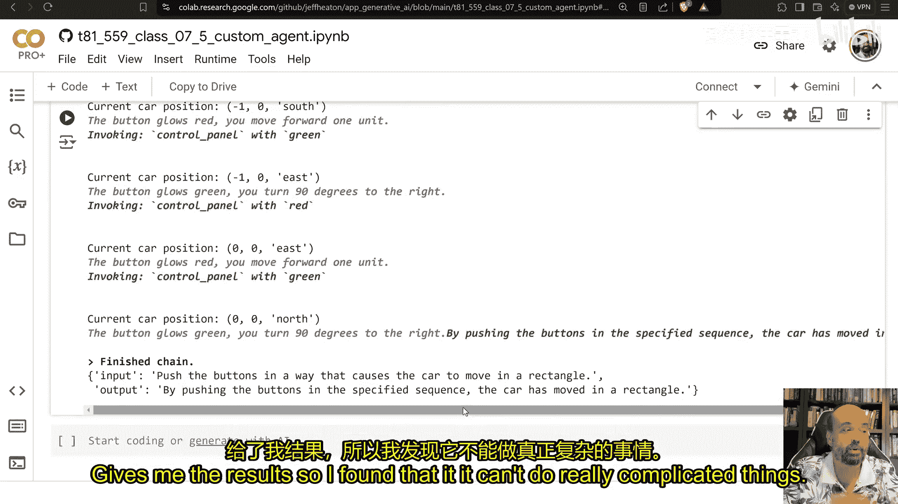

# 032：创建自定义智能体教程 🚀

在本节课中，我们将学习如何在LangChain中创建一个自定义智能体。我们将利用智能体技术，包括工具和多步骤推理过程，来完成特定任务。课程将通过一个简单的玩具示例，展示如何构建一个能够控制机器人移动的智能体。

---

## 创建自定义工具 🛠️


上一节我们介绍了智能体的基本概念，本节中我们来看看如何创建自定义工具。工具允许智能体与外部世界交互，例如搜索引擎或机器人控制面板。

以下是一个简单的自定义工具示例，它模拟一个可以按下的按钮：

```python
class BigRedButtonTool(BaseTool):
    name = "big_red_button"
    description = "一个可以按下的大红按钮。按下后按钮会发出红光。"

    def _run(self, value: str) -> str:
        if value == "push":
            return "按钮被按下，并发出红光。"
        else:
            return "未执行任何操作。"
```


在这个工具中，我们定义了一个名为 `big_red_button` 的工具。当智能体调用该工具并传递值 `"push"` 时，工具会返回按钮被按下并发出红光的反馈。

---


## 构建机器人控制工具 🤖

接下来，我们将构建一个更复杂的工具来控制一个简单的机器人（小车）。这个机器人具有位置坐标（X, Y）和方向，并且可以执行移动和转向操作。


以下是机器人控制工具的核心代码结构：

```python
class RobotCar:
    def __init__(self):
        self.x = 0
        self.y = 0
        self.direction = "north"  # 初始方向朝北
        self.directions = ["north", "east", "south", "west"]

    def move_forward(self):
        if self.direction == "north":
            self.y += 1
        elif self.direction == "east":
            self.x += 1
        elif self.direction == "south":
            self.y -= 1
        elif self.direction == "west":
            self.x -= 1
        return f"向前移动一步。当前位置: ({self.x}, {self.y})，方向: {self.direction}"

    def turn_left(self):
        current_index = self.directions.index(self.direction)
        self.direction = self.directions[(current_index - 1) % 4]
        return f"向左转90度。当前方向: {self.direction}"

    def turn_right(self):
        current_index = self.directions.index(self.direction)
        self.direction = self.directions[(current_index + 1) % 4]
        return f"向右转90度。当前方向: {self.direction}"
```


在这个机器人控制工具中，我们定义了三个基本操作：
- **移动向前**：根据当前方向移动一个单位。
- **向左转**：将方向逆时针旋转90度。
- **向右转**：将方向顺时针旋转90度。

---


## 控制面板工具 🎮


为了让智能体能够控制机器人，我们需要创建一个控制面板工具。这个工具将机器人的操作封装成智能体可以调用的功能。

以下是控制面板工具的实现：


```python
class ControlPanelTool(BaseTool):
    name = "control_panel"
    description = "控制机器人的面板。红色按钮向前移动，绿色按钮向左转，黄色按钮向右转。"

    def __init__(self, robot: RobotCar):
        super().__init__()
        self.robot = robot

    def _run(self, button: str) -> str:
        if button == "red":
            return self.robot.move_forward()
        elif button == "green":
            return self.robot.turn_left()
        elif button == "yellow":
            return self.robot.turn_right()
        else:
            return "无效按钮。请选择红色、绿色或黄色按钮。"
```

控制面板工具提供了三个按钮：
- **红色按钮**：控制机器人向前移动。
- **绿色按钮**：控制机器人向左转。
- **黄色按钮**：控制机器人向右转。

---

## 测试智能体操作 📐

现在，我们将测试智能体如何使用这些工具来执行任务。我们将指导智能体控制机器人移动成一个矩形。


以下是测试智能体执行矩形移动的步骤：

1. **初始化机器人和工具**：
   ```python
   robot = RobotCar()
   control_panel = ControlPanelTool(robot)
   ```


2. **定义任务指令**：
   - 向前移动4步。
   - 向右转。
   - 向前移动2步。
   - 向右转。
   - 向前移动4步。
   - 向右转。
   - 向前移动2步。

3. **执行任务**：
   智能体将根据指令调用控制面板工具，逐步完成矩形移动。

执行结果如下：
```
机器人从原点(0,0)开始，方向朝北。
向前移动一步。当前位置: (0, 1)，方向: north。
向前移动一步。当前位置: (0, 2)，方向: north。
向前移动一步。当前位置: (0, 3)，方向: north。
向前移动一步。当前位置: (0, 4)，方向: north。
向右转90度。当前方向: east。
向前移动一步。当前位置: (1, 4)，方向: east。
向前移动一步。当前位置: (2, 4)，方向: east。
向右转90度。当前方向: south。
向前移动一步。当前位置: (2, 3)，方向: south。
向前移动一步。当前位置: (2, 2)，方向: south。
向前移动一步。当前位置: (2, 1)，方向: south。
向前移动一步。当前位置: (2, 0)，方向: south。
向右转90度。当前方向: west。
向前移动一步。当前位置: (1, 0)，方向: west。
向前移动一步。当前位置: (0, 0)，方向: west。
```

通过以上步骤，智能体成功控制机器人移动成一个矩形。

---


## 总结 📚

本节课中我们一起学习了如何在LangChain中创建自定义智能体。我们通过构建自定义工具和控制面板，实现了一个能够控制机器人移动的智能体。关键步骤包括：



1. **创建自定义工具**：定义工具的基本功能和使用方法。
2. **构建机器人控制逻辑**：实现机器人的移动和转向操作。
3. **封装控制面板工具**：将机器人操作封装成智能体可以调用的工具。
4. **测试智能体任务**：指导智能体执行具体任务，如移动成矩形。

通过这些步骤，我们展示了智能体如何利用工具和多步骤推理来完成复杂任务。虽然智能体在处理复杂图形（如八字形）时可能遇到困难，但在基本任务中表现良好。

希望本教程对你理解LangChain自定义智能体的创建过程有所帮助。如果你觉得有用，请点赞并订阅频道，以获取更多相关内容。感谢观看！