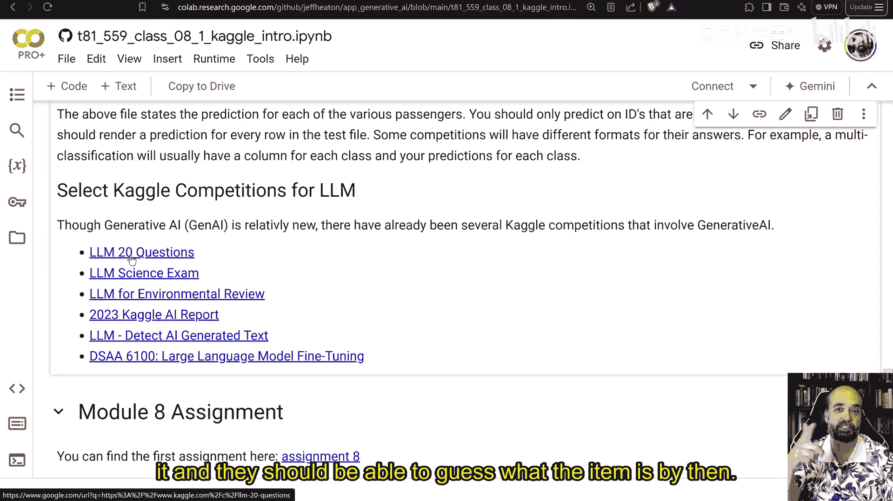

# 033：Kaggle入门 🚀

在本节课中，我们将学习Kaggle平台的基本概念与操作流程。Kaggle是数据科学和机器学习领域的重要竞赛平台，本课程的一项主要作业将在Kaggle上完成。

---


## 平台简介

Kaggle本质上是数据科学家、机器学习与人工智能从业者的“超级碗”或“世界杯”。平台目前涵盖的内容非常广泛。

早期Kaggle主要以表格数据为主，涉及传统的分类与回归任务。如今，表格数据在Kaggle上已占少数，计算机视觉等任务更为普遍。大型语言模型也在Kaggle上取得了显著进展。

以下是Kaggle主页的示例：


您可以点击“Your Profile”查看个人资料。注册Kaggle后，您将拥有个人资料。完成本课程作业需要注册Kaggle账号。

---

## 个人资料与组队

在个人资料中，您可以选择以个人或团队形式参赛。课程通常会提前发布组队登记表，以便学生选择加入团队。Kaggle竞赛通常以团队形式进行，本课程也鼓励采用这种方式。

以下是我的个人资料示例：我于10年前加入，初期活跃，后期参与较少。您可以在Kaggle上获得成就徽章。

成就系统包含多个等级：初始为“贡献者”，获得一定数量的金牌、银牌或铜牌后可升级。例如，我获得了两枚铜牌，因此是“专家”等级。数据集方面，上传一定数量后也可获得相应等级。

在竞赛记录中，我主办过18场学生竞赛，自己也参加过3场。最好成绩是在3295名参赛者中排名第225位。曾有学生在Kaggle上表现出色，成为“Kaggle大师”，这对求职（例如加入NVIDIA等顶尖公司）是很好的履历加分项。

---

## 竞赛内容示例

本课程将使用深度学习相关的竞赛。本学期竞赛的具体数据集尚未发布，但内容将围绕生成式AI展开。


以下是往届竞赛的一个例子：所有图像均由**稳定扩散**模型生成。该模型属于生成式AI范畴，通过输入提示词生成图像。

**代码示例：生成图像的提示词概念**
```
prompt = "a portrait of a person, {age} years old, {ethnicity}, {gender}"
```

在该竞赛中，参赛者的任务是预测生成人物的年龄。提示词中包含了年龄信息。模型能生成不同年龄、性别和种族的人物，但在处理婴儿或90岁以上人物时效果有限。


生成图像时还应用了内容过滤器，以过滤掉不适当的内容，确保所有图像符合基本内容标准。


---

## 数据与提交


在竞赛页面，您可以下载数据集并查看排行榜。排行榜展示了所有参赛团队的成绩。本课程竞赛的优胜者不会获得奖金，但可能获得优质的推荐信。

另一个重要功能是“Notebooks”。您可以像使用Google Colab一样，在Kaggle平台内直接编写和运行代码。

**优势**：无需下载数据集，数据可直接在平台访问。作业要求以类似Kaggle Notebook的格式提交。课程通常会提供一个初始应用程序代码，帮助您入门。

以下是Notebook的界面示意图：


---

## 竞赛机制详解

上一节我们介绍了Notebook的使用，本节中我们来看看Kaggle竞赛的具体评分机制。

Kaggle提供完整的数据集，包含特征X和标签Y。平台将数据划分为训练集和测试集。


**数据划分公式**：
```
完整数据集 = 训练集 (X_train, Y_train) + 测试集 (X_test, Y_test_unknown)
```

训练集同时提供X和Y。而测试集（或称保留集）只提供X，其对应的Y用于最终评估参赛者模型，并生成排行榜。

为了防止过拟合排行榜，Kaggle设置了**公开排行榜**和**私有排行榜**。公开排行榜通常只使用一部分测试数据进行评分。竞赛结束时，才会在私有排行榜上进行最终评估，参赛者无法在过程中看到私有数据。

参赛者需要提交对测试集X的预测结果Y_pred。提交文件通常为CSV格式，包含ID和预测值。

**提交文件示例（泰坦尼克数据集）**：
```
PassengerId,Survived
892,0
893,1
894,0
```

---

## 大型语言模型竞赛

Kaggle上也有许多涉及大型语言模型的竞赛。

例如，有一个竞赛要求创建模型来玩“20个问题”游戏：模型需要思考一个物品，对手可以提出20个相关问题，模型应能据此猜出该物品。

相关竞赛链接可供参考。

---

## 平台精英用户

如果您点击“Kaggle顶级用户”，可以看到排名最高的用户。当前顶级用户通常被称为“Kaggle大师”。许多顶尖从业者（例如来自NVIDIA的员工）在此平台上表现活跃。

用户等级通过在不同领域（如Notebooks、竞赛、数据集）获得奖牌来提升。例如，在竞赛中获得一枚金牌和两枚银牌即可成为“大师”。

---

## 总结



本节课中我们一起学习了Kaggle平台的核心知识。我们了解了Kaggle作为数据科学竞赛平台的重要性，学习了如何注册、查看资料和组队参赛。我们通过生成式AI竞赛的例子，理解了竞赛内容与数据生成过程。我们还深入探讨了Kaggle的竞赛机制，包括数据划分、公开与私有排行榜以及提交格式。最后，我们简要介绍了平台上的大型语言模型竞赛和用户等级体系。掌握这些是完成本课程Kaggle作业的基础。

感谢观看本视频。如果您觉得内容有用，请点赞、关注并订阅频道，以便及时获取本课程及其他机器学习项目的最新内容。