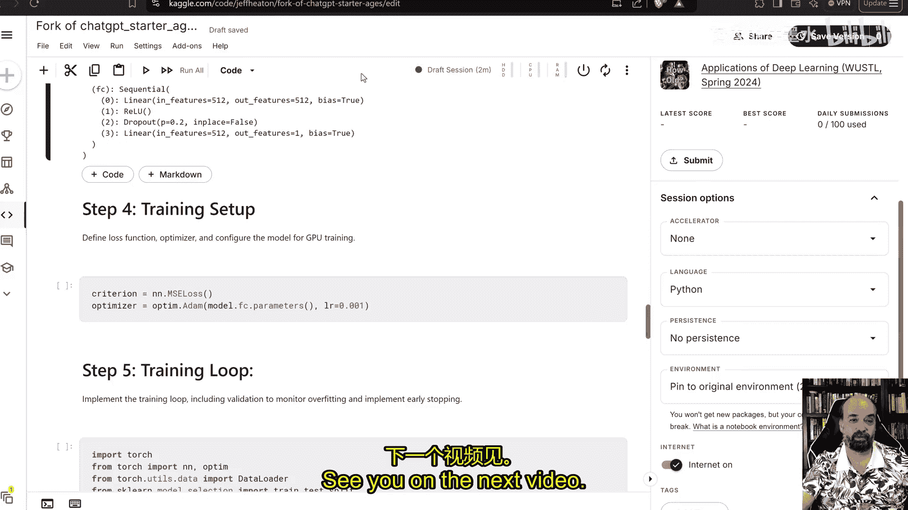

# 034：Kaggle笔记本使用指南 🚀

在本节课中，我们将学习如何使用Kaggle笔记本来完成课程相关的Kaggle竞赛。Kaggle笔记本是一个强大的云端环境，可以让你无需在本地下载和上传数据集，直接进行数据分析和模型训练。

上一节我们介绍了生成式AI的基本概念，本节中我们来看看如何在实际的Kaggle竞赛环境中应用这些知识。

## 为何选择Kaggle笔记本

我强烈推荐你使用Kaggle笔记本来完成课程竞赛。否则，你需要下载当前学期的Kaggle竞赛数据集，然后重新上传到Google Colab。由于本课程主要使用Colab，使用Kaggle笔记本可以简化流程。

我们将看到如何在Kaggle笔记本中运行大型语言模型。主要有两种方式：
1.  使用Kaggle提供的免费GPU运行LLM。我们将在第8.4部分深入探讨如何从启用了GPU的笔记本中运行LLM。
2.  运行小型大型语言模型。你当然可以从Kaggle运行它们，但在许多情况下，如果你的笔记本电脑有足够的内存，也可以本地运行。

最后，我们将以查看当前学期的Kaggle竞赛来结束本部分。

## Kaggle笔记本入门

以下是使用Kaggle笔记本的基本步骤。请注意，这些软件在不断进化，Kaggle也在持续改进。请始终参考Kaggle的最新文档，并意识到操作界面可能每学期都有变化。如果变化足够大，我会重新录制本视频。

现在，让我们进入Kaggle。通常，你会先进入一个Kaggle竞赛页面，当然你也可以直接创建一个全新的笔记本。

不过，让我们实际进入一个竞赛。我将进入为之前课程创建的一个竞赛，这是上学期“应用”课程的内容。在这个竞赛中，你需要尝试预测人们的年龄。

对于当前学期的Kaggle竞赛（内容会与此不同），你将从我这里获得一个初始笔记本。我会直接提供一个解决方案。

课程的唯一要求是，你需要以某种方式扩展这个解决方案并使其变得更好。有些同学会远远超越我提供的内容，登上排行榜前列。有些同学则可能只求及格。我理解，有些课程我表现出色，有些课程我只想拿个D或A然后继续前进。是的，我年轻时作为一名雄心勃勃的硕士生，曾在法学院上过一门课，这是个不应重复的错误。

假设这里有一个我提供的初始笔记本。我们打开它。

你可以看到，我提供了一个提示词。这是我给ChatGPT用来编写这个初始笔记本的提示词。我可能会为当前学期的Kaggle项目提供一个类似的提示词，这取决于项目本身。这展示了大型语言模型的强大能力，你基本上可以生成这个竞赛的起点。

## 操作你的笔记本

当你获得这样一个笔记本时，如果你只想运行它，那很好。但通常会有多个版本，你需要创建一份副本。

你应该选择“复制并编辑笔记本”。注意，这显示了一个分叉路径，你正在“分叉”这个笔记本（我使用了Git和版本控制的术语）。现在你会看到它显示为“Fork of charter...”。

现在，如果你保存一个版本，请谨慎操作。因为保存版本会尝试运行你环境中的所有代码，在等待期间可能会暂时无响应。你通常会在达到重要里程碑时才这样做。

现在，我们运行它。输入数据将是你启动竞赛时的数据，你不需要修改它。输出将保存在Kaggle的工作目录中，可能会生成你的提交文件。你可以下载它，或者直接将其作为解决方案提交。提交后，你会获得一个排行榜排名。

你可以根据需要多次提交。每次对代码进行更改后都可以提交。我可能会限制为每天5次提交，以防止大家过度拟合排行榜。

## 会话与硬件配置

在会话选项中，你可以选择使用P100 GPU（较旧型号）。本课程中我们也会学习一点TPU的知识，如果你想使用TPU，请自便。但TPU是谷歌的专有技术，所以我主要关注GPU。

选择两个T4 GPU在性能上可能实际上比P100更强。但请注意，使用双GPU需要自定义编码，不会自动发生。因此，我通常建议选择P100，除非你特别擅长编写多GPU代码。

你还可以选择开启或关闭互联网连接。我们将在讨论具体学期的Kaggle竞赛时详细说明这一点。基本上，你可能需要开启互联网，因为你要么通过API调用ChatGPT（注意这需要花钱），要么在你的Kaggle环境中加载一个小型大型语言模型来使用。如果你使用外部资源，则需要开启互联网；如果只是本地运行，则可以关闭它。

你也可以将加速器指定为“无”。因为免费GPU的使用时间是有限的。如果你只是进行探索性数据分析，请不要开启GPU，以节省使用时间。

## 运行代码与环境管理

现在我已经关闭了GPU，可以选择运行代码。我进入这个代码块并选择“运行”。这非常类似于Jupyter或Google Colab，是很常见的操作。你会看到会话已启动，它将下载数据，为你的环境做好运行准备。

完成后，请确保停止你的环境，以免浪费计算资源。你可以使用上方的小电源按钮来停止。

这些Jupyter笔记本是许多基于Web的云端数据科学和机器学习工具的通用格式。

第一次运行时可能需要一点时间。运行后，你会注意到我在这里硬编码的路径，那是你的数据集自动加载的位置。通常它在`/kaggle/input/`目录下。刚开始时，我通常会使用`!ls`命令来查看里面有什么。

我们可以继续运行这段代码，你基本上就在一个笔记本环境中了。你可以继续运行设置。你会看到一些警告和红色提示，运行现代机器学习软件难免会遇到一些警告，这很正常。

然后你可以继续运行。你应该尝试运行我提供的示例代码。我总是为Kaggle竞赛提供示例代码，因为真实的Kaggle竞赛就是这样运作的。你获得的数据在每个学期都是完全独特的。

我们将在下一部分更深入地了解如何从你的笔记本电脑以及从Kaggle运行一个小型大型语言模型。

感谢观看本视频。如果对你有用，请订阅频道并点赞。非常感谢观看。😊

我们下个视频见。

---

**本节课总结**：在本节课中，我们一起学习了如何使用Kaggle笔记本来参与和完成课程相关的数据科学竞赛。我们了解了选择Kaggle笔记本的原因、如何创建和编辑笔记本副本、配置会话与硬件资源（如GPU和互联网连接）、运行代码以及管理计算环境。这些技能将帮助你在云端高效地进行数据分析和模型开发，为后续实际运行大型语言模型打下基础。