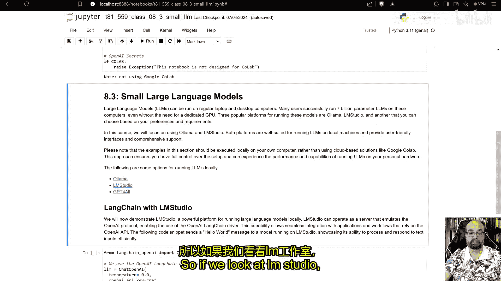
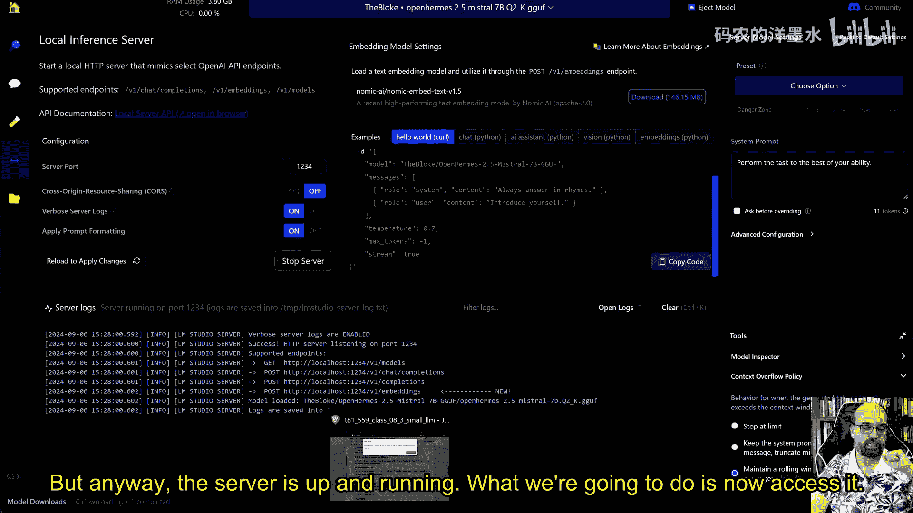
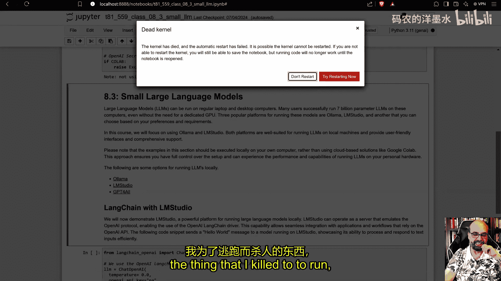
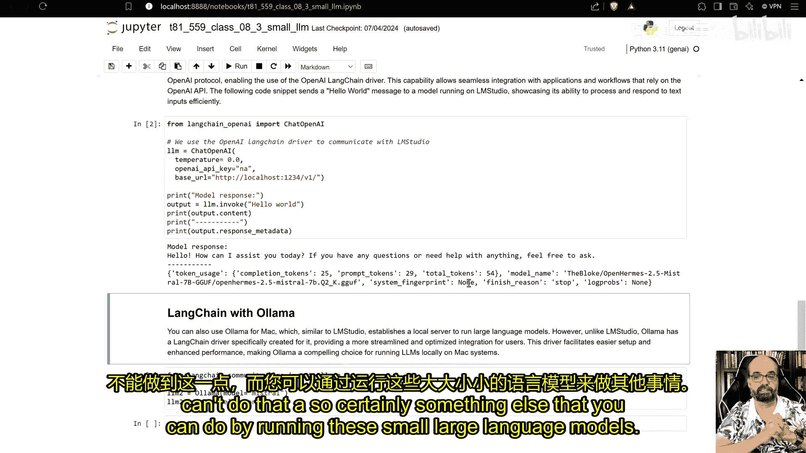

# 035：轻量级大语言模型

在本节课中，我们将学习如何在个人电脑上本地运行大型语言模型。我们将探讨“小型”大语言模型的概念，并实际操作一个名为LM Studio的工具，让你无需联网即可与AI模型对话。

## 本地运行大语言模型

你实际上可以在自己的笔记本电脑上运行大型语言模型。本模块将围绕这一点展开。在接下来的部分，你将看到如何在本地环境中运行一个大语言模型。

当我称它们为“大型语言模型”时，这实际上是一个矛盾的说法。我们这里讨论的是“小型”的大语言模型。它们可能最初是大型模型，但通过剪枝、蒸馏等技术被压缩变小；或者它们从一开始就是为轻量化设计的。

## 工具选择与LM Studio介绍



我们将使用一个名为**LM Studio**的工具。请注意，本部分的代码并非设计在Google Colab中运行，因为我们的重点是在本地运行。

有多种“小型”大语言模型可供选择。例如，**Mistral** 是一个著名的模型。如果你使用的是Mac电脑，可以关注 **Ollama** 这个命令行工具。而 **LM Studio** 则支持Mac和Windows系统，我们将以此为例进行演示。此外，还有 **GPT4All** 等工具允许你在本地运行GPT类模型。

以下是LM Studio的界面示例，你可以在这里搜索并下载模型到本地环境：


## 下载与加载模型

在LM Studio中，我搜索并选择了Mistral模型。这是一个拥有70亿参数的著名“小型”大语言模型。模型有不同的编码和调优版本，这是一个专门的领域，旨在让模型能在资源更有限的环境下运行。

我们加载这个模型，它需要占用约3.08GB的磁盘空间。加载后，模型会被读入内存（本机有32GB RAM，足够容纳）。然后你就可以向它提问了。例如，我可以问它一个问题，它回答后，我还可以继续对话，甚至尝试用错误信息误导它（即“Gaslight”），看看它的反应。

## 使用服务器模式与LangChain集成

模型加载后，你可以持续与它聊天。LM Studio提供了类似OpenAI Playground的功能，可以指定系统提示词。我更喜欢使用它的**服务器模式**。

启动服务器后，防火墙可能会弹出提示，需要允许访问。服务器运行后，理论上可以通过`curl`命令访问，但在Windows环境下可能需要额外配置。

更实用的方法是，我们可以从Jupyter Notebook中通过代码连接这个本地服务器。以下是使用LangChain框架连接本地LM Studio服务器的示例代码：



```python
# 示例：使用LangChain连接本地LM Studio服务器
from langchain.llms import OpenAI



# 将基础URL指向本地LM Studio服务器
llm = OpenAI(openai_api_base="http://localhost:1234/v1", openai_api_key="not-needed")
response = llm("Hello, world!")
print(response)
```

运行上述代码，模型会回复“Hello! How can I assist you today?”之类的信息。这非常酷，意味着整个大语言模型的运行完全在你的机器上进行，是完全私密的，无需将数据发送到云端。

## 非审查模型的应用

运行这些轻量级模型的另一个好处是，你可以下载**非审查模型**。这些模型没有内置的安全限制，可以讨论任何话题。除了显而易见的用途，它们在实践中也很有用。例如，我曾编写程序处理我们拥有权限的数据，需要从中提取出生日期。大约每处理一万行数据，主流大模型会有1%的概率拒绝执行，并提示“不应访问私人信息”。如果使用非审查模型，它就不会对此感到“不安”。再比如，如果你在创作包含暴力或复杂情感关系的电影剧本，通常的模型可能会拒绝，而非审查模型则能完成任务。



## 课程总结


本节课中，我们一起学习了轻量级大语言模型的概念。我们了解了如何在个人电脑上通过LM Studio等工具本地运行模型，体验了完全私密的AI交互。我们还探讨了非审查模型存在的意义及其特定的应用场景。这为你探索生成式AI提供了更灵活、更私密的选择。