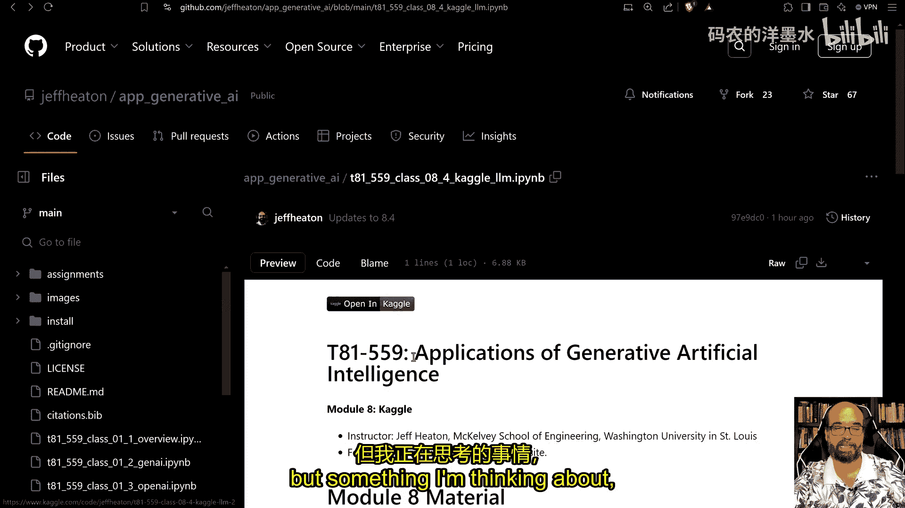
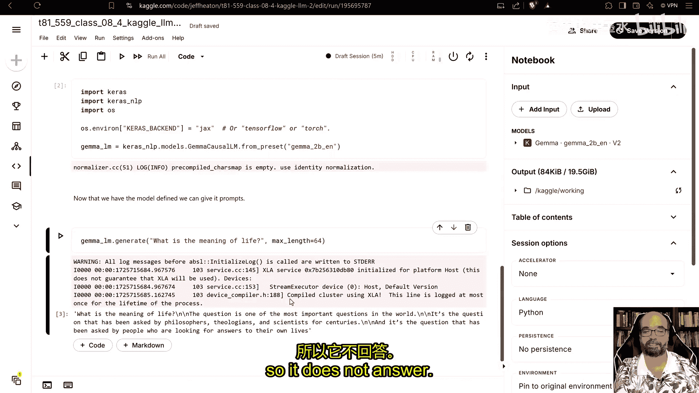

# 036：在Kaggle笔记本中运行轻量级大语言模型 🚀

在本节课中，我们将学习如何在Kaggle笔记本环境中，完全本地运行一个轻量级的大语言模型。这对于许多Kaggle竞赛来说是一种常用技术。

## 概述

你可以在Kaggle环境中完全本地运行小型的大语言模型。浏览Kaggle时，你会看到许多笔记本都使用了这项技术。本节我们将具体看看如何操作。

## 打开Kaggle笔记本


首先，请注意这里我的笔记本是在Github中打开的，就像其他课程一样。但这里显示的是“在Kaggle中打开”，而不是通常看到的“在Colab中打开”。我在考虑是否在所有课程笔记本中都加上这两个按钮。Kaggle环境是否理想尚不确定，我还在思考中，欢迎在评论区分享你的看法。

现在，我们点击这个按钮。



点击后，笔记本会在Kaggle中弹出并打开。这里有一点不同：你的笔记本必须已经保存在Kaggle并发布，而Colab可以直接从Github拉取并打开。

这是我的笔记本，如果有人想在Kaggle上给我点赞，那会非常酷。

在进入代码之前，你需要进行“复制并编辑”操作。因为我拥有这个笔记本，所以我可以直接点击“编辑”，进入编辑模式。你会看到版本信息，目前我只发布了一个版本。当我把所有视频链接都加上后，可能会发布另一个版本。

## 配置Kaggle环境

在编辑界面，有一些非常重要的设置，和之前类似。你也可以添加模型作为输入。我使用的Gemma模型很智能，或者说加载它的框架很智能，会自动为我添加模型。因此，根据你使用的模型，你可能需要也可能不需要手动添加。

你可以添加多个模型。如果我选择“添加输入”，它会将模型视为一种输入。在模型列表中，你可以看到所有支持的模型，数量相当多，甚至比这里显示的还要多。以下是主要的一些，总共有6257个不同的模型。

Gemma是谷歌推出的一个非常流行的模型，类似于精简版的Gemini。这里也有Mistral模型。不过你可能会遇到的问题是，由于Kaggle内存有限，你可能需要加载更小的模型，即使使用GPU也是如此。

我将关闭这个窗口，因为模型在我之前运行时已经添加好了。

我当前是在没有加速器的情况下运行。使用GPU无疑会大大加快速度，有时还能让你加载更大的模型。Kaggle提供常见的GPU，也提供TPU。

编程语言是Python。我没有启用持久化，这有时会有帮助。网络连接是开启的。有些竞赛要求你关闭网络。开启网络后，你就可以使用像OpenAI这样的、完全在Kaggle外部运行的基于API的大语言模型。但在这里，我们看看如何在Kaggle内部完全本地运行一个模型。

## 安装与加载

为了让代码在Kaggle中良好运行，我替换了通常在Colab中使用的一些指令，换成了Kaggle特定的指令。

我们将运行以下代码来安装所需的库，例如`kaggle`、`kis`和`lpt`。我们将为此使用多种后端。

```python
# Kaggle环境下的安装指令示例
!pip install kaggle
!pip install transformers
!pip install torch
```

让我们快速执行这些必要的加载。好的，加载完成了。

现在我们要访问模型，这部分更多是关于框架的通用操作，并非Gemma特有。这个框架支持多个（虽然不是全部）模型。

你可以在这里阅读关于Gemma LLM的信息，或者直接谷歌搜索。它是一个基于谷歌的模型，与Gemini系列有些类似，但能力远不及Gemini。我们使用JAX作为后端，也可以选择TensorFlow或PyTorch。选择JAX有多个原因，它似乎相当不错。

我将运行这部分代码。这需要一些时间，你会在这里看到它下载模型权重。我们快进一下，这部分需要一点时间。

## 运行与提示

好了，现在我们可以实际向它提问了。让我们用“生命的意义是什么”来测试，不知为何很多Gemma示例都喜欢用这个问题。

```python
from transformers import AutoTokenizer, AutoModelForCausalLM

# 加载模型和分词器
model_name = "google/gemma-2b" # 示例模型，请根据实际情况选择
tokenizer = AutoTokenizer.from_pretrained(model_name)
model = AutoModelForCausalLM.from_pretrained(model_name)

# 准备输入
prompt = "What is the meaning of life?"
inputs = tokenizer(prompt, return_tensors="pt")

# 生成回复
outputs = model.generate(**inputs, max_length=100)
response = tokenizer.decode(outputs[0], skip_special_tokens=True)
print(response)
```

使用GPU肯定会让这个过程更快，但请注意，Kaggle上的GPU是有限资源。好的，完成了。

“生命的意义是什么？”Gemma倾向于重复提示，它说“这是世界上最重要的问题之一，是几个世纪以来哲学家、神学家、科学家一直在追问的问题，也是那些寻求答案的人们一直在追问的问题。”它并没有直接回答。




## 总结

本节课我们一起学习了在Kaggle笔记本中本地运行轻量级大语言模型的技术。你可能会在本课程的Kaggle竞赛中使用这项技术，你可能不使用Gemma，而想尝试其他模型。我非常期待看到你们的成果。

感谢观看本视频，请点赞并订阅频道，非常感谢。