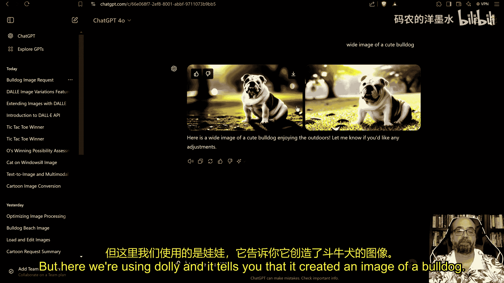
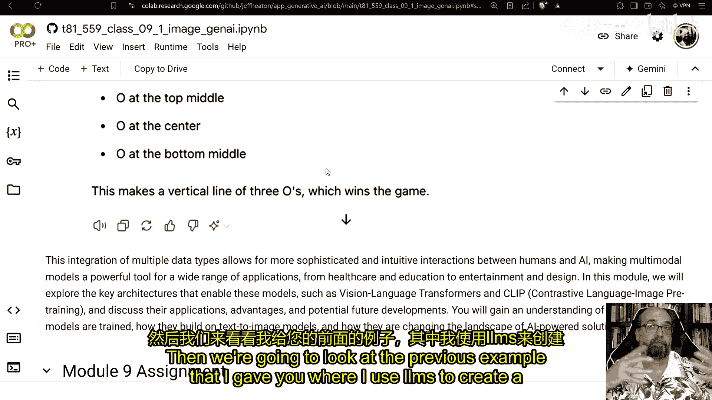

# 037：多模态与文生图入门 🎨

在本节课中，我们将要学习生成式AI中两个重要的方向：文生图模型和多模态模型。我们将了解它们的基本概念、工作原理以及实际应用。

到目前为止，我们主要关注的是文本到文本模型，这可能是生成式AI中最受关注的部分。然而，现在我们将要探讨文生图模型，以及与之相关的多模态模型。

## 文生图模型简介

文生图模型接收文本提示，并生成相应的图像。此时你处理的模型不一定是大型语言模型，也可能是Stable Diffusion或DALL-E等其他模型。你向它提供一个描述图像的文本提示，它就会返回相应的图像。

例如，你可以向ChatGPT提供这样的提示：“生成一张可爱斗牛犬的方形图片”。它会为你生成图像。这实际上更接近于多模态的工作方式，因为我甚至可以给它一张我的照片，并说“渲染成卡通风格”。但在这里，我们使用的是DALL-E。

它告诉你它创建了一张斗牛犬的图片。

我们可以看到生成的斗牛犬，并且模型会对我的提示进行一些优化，使其效果更好。我提供了一个非常简单的提示，而模型会尝试改进它。这是DALL-E的一个功能。这也有助于你遵守其可接受的内容准则，避免生成不当的图像。如果你想生成不受限制的图像，需要使用未经审查的模型，这类模型确实存在。

## 文生图模型的不同方式

现在，让我们首先看看文生图模型。虽然我刚刚在ChatGPT中使用了它，但我们将了解如何通过OpenAI的API来实现这一点。

以下是几种不同的实现方式：
*   **Stable Diffusion**：如果你想在自己的电脑上生成图像，Stable Diffusion是一个选择。在Mac上，有一个叫做Diffusion Bee的工具。在两个平台上，都有Dreambooth，你可以下载自定义模型。顺便提一下，在那里你可以完全不受限制，生成任何你能想到的图像。
*   **DALL-E**：DALL-E会做得更多一些。它会接收你的提示，并为你增强它。

例如，我使用Mac上的Diffusion Bee运行Stable Diffusion，并输入提示：“生成一只在窗台上的猫”。Stable Diffusion会严格按照你的要求执行，不会额外添加内容。所以它生成了猫，那就是猫。

而DALL-E则不同。对于“窗台上的猫”这个简单提示，DALL-E会将其扩展为：“一个舒适的场景，一只猫坐在窗台上，柔和的自然光从外面照射进来。猫优雅地坐着，望向窗外，尾巴蜷缩在爪子周围。窗台上装饰着几盆植物，外面的景色是一个宁静的花园，绿意盎然。室内的房间温暖而诱人，有微妙的阴影，但光线照亮了猫光滑的毛发和放松的姿态。”

它完全扩展了我的简单提示。这是它生成的图像。你可以看到，这基本上就是所描述的场景。你可以获取这个描述，然后反馈给DALL-E并进行修改，例如，你可以说你不想要一个温暖、宁静的房间，也许你想要一个时尚、现代感的房间。

## 多模态模型的重要性

多模态模型同样非常重要，这正在改变世界。例如，在美国，我们使用一种叫做Epic的医疗记录系统，它有一个名为MyChart的程序。我母亲曾向我求助，她给我发了一张她iPhone上Epic MyChart应用的截图，我只是将截图直接粘贴到GPT-4o（这是一个多模态模型）中，并询问：“这是怎么回事？”同时，我给出了我母亲问我的问题，它回答得非常好。因此，它能够查看事物的截图并回答相关问题。

我将在这里给你一个我在多模态模型中做的例子。我创建了这张图片，这是我亲手绘制的，从线条的潦草程度你肯定能看出来。基本上，我在和自己玩井字游戏。与自己玩井字游戏有趣的地方在于，你并不总是能赢，有时你会和自己打成平手。但这是一场胜利，圈（O）赢了。

我能够询问：“谁赢了这场井字游戏？”它基本上会回复并告诉你圈（O）赢了。这就是多模态的一个例子。

你还可以给它一张普通人的图片，如果你告诉它将这个人变成卡通形象，它就会返回一个卡通版本。这是我们即将探讨的基于图像的神经网络（即文生图）以及多模态模型的开始。

## 本节内容预告

我们将探讨许多有趣的内容。首先，我们将看看如何使用DALL-E生成全新的图像，以及对现有图像进行修改。然后，我们将探讨多模态模型，我们可以将图像发送给它，它会处理图像并告诉你关于图像的一些信息。接着，我们将看看我之前给出的例子，即使用LLM创作一本完整的书，但这次我们将让它同时添加插图。

本节课中，我们一起学习了文生图模型（如Stable Diffusion和DALL-E）以及多模态模型的基本概念和应用。我们了解了它们如何接收文本或图像输入，并生成或分析内容，为创作和问题解决提供了强大的工具。

感谢观看本视频，如果觉得有用，请订阅我的频道，这样你就不会错过本课程的任何其他内容。感谢观看。