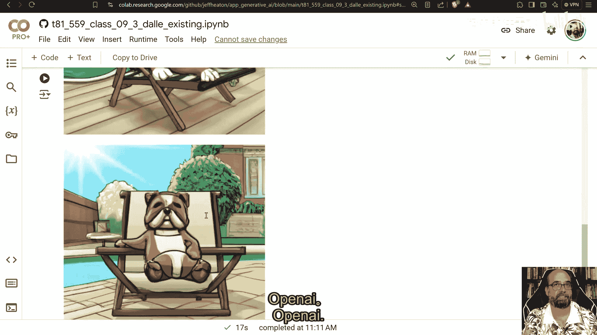

# 039：使用DALL-E编辑现有图像 🖼️

在本节课中，我们将学习如何使用DALL-E模型来编辑和修改现有的图像。我们将重点介绍两个核心功能：**图像扩展**和**图像变体生成**。我们将使用DALL-E 2进行演示，因为DALL-E 3目前尚未内置这些编辑功能。


上一节我们介绍了如何使用DALL-E从零开始生成图像，本节中我们来看看如何利用它来修改已有的图片。


## 准备工作与注意事项


首先，需要明确的是，图像编辑功能目前并非DALL-E 3的内置特性，因此本教程将使用DALL-E 2的API。你需要关注未来版本的功能更新。

要使用这些功能，你需要一个OpenAI的API密钥。在代码中，我们通过以下方式授权访问：

```python
# 假设API密钥已存储在环境变量中
import openai
openai.api_key = os.getenv("OPENAI_API_KEY")
```

## 图像扩展：为图片添加新元素

图像扩展功能允许你在现有图片的特定区域添加新内容。其核心原理是使用一张**蒙版**图像来指定需要修改的区域。

以下是实现图像扩展的关键步骤：

1.  **准备原始图像与蒙版**：原始图像需要保存为PNG格式，因为PNG支持透明度通道。蒙版图像定义了需要被修改的区域（透明部分），而DALL-E将只在这个区域内根据提示词生成新内容，同时会参考图像其余部分的上下文。
2.  **调用编辑API**：通过API同时上传原始图像和蒙版图像，并提供一个文本提示词来描述你想要添加的内容。

让我们通过一个例子来具体操作。我们有一张我的狗Hickory在阳台上的原始图片，我们想在它旁边的椅子上添加一只狮子。

首先，我们加载图像：

```python
import requests
from PIL import Image
from io import BytesIO

# 加载原始图像和蒙版图像
original_image = Image.open("hickory_deck_original.png")
mask_image = Image.open("hickory_deck_mask.png")
```

接着，我们调用DALL-E的编辑接口：

```python
response = openai.Image.create_edit(
    image=open("hickory_deck_original.png", "rb"),
    mask=open("hickory_deck_mask.png", "rb"),
    prompt="A lion sitting on the chair",
    n=1,
    size="1024x1024"
)

# 获取生成图像的URL
image_url = response['data'][0]['url']
```

生成的结果中，狮子被添加到了指定的椅子上。值得注意的是，DALL-E理解了图像的3D空间关系——狮子被正确地放置在了栏杆的后面，而不是简单地覆盖在上面。如果你对生成的狮子不满意，可以重新运行代码，DALL-E会生成一个不同样式的狮子，但它仍然会出现在蒙版定义的区域内。

## 图像变体生成：创造相似风格的新图像

接下来，我们学习如何生成一张图像的多个变体。这个功能可以基于一张输入图像，创造出在风格和内容上相似但又不完全相同的新图像。

我们将使用一张由DALL-E 3生成的、Hickory以人类姿势晒太阳的卡通图片作为输入，来生成三个变体。

以下是生成图像变体的步骤：

1.  **定义功能函数**：我们需要编写函数来从URL加载图像并显示它们。
2.  **调用变体生成API**：将原始图像上传给API，并指定需要生成的变体数量。

以下是关键代码示例：

```python
def generate_variations(image_path, num_variations=3):
    # 打开原始图像
    with open(image_path, "rb") as image_file:
        # 调用DALL-E的变体生成接口
        response = openai.Image.create_variation(
            image=image_file,
            n=num_variations,
            size="1024x1024"
        )
    # 提取所有变体图像的URL
    variation_urls = [data['url'] for data in response['data']]
    return variation_urls

# 生成并保存变体
variation_urls = generate_variations("hickory_cartoon.png", 3)
for i, url in enumerate(variation_urls):
    save_image_from_url(url, f"hickory_variation_{i+1}.png")
```

运行后，我们将获得三张与原始卡通风格一致，但姿势、细节略有不同的Hickory图像。需要再次说明，由于使用的是DALL-E 2，生成的变体在真实感上可能不如DALL-E 3，但此功能展示了模型理解和延续图像风格的能力。

## 总结

本节课中我们一起学习了使用DALL-E编辑现有图像的两个强大技巧。



*   **图像扩展**：通过结合**原始图像**和**蒙版图像**，你可以在图片的指定区域添加全新的元素，模型会智能地考虑周围环境进行融合。
*   **图像变体生成**：你可以基于一张图片，快速生成一系列在风格和主题上保持一致的变体，为创意工作提供更多选择。

这些功能展示了生成式AI不仅能够从无到有进行创造，还能理解现有内容并在此基础上进行有意义的修改和再创作。