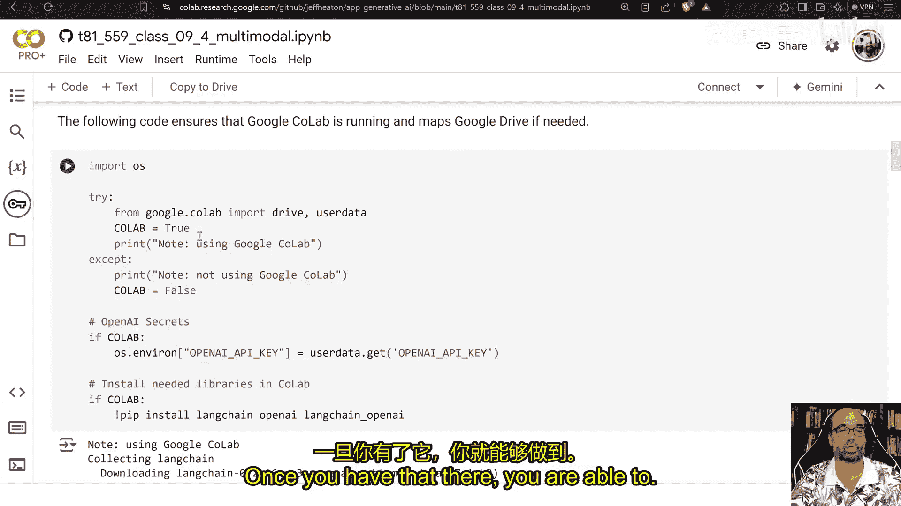
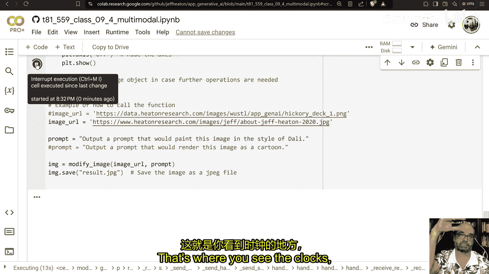
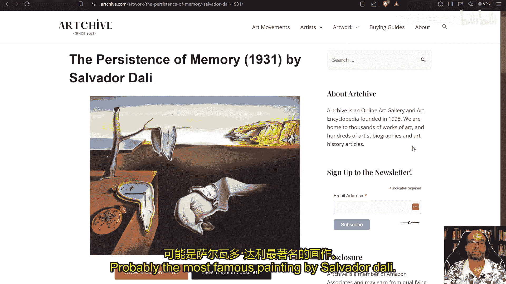
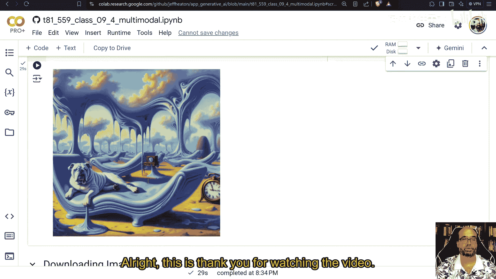

# 040：多模态模型 👁️📄

在本节课中，我们将要学习多模态模型。这是一种能够同时处理文本和图像输入的模型，你可以向它发送文本和图像，并询问关于图像的问题。我们还将看到，我们可以将多模态模型的输出传递给DALL-E，从而生成新的图像。

## 环境设置与准备



上一节我们介绍了多模态模型的基本概念，本节中我们来看看如何开始使用它。首先，你需要进行一些准备工作。


以下是设置步骤：

1.  确保你正在使用OpenAI的服务。
2.  你需要将你的OpenAI API密钥放入代码或Colab环境中。
3.  完成密钥设置后，你可以运行安装部分。

```python
# 安装必要的库
!pip install openai langchain
```

运行上述代码后，系统会安装所有必需的依赖项。接着，你需要授权访问之前设置的密钥。

## 图像描述功能

完成环境设置后，我们可以开始探索多模态模型的功能。首先，我们将使用LangChain框架，就像之前使用其他模型一样。

我们将使用一张特定的图片，你可以将任何你想要的图片URL放入代码中。这里使用的图片是我的狗在甲板上的照片。

我们使用GPT-4V-mini这个多模态模型。我们需要将图像数据进行Base64编码，这是模型接收图像所需的格式。

我们像往常一样构建消息，但这次我们不仅放入文本提示，还放入了图像。这样，模型就能同时处理图像和文本。这里的文本提示是“描述这张图片”。

模型返回的描述是：“图片显示一只狗舒适地躺在甲板上的两张蓝色躺椅上。”描述非常详细，并进一步描述了我的院子。

## 多模态模型的应用场景

了解了基本的图像描述后，我们来看看这些多模态模型的其他应用场景。

以下是潜在的应用方向：

*   **作业应用**：在本课程的作业中，你需要查看一系列图像并检测其中的特定内容。作业9中有更详细的描述。
*   **游戏分析**：例如，我曾画过一个井字棋棋盘，放上X和O，然后问模型“谁赢了这局井字棋游戏？”这是一种可以应用于许多场景的方法。

## 图像风格转换

现在，让我们看看图像到艺术的转换。我们将提供一个图像，并创建一个修改图像的函数。

`modify_image`函数使用GPT-4V-mini模型。它对你传入的图像进行编码，但不同之处在于提示词。提示词会指定类似“将其转换为卡通风格”或“创建一个能将其渲染为卡通风格的提示词”这样的指令。

我们调用构建好的消息，就能得到一个卡通风格的提示词。这样理解起来更直观：我们传入的指令是“输出一个能将此图像渲染为卡通风格的提示词”。因此，无论你传入什么图像，它都会被渲染成卡通风格，因为模型会构建出完整的描述性提示词。

当然，大语言模型有时会对输入内容进行自由发挥。你可以看到它保留了一些元素，但也明显进行了一些创作。

我们得到卡通提示词后，将其传递给DALL-E模型，生成一张1024x1024像素的图像。我们会下载并显示它。运行代码后，你会得到我的斗牛犬Hickory坐在甲板椅子上的另一个卡通版本，结果非常可爱。不过它总想给我的院子加个游泳池，这倒也不错。

## 尝试不同的图像与风格

我们可以更换图像进行尝试。例如，使用我的一张标准个人资料照片，背景是同一个书架。

运行后，模型让我看起来更年轻，头发也更多了。有时你需要多运行几次才能得到理想的结果。你可以在一个循环中生成多个版本（比如20个），然后挑选你最喜欢的一个。你也可以手动编辑模型生成的提示词，这需要对程序进行一些修改。



让我们尝试一个完全不同的提示风格。这个提示词要求“以萨尔瓦多·达利的风格创建一张图像”。达利以其超现实的抽象画作而闻名，其中最著名的可能是《记忆的永恒》，画中时钟像融化了一样挂在树枝上。



用我的照片生成达利风格的结果，看起来有点像《记忆的永恒》中的我，但可能不完全符合达利风格。我们也可以用我的斗牛犬Hickory的图像尝试同样的风格，生成的效果非常迷幻。



## 总结

本节课中我们一起学习了多模态模型。我们了解了如何设置环境来使用能够处理文本和图像的模型，探索了其基础的图像描述功能，并看到了它在作业分析和游戏解读等场景的应用。更重要的是，我们实践了如何利用多模态模型分析图像并生成特定风格（如卡通或艺术家风格）的文本描述，进而驱动像DALL-E这样的图像生成模型创造出全新的视觉内容。这展示了多模态AI在连接视觉理解与创造性生成方面的强大能力。