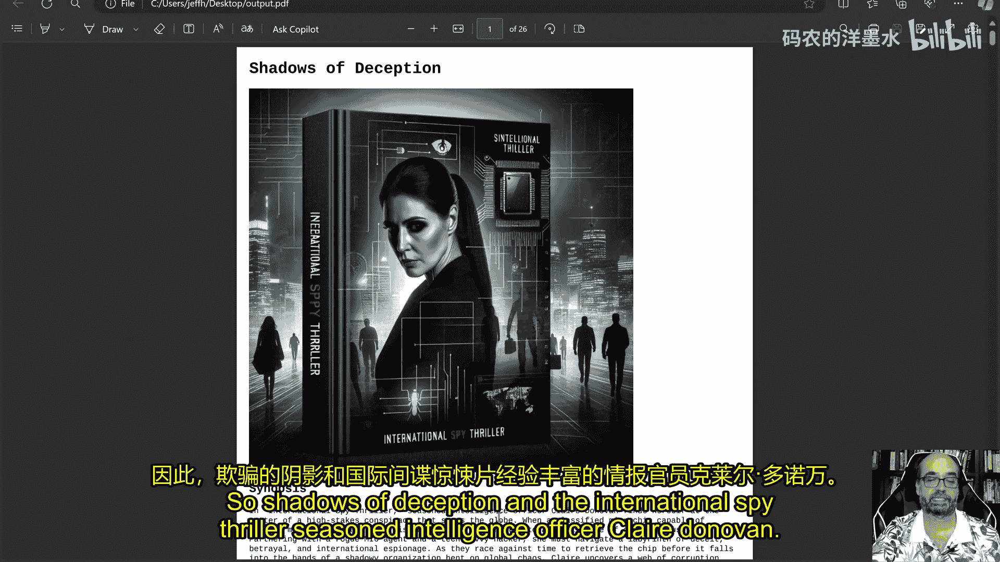
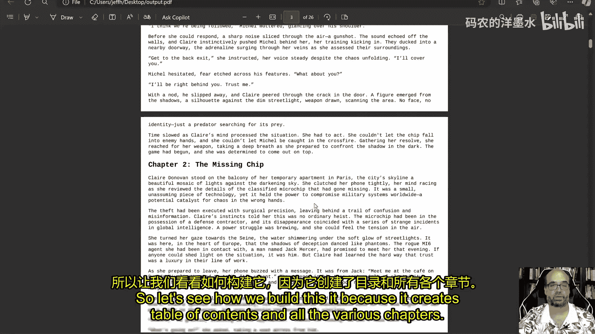
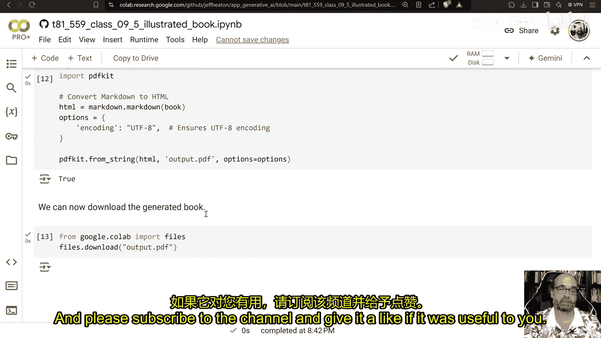

# 041：使用大语言模型与DALL-E制作插画书 📚

在本节课中，我们将学习如何结合使用生成式AI（大语言模型和图像生成模型）与Python程序，来自动生成一本包含封面、目录和多个章节的完整插画书，并最终输出为PDF文件。

上一节我们介绍了生成式AI的基本概念，本节中我们来看看如何将其应用于具体的创意项目。

---

## 项目概述

该项目旨在创建一个自动化流程，利用OpenAI的GPT-4模型生成小说文本，并利用DALL-E 3模型为书籍生成封面和章节插图，最终将所有内容整合成一个格式规范的PDF文件。生成的书籍示例为一本名为《欺骗之影》的国际间谍惊悚小说。



## 核心代码与流程解析



以下是构建该项目的核心步骤和代码逻辑。

### 1. 环境设置与API调用

首先，需要设置OpenAI的API密钥，并创建用于调用大语言模型和图像生成模型的函数。

```python
import openai

# 设置您的OpenAI API密钥
openai.api_key = "YOUR_API_KEY"

def query_llm(prompt):
    """向大语言模型发送提示并获取响应。"""
    response = openai.ChatCompletion.create(
        model="gpt-4",
        messages=[{"role": "user", "content": prompt}]
    )
    return response.choices[0].message.content

def generate_image_dalle3(prompt, filename, height=768, width=768):
    """使用DALL-E 3根据提示生成图像，并保存到指定文件。"""
    response = openai.Image.create(
        model="dall-e-3",
        prompt=prompt,
        size=f"{height}x{width}"
    )
    image_url = response.data[0].url
    # 下载图像并保存为文件
    # ... (下载和保存图像的代码)
    return filename
```

### 2. 生成书籍元数据

利用大语言模型，逐步生成书籍的标题、概要等元数据。

```python
# 步骤1：生成随机书名
book_subject = "International Spy Thriller"
title_prompt = f"Generate a creative book title for a {book_subject}."
book_title = query_llm(title_prompt)

# 步骤2：基于书名生成概要
synopsis_prompt = f"Write a brief synopsis for a book titled '{book_title}'."
book_synopsis = query_llm(synopsis_prompt)

# 步骤3：使用概要生成封面图
cover_art_prompt = f"Cover art for a spy thriller novel titled '{book_title}'. Style: dramatic and mysterious."
cover_image_file = generate_image_dalle3(cover_art_prompt, "cover.png")
```

### 3. 生成目录与章节内容

接下来，生成结构化的目录和每个章节的详细内容。

```python
# 生成目录，要求以特定格式（用“|”分隔）返回
toc_prompt = f"Generate a table of contents with chapter titles for the book '{book_title}'. Return ONLY the titles, separated by the '|' character."
toc_response = query_llm(toc_prompt)
chapter_titles = toc_response.split("|")

def render_chapter(chapter_title):
    """根据章节标题，生成该章节的完整内容。"""
    chapter_prompt = f"Write a detailed chapter for a spy thriller novel. Chapter title: {chapter_title}. The chapter should be engaging and around 500 words."
    chapter_content = query_llm(chapter_prompt)
    return f"# {chapter_title}\n\n{chapter_content}"
```

### 4. 整合内容并生成PDF

最后，将所有生成的文本和图像整合到Markdown格式中，并转换为PDF。

book_content += f'\n\n'

```python
import base64
from markdown2 import markdown
from weasyprint import HTML

# 初始化书籍内容（Markdown格式）
book_content = f"# {book_title}\n\n## Synopsis\n\n{book_synopsis}\n\n"

# 添加封面图像（Base64编码嵌入）
with open(cover_image_file, "rb") as image_file:
    encoded_string = base64.b64encode(image_file.read()).decode()
# 添加目录
book_content += "## Table of Contents\n\n"
for title in chapter_titles:
    book_content += f"- {title}\n"
book_content += "\n---\n\n"

# 循环生成并添加各个章节
for title in chapter_titles:
    book_content += render_chapter(title) + "\n\n"

# 将Markdown转换为HTML，再生成PDF
html_content = markdown(book_content)
HTML(string=html_content).write_pdf("generated_book.pdf")
```

以下是构建流程中的关键步骤列表：
1.  **初始化与API配置**：设置OpenAI环境并创建核心调用函数。
2.  **生成书籍框架**：利用LLM生成书名、概要和封面图提示。
3.  **创建书籍结构**：生成格式化的目录列表。
4.  **填充内容**：根据每个章节标题，生成详细的章节正文。
5.  **汇编与输出**：将所有文本和图像整合到Markdown中，并最终渲染为PDF文件。

---

## 总结



本节课中我们一起学习了如何将大语言模型（如GPT-4）和图像生成模型（如DALL-E 3）的能力相结合，通过一个结构化的Python脚本，自动化完成从创意构思到成品输出的完整书籍创作流程。核心在于通过精心设计的提示词（Prompt）分步获取内容，并将不同模型生成的结果（文本和图像）进行有效整合与格式化。这种方法为快速原型制作、内容创作自动化提供了强大的工具。