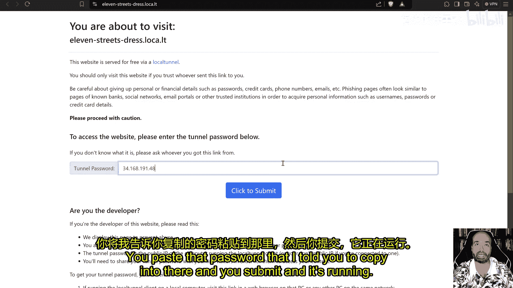
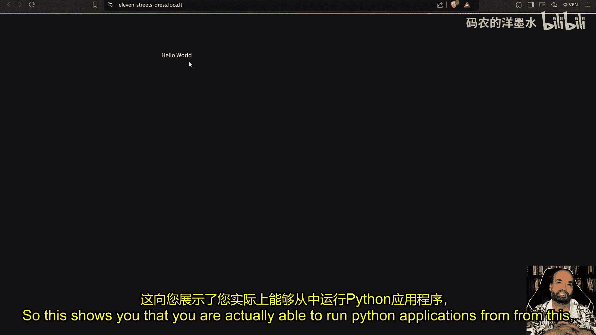
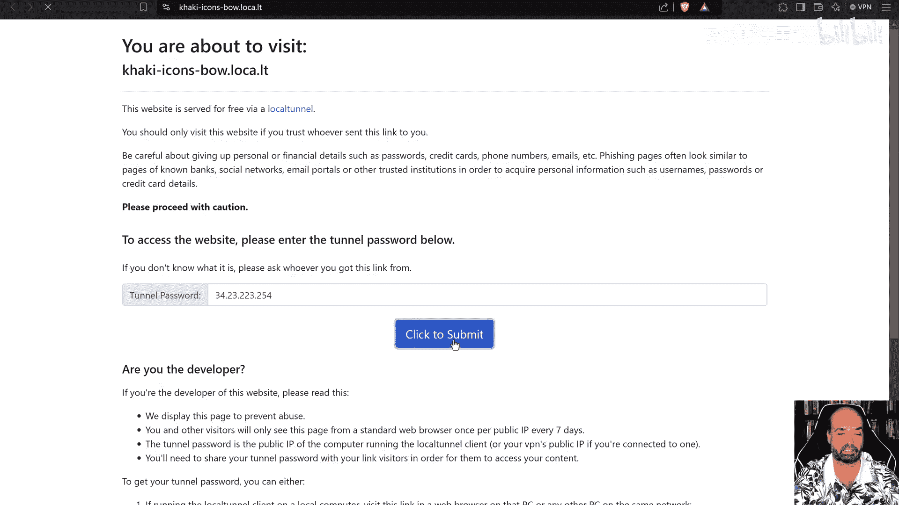
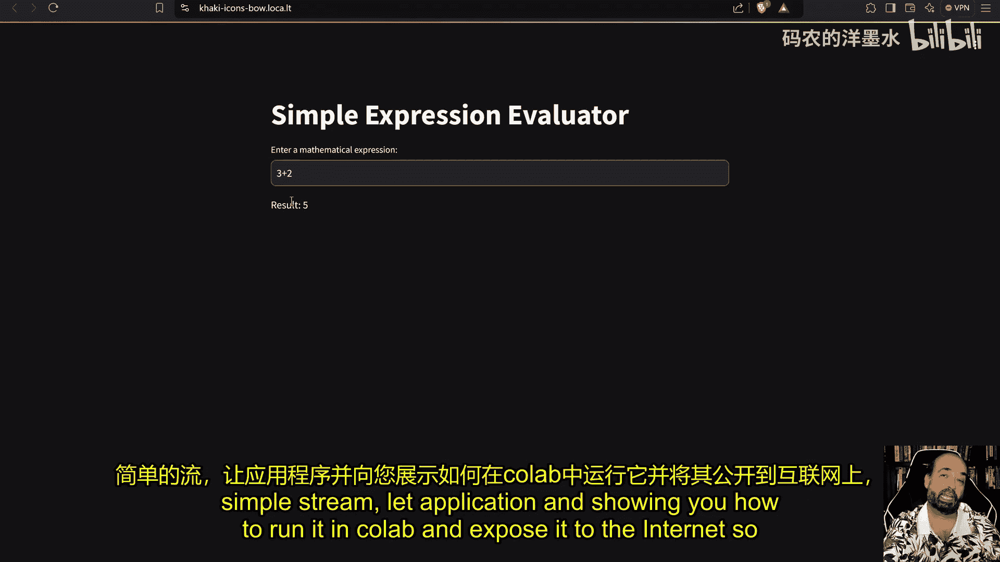

# 042：在Google Colab中运行StreamLit 🚀

在本节课中，我们将学习如何为大型语言模型和生成式AI应用添加用户界面。我们将使用StreamLit这个完全基于Python的Web应用开发框架，它允许我们无需使用JavaScript、React或TypeScript等技术，就能创建可高度自定义的界面。我们将通过一个具体示例，演示如何在Google Colab环境中设置、运行并访问一个StreamLit应用。

## 概述与准备工作

首先，我们假设你正在使用OpenAI，并且已经在此环境中设置好了API密钥。我们将运行一个完整的示例，展示其工作原理并讨论相关代码。由于运行需要一些时间，我们会快速推进。

StreamLit是一个Python库，专为构建Web用户界面而设计，尤其适合机器学习和生成式AI应用。虽然存在其他库（如Flask）可以创建各种应用（甚至可部署为手机应用或独立应用），但StreamLit因其与机器学习生态的良好集成而被我们选用。

以下是相关资源链接：
*   [StreamLit 官网](https://streamlit.io/)
*   [StreamLit 文档](https://docs.streamlit.io/)

这些资源提供了完善的文档和应用示例库。

## 第一个示例：StreamLit “Hello World”

上一节我们介绍了StreamLit的基本概念，本节中我们来看看如何创建一个最简单的“Hello World”应用。

我们将首先在Colab中编写一个基础的StreamLit应用代码。请注意代码顶部的 `%%writefile app.py` 命令，这是一个Jupyter的“魔法命令”。它的作用不是执行该单元格的代码，而是将其写入到我们当前连接的虚拟机的本地存储中，即保存为 `app.py` 文件。这是因为要让StreamLit（或LangChain）正常工作，它需要作为一个服务器应用运行，并通过浏览器访问。在Colab中运行此类服务器需要一些额外步骤，主要是使用隧道技术。

以下是一个极简的StreamLit应用，它仅仅打印出“Hello World”：

```python
%%writefile app.py
import streamlit as st
st.write(‘Hello World’)
```

### 在Colab中运行StreamLit服务器

为了在Colab中运行这个应用并将其暴露到互联网以供访问，我们需要使用隧道。隧道能够将本地运行的服务器穿透防火墙，映射到一个公共的互联网地址上。

以下是操作步骤：

1.  **获取虚拟机IP地址**：你需要知道你的Colab虚拟机的IP地址。这个地址并非用于直接连接，而是隧道软件用于验证你对虚拟机控制权的一种安全机制，相当于你的密码。
    ```python
    # 在Colab单元格中运行以获取IP
    !curl ipv4.icanhazip.com
    ```
    请复制输出的IP地址，后续步骤会用到它。

2.  **在后台启动StreamLit**：运行以下命令，它将在后台启动StreamLit服务器，并将输出重定向到日志文件。
    ```bash
    !streamlit run app.py &> /content/logs.txt &
    ```
    运行此命令后，表面上看不会立即发生什么，因为服务器已在后台启动。

3.  **建立隧道**：接下来，运行隧道命令来暴露本地服务器。
    ```bash
    !npx localtunnel --port 8501
    ```
    首次运行时，它会询问是否安装相关库，输入 `yes` 继续。接着，它会生成一个临时的公共URL（例如 `https://some-random-string.loca.lt`）。

4.  **访问应用**：在浏览器中打开上一步获得的临时URL。页面会提示输入“password”，此时将第一步复制的IP地址粘贴进去并提交。成功后，你将看到显示着“Hello World”的StreamLit应用页面。

至此，你已经成功在Colab中运行了一个StreamLit应用。这证明了你可以通过隧道技术，在此环境中运行Python Web应用。

在切换到下一个更复杂的示例之前，建议完全终止当前的Colab运行时，以确保环境干净。然后重新运行所有安装和设置步骤。

## 第二个示例：交互式表达式求值器



在成功运行了基础示例后，本节我们将构建一个更具交互性的应用：一个通过Web界面输入并计算数学表达式的求值器。

这个示例将展示如何在StreamLit中处理用户输入。我们创建一个程序，允许用户输入像 `1 + 1` 这样的表达式，然后返回结果 `2`。



以下是应用的核心代码，我们将它写入 `app.py`：

```python
%%writefile app.py
import streamlit as st
import re

st.title(‘表达式求值器’)

# 创建输入框并同时获取其值
expression = st.text_input(‘输入一个表达式（例如：3 + 2）:’, ‘’)

# 安全验证：只允许数字和基本运算符
if expression:
    # 使用正则表达式进行简单验证
    if re.match(r’^[\d\s\+\-\*\/\(\)\.]+$’, expression):
        try:
            # 使用eval求值（注意：在生产环境中对用户输入使用eval需极其谨慎）
            result = eval(expression)
            st.write(f’结果: **{result}**’)
        except Exception as e:
            st.error(f’计算错误: {e}’)
    else:
        st.warning(‘请输入有效的数学表达式（仅包含数字、+、-、*、/、(、)）。’)
```

### 理解StreamLit的执行模型

这段代码揭示了一个关于StreamLit工作原理的关键且必须理解的概念：

**代码执行流程**：`expression = st.text_input(...)` 这行代码具有双重作用。它既在页面上创建了一个文本框控件，同时也用于检索用户输入到该文本框的值。关键在于，当你启动应用时，这段代码**至少会被执行两次**。

1.  **第一次执行（初始化）**：当应用首次加载时，代码运行是为了设置页面布局。此时 `expression` 的值为空（或默认值），因此 `if expression:` 条件为假，不会显示结果。
2.  **第二次执行（交互后）**：当用户在文本框中输入内容并触发交互（如按下回车）后，整个脚本会重新执行。这一次，`st.text_input` 会返回用户刚才输入的值，`expression` 不再为空，条件判断通过，进而计算并显示结果。

**重要提示**：StreamLit在每次交互后都是**从头开始重新运行整个脚本**的，它默认不保留之前的状态（我们将在后续学习如何引入状态管理）。因此，你会看到每次交互后，页面都基于最新的输入重新构建。

### 运行与测试表达式求值器

现在，让我们在Colab中运行这个新应用。步骤与“Hello World”示例完全相同：

1.  将上述代码单元格写入 `app.py`。
2.  获取当前虚拟机的IP地址并复制。
3.  在后台启动StreamLit服务器（`!streamlit run app.py &> /content/logs.txt &`）。
4.  启动隧道（`!npx localtunnel --port 8501`），同意安装，并获取临时URL。
5.  在浏览器中打开该URL，在隧道验证页面输入复制的IP地址。
6.  访问应用页面，尝试在输入框中键入 `3 + 2` 然后按回车。首次加载时不会显示结果，提交后页面刷新，你会看到输出“结果: **5**”。

这样，你就创建并测试了一个简单的交互式StreamLit应用，并了解了如何在Colab中运行和访问它。



## 总结

本节课中，我们一起学习了如何利用StreamLit为AI应用构建Web用户界面。我们从StreamLit的基本介绍开始，然后逐步实践：

1.  我们创建了一个最简单的“Hello World”应用，并学会了如何在Google Colab的特殊环境下，借助隧道技术将本地StreamLit服务器暴露到公网进行访问测试。
2.  我们构建了一个交互式的数学表达式求值器，通过这个例子深入理解了StreamLit**响应式**和**无状态**的执行模型——即整个脚本在每次用户交互后重新执行，控件同时负责显示和返回值。



这仅仅是使用StreamLit的开始。在后续课程中，我们将利用这些基础知识，实现更复杂、功能更丰富的生成式AI应用界面。

希望本教程对你有用。