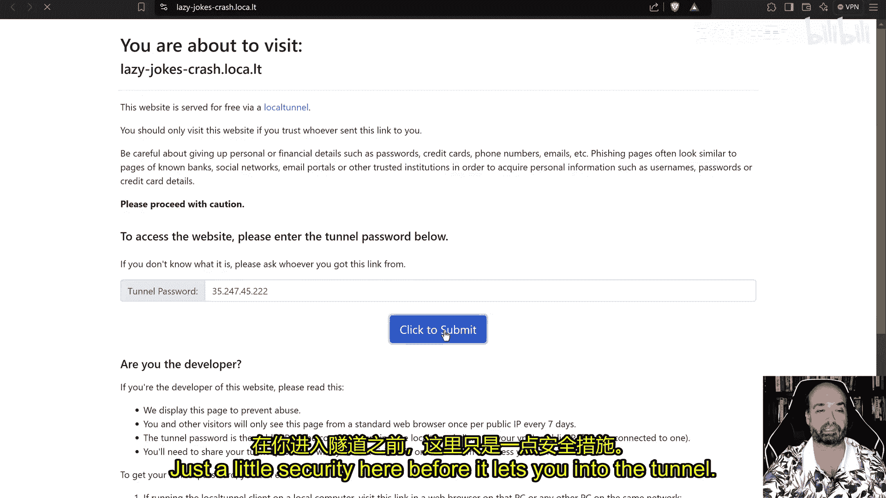
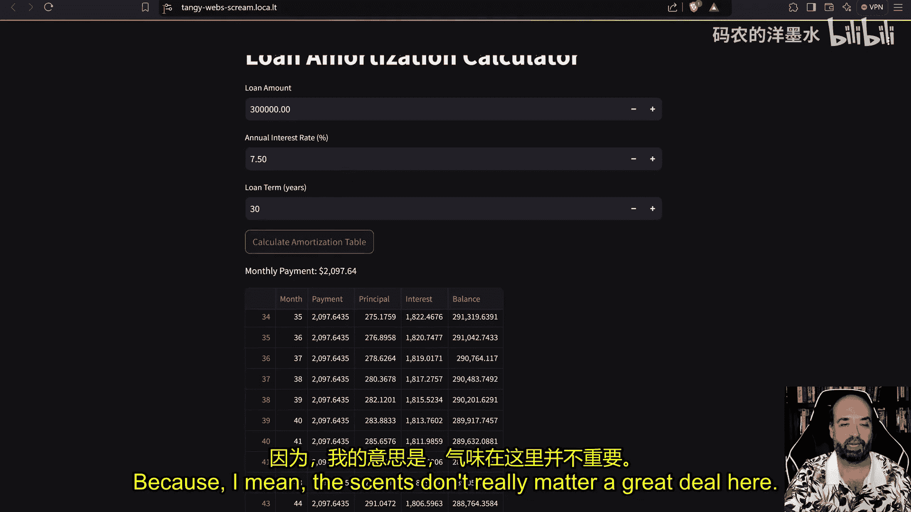
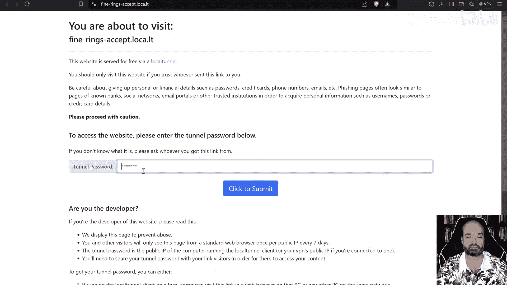
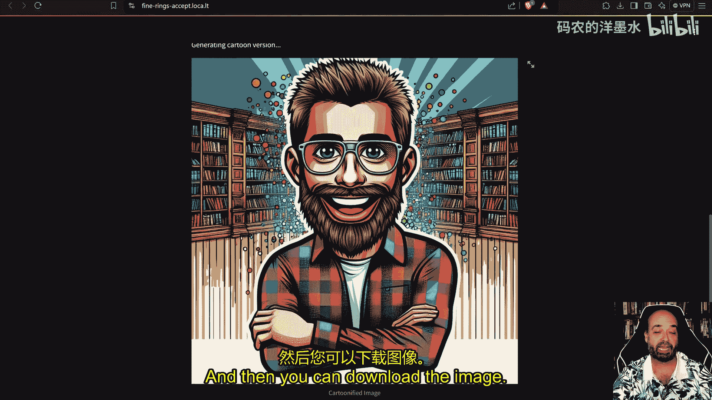
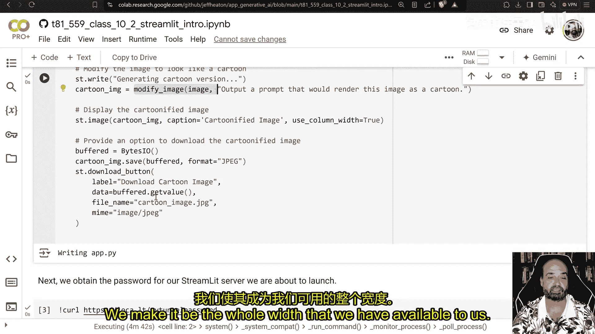

# 043：StreamLit进阶教程

## 概述

在本节课中，我们将深入学习StreamLit，构建两个更复杂的应用程序示例。第一个是贷款分期偿还表计算器，第二个是基于多模态AI模型的图像卡通化工具。我们将详细解析代码结构，并理解StreamLit如何处理用户交互与数据流。

---

## 回顾与准备

上一节我们介绍了StreamLit的基础知识。本节中，我们来看看如何构建功能更丰富的应用。

在开始前，请确保已完成以下准备工作：
*   回顾之前的课程（例如10.1节）。
*   所有相关链接均在视频描述中。
*   假设你正在使用OpenAI，并已将API密钥正确设置。
*   建议将密钥存储在StreamLit的`secrets`中，以防在分享笔记本时意外泄露。

---

## 示例一：贷款分期偿还表计算器 🏦

这个应用程序用于计算贷款（如房贷、车贷）的分期偿还表。在整个贷款周期内，每月还款额是固定的，但偿还的本金和利息比例会随时间变化。

### 分期偿还原理

贷款初期，还款中利息占绝大部分，本金偿还很少。随着时间推移，利息部分逐渐减少，本金部分增加。这种计算方式使得每月还款额保持稳定。在贷款初期额外还款可以节省大量利息，但需权衡资金在其他地方的可能收益。

以下是计算分期偿还表的标准公式，你可以在维基百科或许多教程中找到它，此处不涉及AI技术。

```python
# 这是一个标准的分期偿还计算公式
monthly_rate = annual_rate / 12 / 100
n_payments = years * 12
monthly_payment = loan_amount * (monthly_rate * (1 + monthly_rate)**n_payments) / ((1 + monthly_rate)**n_payments - 1)
```

### 应用程序代码解析

以下是构建该应用的核心步骤：

首先，我们设置应用程序标题并创建三个控制组件。

```python
st.title('贷款分期偿还计算器')
loan_amount = st.number_input('贷款金额', value=300000)
annual_rate = st.number_input('年利率 (%)', value=7.5)
years = st.number_input('贷款年限', value=30)
calculate_button = st.button('计算分期偿还表')
```

StreamLit应用会运行两次。首次运行时，上述代码仅用于在页面上创建和放置控件，此时按钮返回值为`None`。

当用户点击按钮后，应用第二次运行。此时，控件将包含用户输入的值。我们获取这些值并计算分期偿还表。

```python
if calculate_button:
    # 获取用户输入
    loan = loan_amount
    rate = annual_rate
    term_years = years

    # 调用函数计算分期偿还表，返回一个Pandas DataFrame
    amortization_df = calculate_amortization_table(loan, rate, term_years)

    # 显示计算结果
    st.write(f"每月还款额: ${monthly_payment:,.2f}")
    st.dataframe(amortization_df)

    # 提供下载CSV文件的选项
    csv = amortization_df.to_csv(index=False)
    st.download_button('下载CSV文件', data=csv, file_name='amortization_schedule.csv')
```

Pandas DataFrame能与StreamLit完美配合，`st.dataframe()`可以将其以交互表格的形式优雅地展示在页面上。

### 运行演示

运行代码后，我们启动StreamLit服务器并通过隧道在Colab中访问它。应用程序界面如下：




你可以调整贷款金额、利率和年限，然后点击“计算分期偿还表”。结果将显示每月还款额以及详细的偿还计划表，清晰地展示每期还款中本金和利息的构成。




---

## 示例二：AI图像卡通化工具 🎨

现在，让我们看一个更复杂的例子。这个应用允许用户上传一张图片，然后利用多模态AI模型将其转换为卡通风格。



### 重启环境与代码结构

在运行这个全新示例前，建议重启环境并运行安装脚本来确保环境干净。以下是应用的主要代码结构。

首先，我们定义核心函数`modify_image`，它负责处理图像转换的AI逻辑。

```python
def modify_image(image, prompt):
    """
    使用多模态模型分析图像并生成描述，再用文生图模型创建卡通版本。
    :param image: 输入的PIL图像对象
    :param prompt: 用户指令
    :return: 生成的卡通图像（PIL对象）
    """
    # 1. 将图像编码为base64字符串，以便发送给AI模型
    buffered = BytesIO()
    image.save(buffered, format="PNG")
    img_str = base64.b64encode(buffered.getvalue()).decode()

    # 2. 使用多模态模型（如GPT-4V）分析原图并生成一个详细的卡通化提示词
    client = OpenAI(api_key=st.secrets["OPENAI_API_KEY"])
    response = client.chat.completions.create(
        model="gpt-4-vision-preview", # 使用支持图像输入的多模态模型
        messages=[
            {
                "role": "user",
                "content": [
                    {"type": "text", "text": prompt},
                    {"type": "image_url", "image_url": {"url": f"data:image/png;base64,{img_str}"}}
                ]
            }
        ]
    )
    # 提取模型生成的详细卡通化描述
    cartoon_prompt = response.choices[0].message.content

    # 3. 使用文生图模型（如DALL-E 3）根据生成的描述创建卡通图像
    image_response = client.images.generate(
        model="dall-e-3",
        prompt=cartoon_prompt,
        size="1024x1024",
        quality="standard", # 可选择“hd”获取更高细节
        n=1,
    )
    # 获取生成图像的URL并转换为PIL图像对象
    generated_image_url = image_response.data[0].url
    cartoon_image = Image.open(requests.get(generated_image_url, stream=True).raw)
    return cartoon_image
```

这个函数分两步工作：
1.  **图像分析**：使用多模态模型（如GPT-4V）“理解”上传的图片，并根据指令生成一个用于创建卡通版的详细文本描述。
2.  **图像生成**：使用文生图模型（如DALL-E 3），根据上一步生成的描述，创造出最终的卡通图像。



### StreamLit应用程序界面

接下来，我们构建StreamLit前端界面。

```python
st.title('使用多模态AI卡通化图像')

# 文件上传组件
uploaded_file = st.file_uploader("选择一张图片...", type=['jpg', 'jpeg', 'png'])

if uploaded_file is not None:
    # 将上传的文件转换为PIL图像对象
    original_image = Image.open(uploaded_file)

    # 显示原始图像
    st.image(original_image, caption='上传的原始图像', use_column_width=True)

    st.write("正在生成卡通图像...")

    # 调用AI处理函数
    cartoon_image = modify_image(original_image, "请生成一个卡通版本的此图像。")

    # 显示生成的卡通图像
    st.image(cartoon_image, caption='生成的卡通图像', use_column_width=True)

    # 提供下载功能
    buffered = BytesIO()
    cartoon_image.save(buffered, format="PNG")
    st.download_button(
        label="下载卡通图像",
        data=buffered.getvalue(),
        file_name="cartoon_image.png",
        mime="image/png"
    )
```

与第一个例子类似，应用首次运行时仅渲染文件上传器。当用户上传图片后，应用第二次运行，执行图像处理和显示逻辑。

### 运行演示

启动应用后，界面如下：


上传一张个人照片后，应用会先显示原图，然后调用AI模型进行处理。稍等片刻，卡通化的结果就会显示出来。


你可以看到，AI不仅改变了风格，还可能加入了一些创意性的诠释（例如更多的头发）。最后，你可以选择下载生成的卡通图像。

---

## 总结



本节课中我们一起学习了如何构建两个进阶的StreamLit应用。

1.  **贷款计算器**：我们利用StreamLit的交互组件和Pandas DataFrame，构建了一个实用的金融计算工具，演示了如何捕获用户输入、进行计算并展示结构化数据。
2.  **AI图像卡通化工具**：我们创建了一个更复杂的应用，它整合了多模态AI模型（用于图像分析）和文生图模型。这个例子展示了StreamLit如何处理文件上传、图像显示，以及如何将AI服务无缝嵌入到Web应用中。

通过这两个例子，你应该对StreamLit处理前后端数据流、构建交互式界面以及集成外部AI API有了更深入的理解。