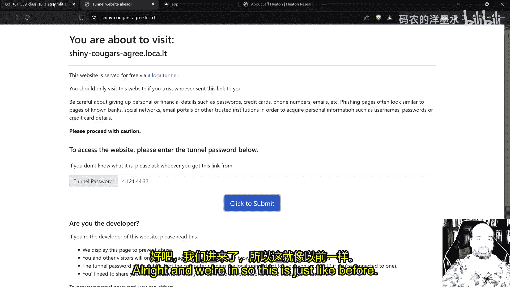
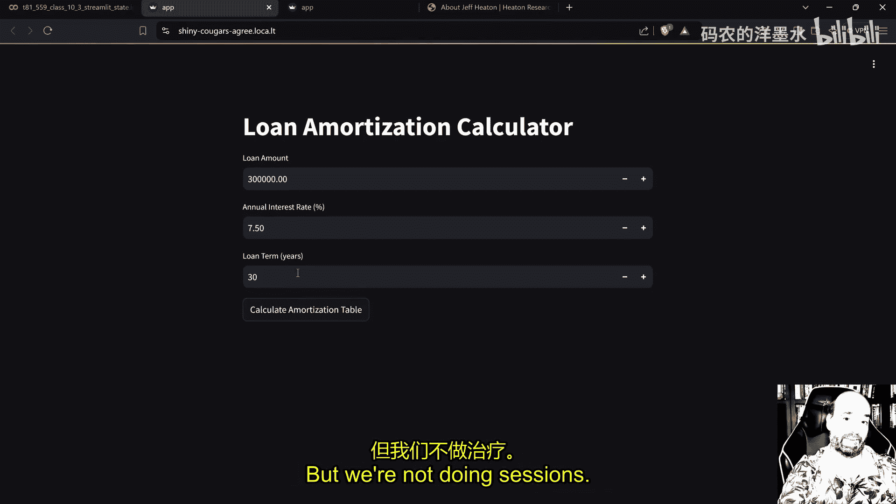
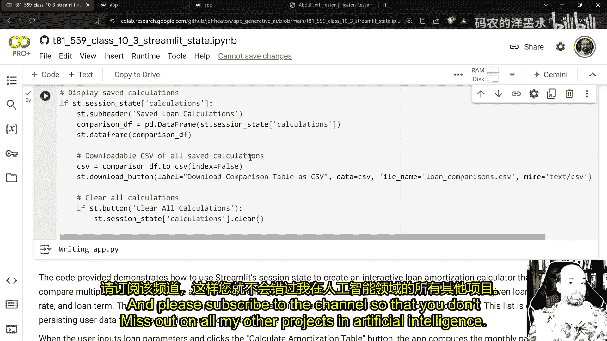

# 044：理解Streamlit状态管理 🧠

在本节课中，我们将学习如何为生成式AI应用添加交互性，核心是理解并应用Streamlit的状态管理功能。状态管理对于Web应用至关重要，它允许应用在用户交互过程中记住信息。

## 概述

上一节我们讨论了Streamlit的基础交互组件。本节中，我们将深入探讨**状态管理**。理想情况下，我们希望Web应用尽可能“无状态”，但某些交互场景必须依赖状态。我们将通过一个贷款分期偿还计算器的实例，来演示为何需要状态以及如何在Streamlit中实现它。

## 状态管理的必要性

首先，我们运行一个示例应用来观察状态的作用，然后分析其背后的实现原理。

假设您正在使用OpenAI（虽然此应用仅使用分期计算，无需API密钥，但其他功能可能需要）。我们假设您已将密钥存储在Google Colab的secrets中。

代码运行需要一些时间。启动后，我们将访问一个本地服务器。



应用界面如下所示。您可以输入贷款金额（例如默认的$7.5万）、年利率（5%）和贷款年限（30年），然后计算分期偿还表。


计算结果会显示月供约为$2000，总利息支付额很高，这在30年贷款初期是典型情况。

## 交互与状态保持

现在，如果我们想调整参数，例如将贷款年限改为15年。一旦更改，应用会重新计算。

但请注意，界面上现在同时显示了**两次**计算的结果：一次是30年贷款，一次是15年贷款。这就是**状态**在起作用。

如果没有状态管理，第一次计算的结果会在第二次点击按钮时丢失。应用是“无状态”的，每次交互都像是第一次运行。在下一节构建聊天机器人时，这一点尤其关键：您需要让LLM记住之前的对话内容，这必须通过状态来实现。

以下是两次计算的对比：
*   **30年贷款**：月供较低，但总利息极高。
*   **15年贷款**：月供高出约$700，但总利息大幅减少，且15年即可还清。

## 状态（State） vs 会话（Session）

需要明确的是，这里实现的是**状态**，而非**会话**。
*   **状态**：在单次页面访问期间，记住从一次按钮点击到下一次点击之间的数据。
*   **会话**：通常通过Cookie实现，可以在用户关闭浏览器再重新打开后依然识别用户，并设置超时时间（例如一周）。

我们的示例不是会话。如果您点击浏览器刷新，所有已保存的计算结果都会消失。




## 代码实现解析

理解了状态的作用后，我们来看看代码是如何实现的。

首先，我们定义了一个计算分期偿还表的函数 `calculate_amortization`。它接收贷款金额、年利率和年限三个参数，执行标准的财务数学计算。

```python
def calculate_amortization(loan_amount, annual_rate, years):
    # ... 财务计算逻辑 ...
    return monthly_payment, total_interest, amortization_table
```

应用的核心逻辑如下：

1.  **初始化状态**：检查 `st.session_state` 字典中是否存在一个用于存储历史计算的列表。如果不存在，则将其初始化为空列表。
    ```python
    if 'calculations' not in st.session_state:
        st.session_state.calculations = []
    ```

2.  **创建输入组件**：创建三个输入框用于输入贷款参数，以及一个“计算”按钮。页面首次加载时，这些组件的值均为 `None`。

3.  **处理按钮点击**：当用户点击“计算”按钮时，代码会获取输入框的当前值，调用 `calculate_amortization` 函数进行计算。

4.  **保存状态**：将本次计算的关键结果（如月供、总利息）添加到 `st.session_state.calculations` 列表中。这样，下次渲染页面时，这个列表仍然存在。

5.  **显示结果**：
    *   显示本次计算的详细分期表。
    *   检查 `st.session_state.calculations` 列表，如果其中有保存的历史计算，则用子标题“已保存贷款”将其以DataFrame表格形式展示出来。
    *   提供下载CSV和清除状态（清空列表）的选项。



## 总结


本节课中，我们一起学习了Streamlit的状态管理。我们通过一个贷款计算器实例，明白了为何需要在应用交互中保持状态，并掌握了使用 `st.session_state` 字典来存储和检索跨多次交互的数据的方法。关键步骤包括初始化状态变量、在用户操作后更新状态，以及基于状态数据动态更新界面显示。这为构建更复杂、具有记忆功能的交互式生成式AI应用（如聊天机器人）奠定了基础。