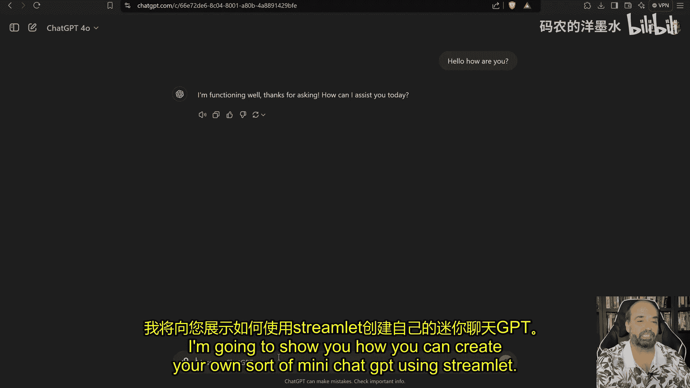
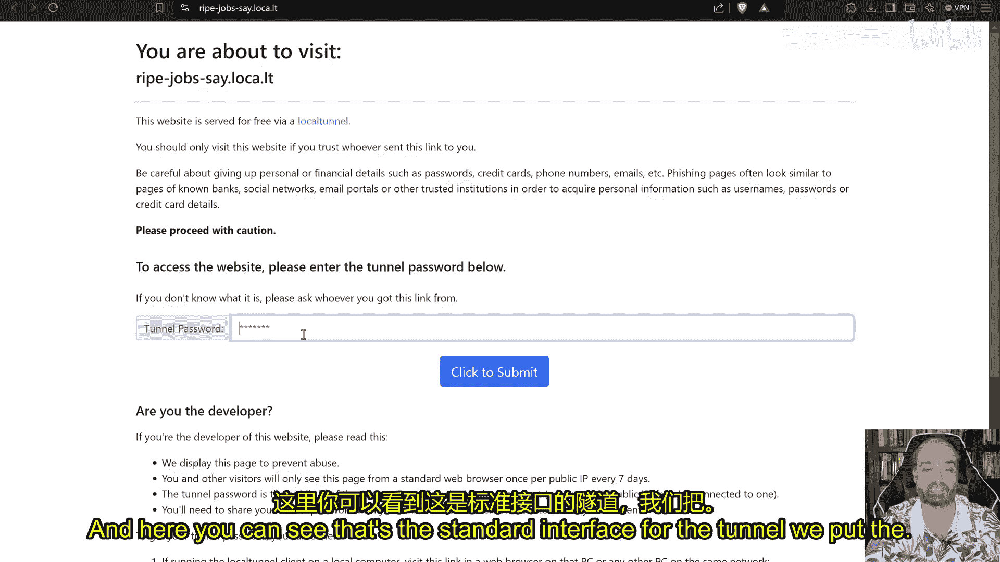
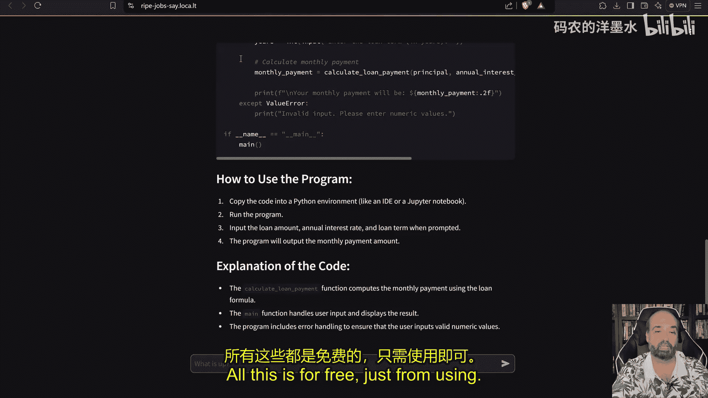
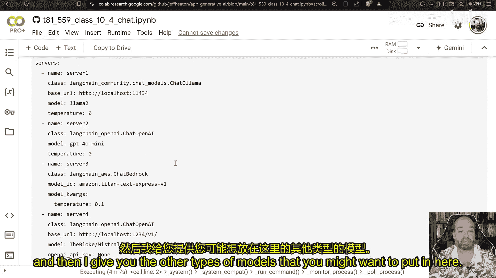

# 045：创建大语言模型聊天应用 💬



在本节课中，我们将学习如何使用 Streamlit 框架，结合大语言模型（LLM），创建一个类似于 ChatGPT 的交互式聊天应用。我们将从环境配置开始，逐步讲解应用的核心代码结构，并了解如何适配不同的 LLM 服务提供商。

---

## 概述

我们将在 Google Colab 环境中运行一个 Streamlit 应用。这个应用的核心功能是：通过一个简洁的网页界面与大型语言模型进行多轮对话，并保留对话历史。我们将使用一个工具类来抽象不同 LLM 提供商（如 OpenAI、Ollama、LM Studio 等）的调用细节，使得切换模型变得简单。

首先，我们需要安装必要的依赖并配置 API 密钥。

以下是启动应用前的准备工作：

1.  安装 Streamlit 等 Python 包。
2.  从安全存储中获取 OpenAI API 密钥（若使用其他提供商，则需相应调整）。
3.  编写并运行 Streamlit 应用主文件。

## 配置与启动应用

上一节我们介绍了项目的整体目标，本节中我们来看看具体的配置和启动步骤。

代码首先会安装依赖并设置环境。关键的一步是配置 LLM 连接参数。我们使用一个配置文件（如 `config.yaml`）来管理不同模型的设置，这提高了灵活性。



```python
# 示例：config.yaml 配置片段
server1:
  class: ChatOpenAI
  model: "gpt-4o-mini"
  temperature: 0
  openai_api_key: ${OPENAI_API_KEY}
```

运行应用后，Streamlit 会启动一个本地服务器。由于我们在 Colab 中，需要使用隧道服务将本地端口暴露到公网，以便通过浏览器访问应用界面。

## 应用核心代码解析

现在应用已经运行起来了，接下来我们深入查看其核心代码逻辑，理解聊天功能是如何实现的。



代码主要处理命令行参数、初始化聊天记忆、以及管理对话状态。`session_state` 是 Streamlit 用于在页面交互间保存数据的核心概念。

以下是应用初始化的关键步骤：

*   **解析参数**：从命令行获取要使用的聊天服务器配置名称（如 `server1`）。
*   **初始化对话记忆**：创建一个 `ConversationBufferMemory` 对象来存储用户和助手的对话历史。
*   **创建LLM实例**：根据配置名称加载对应的 LLM 驱动和参数。
*   **管理会话状态**：检查 `st.session_state` 中是否已存在聊天记录，若无则进行初始化。

当用户在前端输入消息并提交后，代码会执行以下流程：

```python
# 简化后的消息处理流程
if prompt := st.chat_input("What's up?"):
    # 1. 将用户输入显示在界面
    st.chat_message("user").write(prompt)
    # 2. 将用户输入添加到对话历史
    st.session_state.messages.append({"role": "user", "content": prompt})
    # 3. 调用LLM获取回复
    with st.chat_message("assistant"):
        response = llm_chain.run(prompt)
        st.write(response) # Streamlit 会自动渲染 Markdown
    # 4. 将助手回复添加到对话历史
    st.session_state.messages.append({"role": "assistant", "content": response})
```

## 抽象层：LLM工具类

为了能够轻松切换不同的语言模型提供商，我们引入了一个抽象层——`LLMUtility` 类。

这个工具类的主要职责是读取 YAML 配置文件，并根据指定的配置名称，实例化对应的 LangChain 聊天模型类。许多第三方服务都提供了与 OpenAI API 兼容的驱动，这使得适配工作变得相对简单。

以下是该工具类工作的简要说明：

*   **加载配置**：读取 `config.yaml` 文件。
*   **实例化模型**：根据配置中的 `class` 字段（如 `ChatOpenAI`），动态创建对应的 LangChain 模型对象。
*   **注入参数**：将配置中的 `model`、`temperature`、`api_key` 等参数传递给模型构造函数。

通过这种方式，我们只需修改配置文件，而无需改动主应用代码，就能更换后台的 LLM 服务。

## 总结

本节课中我们一起学习了如何使用 Streamlit 快速构建一个功能完整的 LLM 聊天应用。我们涵盖了从环境配置、应用启动、核心对话逻辑实现到通过抽象层支持多模型提供商的全过程。



关键要点包括：利用 Streamlit 的 `session_state` 管理对话状态；使用 `ConversationBufferMemory` 保存聊天历史；以及通过配置文件和工具类将模型调用逻辑抽象化，提升代码的可维护性和扩展性。你可以基于此框架，集成更多功能，如文件上传、工具调用等，打造更强大的生成式 AI 应用。