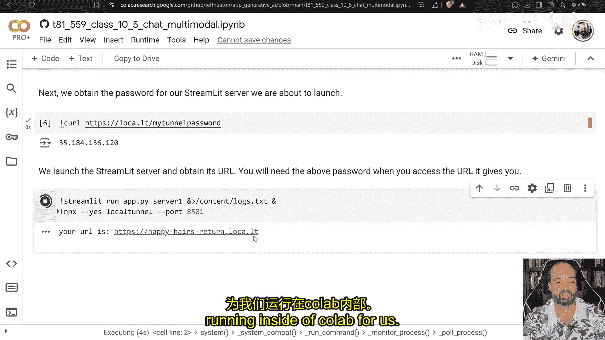
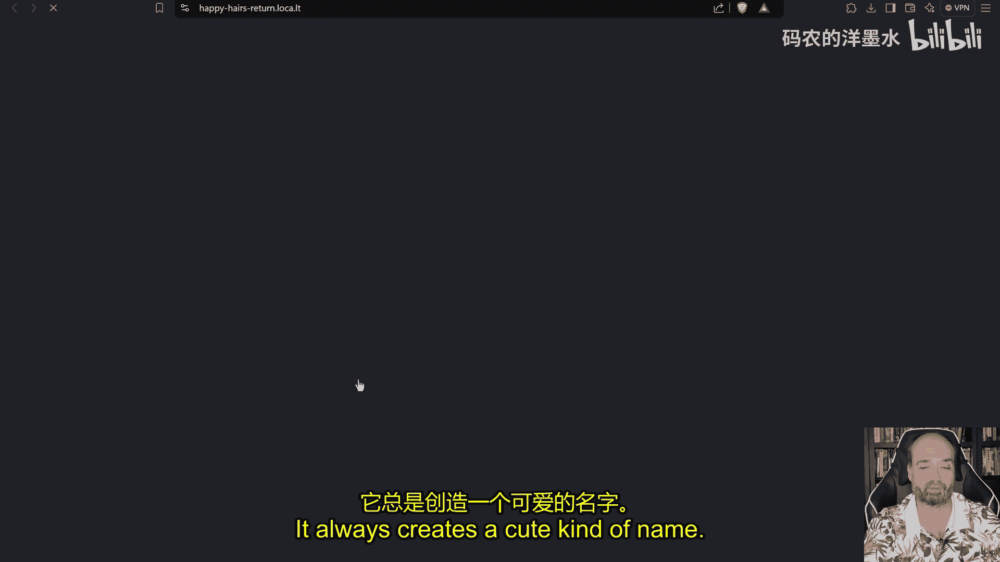
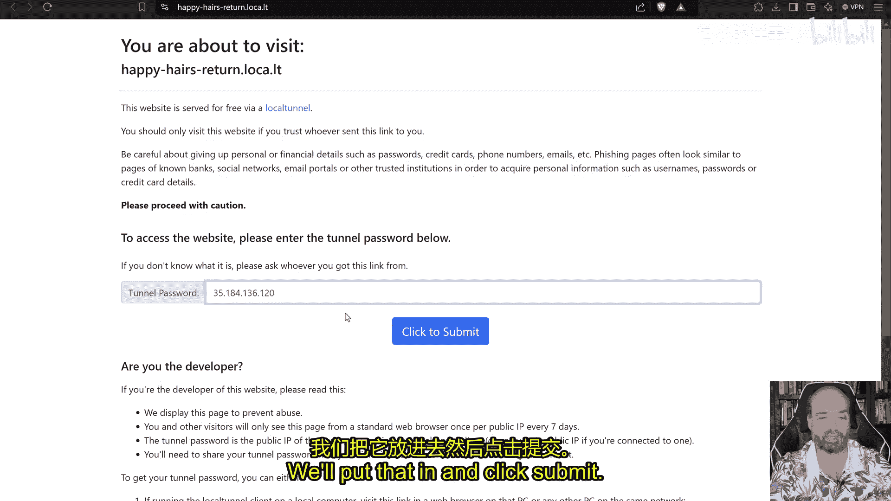
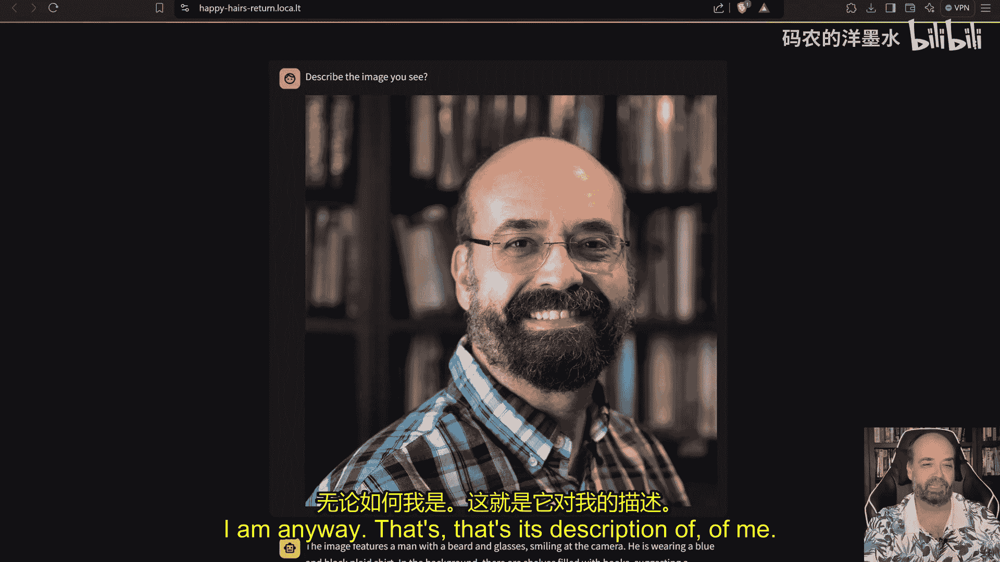
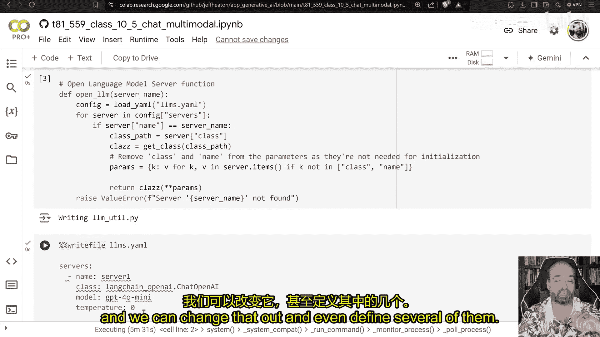

# 046：StreamLit中的多模态大语言模型聊天应用 🚀

## 概述
在本节课中，我们将学习如何使用StreamLit框架构建一个支持多模态输入（文本和图像）的大语言模型聊天应用。我们将创建一个类似聊天界面的应用，用户可以与AI进行对话，并上传图片让AI进行描述。

---

## 构建多模态聊天机器人

上一节我们介绍了StreamLit的基础知识，本节中我们来看看如何构建一个完整的、支持多模态输入的聊天应用。

首先，我们将运行一个示例应用。这个应用会创建一个名为 `app.py` 的文件。我们将通过一个隧道访问在Colab中运行的服务器。如果你想了解具体如何设置，可以参考之前的教程。

我们使用一个LLM工具类来连接不同的聊天服务器。需要注意的是，并非所有聊天服务器都支持多模态功能。

以下是配置多模态聊天应用的核心步骤：

1.  获取访问密码。
2.  运行代码启动服务器并打开隧道，以便我们能访问在Colab中运行的虚拟机。

应用启动后，界面会与之前的纯文本聊天应用有所不同。现在，界面上多了一个文件上传区域。

---

## 应用功能演示

我们可以像普通聊天一样输入文本，例如“你好”，AI会给出一个非常机械化的回答。

接下来，我们测试多模态功能。点击“浏览文件”按钮，上传一张图片。然后输入指令“描述这张图片”，并点击发送。

AI会分析图片并生成描述。例如，对于一张人物照片，它可能会描述人物的外貌特征（如胡子、眼镜、笑容）、衣着以及背景环境（如书架），并尝试解读场景的氛围。

---

## 代码实现解析

现在，我们来看看实现这个应用的代码逻辑。这是基于StreamLit框架的，需要理解其运行机制：代码会执行多次。首次执行时，它绘制初始界面状态。当用户点击按钮发送消息后，代码会再次执行。

为了在多次执行间保留聊天历史记录，我们需要使用状态管理。如果不这样做，每次发送新消息时，应用都会重置，无法看到之前的对话历史。

以下是实现的核心步骤：

1.  **初始化聊天连接**：根据配置文件（例如 `server1`）初始化与特定AI服务提供商（如OpenAI）的连接。
2.  **显示历史消息**：从StreamLit的会话状态中读取并显示已有的聊天记录。
3.  **创建输入表单**：创建一个包含文本输入框和文件上传组件的表单，以及一个提交按钮。
4.  **处理用户提交**：当用户点击提交按钮后：
    *   将用户输入的文本添加到聊天历史中。
    *   如果上传了文件，则按照OpenAI等多模态模型要求的格式，将文件内容作为对话的一部分添加进去。
    *   调用大语言模型获取响应。
    *   将AI助手的响应添加到聊天历史中。
    *   将最新的AI响应以Markdown格式渲染显示在输入区域下方的面板中。

我们使用的大语言模型工具类（`large language model utility`）会读取配置文件，并根据配置动态实例化相应的模型类。这样做的好处是，所有模型特定的信息都放在配置文件中，我们可以轻松切换不同的模型或配置多个模型，而无需修改主程序代码。

---

## 总结
本节课中我们一起学习了如何使用StreamLit构建一个支持文本和图像输入的多模态聊天应用。我们了解了应用的工作流程，包括状态管理、处理用户输入、调用多模态大语言模型以及展示交互结果。通过将模型配置与主程序代码分离，我们能够灵活地管理和切换不同的AI服务。