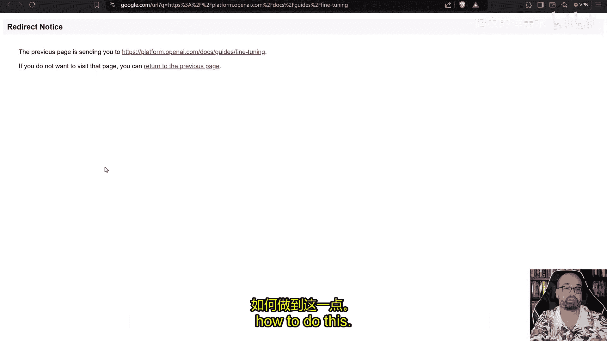
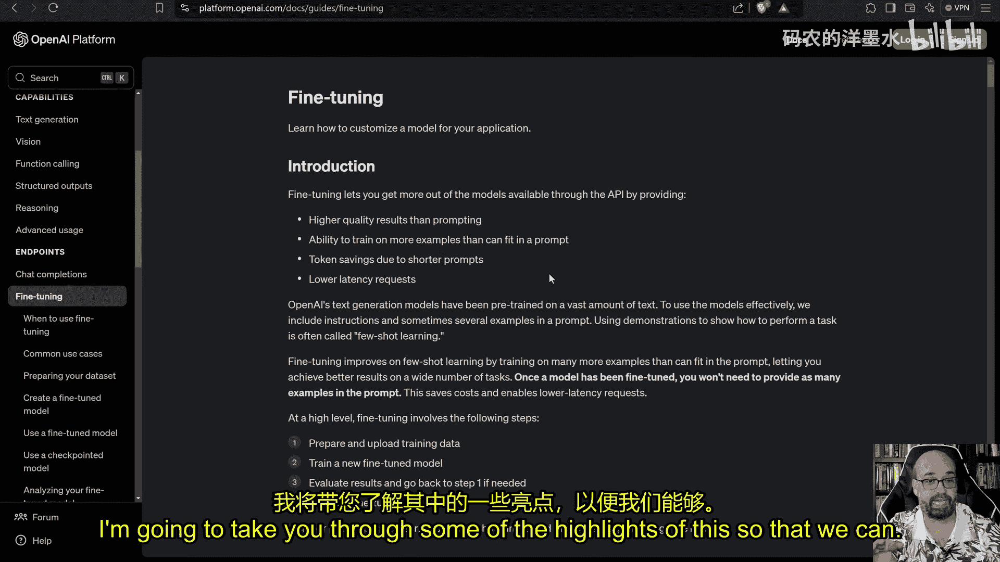
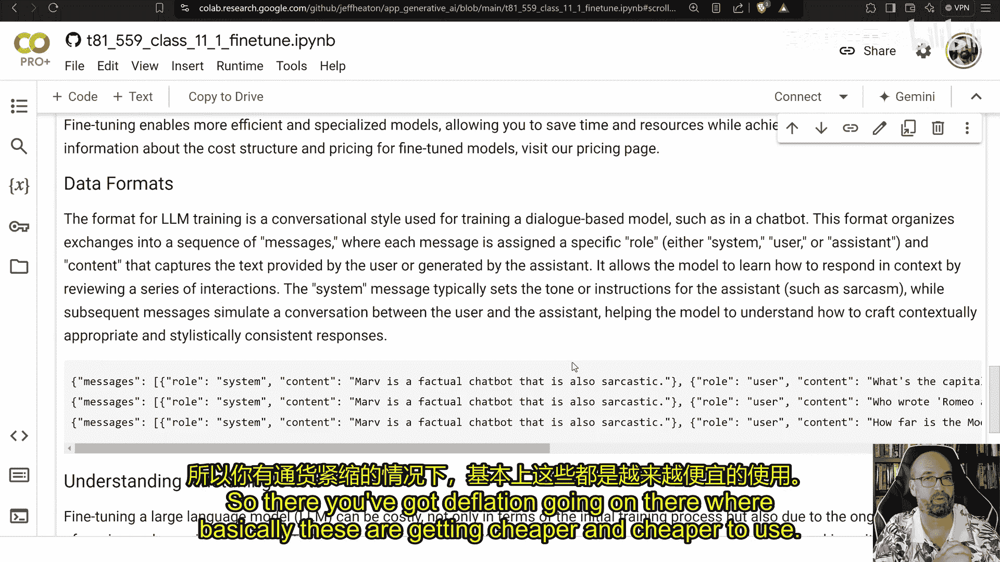

# 047：何时需要微调 🎯

在本节课中，我们将学习什么是微调，以及何时应该考虑使用微调来改进你的生成式AI模型。我们将探讨微调的基本概念、成本考量、适用场景以及其与提示工程的区别。

---

上一节我们介绍了提示工程和检索增强生成等技术。本节中，我们来看看另一种更强大的模型定制方法：微调。



微调是一种可以实际更新你所使用的基础模型的方法。与之前讨论的技术不同，微调会改变基础模型本身。你基于原始的基础模型，创建一个专属于你的新模型，并将在后续应用中使用它。



与检索增强生成相比，微调的前期成本更高。检索增强生成是将相关知识加载到提示词中，通过搜索知识库并选取与提示相关的片段来工作。其问题在于提示词会变得非常庞大，并且每次推理都基于这个庞大的提示进行构建。

而微调则需要预先支付训练成本。根据训练数据量的不同，这笔费用可能相当昂贵。但微调的优势在于，完成训练后，你的提示词可以变得非常简短，甚至可能不再需要使用检索增强生成技术。你只需将所有可用数据用于训练模型，并为此生成相应的训练提示。我们稍后会看到，这是微调的一个关键方面：你需要使用工具将大段文本转化为训练提示，或者精心设计这些用于训练的提示。

以下是微调的一些核心优势和应用场景：

*   **风格与语气**：微调可以彻底改变大语言模型的“语调”。例如，OpenAI的示例展示了如何将模型训练得具有讽刺性。当被问及“法国的首都是哪里？”时，模型可能回答“巴黎，这谁不知道啊？”，从而完全改变了输出风格。
*   **结构化输出**：如果你希望模型输出非常特定的结构（不仅仅是JSON，而是特定格式的JSON），微调对此非常有效。
*   **工具调用与函数调用**：如果你希望模型以特定方式调用某些工具或Python函数，也可以通过微调将其能力内化到模型中，使其更有效地调用函数来增强其功能。

考虑微调的成本至关重要，主要涉及两方面：
1.  **训练成本**：在云端运行所有训练迭代的费用。由于像GPT-4这样的模型权重是闭源的，你无法下载并在本地训练，所有训练都发生在云端。
2.  **推理成本**：当你向微调后的模型发送提示并获取响应时，产生的费用。这比使用标准基础模型更昂贵，因为服务商需要在内存中维护你的专属权重来处理推理请求。

目前，OpenAI对于存储你训练好的模型权重本身并不收费。但训练和使用（推理）都需要付费。

微调本质上是一种监督训练。你需要为模型提供输入提示和期望的输出提示对。

以下是一个训练数据格式的示例（JSONL文件）：

```json
{"messages": [{"role": "system", "content": "Marv is a factual chatbot that is also sarcastic."}, {"role": "user", "content": "What's the capital of France?"}, {"role": "assistant", "content": "Paris, as if everyone doesn't know that already."}]}
{"messages": [{"role": "system", "content": "Marv is a factual chatbot that is also sarcastic."}, {"role": "user", "content": "Who wrote Romeo and Juliet?"}, {"role": "assistant", "content": "Oh, just some guy named William Shakespeare. Ever heard of him?"}]}
{"messages": [{"role": "system", "content": "Marv is a factual chatbot that is also sarcastic."}, {"role": "user", "content": "How far is the moon from Earth?"}, {"role": "assistant", "content": "Around 384,400 km. Give or take a few, like it really matters."}]}
```

> **注意**：系统提示的设置应与你训练数据中的设定保持一致，否则模型可能接收到矛盾的信息，影响效果。

---



本节课中我们一起学习了微调的核心概念。我们了解到，微调通过直接更新模型权重来获得比简单提示更高质量、更定制化的结果，尤其适用于改变模型风格、确保特定输出格式或优化工具调用。同时，我们也必须权衡其较高的前期训练成本和后续推理成本。

在接下来的课程中，我们将通过OpenAI平台的控制台实际操作微调，之后还会学习如何通过代码来实现这一过程。