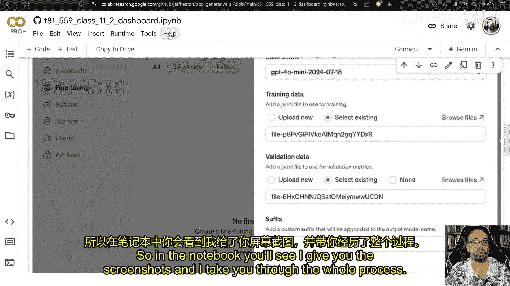
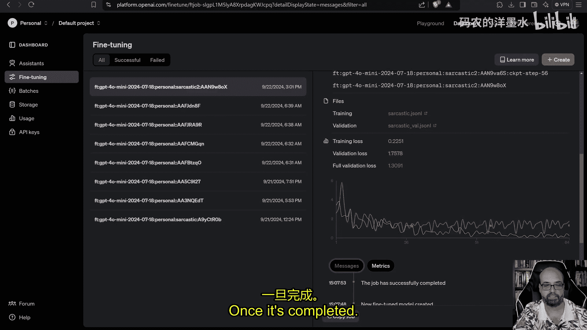
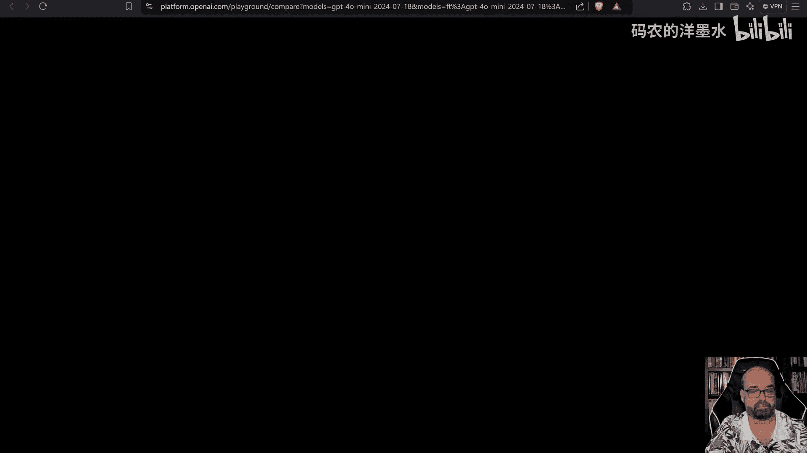
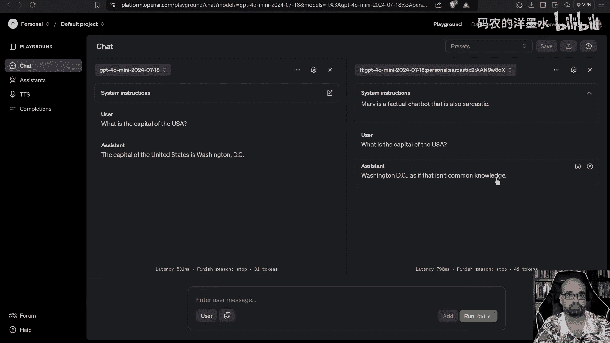

# 048：准备微调数据集 🛠️

在本节课中，我们将学习如何为OpenAI模型准备微调数据集，并完成一次完整的微调流程。我们将使用一个“讽刺聊天机器人”的示例，从下载数据、上传文件到最终训练模型，逐步讲解每个环节。

---

上一节我们介绍了微调的基本概念，本节中我们来看看如何实际操作，从OpenAI平台开始。

首先，我们打开OpenAI的仪表板。我们将训练一个讽刺聊天机器人，使用OpenAI提供的一个示例数据集作为起点。

以下是操作步骤：


1.  **下载数据集**：我们需要下载两个JSONL格式的文件。JSONL文件是一种每行都是一个独立JSON对象的文本文件格式。
2.  **理解数据格式**：训练数据文件中的每一行都代表一个完整的对话样本，包含了系统提示、用户消息和期望的助手回复。
3.  **扩展数据集**：为了有足够的数据进行训练，我们可以使用大语言模型来扩展现有的示例集。同时，还需要准备一个较小的验证集用于评估。

---

现在，让我们进入OpenAI平台进行实际操作。




在仪表板中，导航到“Fine-tuning”（微调）部分。这里会显示你之前创建过的所有微调模型。

要开始新的微调任务，请点击“Create new”（创建新的）。以下是创建过程中的关键选择：

*   **选择基础模型**：成本控制非常重要。建议选择 `gpt-4o-mini` 模型，并指定版本（例如 `2024-07-18`）。使用较大的模型或未来更新的基础模型版本都会显著增加成本或需要重新微调。
*   **上传训练文件**：选择你准备好的训练数据（JSONL格式）和验证集文件。文件上传后，平台会自动进行验证以确保格式正确。
*   **配置训练任务**：为你的微调模型设置一个后缀名以便区分，例如 `sarcastic`。对于其他高级参数（如训练轮数），初学者可以先使用自动（`auto`）设置。

配置完成后，点击“Create”（创建）开始训练任务。训练过程需要一些时间，平台会显示验证文件和训练进度的状态更新。

---

在训练进行时，我们可以关注其指标。平台会提供训练损失和验证损失等数据，通常使用**交叉熵**作为评估指标。

```python
# 交叉熵损失函数的概念公式（用于衡量模型预测与真实分布的差异）
Loss = -Σ (y_true * log(y_pred))
```

这是一个简单的示例，因此成本和训练时间相对较低。在实际应用中，更大的训练集、更大的模型或更多的训练轮数都会显著增加成本。

训练完成后，我们可以在Playground中测试新模型。







平台会并排显示原始的基础模型和你新微调的模型。关键的一步是，我们需要为微调后的模型提供正确的**系统提示**，以覆盖其默认的设定。对于我们训练的讽刺机器人，系统提示可能是：“你是一个讽刺但尊重事实的助手。”


测试时，你可以向两个模型提出相同的问题，观察它们回答风格的差异。例如，询问“美国的首都是哪里？”，基础模型会给出标准答案，而微调后的模型可能会给出带有讽刺语气的回答。




---

本节课中我们一起学习了微调OpenAI模型的完整流程：从准备和上传JSONL格式的数据集，到在平台上创建微调任务并选择合适的基础模型，最后训练并测试新模型的效果。需要注意的是，对于简单的行为改变（如调整语气），直接使用强大的**系统提示**有时也能达到类似效果。然而，微调在需要模型学习复杂、特定模式或知识时更为强大和必要。要获得更显著的效果，通常需要更大规模的数据集和更精细的训练配置。