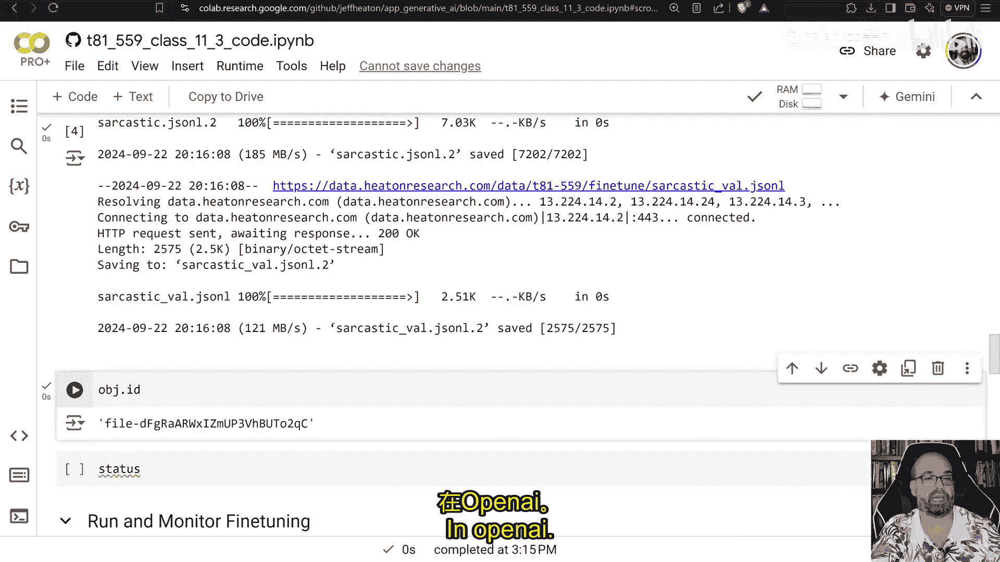
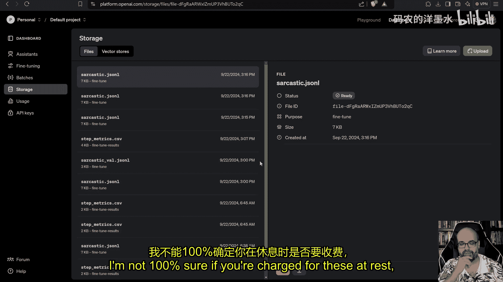
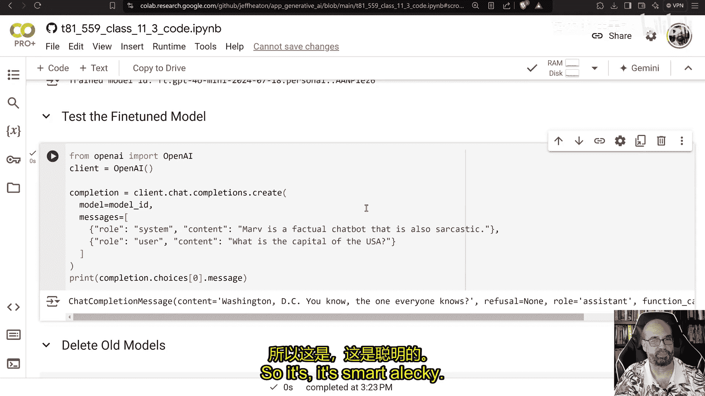

# 049：OpenAI微调

## 概述
在本节课中，我们将学习如何通过代码（而非控制台）来微调一个OpenAI模型，例如GPT-4。我们将一步步演示如何准备数据、启动训练任务、监控进度，并最终测试和使用微调后的模型。

## 准备工作
上一节我们介绍了微调的基本概念，本节中我们来看看具体的代码实现。首先，你需要确保在运行环境中正确设置了OpenAI的API密钥。

```python
# 假设你的API密钥已安全地存储在环境变量中
import openai
openai.api_key = '你的API密钥'
```

运行上述代码将加载必要的库并验证你的访问权限。这个过程可能需要一些时间来完成依赖项的安装。

## 加载训练数据
以下是准备训练数据所需的步骤。



我们需要两个数据文件。在本示例中，我们已经提前下载好了这些文件，因此可以直接从云端加载。请注意，我们主要使用`sarcastic`数据集，虽然也可以（并且可能应该）使用验证集，但本教程中暂不涉及。

```python
# 加载数据到OpenAI
training_file = openai.File.create(
  file=open("sarcastic.jsonl", "rb"),
  purpose='fine-tune'
)
print(training_file.id)
```



这段代码会将你的数据文件上传至OpenAI服务器，并返回一个文件对象ID。你可以打印这个ID以便后续引用。上传后，你可以在OpenAI平台的“存储”部分看到这些文件。

## 启动微调任务
现在，我们将启动实际的模型微调过程。

我们将使用一个自定义方法来启动训练任务。你需要传入上一步获得的文件对象ID。运行此代码将开始训练，这可能需要一些时间。

```python
def start_fine_tuning(training_file_id, model="gpt-4"):
    # 创建微调任务
    fine_tune_job = openai.FineTune.create(
        training_file=training_file_id,
        model=model
    )
    return fine_tune_job
```

在任务运行期间，我们将监控其状态。我们将事件轮询间隔设置为20秒，以避免频繁请求。以下是监控逻辑的核心部分：

```python
import time

event_ids = set()
job_status = "running"

while job_status == "running":
    # 获取当前任务状态
    status = openai.FineTune.retrieve(fine_tune_job.id)
    job_status = status.status

    # 获取并处理事件列表
    events = openai.FineTune.list_events(id=fine_tune_job.id)
    for event in events:
        if event.id not in event_ids:
            print(f"[{event.created_at}] {event.message}")
            event_ids.add(event.id)

    if job_status == "succeeded":
        print("训练成功完成！")
        break
    elif job_status == "failed":
        print("训练失败。")
        break
    else:
        print("等待训练更新...")
        time.sleep(20)
```

在训练过程中，你会在输出中看到带有时间戳的事件更新，例如步骤进度（如“1 of 84”）。同时，你也可以在OpenAI的用户界面（platform.openai.com）中实时查看任务的进展。

## 测试微调后的模型
训练成功完成后，我们就可以测试新模型了。

训练完成后，我们会获得一个唯一的模型ID。我们可以使用这个ID来调用微调后的模型。

```python
# 使用微调后的模型进行推理
response = openai.Completion.create(
    model="你的微调模型ID",
    prompt="美国的首都是哪里？",
    max_tokens=50
)
print(response.choices[0].text.strip())
```

例如，对于问题“美国的首都是哪里？”，模型应该会回答“华盛顿特区”。

## 模型管理
最后，我们来了解一下如何管理已创建的模型。



如果你希望删除不再需要的微调模型以保持界面整洁，可以使用删除操作。

```python
# 删除微调模型
openai.Model.delete("你的微调模型ID")
```

需要注意的是，即使通过API删除了模型，它可能仍会短暂地显示在用户界面中。目前OpenAI并未对存储这些模型元数据收费，但未来的政策可能会发生变化。

## 总结
本节课中我们一起学习了如何使用OpenAI API通过代码完整地微调一个模型。我们涵盖了从设置环境、上传数据、启动并监控训练任务，到测试最终模型和进行基本管理的全过程。掌握这些步骤后，你就可以根据自己的数据集定制化大型语言模型了。