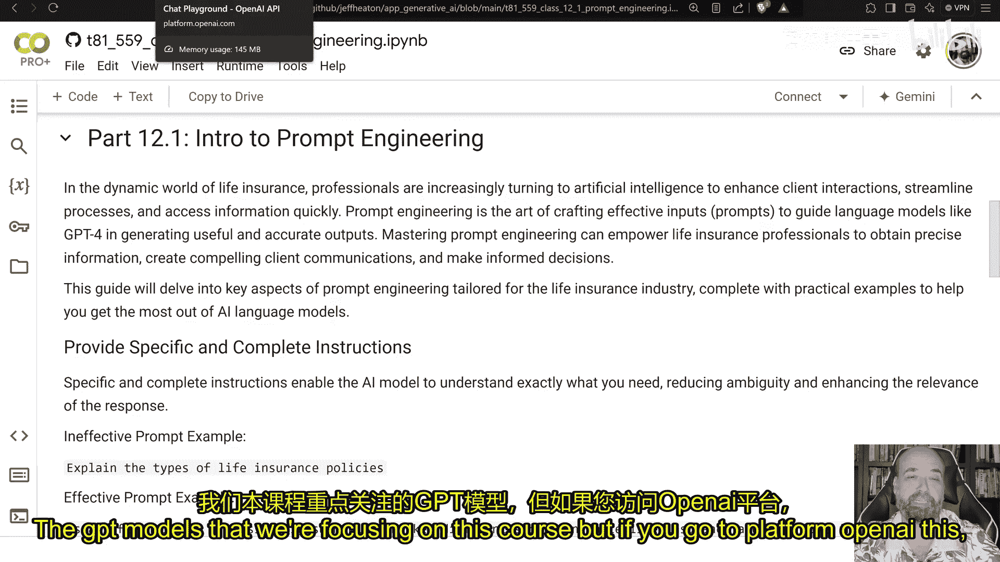
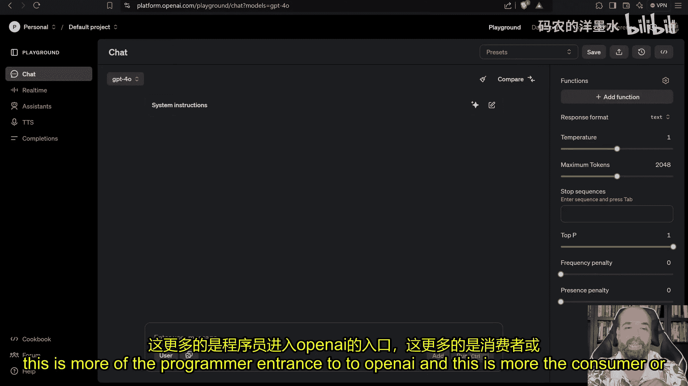
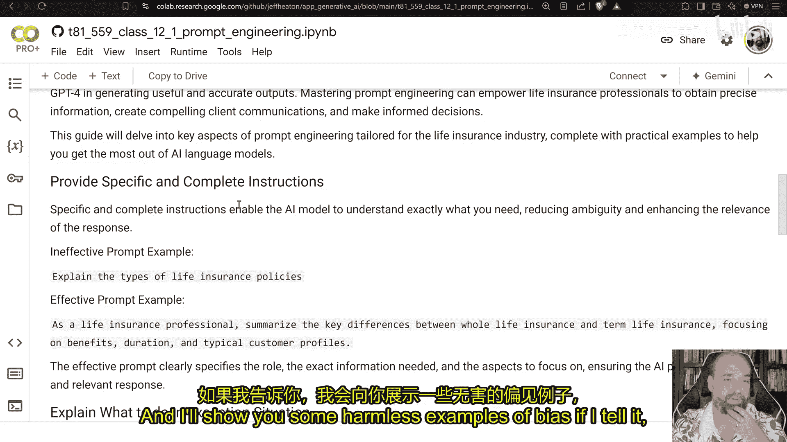
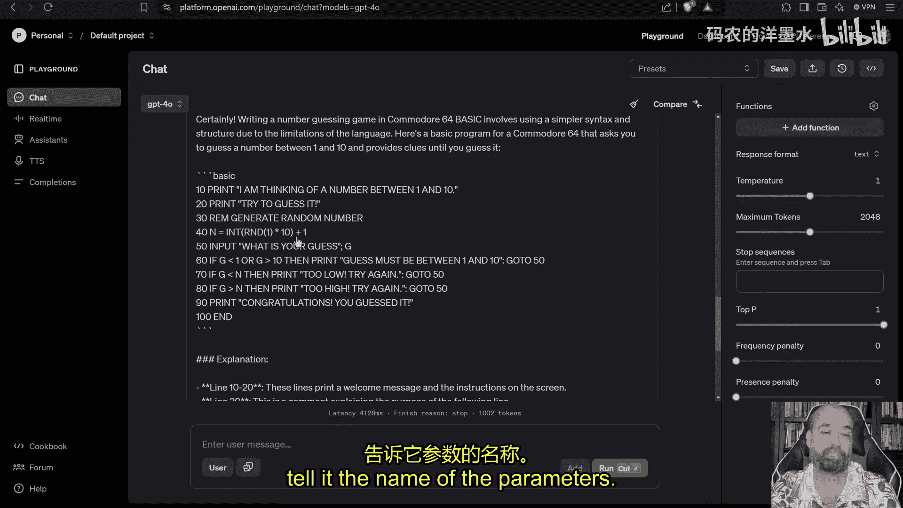
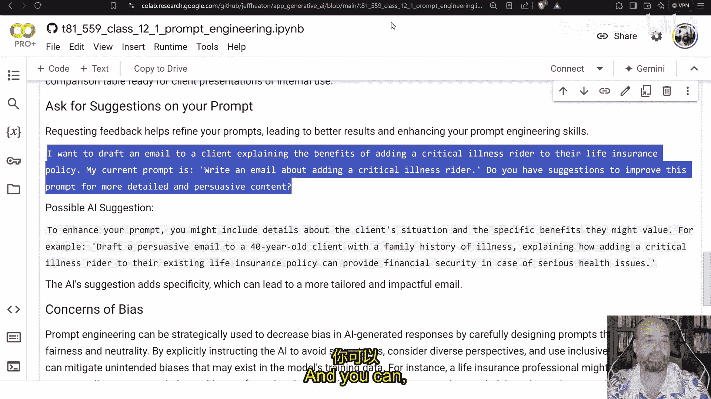
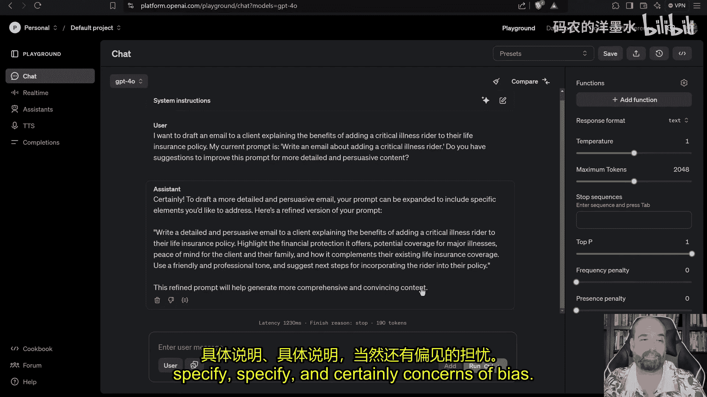
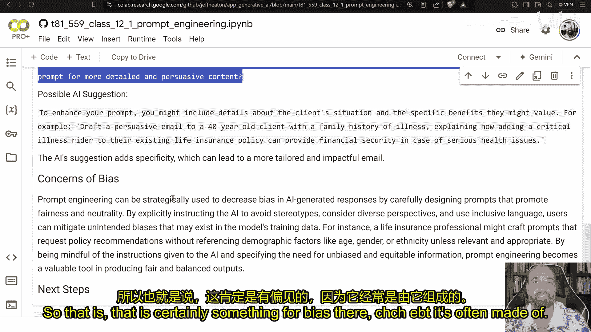

# 051：提示词工程入门 🧠

在本节课中，我们将要学习提示词工程的基础知识。提示词工程是生成式人工智能领域中一个非常重要的主题，它关乎如何构建最有效的指令，以引导大型语言模型生成我们期望的输出。这是一个迭代的过程，我们将从基础概念开始，逐步深入。

## 概述

提示词工程的核心是精心设计输入给AI模型的指令或问题。通过优化提示词，我们可以显著提升模型输出的质量和相关性。本模块将不涉及具体代码，而是专注于概念和模式。为了实践所学内容，建议使用如OpenAI的Playground等交互平台，直接体验不同提示词的效果。

## 创建有效提示词的建议

以下是构建有效提示词的一些具体建议。遵循这些原则可以帮助你获得更准确、更符合预期的结果。

1.  **提供具体且完整的信息**
    如果给出的信息不够完整，模型的固有偏见可能会显现出来。例如，如果只要求“写一个猜数字的程序”，模型可能会默认使用Python编写。但如果你指定“用Commodore 64 BASIC语言编写”，它就能生成符合要求的代码。在代码生成任务中，务必明确函数名、参数名等细节。

2.  **明确异常情况的处理方式**
    当要求模型从数据中提取信息时，必须说明在找不到目标信息时应如何处理。否则，模型可能会进行“幻觉”式猜测，编造出看似合理但错误的内容。例如，可以指示：“如果当前数据不可用，请提供最新的统计数据。”

3.  **向模型寻求优化建议**
    你可以直接要求模型对你的提示词提出改进建议。例如，在提示词末尾加上“你对我完善这个提示词有什么建议吗？”。这能帮助你获得更全面、更具说服力的指令。

4.  **注意总结任务中的偏见**
    当要求模型总结大段文本时，模型需要判断哪些信息重要、哪些可以舍弃。这个过程本身就带有主观性，可能引入偏见。因此，在涉及总结时需保持警惕。

5.  **通过具体描述规避生成偏见**
    在图像生成或描述性任务中，模型的输出可能反映其训练数据中的常见模式（即偏见）。例如，要求生成“医生的方形图片”可能默认产生特定种族或性别的形象。要避免这一点，必须具体指定细节，如“一位中年印度裔女医生的方形图片”。

## 总结

本节课我们一起学习了提示词工程的基本概念和核心建议。我们了解到，提供具体、完整的指令，明确异常处理，并主动规避潜在偏见，是构建有效提示词的关键。在接下来的章节中，我们将深入探讨提示词的具体模式，例如“少样本学习”和“思维链”等重要技术。

感谢观看，请订阅频道以获取本课程及其他人工智能项目的最新内容。