# 052：少样本学习与思维链 🧠

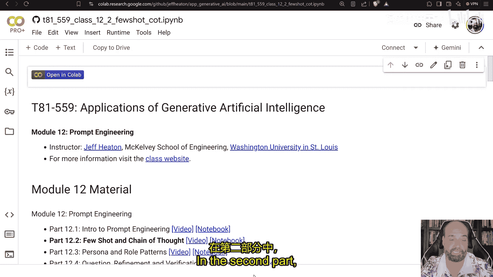

在本节课中，我们将继续探讨提示工程，重点介绍两种强大且常用的模式：少样本学习与思维链。我们将通过具体示例，学习如何通过提供少量例子来引导模型，以及如何通过要求模型分步解释其推理过程来提升其复杂任务的执行能力。

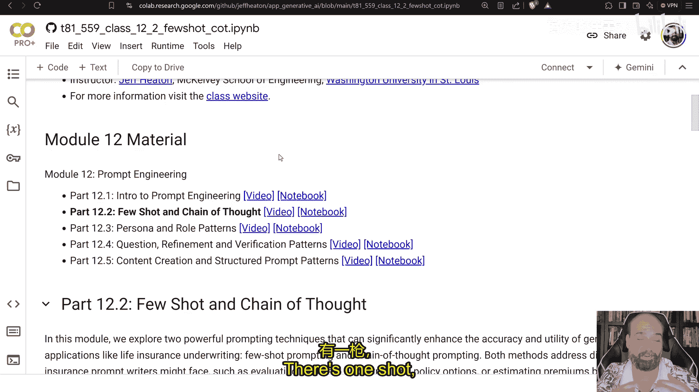

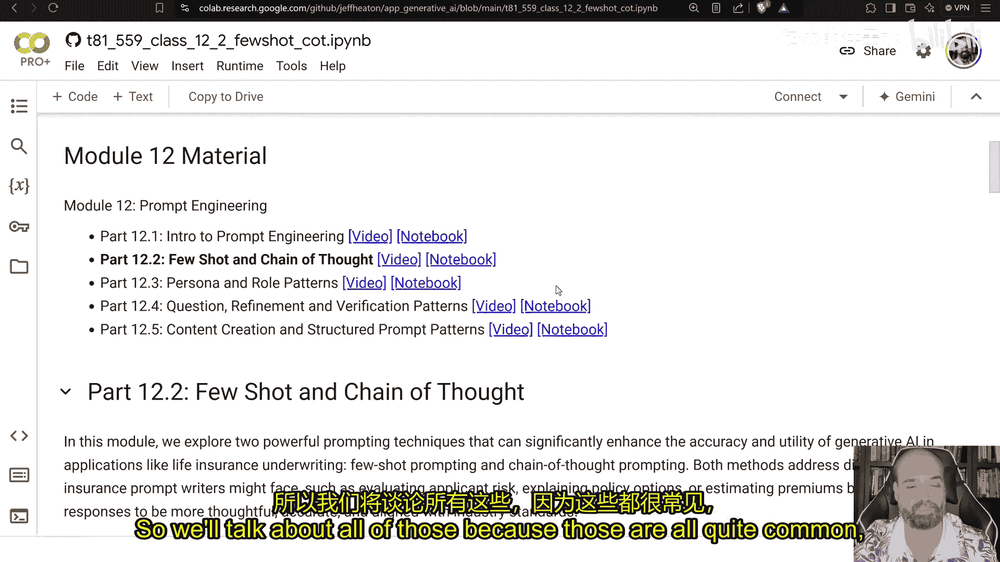

上一节我们介绍了提示工程的基本概念，本节中我们来看看两种具体的提示模式。

### 少样本学习 📝

少样本学习是指在提示中为模型提供几个示例，以指导其完成新任务。这里的“样本”即示例。根据提供的示例数量，可以分为：
*   **零样本**：不提供任何示例。
*   **单样本**：仅提供一个示例。
*   **少样本**：通常提供两到三个示例。

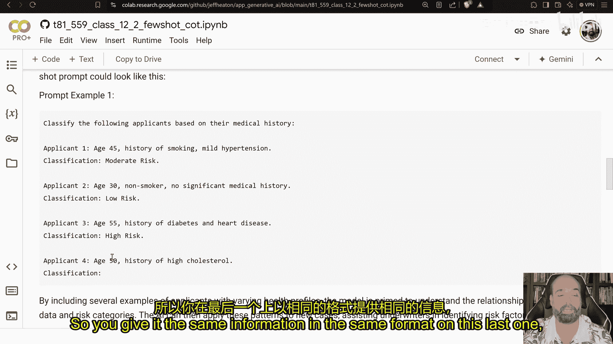

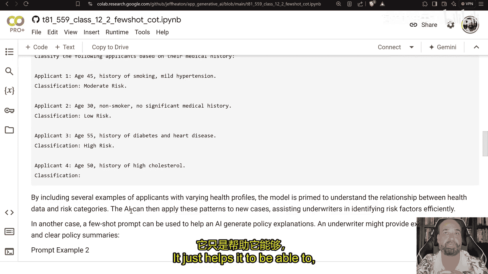

以下是少样本学习的几个应用实例：

**实例一：保险风险评估**
我们通过几个示例“训练”模型进行风险评估。
```
申请人1：年龄45岁，有吸烟史，轻度高血压。风险等级：中等。
申请人2：年龄30岁，不吸烟，无重大病史。风险等级：低。
申请人3：年龄55岁，有糖尿病和心脏病史。风险等级：高。
申请人4：年龄52岁，不吸烟，有心脏病家族史。风险等级：？
```
通过前三个示例，模型学习到评估模式，从而能对第四个申请人给出风险评估。

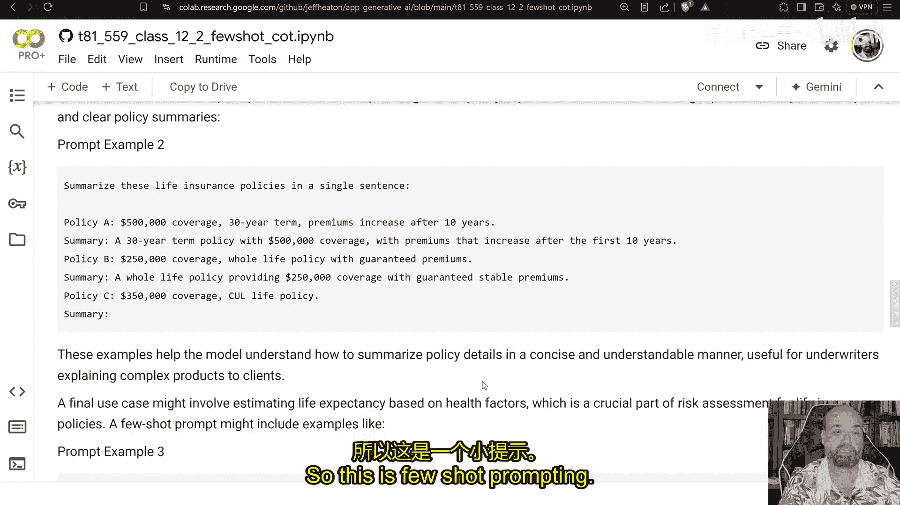

**实例二：保单摘要生成**
我们提供保单细节，并示范如何生成摘要。
```
保单A：面额100,000美元，期限20年，保费固定。摘要：这是一份高面额、长期限的固定保费保单。
保单B：面额50,000美元，期限10年，保费递增。摘要：这是一份中等面额、短期限的递增保费保单。
保单C：面额200,000美元，期限30年，保费可变。摘要：？
```
模型根据前两个示例的格式，为保单C生成相应的摘要。

**实例三：预测预期寿命**
我们提供几个人的健康信息及其预期寿命作为示例。
```
人物A：年龄40，不吸烟，血压正常。预期寿命：85岁。
人物B：年龄60，吸烟，有高血压。预期寿命：72岁。
人物C：年龄50，不吸烟，胆固醇偏高。预期寿命：？
```
模型基于给定的模式，对人物C的预期寿命进行估算。

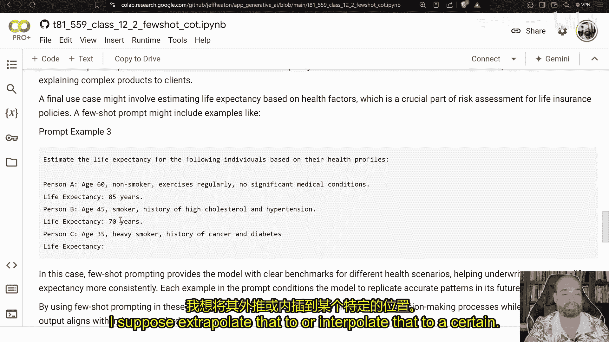

### 思维链 ⛓️

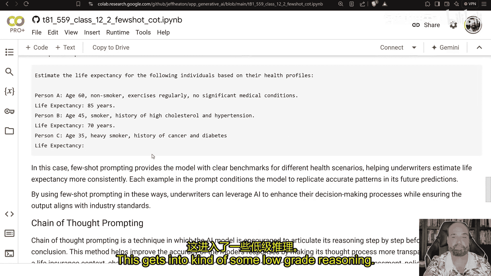

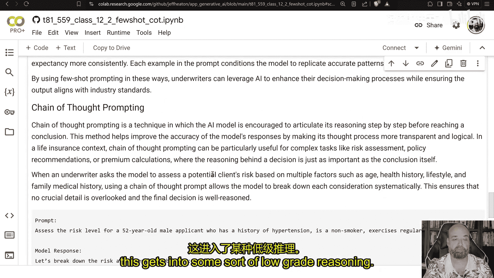

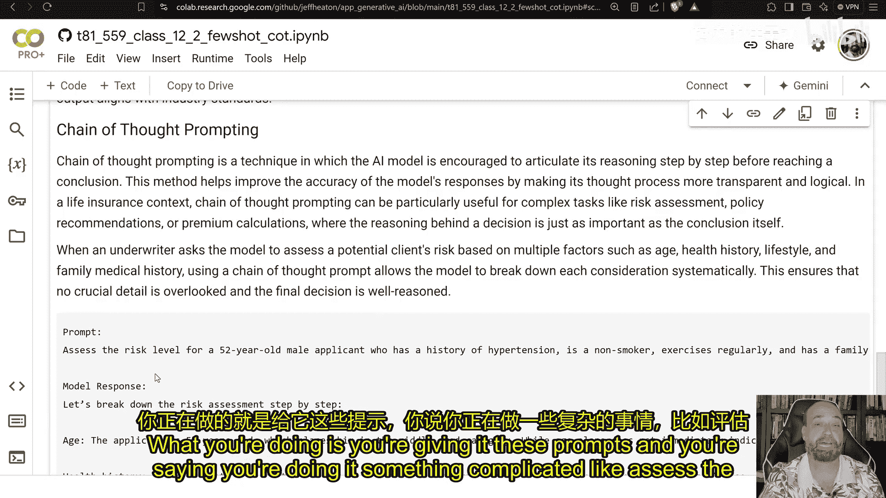

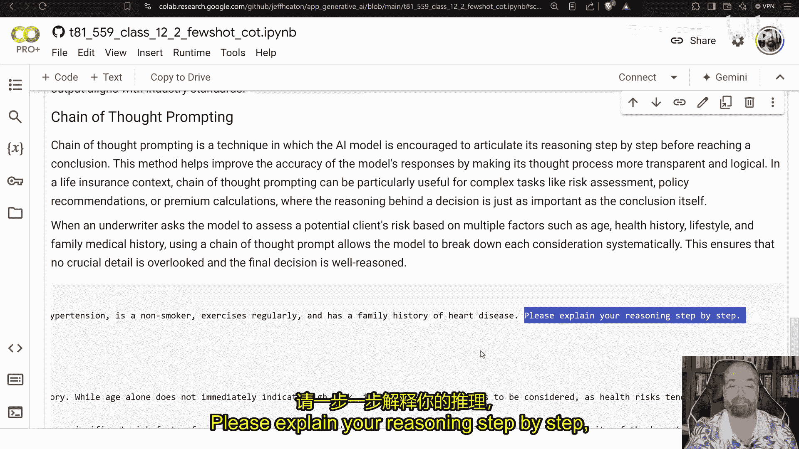

思维链模式涉及让模型进行一些低程度的推理。其核心是要求模型“分步解释你的推理过程”。这不仅让模型解释其答案，更促使它形成一个解决问题的分步计划。

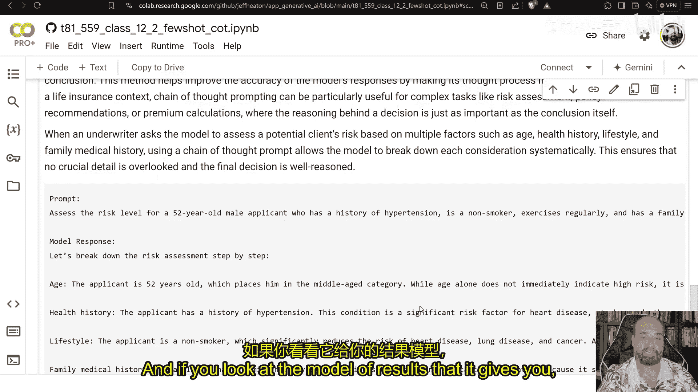

例如，在复杂的保险风险评估中，提示可以这样设计：
```
评估一位52岁、不吸烟、有心脏病家族史的申请人的风险。请分步解释你的推理过程。
```
模型可能会生成如下回复：
```
步骤1：识别关键风险因素：年龄（52岁）、吸烟状况（不吸烟）、家族史（心脏病）。
步骤2：评估每个因素：年龄超过50岁略微增加风险；不吸烟是积极因素；心脏病家族史是显著风险因素。
步骤3：综合权衡：积极因素（不吸烟）部分抵消了年龄和家族史带来的风险。
步骤4：得出结论：总体风险等级为中等偏高。
```
通过强制模型展示其思考步骤，可以提高其在复杂任务上的推理质量和准确性。一些先进的模型（如GPT-4）已内置类似机制，会尝试为任务制定计划并逐步执行。

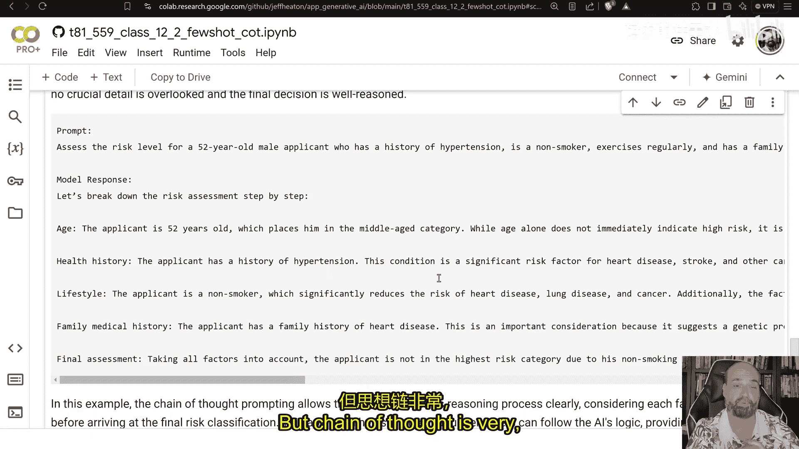

本节课中我们一起学习了提示工程中两种关键模式：少样本学习和思维链。少样本学习通过提供少量示例来引导模型；思维链则通过要求模型分步展示推理过程，来提升其处理复杂任务的能力。掌握这两种模式将帮助你更有效地与大语言模型进行交互。