# 053：角色与身份模式 🎭

在本节课中，我们将继续学习提示工程，重点探讨三种不同的提示模式。模式是构建提示的一种标准化方法，它们通常源于模型的训练方式或研究者的实践经验。我们将首先了解角色与身份模式，这类模式能引导AI扮演特定角色或面向特定受众进行回应。

## 概述

本节课我们将学习提示工程中的三种模式分类：**角色与身份模式**、**问题优化与验证模式**以及**内容创作与结构化提示模式**。首先，我们聚焦于最常用的角色与身份模式，它通过赋予AI特定角色或指定对话受众，来塑造其回应的风格与深度。

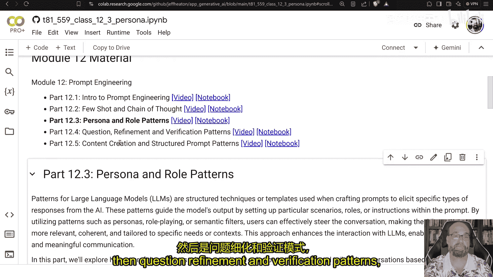

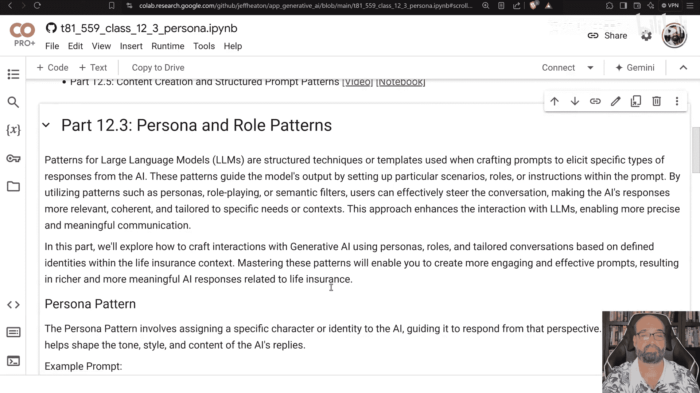

## 角色与身份模式

角色与身份模式可能是最流行的提示模式。你经常可以看到类似“你是一位经验丰富的人寿保险代理人”或“你是一个高级程序员”这样的提示。通过这种方式，AI会采纳你指定的身份进行回应。

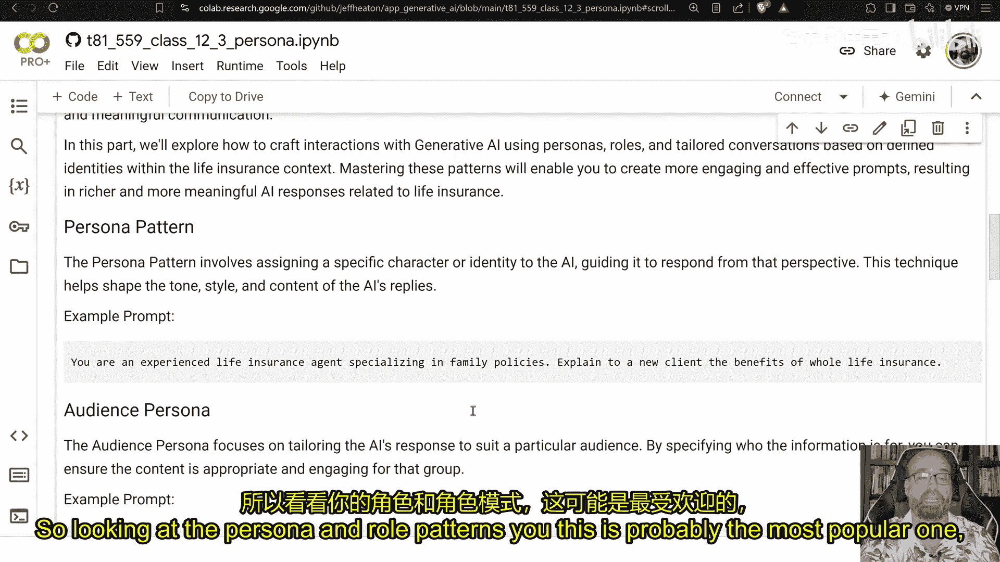

例如，你可以使用以下提示：
```
你是一位经验丰富的人寿保险代理人，请向一位新客户解释终身寿险保单的好处。
```

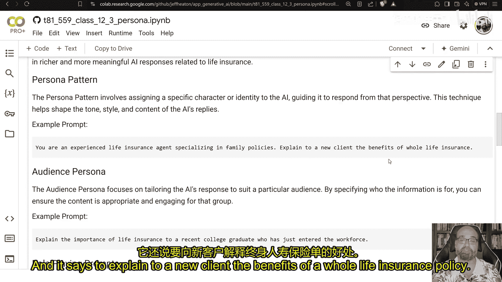

## 受众身份模式

受众身份模式非常实用，其经典表述是“像对五年级学生那样解释给我听”。通过指定受众，你可以让AI调整其解释的复杂程度。

例如：
```
请向一位刚毕业的大学生解释人寿保险的重要性。
```


你可以要求AI以博士生的水平进行解释，也可以要求它面向对技术一无所知的人进行说明，这提供了极大的灵活性。

## 角色扮演模式

我经常使用角色扮演模式。它对于练习辩论或完善文稿非常有帮助。在这种模式下，你让AI模拟特定场景中的一方。

例如：
```
你是一位对人寿保险感兴趣的客户。请发起与保险代理人的对话，表达你的担忧。
```
这种模式既可以用于保险代理人的练习，也可以帮助潜在客户做准备。

## 翻转互动模式

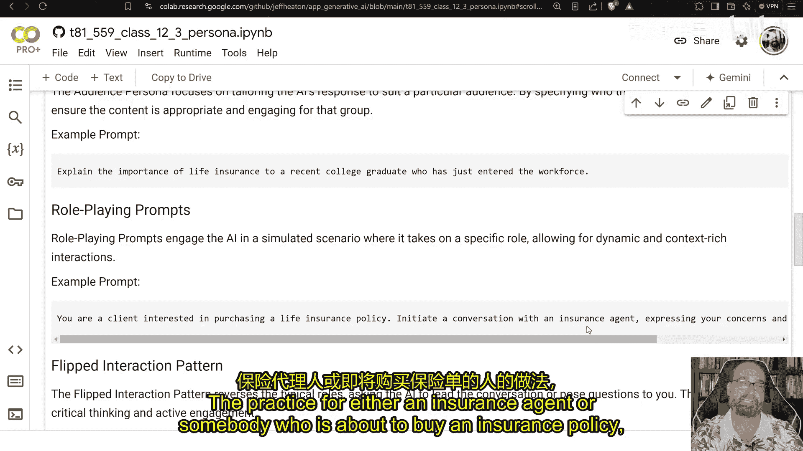

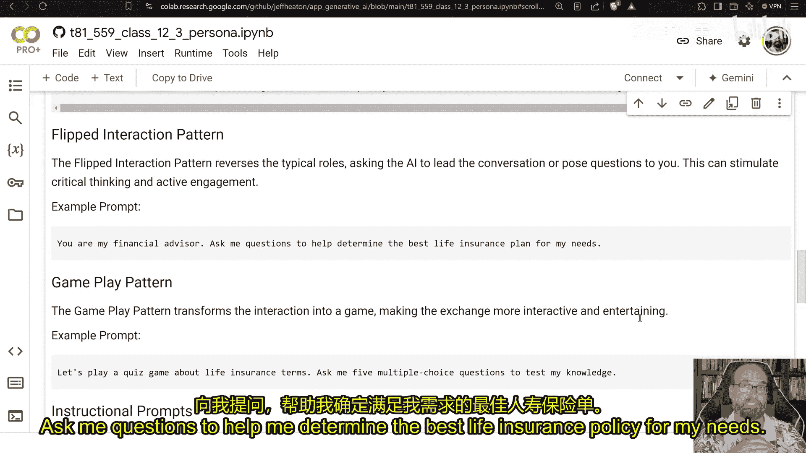

翻转互动模式我使用得不多，但它能改变互动的常规规则。你要求AI主导对话或提出问题，而通常AI是比较被动的，等待你的指令。

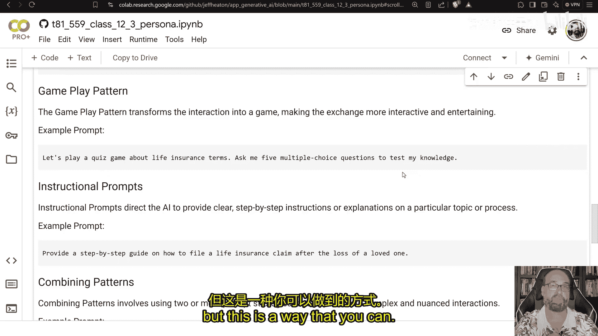

例如：
```
你是我的财务顾问。请通过提问来帮助我确定最适合我需求的人寿保险单。
```

## 游戏模式

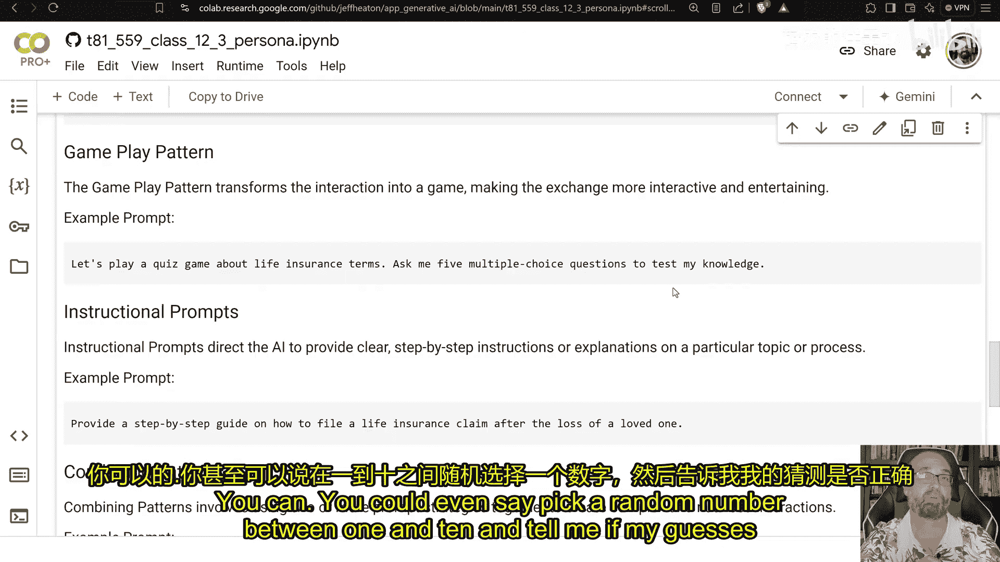

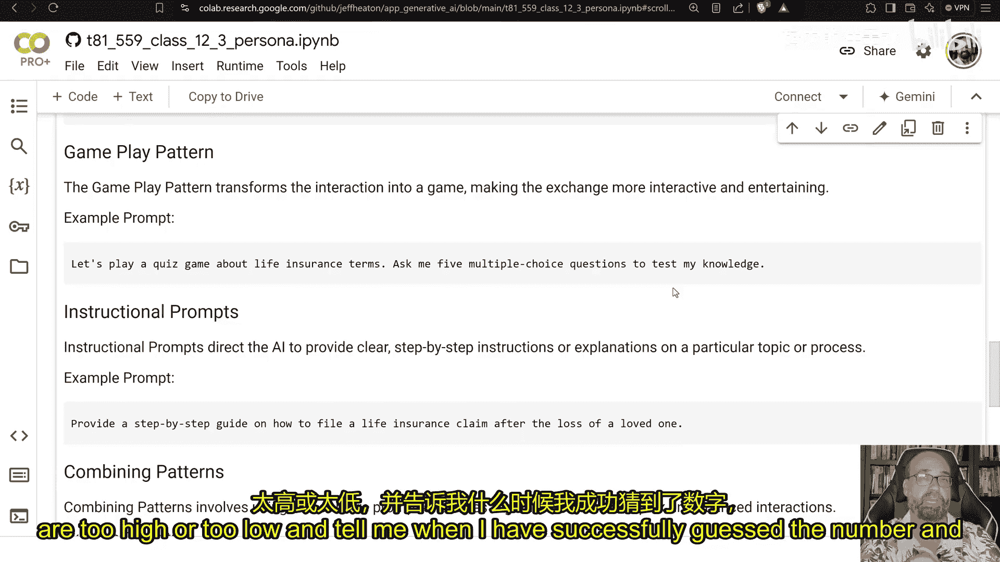

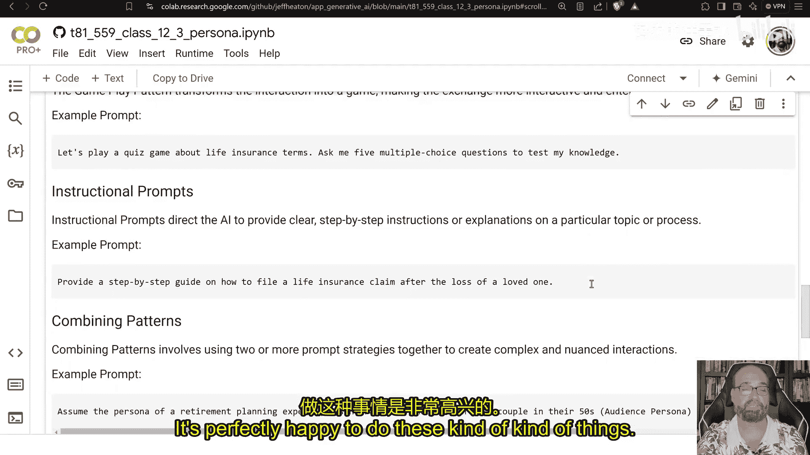

游戏模式让AI参与游戏互动。例如，你可以说：“让我们玩一个关于人寿保险的问答游戏。问我五个问题。”

AI在这种来回互动的游戏（比如“20个问题”猜谜游戏）中表现不一定总是最佳，但它完全能够胜任此类任务。你甚至可以说：
```
请随机选择一个1到10之间的数字，并在我猜测时告诉我猜高了还是猜低了，当我猜中时告诉我，然后开始新游戏。
```
AI很乐意进行这类互动。

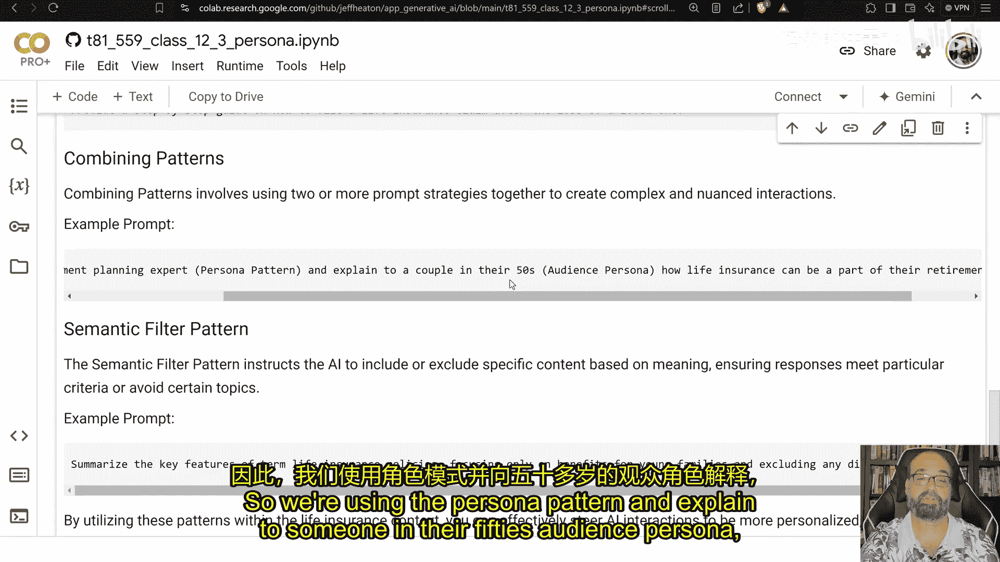

## 模式组合

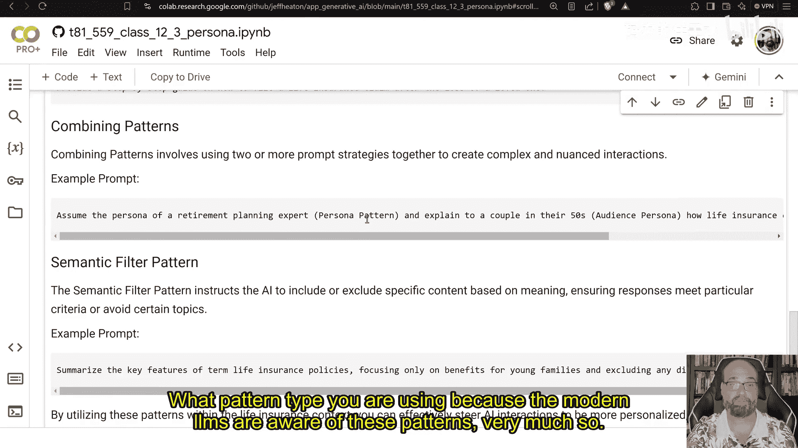

你当然可以组合使用多种模式。以下是一个结合了**角色模式**和**受众身份模式**的例子：
```
假设你是一位退休规划专家（角色模式），请向一位50多岁的人（受众身份模式）解释延迟退休对社保福利的影响。
```
通常，你可以直接告诉AI你正在使用哪种模式，因为现代的大语言模型对这些模式非常了解。

## 语义过滤模式

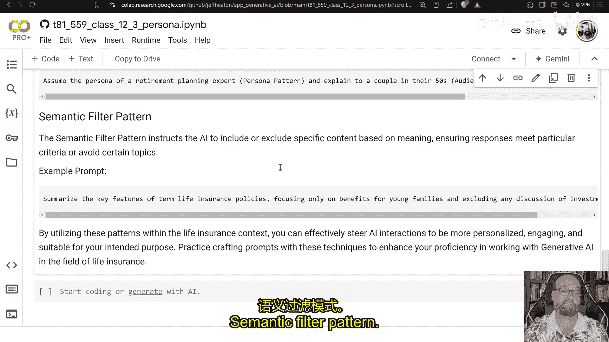

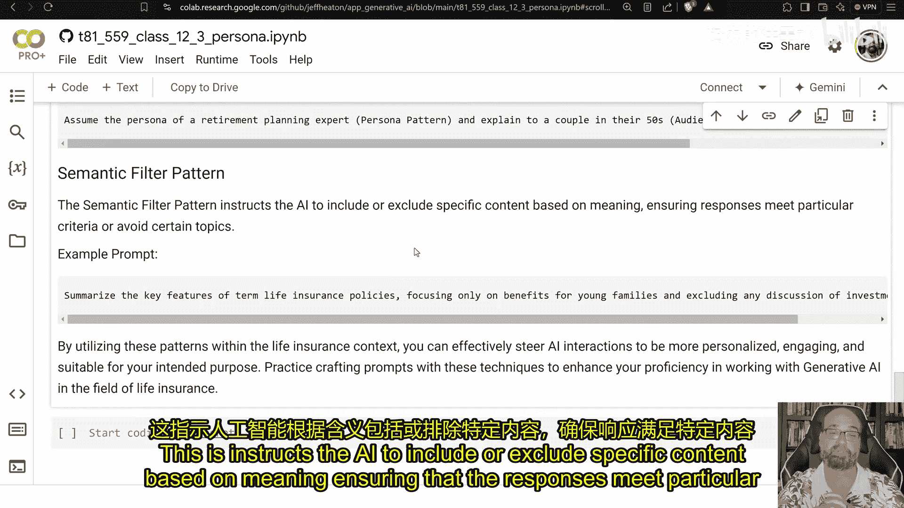

语义过滤模式指示AI根据含义包含或排除特定内容，确保回应符合特定标准。

例如：
```
总结定期人寿保险单的关键特点，但避免讨论投资回报，重点阐述承保范围和保费。
```
通过这种模式，你可以非常具体地告诉AI要避免讨论哪些话题，要重点谈论哪些话题。虽然我（在意识层面）不常使用这种模式，但它在某些场景下非常有用，例如要求AI“不要谈论政治”。

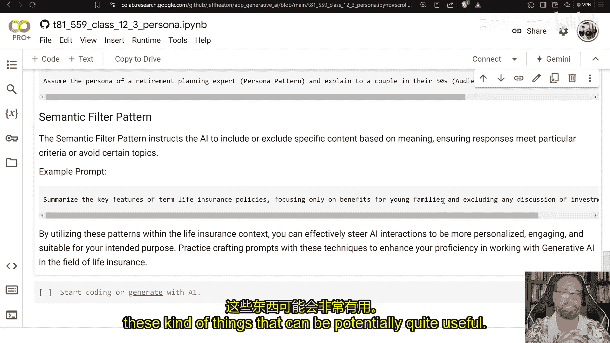

## 总结

本节课我们一起学习了提示工程中的**角色与身份模式**。我们探讨了如何通过赋予AI特定**角色**（如专家、客户）或指定**受众**来塑造其回应。我们还了解了**角色扮演**、**翻转互动**、**游戏模式**以及如何**组合多种模式**来获得更精准的回应。最后，我们简要介绍了**语义过滤模式**，它可以帮助我们控制回应的内容范围。掌握这些模式能让你更有效地与AI进行交互，获得更符合需求的输出。