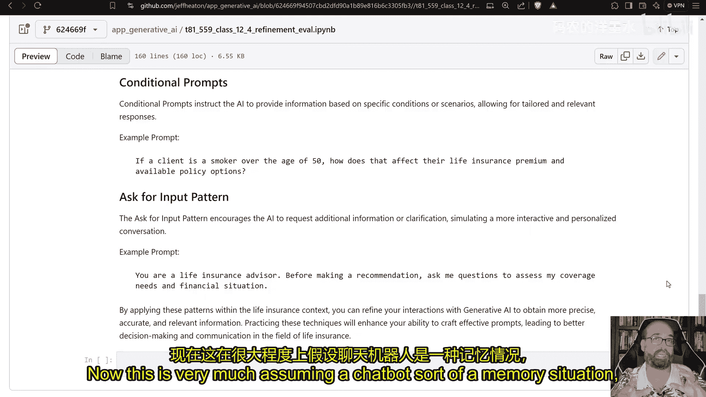

# 054：提问、优化与验证模式 🧠


在本节课中，我们将继续学习提示工程，重点介绍三种核心模式：提问模式、优化模式和验证模式。这些模式能帮助你更有效地与AI互动，获得更精确、可靠的回答。

上一节我们介绍了提示工程的基础概念，本节中我们来看看几种实用的高级模式。

## 提问模式 ❓

提问模式是最常见的交互方式，即直接向AI提出问题以获取信息。


以下是提问模式的一个典型示例：


```text
什么是与终身寿险相关的税收优惠？
```

在使用提问模式时，一个良好的实践是指定当AI不知道答案时应如何回应，这可以防止其编造信息。

## 优化模式 🔧

优化模式用于请求AI对先前的回答进行改进、细化或扩展。当你获得一个初步答案后，可以使用此模式来获取更深入或更具体的细节。

例如，在AI回答了某个问题后，你可以接着提出：


```text
你提到人寿保险有助于遗产规划。能否提供更具体的细节？
```


另一种常见的优化模式是对比提示，用于要求AI突出两个或多个事物之间的差异。

例如：


```text
闪电接口和普通USB 3.0接口有什么区别？
```

## 验证模式 ✅


验证模式旨在引导AI核实或双重检查其提供的信息，这对于需要高准确性的场景至关重要。

**认知验证模式**是其中一种，它提示AI验证信息。你可以这样使用：


```text
解释万能寿险保单是如何运作的。请通过总结其关键特征和关联风险来验证这些信息。
```

**事实核查清单模式**是另一种验证模式，你向AI提供一个需要核查的事实清单。

例如：

```text
列出将定期寿险转换为终身寿险所需的步骤，并简要解释每个步骤。
```

这种方法将任务分解，并可能对每个步骤进行事实核查。

## 条件提示与输入请求 🤖

除了上述模式，还有其他有用的提示技巧。


**条件提示**允许你在提示中嵌入“如果-那么”的逻辑。

例如：

```text
如果客户是年龄超过50岁的吸烟者，这会对人寿保险保单产生什么影响？
```

**输入请求提示**则用于引导AI在给出建议前，先向你提问以收集必要信息。这模拟了对话式交互。



例如：

```text
你是一名寿险顾问。在给出建议之前，请先问我一些问题以评估我的保障需求。
```

本节课中我们一起学习了提示工程中的三种核心模式：**提问模式**用于直接获取信息，**优化模式**用于细化和对比答案，**验证模式**用于确保信息的准确性。掌握这些模式将帮助你更高效、更可靠地利用生成式AI。