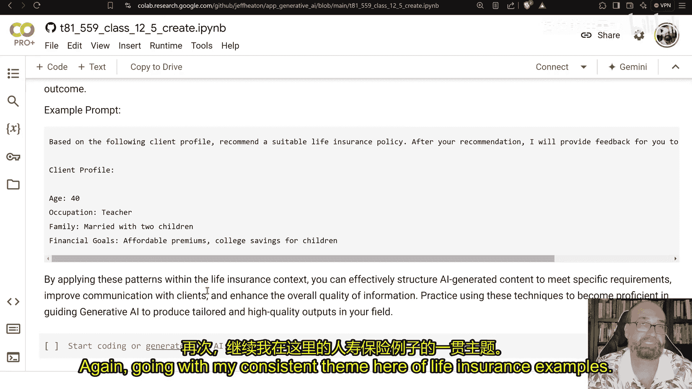

# 055：内容创作与结构化提示词模式 🧠

在本节课中，我们将学习如何利用生成式AI进行内容创作，并介绍几种高效的结构化提示词模式。这些模式能帮助你更精准地引导AI，生成符合特定格式、风格或逻辑的内容。

上一节我们探讨了提示工程的基础概念，本节中我们来看看专门用于内容创作的结构化提示模式。


## 模板模式 📝


模板模式是一种非常常见的模式。在这种模式下，你向AI提供一个内容模板，并让它根据你提供的非结构化数据来填充这个模板。这通常是一种零样本提示，因为你没有提供任何示例，只是给出了一个结构框架。

**核心公式**：
```
使用以下模板，根据提供的数据创建一份新的[内容类型]。
模板：[你的模板结构]
数据：[你的非结构化数据]
```

例如，一个提示词可以是：“使用以下模板，根据客户信息创建一份新的人寿保险摘要。”

## 元语言模式 🔤

元语言模式在提示词中使用特定的占位符指令，本质上是一种“填空”练习。你提供一个包含占位符（如`[客户姓名]`）的句子或段落框架，然后AI会根据你提供的上下文信息来填充这些占位符。

**核心公式**：
```
起草一封个性化邮件给[客户姓名]，告知他们关于[产品/服务]的好处。
上下文信息：[具体的客户和产品信息]
```

例如：“起草一封个性化邮件给`client_name`，告知他们关于终身寿险的好处。”


## 食谱模式 🥘


食谱模式为AI提供一步一步的指令或流程，引导其生成遵循特定逻辑顺序的内容。这非常像一份烹饪食谱。


以下是使用此模式时常见的步骤：


1.  提供明确的最终目标。
2.  列出所有必需的步骤或组成部分。
3.  按逻辑顺序组织步骤。
4.  确保每个步骤清晰、可执行。

例如，一个提示词可以是：“提供一份关于如何提交人寿保险理赔的逐步指南。请包含所有必要步骤。”

## 替代方法模式 🔄

这种模式要求AI针对同一个问题或目标，提出多种不同的解决方案或策略。在代码生成中经常可以看到这种应用。

**核心公式**：
```
描述[数量]种不同的策略，用于实现[目标]。
```


例如：“描述三种不同的策略，帮助年轻家庭最大化他们的人寿保险保障。”


## 大纲扩展模式 📑

大纲扩展模式与模板模式有些相似，但你提供的是一个内容大纲（如论文、报告、文章的章节标题），然后AI会根据这个大纲来撰写完整的内容。

**核心公式**：
```
根据以下大纲，撰写一篇关于[主题]的完整文章。
大纲：
1. [章节一标题]
2. [章节二标题]
3. [章节三标题]
...
```


**请注意**：如果你在撰写学术论文，请务必确保你的教授允许使用AI辅助工具。


## 菜单操作模式 📋

这种模式指示AI提供一系列选项供用户选择，类似于旧式文本应用程序中的菜单。

**核心公式**：
```
列出适用于[特定条件或用户]的可用[选项类型]。
```


例如：“列出适用于一名35岁不吸烟、寻求5万美元人寿保险保障的客户的可用保单选项。”


## 续写生成模式 ✍️

续写生成模式非常直接：你提供一个开头，AI会接着写完剩余部分。这通常用于信件、故事等创作。


**核心公式**：
```
完成书写以下给客户的关于其保单续期的信件：
[你的信件开头]...
```

例如：“完成书写以下给客户的关于其保单续期的信件：尊敬的`client_name`，我们想提醒您...”

## 内容生成提示 🎨

这类提示直接要求AI为你创建特定类型的内容，如博客文章、社交媒体帖子等。


**核心公式**：
```
以[某种风格]撰写一篇关于[主题]的[内容类型]。
```

例如：“撰写一篇博客文章，标题为‘关于人寿保险的五大误区’。” 或者 “以《纽约时报》的风格撰写一篇关于退休规划的文章。”


## 分类提示 🏷️

分类提示要求AI将给定的项目归类到预定义的类别中。这通常是一种零样本提示，无需提供示例。

**核心公式**：
```
将以下[项目列表]分类到适当的[类别类型]中。
```


例如：“将以下三位客户分类到合适的保单类型中。” 然后列出三位客户的简要信息。

## 翻译提示 🌐

翻译提示非常简单直接，即要求AI将一段内容从一种语言翻译成另一种语言。

**核心公式**：
```
将以下[内容]翻译成[目标语言]。
[待翻译的内容]
```


例如：“将以下人寿保险常见问题解答翻译成西班牙语。” 然后附上FAQ文本。


## 数据提取提示 📊

在这种模式下，你在提示词末尾提供一大段非结构化数据（如文本），然后在开头指示AI从中提取特定信息。

**核心公式**：
```
从以下文本中，提取[所需信息1]、[所需信息2]等。如果找不到某项信息，请填写“无”。
[你的非结构化文本]
```


**重要提示**：务必指示AI在找不到信息时如何处理（例如“填写‘无’”），否则AI可能会进行猜测。

## 风格化提示 🎭


风格化提示用于指定生成内容的语气、风格或情感基调。


**核心公式**：
```
以[某种风格/语气]撰写一篇关于[主题]的[内容类型]。
```

例如：“以鼓舞人心的语气，撰写一篇关于财务规划重要性的文章。” 或者 “撰写一篇有说服力的文章，鼓励年轻人购买人寿保险。”

## 交互式或迭代提示 💬


这类提示设计用于进行多轮对话和迭代。你提供一个初始场景或请求，AI给出回应后，你可以提供反馈，让AI进行调整。


**核心公式**：
```
基于以下[客户资料/信息]，推荐一个合适的[解决方案]。在推荐之后，我将提供反馈以帮助你调整。
[初始信息]
```

例如：“基于以下客户资料，推荐一个合适的人寿保险保单。在推荐之后，我将提供反馈以帮助你调整推荐。”



---

本节课中我们一起学习了多种用于内容创作的结构化提示词模式，包括模板模式、元语言模式、食谱模式、替代方法模式、大纲扩展模式、菜单操作模式、续写生成模式、内容生成提示、分类提示、翻译提示、数据提取提示、风格化提示以及交互式提示。掌握这些模式能帮助你更有效、更精准地利用生成式AI完成各种内容创作任务。