# 056：语音处理入门 🎤

在本节课中，我们将学习如何利用计算机生成和理解语音来构建应用程序。我们将使用OpenAI API，探索如何将普通文本转换为语音，以及如何将语音转换为文本。最后，我们将把这些功能结合起来，创建一个可以进行语音交互的聊天机器人。整个项目将在Colab环境中运行，尽管在生产环境中，你可能更倾向于将其部署为移动应用或JavaScript网页应用。

## 概述

语音应用已经无处不在。例如，我们可以对智能音箱说“Alexa，现在几点了？”，或者使用ChatGPT的语音功能进行对话。这些应用的核心在于计算机能够理解我们的语音并作出响应。本节中，我们将重点介绍OpenAI平台提供的语音处理工具。

上一节我们介绍了课程的整体安排，本节中我们来看看如何具体实现语音的生成与识别。

## 语音应用示例

以下是几个常见的语音应用场景：

*   **智能家居助手**：如Amazon Alexa，可以通过语音指令控制设备、查询信息。
*   **手机语音助手**：如Apple Siri，集成在移动设备中，提供便捷的语音交互。
*   **AI聊天机器人**：如ChatGPT的语音对话功能，允许用户通过语音与AI模型进行自然交流。

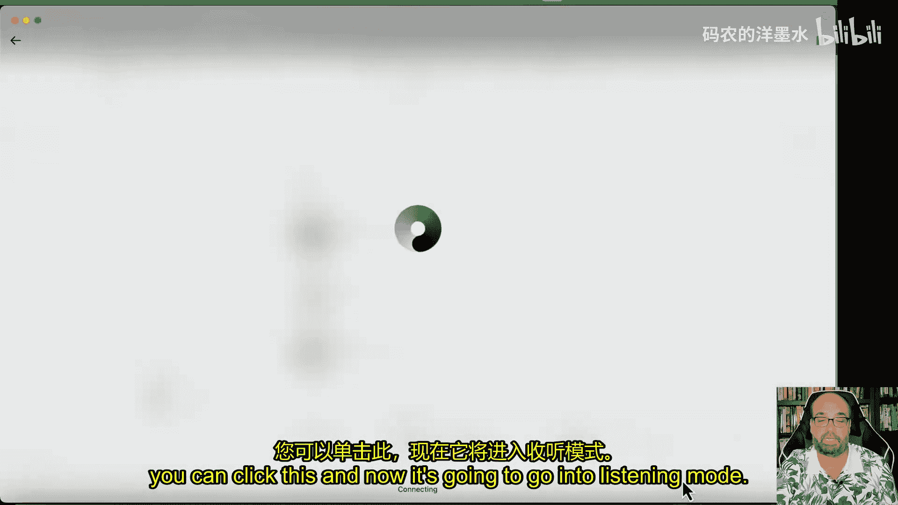

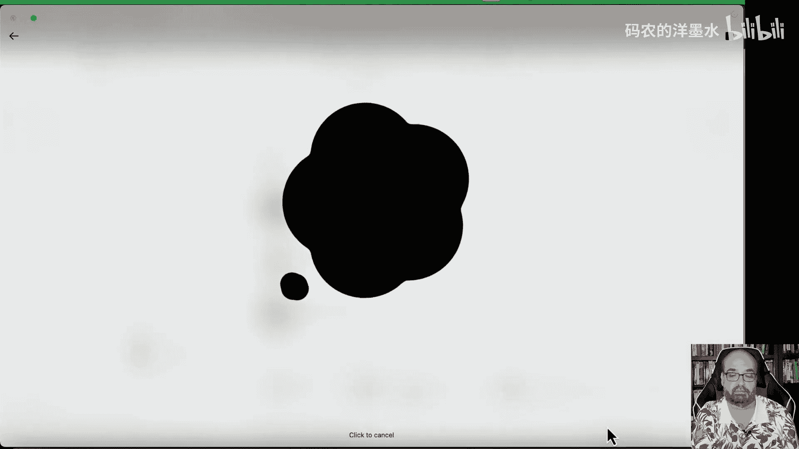

这些应用展示了语音技术如何成为人机交互的重要桥梁。

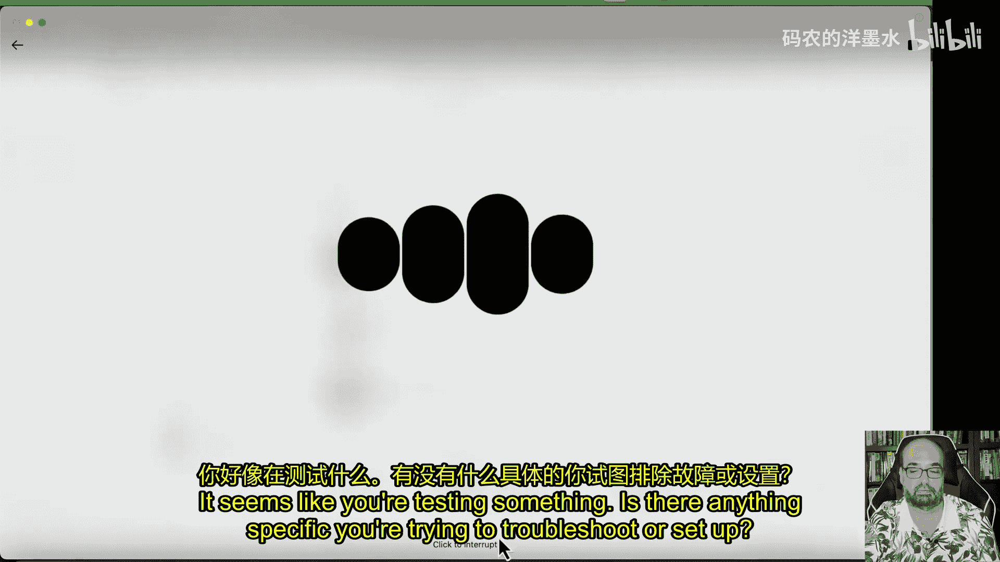

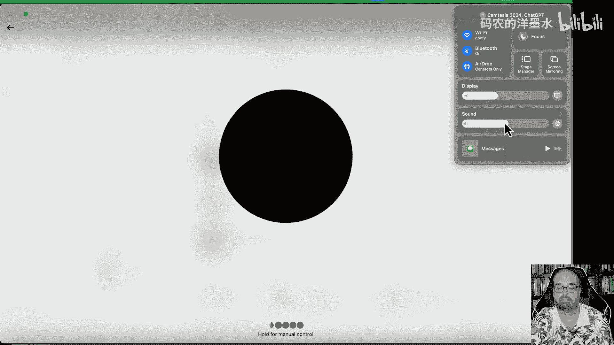

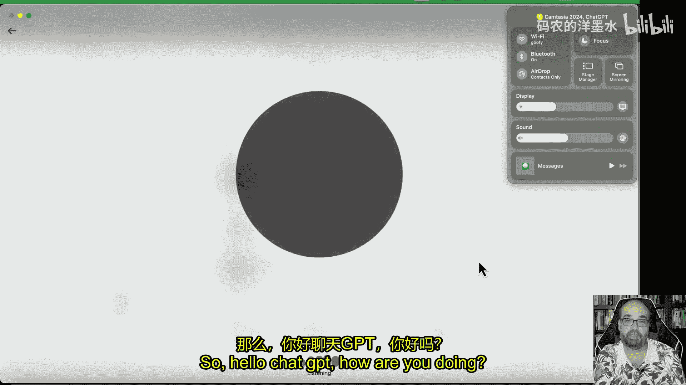

## OpenAI语音API

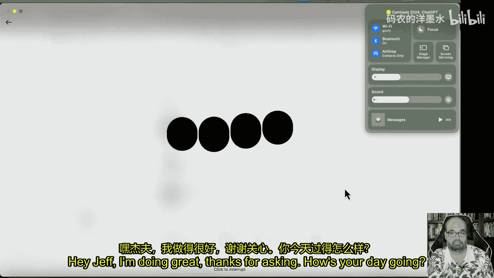

我们将使用OpenAI的API来实现核心的语音功能。主要包括两个方面：

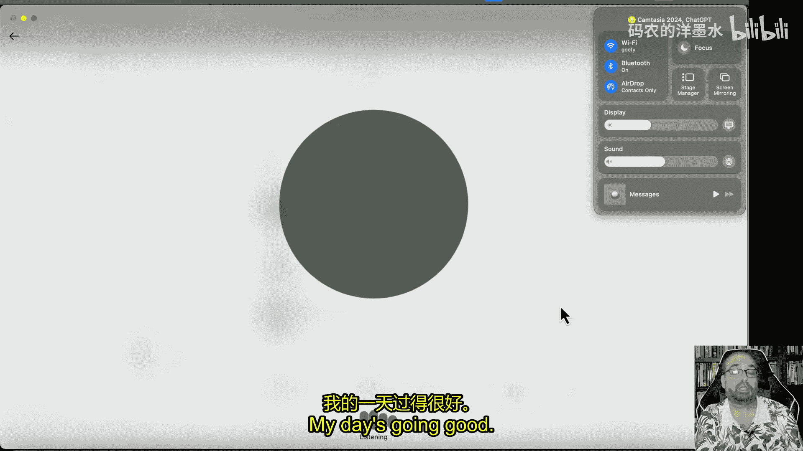

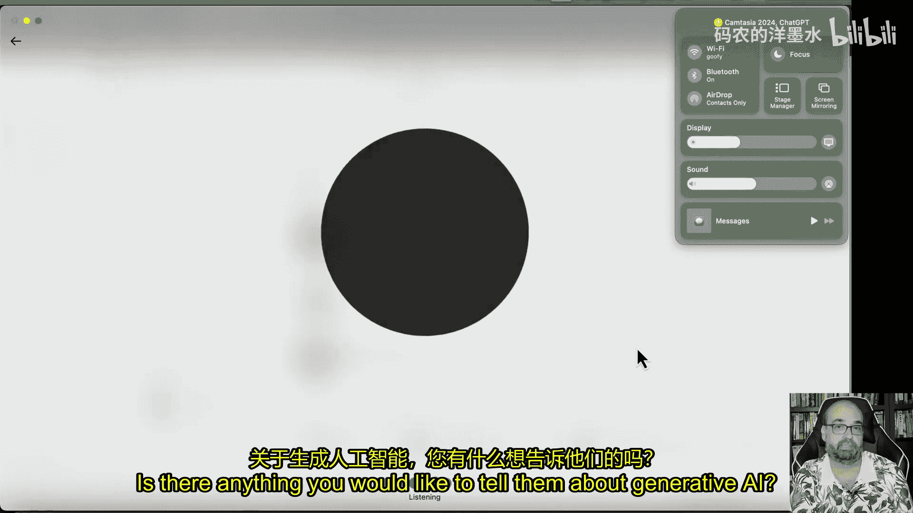

1.  **文本转语音**：将计算机生成的文本信息转换为可听的语音。
    ```python
    # 示例：使用OpenAI TTS API将文本转为语音
    from openai import OpenAI
    client = OpenAI()

    response = client.audio.speech.create(
        model="tts-1",
        voice="alloy",
        input="你好，世界！"
    )
    response.stream_to_file("output.mp3")
    ```

2.  **语音转文本**：将用户说出的语音内容转换为计算机可以理解的文本。
    ```python
    # 示例：使用OpenAI Whisper API将语音转为文本
    from openai import OpenAI
    client = OpenAI()

    audio_file = open("speech.mp3", "rb")
    transcript = client.audio.transcriptions.create(
        model="whisper-1",
        file=audio_file
    )
    print(transcript.text)
    ```

## 构建语音聊天机器人

在掌握了文本转语音和语音转文本的基础后，我们可以将它们与大型语言模型结合，创建一个完整的语音聊天机器人。其工作流程遵循一个清晰的循环：

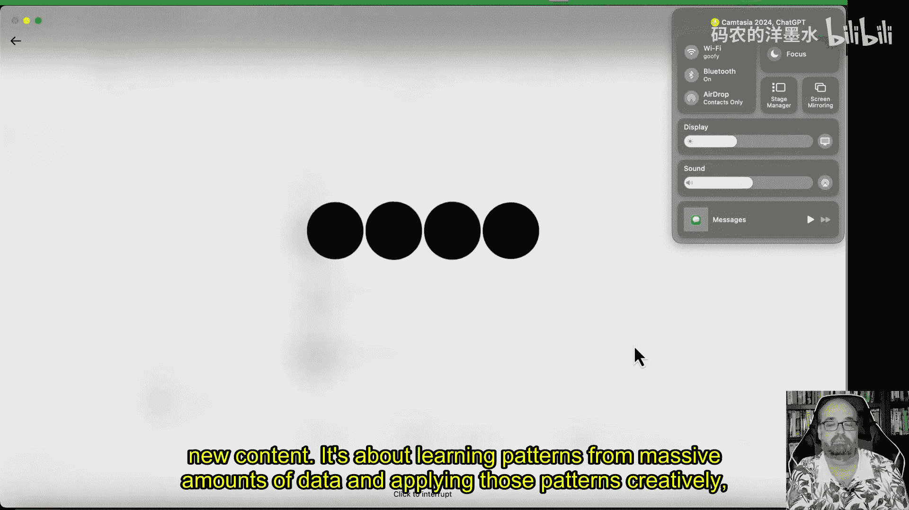

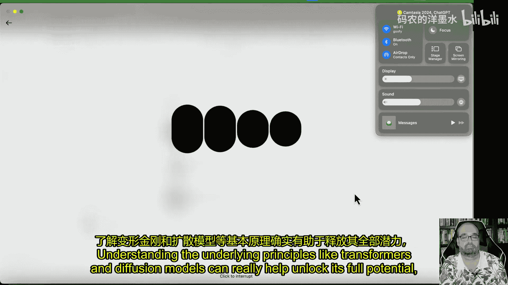

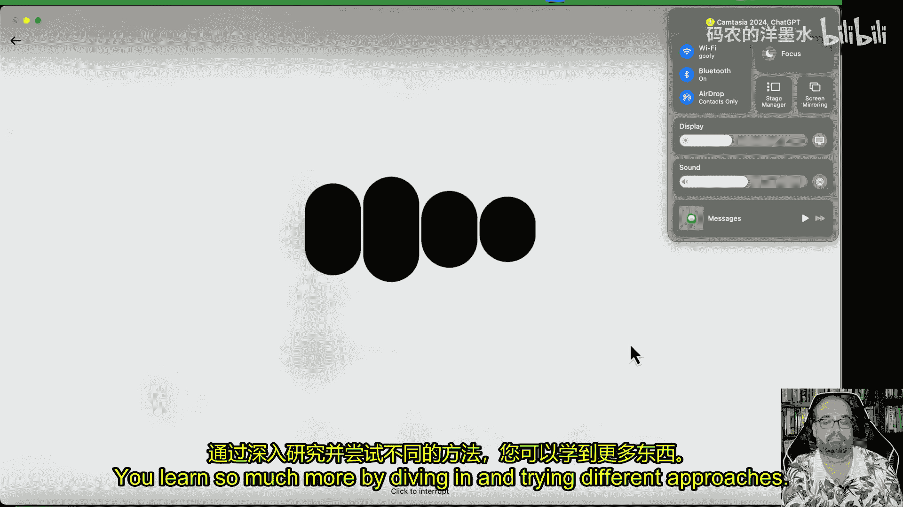

1.  用户通过麦克风输入语音。
2.  系统使用**语音转文本**模型将语音转换为文本。
3.  将转换后的文本发送给**大型语言模型**生成回复文本。
4.  系统使用**文本转语音**模型将回复文本转换为语音。
5.  通过扬声器播放生成的语音回复给用户。

这个循环使得用户能够与AI进行流畅的、近似于人与人之间的对话。

## 课程总结与展望

本节课中，我们一起学习了语音处理的基本概念，包括如何使用OpenAI API实现文本转语音和语音转文本功能，并探讨了如何将这些技术整合起来构建一个语音交互式聊天机器人。

作为本课程的最后一个模块，我们不仅掌握了具体的工具应用，也为探索生成式AI更广阔的未来奠定了基础。在接下来的内容中，我们将展望生成式AI的发展趋势，为这门课程画上一个圆满的句号。