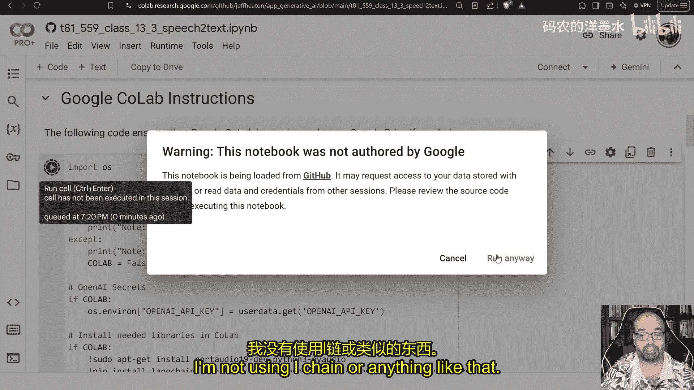
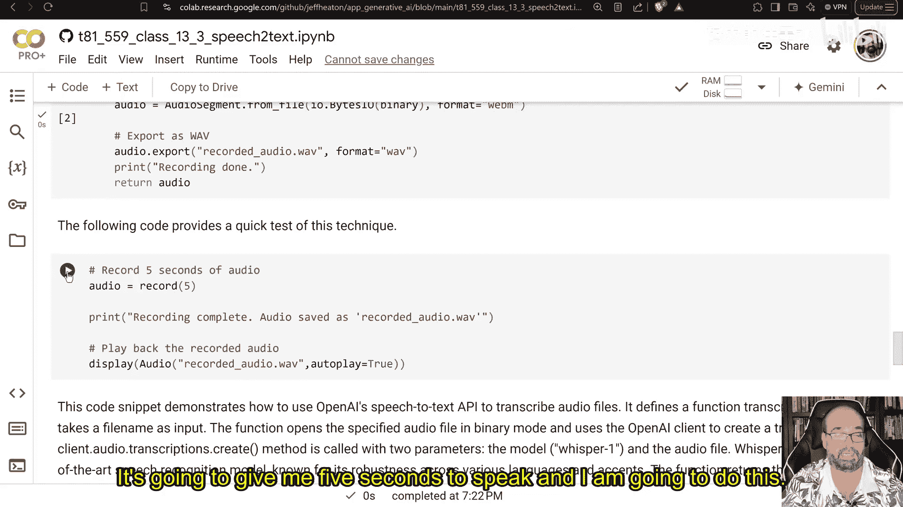
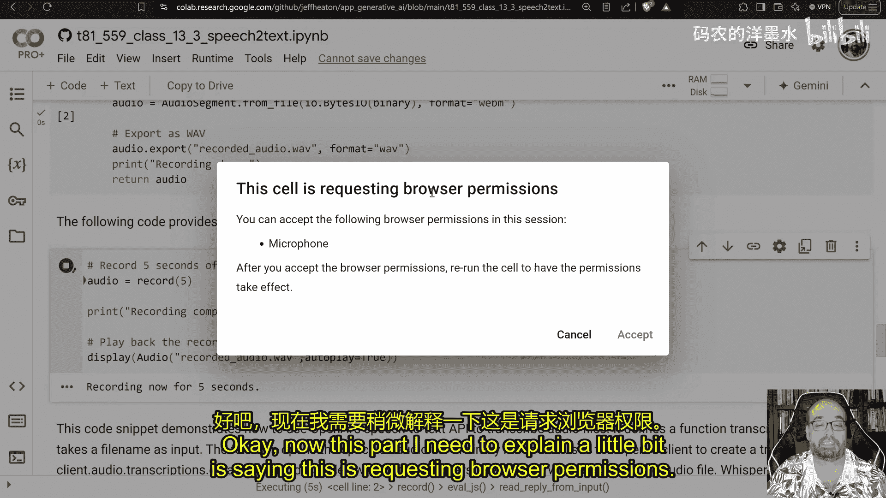
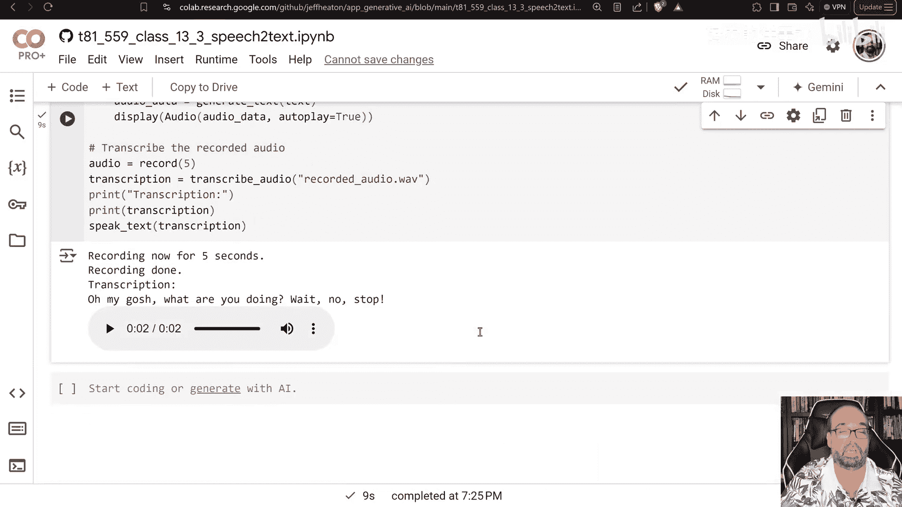

# 058：语音转文本 🎤

在本节课中，我们将学习如何使用OpenAI的API，将语音转换为文本。我们将从零开始，在Google Colab环境中实现一个简单的语音录制和转录系统。



上一节我们介绍了文本转语音的应用，本节中我们来看看如何实现反向操作——语音转文本。

## 概述与准备工作

本教程完全依赖OpenAI的API，未使用LangChain等框架。请确保你已拥有OpenAI API密钥，并已在Google Colab中配置好访问权限。

为了在Google Colab中直接录制语音，我们需要使用一些特殊技巧。以下代码结合了JavaScript技术和ChatGPT生成的代码，用于访问浏览器的麦克风并录制音频。

```python
# 安装必要的库
!pip install openai
```

## 实现语音录制功能

以下是实现语音录制的核心JavaScript代码。它负责请求麦克风权限并录制指定时长的音频。

```javascript
// 用于在Colab中录制音频的JavaScript代码
const recordAudio = () => {
  return new Promise(async resolve => {
    const stream = await navigator.mediaDevices.getUserMedia({ audio: true });
    const mediaRecorder = new MediaRecorder(stream);
    const audioChunks = [];
    mediaRecorder.addEventListener("dataavailable", event => {
      audioChunks.push(event.data);
    });
    const start = () => mediaRecorder.start();
    const stop = () =>
      new Promise(resolve => {
        mediaRecorder.addEventListener("stop", () => {
          const audioBlob = new Blob(audioChunks);
          const audioUrl = URL.createObjectURL(audioBlob);
          const audio = new Audio(audioUrl);
          const play = () => audio.play();
          resolve({ audioBlob, audioUrl, play });
        });
        mediaRecorder.stop();
      });
    resolve({ start, stop });
  });
};
```

运行此代码后，系统会请求麦克风权限。授权后，即可开始录制。

## 执行录音与处理

现在，我们使用Python代码来调用上述录制功能，并设置录制时长为5秒。




```python
import openai
import time

# 设置OpenAI API密钥
openai.api_key = '你的API密钥'
# 录制5秒音频的示例调用
print("开始录制5秒音频...")
# 此处应调用上述JavaScript录音函数
time.sleep(5)  # 模拟录制过程
print("录制结束。")
```

需要注意的是，简单的定时录制可能不够智能。更高级的实现应包含静音检测，以在用户停止说话时自动结束录制，但这涉及到判断静音时长等复杂问题。未来的流式聊天模型将支持更自然的中断和连续对话。



## 语音转录为文本

录制完成后，我们将音频文件发送给OpenAI的Whisper模型进行转录。

以下是转录步骤：

1.  打开录制好的音频文件。
2.  调用OpenAI的音频转录接口。
3.  获取并输出转录后的文本。

```python
# 转录音频文件
audio_file = open("recorded_audio.wav", "rb")
transcript = openai.Audio.transcribe("whisper-1", audio_file)

print(f"转录结果: {transcript['text']}")
```

运行后，模型会将你说的话转换为文字。例如，如果你说“现在我相信它真的在录音”，模型可能会转录为“Now I believe it is truly recording.”。有趣的是，如果录音在句子中间被切断，模型通常会假设句子已经结束并加上句号。

## 综合演示：语音转文本再转语音

为了更完整地演示，我们可以将流程串联起来：录制语音、转成文本，再将文本用语音合成播放出来。

以下是实现此功能的步骤：

1.  录制一段语音。
2.  将其转录为文本。
3.  使用文本转语音功能（如上节课所学）将文本读出来。

```python
# 假设已有转录文本
transcribed_text = "重复我现在说的话，电脑。"

# 调用文本转语音函数（此处为伪代码，需根据上节课内容实现）
# speak_text(transcribed_text, voice="nova")
```

运行此流程，你可以对电脑说“重复我现在说的话，电脑”，它便会通过语音合成将这句话复述出来。需要指出的是，当前的语音转文本过程会丢失所有情感和语调信息，输出的只是纯文字内容。



## 总结

本节课中我们一起学习了语音转文本的基本流程。你看到了如何从录制音频开始，利用OpenAI的Whisper模型将语音准确转录为文字，并了解了该技术目前的一些局限性，例如情感信息的丢失。

通过本课和上一课，你已经掌握了文本转语音和语音转文本这两个相对的操作。在下一节课中，我们将把这两个功能与聊天模型结合起来，构建一个完整的语音交互聊天应用。

感谢观看本视频，如果内容对你有帮助，请订阅频道并点赞。