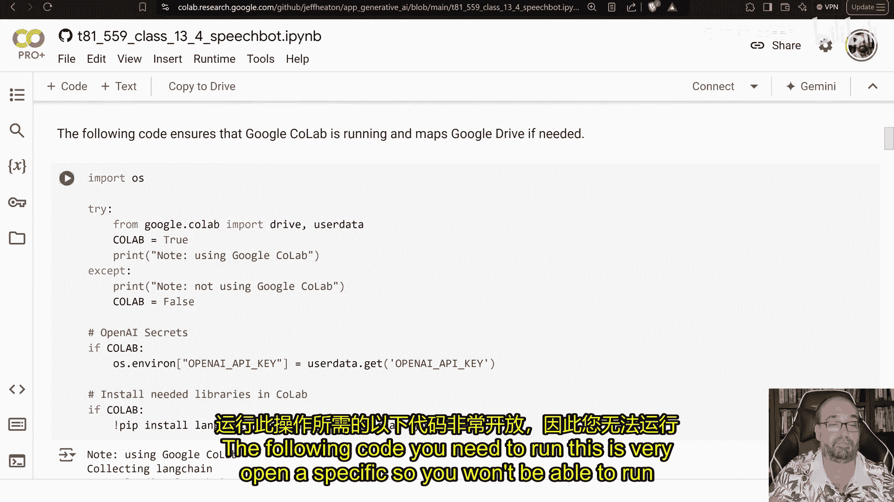
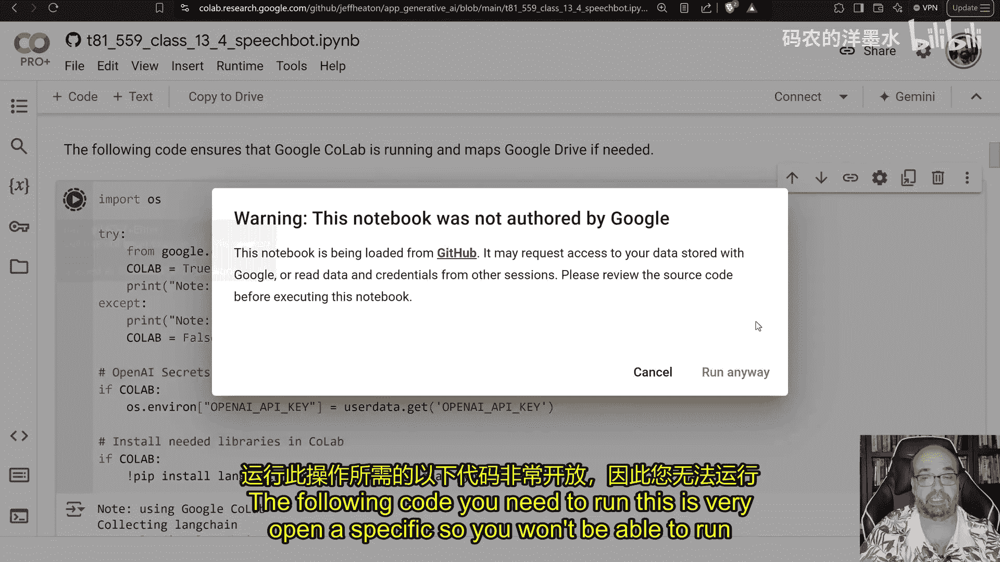
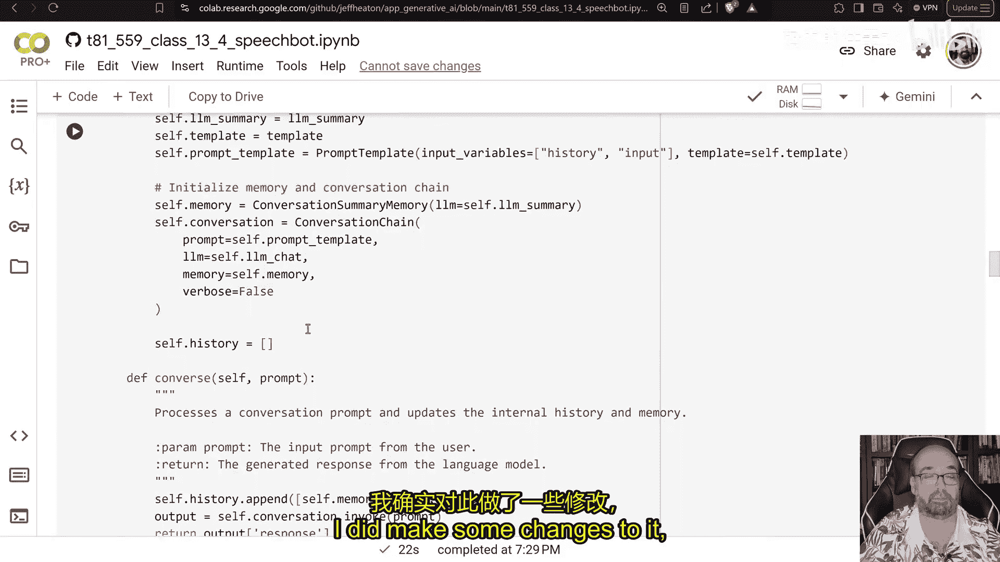
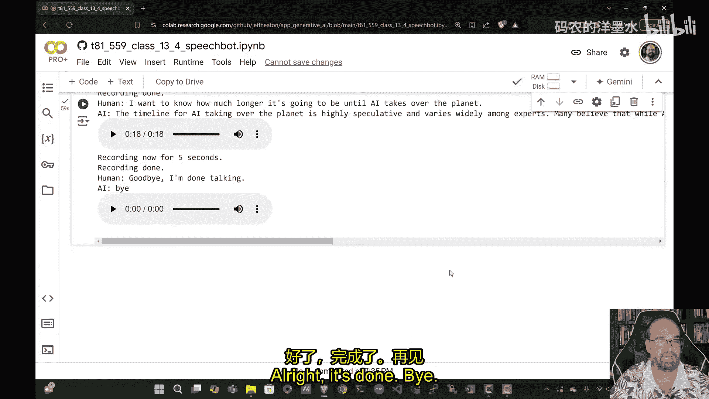

# 059：语音交互聊天机器人 🎤🤖

在本节课中，我们将学习如何结合之前介绍的文本转语音和语音转文本技术，构建一个能够进行语音对话的聊天机器人。我们将使用OpenAI的特定工具来实现这一功能，并在最后简要探讨生成式AI的未来发展方向。





## 概述

上一节我们介绍了语音转文本和文本转语音的基础技术。本节中，我们将把这些技术结合起来，创建一个完整的语音交互聊天机器人。这个机器人能够听取用户的语音输入，将其转换为文本，生成文本回复，再将回复转换为语音播放出来，从而实现自然的语音对话。

## 准备工作



以下是运行本教程代码的前提条件。请注意，本教程的代码是专门为OpenAI的API设计的，因此无法直接在其他大型语言模型或语音聊天模型上运行。

*   你需要将你的OpenAI API密钥存储在环境变量或配置文件的`keys`部分。
*   运行代码前，系统会自动安装所有必要的依赖库。

## 创建文本聊天机器人基类

首先，我们创建一个基础的文本聊天机器人。这部分代码基于之前的内容，我们创建了一个类来封装创建文本聊天机器人所需的大部分操作。

```python
class ChatBot:
    def __init__(self):
        self.system_prompt = "你是一个乐于助人的助手。不要使用Markdown格式，只使用纯文本。将你的回复限制在几句话以内。如果用户表达了结束对话的意愿，请直接返回‘bye’（不带引号），以便我结束循环。"
        self.memory = []
        # ... 其他初始化代码

    def chat(self, user_input):
        # 处理用户输入并返回AI的文本回复
        # ... 核心聊天逻辑
        return ai_response

    def converse(self):
        # 在控制台进行交互式对话并打印结果
        # ... 交互逻辑

    def clear_memory(self):
        # 清空对话记忆
        self.memory = []

    # ... 其他方法如保存/加载历史记录、撤销等
```

我们对系统提示词做了一些关键调整：
*   **`“不要使用Markdown”`**：因为Markdown格式在语音播放时效果不佳，我们要求机器人只返回纯文本。
*   **`“将回复限制在几句话以内”`**：这是为了防止聊天机器人回复大段文字，在语音对话中造成冗长的独白。
*   **`“如果用户想结束，返回‘bye’”`**：这提供了一个简单的机制来终止对话循环，避免了手动编程检测“再见”、“拜拜”等词的复杂性。

我们使用的模型是`gpt-4`。在添加语音功能之前，我们先运行一个简单的文本测试，确保聊天机器人基础功能正常。

**测试输出示例：**
> 人类：你好。
> AI：很高兴认识你，Jeff。今天我能为你做些什么？

## 集成语音功能

现在，我们将语音功能集成到聊天机器人中。这主要涉及三个核心函数。

### 1. 录音功能 (`record`)
这个函数使用JavaScript在Google Colab环境中录制音频。它提供了一个在笔记本中录制麦克风输入的便捷方法。

### 2. 转录功能 (`transcribe_audio`)
此函数接收录制的音频文件，调用OpenAI的语音转文本API，将用户的语音内容转换为文本字符串，以便输入给聊天机器人。

### 3. 语音合成与播放功能 (`generate_and_speak_text`)
这个函数接收聊天机器人生成的文本回复，调用OpenAI的文本转语音API生成音频，然后在Colab中播放。这里有一个重要的细节：语音播放必须是**同步**的。我们必须等待一段语音完全播放完毕，再开始监听下一次用户输入，否则机器人会听到自己的声音并陷入循环自问自答。

```python
def generate_and_speak_text(text):
    # 生成音频文件
    audio_response = openai.audio.speech.create(model="tts-1", voice="nova", input=text)
    audio_response.stream_to_file("output.mp3")

    # 在Colab中同步播放音频
    # ... 平台特定的播放代码，确保播放完成后再继续
```

## 构建语音对话循环

核心的交互逻辑发生在一个循环中。这个循环会持续运行，直到聊天机器人返回“bye”信号。

以下是循环的主要步骤：
1.  调用`record()`录制用户语音。
2.  调用`transcribe_audio()`将语音转为文本。
3.  将文本输入给`ChatBot.chat()`方法，获取文本回复。
4.  在控制台打印用户和AI的对话内容。
5.  调用`generate_and_speak_text()`将AI的文本回复转换为语音并播放。
6.  检查回复是否为“bye”，如果是则跳出循环。

**对话示例：**
> （用户说：“嗨，我叫Jeff。”）
> 人类：嗨，我叫Jeff。
> AI：你好Jeff，今天我能为你做些什么？
>
> （用户说：“我想知道AI还要多久才能接管地球。”）
> 人类：我想知道AI还要多久才能接管地球。
> AI：AI接管地球的时间表具有高度推测性，专家们的看法差异很大。许多人认为，虽然AI将继续发展并在社会中扮演重要角色，但在可预见的未来完全接管是不太可能的。这更多是关于人类与AI之间的协作。
>
> （用户说：“再见，我说完了。”）
> 人类：再见，我说完了。
> AI：bye
> （循环结束）

## 总结与展望



本节课中，我们一起学习了如何构建一个语音交互聊天机器人。我们整合了语音转文本、大型语言模型对话和文本转语音这三个模块，实现了一个完整的语音对话流程。虽然本教程是在Google Colab中使用OpenAI特定API完成的，但核心概念（录音、转录、处理、合成、播放）适用于任何平台。

通过这个项目，你已经掌握了创建基础语音助手的关键技能。要将其部署到其他平台（如JavaScript网页或手机应用），你需要学习相应的平台特定编码知识。

生成式AI，特别是多模态交互（如语音、视觉结合）的AI，正在快速发展。未来，我们可以期待更自然、更智能、更上下文感知的交互体验。希望本教程为你继续探索这一激动人心的领域打下了坚实的基础。