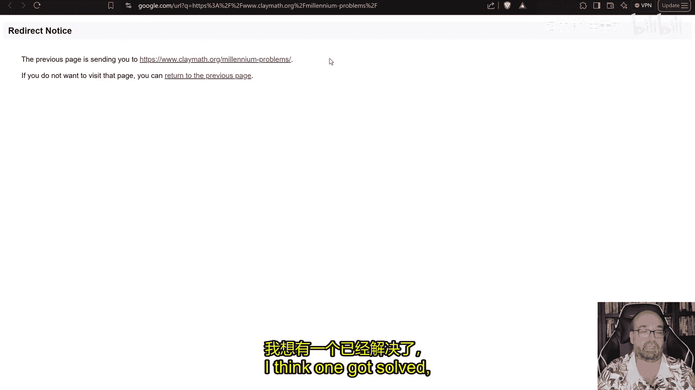
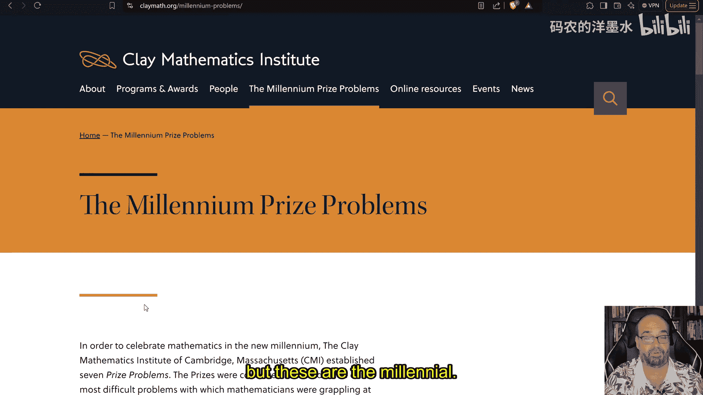
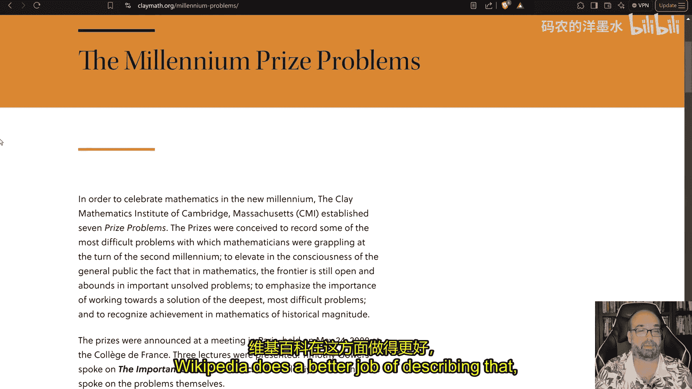
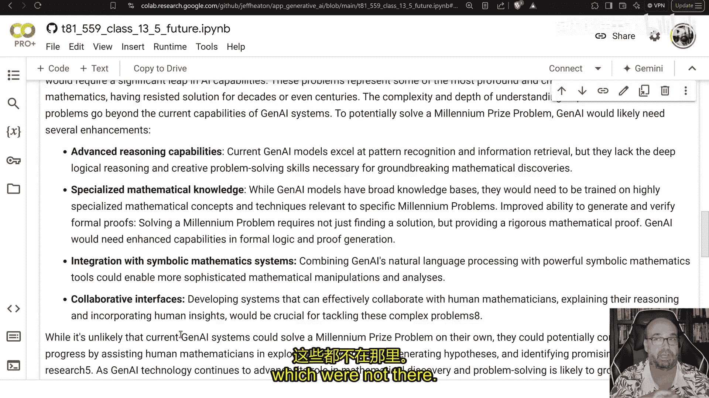

生成式AI的应用：60：生成式AI的未来 🚀

在本节课中，我们将探讨生成式人工智能（Gen AI）的未来发展方向，并分析其潜在影响。我们将讨论AI的智能程度、未来技术趋势以及它可能如何改变世界。

---

上一节我们介绍了生成式AI的多种应用，本节中我们来看看其未来的发展轨迹与潜在影响。

关于生成式AI是否会取代人类工作、甚至超越人类智能，存在广泛讨论。引发这种讨论的核心原因在于，当前AI与我们对话的流畅度已非常高，几乎像与另一个人交谈。例如，AI可以帮助我在面对有敌意的观众前进行辩论练习，并且相当熟练。传统的图灵测试（即人类无法分辨对话对象是机器还是人）在纯文本层面已变得极具挑战性。虽然在使用某些刻意模仿人类的角色扮演AI时，我们或许还能分辨，但到2024年已达到的对话流畅度，确实超出了许多人的预期。

目前，致电银行或网络服务提供商时，听到的仍是机械的语音提示（“请按1查询余额”）。我尚未见到使用生成式AI的客服系统，但这无疑即将到来。我期待这种僵化的机器人语音能被更流畅的生成式AI取代，或者更好的是，能直接通过文字交流，而无需使用语音。

---

在探讨AI的智能程度时，像“草莓”这样的模型声称具备推理能力。然而，诸如“意识”、“推理”等概念，即使对人类而言也缺乏清晰统一的定义。例如，思考“传送悖论”：如果复制了我身体的每一个原子，产生了另一个“我”，那么哪一个“我”才受我控制？这就像在电子游戏中控制吃豆人，如果出现两个吃豆人，哪一个才是我？这对“我”而言至关重要，但对世界其他部分而言，一个假装是Jeff的自动机或许并无区别。因此，关于意识、推理的本质存在许多深层问题。

目前，我并不认为像“01草莓”这样的模型达到了真正的人类级推理水平。它可以近似推理，例如我们在提示工程中学到的“思维链”技术，但这本质上意味着它将一个问题分解为一系列步骤然后逐步解决。这离真正的、创造性的推理还有距离。

---

以下是关于AI未来发展的一些核心概念：

**递归自我改进**
这意味着AI真正具备了与人类同等水平的编程能力。例如，OpenAI等公司的团队正在开发先进的生成式AI。生成式AI本身可以生成代码，但当前的ChatGPT是其开发团队的正式成员吗？并不是。当前的模型主要是在吸收和重组人类已有的知识。虽然它能创造出前所未见的事物（比如一幅“在海底推割草机的斗牛犬”图像），但它是在混合已有的艺术风格和概念。离人类理解的核心越远，它的表现就越弱。

真正的递归自我改进意味着AI能编写出超越当前最先进算法（如Transformer）的下一代算法。Transformer是目前驱动许多AI应用的核心算法，但它终将被超越。历史上，支持向量机等技术也曾被视为未来，但最终神经网络和Transformer占据了主导。Transformer在自然语言处理等领域表现出色，但它并非驱动自动驾驶汽车的唯一算法（那更多涉及强化学习和卷积网络）。未来，这些算法可能会进一步融合。

当机器能够真正实现递归自我改进时，它将可以持续不断地优化自身算法，而无需像人类一样需要休息、睡眠或娱乐。这可能是通向超级智能的一步。

**人工通用智能**
这是指出现一种“全能算法”，能够统治所有领域。这将是Transformer或其他算法的真正继任者，成为解决所有问题的最佳算法。这涉及到“没有免费午餐定理”，即不同模型在不同任务上各有所长。但人脑在结构上大体相同，却能处理各种任务。AGI的目标就是实现这种统一的、通用的智能。结合RSI，它可能将智能推向更高水平。

**技术奇点**
这通常指AI在智能上超越人类理解，并且假设机器人也具备在现实世界中行动的完整能力。它拥有超越我们自身的智能。“奇点”这个词也用于描述黑洞的事件视界——视界之外是我们完全无法知晓的世界。这可能是AI潜在的未来。

当我与不同群体交流时，经常被问及这类问题，因为人们看到了生成式AI令人惊叹的能力，并好奇它将走向何方。

---

在评估AI能力时，一个关键指标是它何时能进行真正的硬核研究，例如赢得诺贝尔奖或解决“千禧年大奖难题”。千禧年大奖难题是七个极其复杂的数学问题，其中一个已被解决（但并非由程序解决）。其中一个著名的计算机科学问题是“P vs NP问题”。

我大致理解为何“P不等于NP”这个问题如此困难。我曾尝试与AI讨论其解决方案，但发现它目前无法突破当前人类理解的边界。当我看到AI能够解决或完成其中一个难题90%的解决方案时，我才会认为我们真正接近了那个水平。

---

当前有一些研究方向可能成为Transformer的继任者。也许你将是创造Transformer继任者的人，因为利用PyTorch等工具，你确实可以编写和创造许多潜在的下一代算法。如果要用像PyTorch这样的框架来表达新算法，以便它能在GPU上运行，这将是一条艰难的道路，因为创造下一代算法可能还需要配套的硬件支持。这或许是那些大型科技公司正在思考的方向。

感谢你学习本课程。我认为AI要达到真正的人类水平，并导致所有工作被取代、机器人全面普及，可能还需要一段时间。技术发展往往会遇到平台期。Transformer看起来正在线性发展，潜力无限，但在某个时刻，我们将穷尽其所能给予我们的一切，那时就需要新的突破来将其推向下一个水平。最终，某个突破将引领我们走向AGI，并可能带来技术奇点。

当然，也存在其他理论，认为机器可能永远无法真正达到生物体在推理方面的能力。或许我们需要迈向生物计算，但目前我们尚未达到那个阶段。

---

本节课中我们一起学习了生成式AI的未来展望。我们探讨了AI的当前智能水平、递归自我改进、人工通用智能和技术奇点等概念，并思考了AI在解决顶级科学难题和未来算法发展方面的潜力。技术发展道路漫长且充满未知，但持续学习和关注前沿动态至关重要。

感谢观看。请点赞并订阅频道，我可能会在未来更新此视频，讨论AI领域的下一步进展。感谢你成为本课程的一部分。