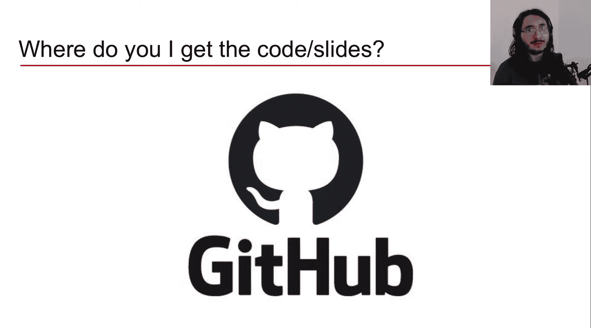
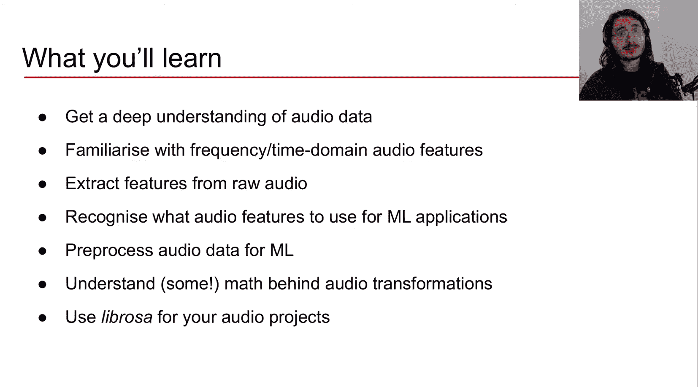
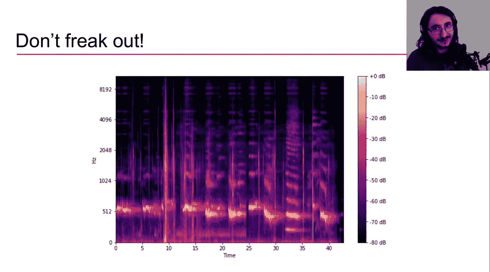
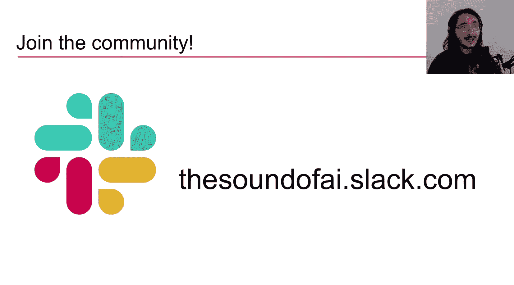

# Valerio Velardo【中英⚡面向机器学习的音频信号处理 Audio Signal Processing for Machine Learning】 p01 p0 Audio Signal Processing for Machine Learning [BV1ftPLeCEhX_p1]

Hi， everybody。 and welcome to a new exciting video series called Audio signal processing for machinech learning。

 Many of you you guys have asked me to dig deeper into audio digital signal processing。

 And so here you have a whole series on that in this video。

 I'm going to give you a quick overview of the series， the different content。

 the things that you learn the prequiites and the resources。 Now， what's the problem。

 why do we need this series。 So the main issue that probably most deep learning engineers know is that when it comes time to work on deep learning applications for images。

 that's not that much of an issue because we have a lot of resources that explain how you can process image erode data and make it viable for deep learning and machine learning models。

 But that's not necessarily the case for audio。 There's a sort of mist around audio data and how you should use it for。

😊，learningearning applications。 And so this is why you're getting like this series。 Now。

 when we talk about audio AI applications， we can divide two stages here。

 So one is the development and the evaluation of models。

 And this is a part that I covered in another series that I have on my channel that's called deep learning for audio in Python。

😊，And you should find it over here in case you want to check that out。

 And then there's the other level， which is that of preparing the audio row data in order to make it viable for ingess in the models。

 Now， I have a couple of videos in that series that I've just mentioned and deep learning for audio year where I talk about audio preprocessing and audio your features and all these sorts of things。

 But I realized that that wasn't really enough。 And many of you guys have asked me to dig deeper。

 Okay。So now our question is， so where do we use audio digital signal processing for machine learning and for deep learning specifically Well there are a bunch of applications in AI audio where we use audio signal processing So obviously you have all sorts of audio classification。

 a problems stem speech recognition， speaker verification a speaker diorization for example and then audio dennoizing audio up sampling and if you are a music type of guy there's a whole field for you that's called music information retrieval that uses tools from digital signal processing along with machine learning to crack set and problems like music instrument identification or music mood and a genre classification and there's a bunch bunch more of those cool。

😊，So what are we going to cover in this series so it's a lot of stuff really and it's not sat on the stone yet so I'm open to get feedback from you guys on like what topics like to cover during the process like of this series but for sure I'm going cover sound waves。

 digital to analog converters， analog to digital converters and then I'll jump into audio your features and we'll take a look at time and frequency domain audio your features like RMSs Spectro centroid MfCCs then we're going to also look at a bunch of very important audio transformations we'll take a look at the Fourier transform。

 the shorttime Fourier transform that leads to spectrograms then we'll compare that against other transformations like the constant transform the male spectrograms and chromoograms on top of that。

😊，We're going to also take a look at topics in audio and music perception。

 which we can leverage to preproces the audio data in a way that makes sense for the current problem。

😊，That we're trying to solve。Okay， so what should you expect from this series if you usually follow the sound of AI channel。

 you know that I love to cover both theoretical stuff and implementation stuff。

 So this series is going to be no different。 So we're going to have theoretical sessions where I dig deeper into the theoretical ideas behind the stuff that we are discussing。

 and then we're going to have coding sessions where I implement or the theoretical stuff that we've discussed。

😊，Now you may be wondering but where do I get all the material that you'll be post with these videos。

 well I have a Github page that's linked in the description section below and there you can find the code samples as well as the slides just to have all the material with yourself for review。

😊。

So if you're familiar with my channel， you know that I literally love Python and it's not shouldn't come as a surprise to you that throughout the series I'm going to be using Python。

 And then on top of that， I'm going to be using Lib browsers。

 which is an open source all your processing libraries that we can use to extract loads of all your features in a very handy way。

 Okay， so what will you learn from an operational standpoint。 First of all。

 you're going get a deep dive into all your data so that you really know what you are talking about there and how to manipulate and preprocess all of this data。

 Then obviously， you'll familiarize with frequency and time domain。

 all your features and you're gonna be able to extract this features from audio。 Most importantly。

 you recognize。What are the audio features to use in your audio Ml applications。

 So what makes the most sense for different types of applications。 And along with that。

 throughout this series， we're， I'm going to show you how to pre processces audio data and make it ready for your deep learning applications。

Okay， and then there's a thing that's very dear to me。

 So I'm going to cover a little bit of math behind all the audio transformations that we're going touch upon。

 And I think that's very important for you to understand that so that you know。

 really dig down what like audio features are and how we can extract them and how you can。😊。

Basically， tweak the parameters for extracting those features in a way that makes the most sense for your problem。

And finally， on top of that， obviously， you're going to be able to use a Lib browsers efficiently so that you can extract all the features that you need for your audio ML projects。

😊。

But， mainly。The success of this series is going to be measured against this thing。

 So the moment you'll see a spectrogram like this。 you just don't freak out。

 but rather know what we're talking about and what this image is actually telling you all your eyes。

 and you're going to be able to interpret it。😊。

Good。Who's this series for， Well， if you are a machine learning or more specifically deep learning engineer and you're tapping your feet into the audio domain。

 This is a perfect series for you。 same thing if you are a computer science student。

 I've received a ton of request from CSs students who've asked me how can I preprocess audio data for this specific audio AI application。

 Well， you're gonna get most of those answers here in this series。 Now。

 if you are a software engineer with an interest in audio and music， again。

 this is a series that's for you and of course， if you are a music technologist or tech oriented musician who wants to dig deeper into audio and computation。

 again， this is an ideal series for you。😊，Great， so obviously this is not going to be a series for beginners。

 Python beginners， rather you should have intermediate python skills in order to follow the coding sessions。

😊，And finally， I invite you to join the sound of AI Slack community？ So why should you do that。

 Because there you'll find a growing community of like- mindded people who are interested in AI music。

 AI audio， audio and music processing。 And so you can really ask a bunch of questions and grow your understanding of the topic while networking with a lot of like cool and knowledgeable people。

 Good， so I'll leave the link to the sound of AI Sla workspace below in the description。

 Just go check that out and sign up。 Okay， so this was all for today。

 I'm looking forward to starting this journey with you and I hope youll join in。😊。

