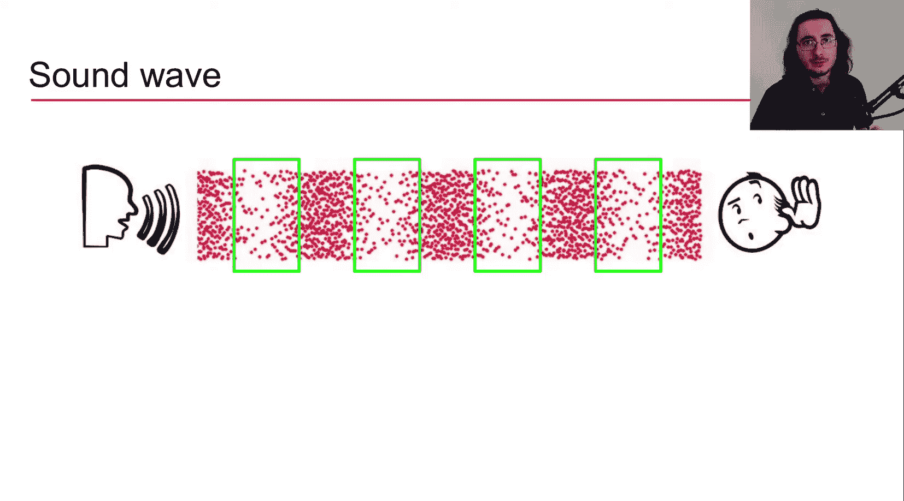
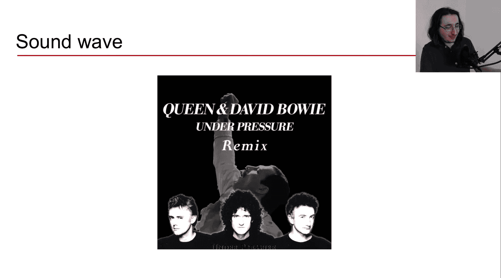
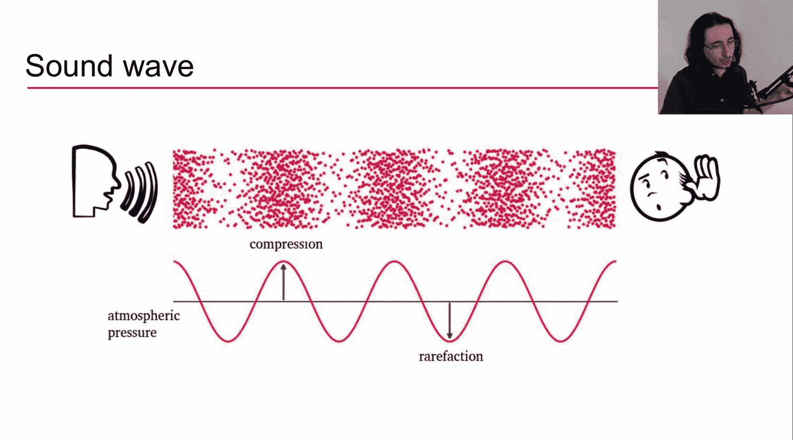
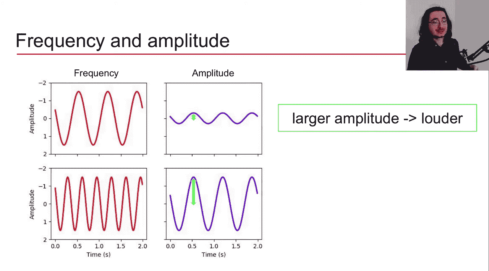
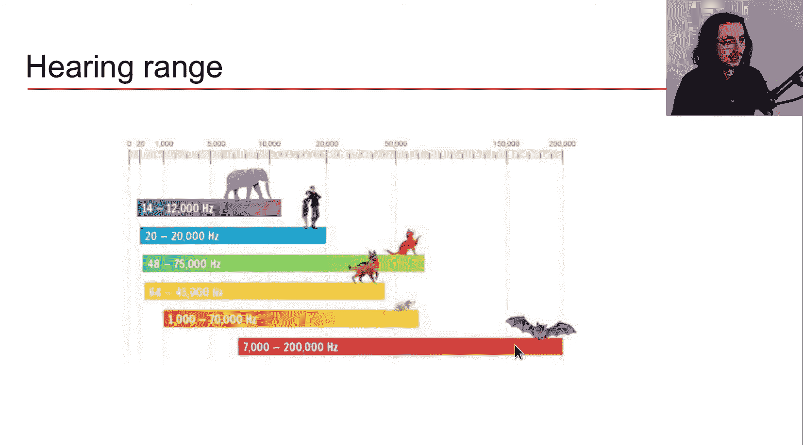
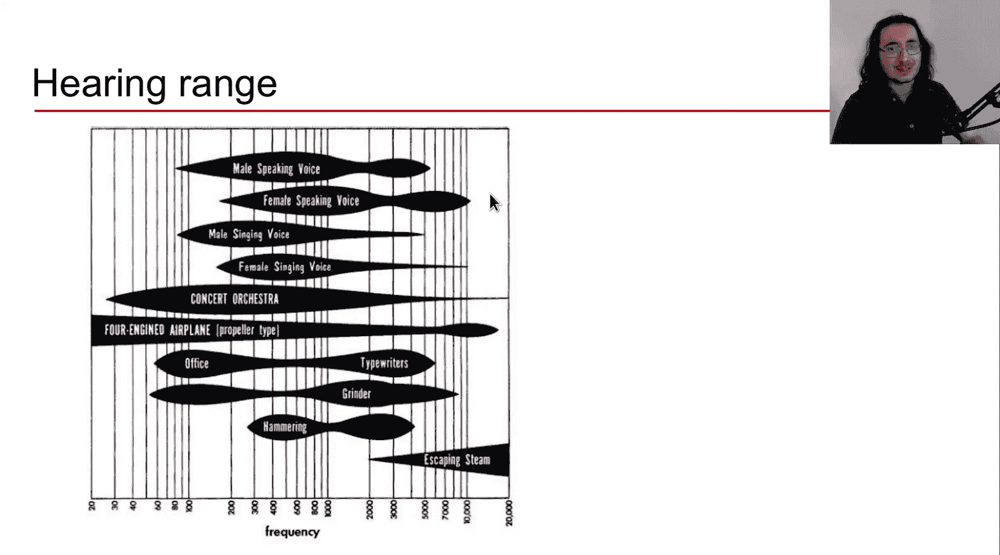

# Valerio Velardo【中英⚡面向机器学习的音频信号处理 Audio Signal Processing for Machine Learning】 p02 p1 Sound and Waveforms [BV1ftPLeCEhX_p2]

Hi， everybody。 and welcome to a new video in the audio processing for machine learning series。

 This time， we are basically startingting the whole series。

 and it's going to be quite theoretical because I want to introduce a few basic idea。

 So what's sound， What are waveform。 And so whats frequency。

 And how can we use all of those notions in audio processing， Okay。

 so let's get started with the basic idea here。 So what is sound。 Well。

 sound is produced by vibrating objects。 So these objects vibrate and these vibrations cause are air molecules to oscillate and to bump into each other and by bumping into each other。

 these air molecules kind of like change the state of the air pressure in in like the local region where they are acting。

 And so they create in this process a wave。 So in other words。😊。

We can think of sound as a wave that transmits transfer some energy from one point to another through air molecules。

 but the question is what is a mechanical wave and I'm talking about mechanical waves here because sound is a mechanical wave So a mechanical wave is a wave that oscillates and that an oscillation that travels through space and the energy travels from。

 as I said， one point to another and the particularity of mechanical waves is that they need a medium through which the wave can expand and propagate through in the case of sound most of the time this medium is just air right and when we have this sound wave or a mechanical wave。

 the medium gets the forms and in the case of sound。What happens is like as I mentioned before。

 is that's like this。😊，Molecules tend to bump into each other and when that happens we have like higher points of pressure right and then when they just like kind of like move away from each other。

 we have like points of more like rafa of less air pressure。

And obviously we can represent visualize all of this by using a pressure plot so but obviously this is not the type of pressure that I want to talk about here is like air pressure right so basically the idea here is like we can visualize a sound wave as a in this case like as a simple like sinine wave right and so we have the center here。

 the average atmospheric pressure and then we have over time points of compression which are connected with this like denser points where like air molecules collide with each other And then we have like this points of rare refraction where just the air molecules are more spaced out right so this is like the whole idea of a sound wave that just kind of like travels through a space using air as。

😊。

medium okay so now we can represent a complex sound using a waveform。

 which once again is basically like a pressure plot。

 So we are we are plotting the deviation of air from these pressure from this zero level against time。

 and so with a waveform like this that I'm sure like you'll be familiar with with。

 we can just like represent a whole piece of music， some noise， whatever we want really。

 and it's a nice way of visualizing and having like a quick understanding of visualization of what like a sound like looks like okay and as we'll see the waveform is going to be like fundamental for doing certain transformations which are going be very important to get important features about audio signals okay so now。

A waveform is great because it provides us with an array of different information。

 It's not just about like frequency information， but also about intensity timebra。

 other types of temporal information duration。 So for example。

 if we have like a complex waveform for like a piece of music。

 we can identify onsets and the duration of the nets and all of these kind of cues。

 and it's kind of like mesmerizing that all of thats comes from like a very simple graph2 d graph。

 Co so now we can divide sound into a couple of like classes of categories So we have periodic and a periodioic sound。

 So in the case of periodic sound， this is like a sound where the compressions and rare fractions repeat regularly right。

😊，You can fix a period at which you have peaks or you have dips。Now。

 the simplest form of periodic sound is a single sine wave。

 And so we know like the math behind sound waves like really， really well。

 So that is like very convenient for us。 Now a more complex type of sound that is like sound。

 for example， of an orchestra playing is the so-called complex sound that as we'll see in a few videos is the result of multiple sine waves that get kind of like combined a superimposed together。

 Now so this is the type of like periodic sound。 then we have a periodioic sound。

 obviously like the name here is a clear hint。 So which a periodioic sound we don't have like periodicity in the audio signal and we can differentiate between two types of a periodioic sound so continuous and transient So continuously a periodioic sound is just noise and basically you have like a。

😊，Of points as a away from， which don't follow any pattern whatsoever in the air pressure。

 It's just like some random points sampled through like the on the air pressure axis。 Okay。

 so the transient a periodioic sound is a little bit different。

 So all of those like popping sounds or like clicks and things like that can be folded like a transient。

 So these are just like bursts of energy and which change like the air pressure suddenly it's kind of like a pulse thing。

 And then again there you don't have any type of periodicity whatsoever。 Okay。

 so now let's try to start with the simplest things first， which is like I having like a simple。

Sine wave。 okay， so here we have the waveform for like a simple sine wave。 And here also down here。

 we have the math for that。 And as you can see， we can easily create the equation of this sine wave by using a bunch of like different parameters。

 So this a caps a here is the amplitude。 And then we have F， which is the frequency T is just time。

 And then p is the phase。 Now， let's try to take a look at each of these parameters in isolation。

 So that you get an idea of like how they influence the waveform itself。 Okay。

 so frequency is connect it with the idea of period。

 So the period is is very simple like to understand as a concept， right。

 is just like the amount of time that we need to elase before having to picks。😊，Or， for example， to。

Dips， right？ Okay， so this is the period。 Now the frequency is just the inverse of the period where we've indicated period with capital T here and frequency is expressed in hertz。

 which is number of cycles per second。 Okay， so now the amplitude in sta is a yeah。

 quite simple intuitive concepts as well to understand。

 and it's basically how high or low this perturbation in air pressure it goes， the higher it goes。😊。

And the higher the amplitude， obviously， right？ So this is like we can take like this information just by starting from0 and then looking at the difference。

 For example， between the peak， the the value of the amplitude at the peak and and at 0 right and so there we have the amplitude。

 Okay， then the final parameter that we were kind of like pondering was a phase。

 which is indicated with the phi letter from the Greek alphabet。 Okay， so phase。

 what phase tells us is basically like it enables us like to shift the waveform to the right or to the left。

 and phase basically tells us what is the position of the the waveform at time 0， right？ Okay。

 so which amplitude which frequency and with。😊，Phase we are able of determining。

All the parameters and have like a complete understanding of a sine wave and as we'll see in future videos。

 this is extremely important because complex sounds can just be thought of as a combination or superimposition of many sine waves together。

 okay。😊，Cool， okay， now let's take a look at frequency and amplitude a little bit more。

 And so as you can see here， we have like here with this red graph， like two waves。

 And so the one above here has like this frequency or like well。

 that actually like is the period right and this one down here as this period here。

 which is like shorter。 So the frequency being the inverse is higher。

 So what's the relationship between frequency and sound。 Well， the higher the frequency。

 the higher the sound that we perceive right now a similar thing can happen with amplitude。

 So we we see here with this purple graph in the top right where the amplitude is quite low and then down here like bottom right。

 we have a sgue with a higher amplitude and that perceptually translates to。😊，Have a louder sound。

 so larger amplitude are connected with louder sounds and this like makes sense intuitively because the amplitude just measures the amount of perturbation that happens in the air pressure right and the higher de perturbation。

 the higher the energy that we transfer and the louder that will sound。😊，Okay。

 so now here we have like a basic understanding of how frequency and amplitude map onto perceptual aspects Okay so now an interesting thing that I want to cover here is the hearing range and as we'll see。

 this is extremely important for decisions in audio processing like sample range and a bunch of other things now different animals usually have like very different hearing ranges so humans。

 for example， have a hearing range which is between 20 hs in 20000 hers but if we go and we take a look at the hearing range for cats and dogs。

 we see that they are capable of hearing ultra higher frequencies the frequencies that we humans call ultrasound just because like we I mean guess like everything is anpocentric and so what we can hear。

😊。

And goes beyond like what the highest ribbonance we can hear is called ultrasound and basically like the both of cats and dogs and definitely bats can hear ultrasound。

Right， so now let's take a look at a few examples of like sounds and where they are mapped into the hearing range。

 So if we take a look at the concert orchestra， for example， in the middle here。

 So you'll see that the concert orchestra more or less like covers the whole spectrum of hearing range of human hearing range and like I mean that like makes sense。

 And so here you have， for example， like the male singing voice， which is between somewhere。

 it'd say like 60 to 2000， even like 5000。 and then the female speaking voice。

 which is usually like anoc of above the male speaking voice as a rule of thumb And so it starts around like 200 hertz and it goes all the way up to 10000 hertz okay so here like you get an idea of different types of sounds and how they mapped onto hertz and our hearing range。

Okay， so now what we've talked about until now is a kind of objective measure of sound。

 which is frequency。 Now the way we hear frequency and we perceive frequency it's kind of like very subjective and it's not really like that objective like a tool and now pitch is the concept that we use for the perception of frequency right。

 okay， so the thing the interesting thing I should say like about pitch is that we don't hear pitch in a kind we don't hear。

 I should say frequency in a linear way， but rather in a logarithmic way。😊。

So one other like interesting thing here is that two frequencies。

Are perceived to be more or less like the same。If they differ by a power of two。

 And so this is like the concept of octave that's coming into place and we'll cover this。

 But for now， I want you to understand that the way we perceive a pitch or the way we perceive frequency through pitch it's kind of like very different and different from like frequency itself because we have this kind of like logarithmic perception of frequency。

 Okay so to understand the concept of pitch， we need to understand the concept of media notes。

 now mediai notes our kind of like very common and very handy convention for just like transferring information about like musical notes and stuff like that。

 But what we want to understand here is that how they map onto like pitch and a keyboard。

 So now here we have like a piano keyboard right， and the idea of media notes is that we can attach。

To each keyboard， a number， I a media number， right？ So， for example， the middle C down here。

Has a midi note， which is equal to 60。 Now， we can map this midi notes to note names。

 So this midi note 60 is equal to C 4。 Now， what does that stand for。

 So we have like for a note name like two parameters there。 So one is a letter。 And yeah。

 that's just like the the note names， right， C D， E F， F sharp， all these things， right。

 and the other one is a number。 So what's that number。 Well。

 that number represents the octave we are at。 So now。

 I guess like most of you are familiar with the a concept of like a scale， like or a octave。

 and you've like perhaps played it around like with with a keyboard like a piano yourself。

 But if you're not。 The basic idea is that we have。A pattern of notes that always repeats itself。

 So we start like with C， we go to see sharp D and an E F，G A B。 And then we can go up an octave。

 And here we have like the very same pattern， the very same 12 notes， which we call sentence。

 So there are like 12 sentence in the whole octave。 Okay， so now what's the difference between this。

 this， this and this。 Well， basically like the the notes that get like the same name。

 So C will sound basically the same， but they'll sound somehow like higher。

 So it's difficult to explain， but basically like the tone itself is the same。

 but it will be perceived as higher。 Okay， so， and basically like with the number here in the note name。

 like the C 4， the4 just expresses the octave we are at。 and obviously。The octave。

 like is this interval that we have like between， for example， like C 4 and C 5。 Okay， cool。

 So how does that map onto the idea of frequency， So let's take a look at that。

 So we start with the with a simple note， a fundamental note， which is a4 or pitch or midi note69。

 And this is set at 440 Hz。 Now， the idea is that if we go up a octave。

 So to a 5 will have the frequency that's double that， it's 880 Hz。

 So the the basic takeaway point here is that when you have like notes that are like at an octave above。

 they'll have a frequency that's double the frequency of the same note at the octave below。

 right okay。😊，So。😊，Now， if we take all of these ideas and we plot them on a pitch frequency chart。

 you'll see that now the connection， like the the mapping between frequency and pitch is a logarithmic one。

 And you can see like here， the nice logarithm function here。

 And here on the y axis on the pitch axis， we just have like a 0， a1 a2， a 3， a4 so on and so forth。

 And you'll see that basically like at every octave， we go above。

 we we just like double the frequency in Hs down here okay。So this is like a very interesting aspect。

 And it seems that in sound， like the way we perceive sound across the board。

 not just by full frequency， but also， for example， for。😊。

Aitude for like intensity is a logarithmic and not only that， but if we're talking about music。

 even like the very concept of time and rhythm is somehow logarithum a logarithmic and based on powers of2 but yeah。

 I guess we'll look into that in the common videos。

 Okay so how do we map pitch onto frequency here we can use a very simple equation。

 So you have like this frequency F as a function of p。

 which is the pitch and will pass the pitch in as a middin and here you have this nice function So you have two to the power of P minus 69 divided by 12 and all of this guy is multiplied by 440 and this 440。

 you can recognize that's just the frequency of pitch69 at middi notes。😊。

because like if you plug into this P here， 69， the whole thing here will become one。

 And if you multiply that by 440， basically you just get 440。

 which is the frequency for pitch 69 or a4 Okay so now let's try to plug like an example number here。

 Okay so here we are plugging 60， which is middle C or I think it's C4 right and we plug it in here。

 and when we when it's all said and done， we get back 261。6 and that's the frequency for pitch 60。No。

So as we said， an octave is divided into 12 semitones。 Okay。

 so 12 different nodes that are that have like the same distance like among themselves， right？ Okay。

 so they basically divide the whole octave in 12 equal parts。 Okay。

 so so what's the relationship between two subsequent pitches。 Okay。

 and so we can just like take a look at that by using like this function this equation here。

 So the frequency of p plus one， which is like the subsequent pitch to the one that we are analyzing。

 So the subsequent semiton。Divided by FP， the ratio is given by2 to the power of 1 divided by 12。

Okay， and that's equal to 1。0 59。 So this is like the ratio between two subsequent sentencetons。

 And this remains always the same throughout like the entire like keyboard of a piano， if you will。

 Okay， so now one thing that you， I want you to notice here is that like this is like quite intuitive。

 And it's because if we。So basically we are saying that like every time we go up and octave。

 like this factor is going to be like equal to 2， like the factor。

 like the multiplication factor of the frequency is going to be equal to 2。

 but if you could just opt up a semiton， so this is going to be equal to2。

To the power one divided by 12， because we know that we are dividing the octave in 12 seton。Okay。

 cool， okay， so now to finish this video， I want to talk about a sense。

 So this is like another very important concept and it's related with the idea of like music perception mainly so。

😊，The idea is， basically， that we have。We have like a quite decent resolution when it comes down to pitch obviously we are capable of like picking up like different stons and understanding that there's a difference in pitch there。

 but we are better than that so we are capable of like。

Appreciating pitch differences that are smaller than a semiton。 So how can we measure that。 Well。

 here is where sense come into place。 So the idea of a scent is that it the whole ocve is divided in 1200 cents。

 So we have100 sense for each semiton。 Okay， and so here。

 the cool thing is that obviously like there's a there's a threshold below which we can't just like really tell the difference between two pitches。

 but that threshold of so-called noticeable pitch difference is between 10 and 25 sense depending like on who you are。

 I guess your age and your background if you are like a musician or you're not。

 Probably if you're a musician， like you are capable of appreciating pitch differences is way better than non musicians。

😊，Okay， cool， so by now you should have like a fair understanding of what what sound is。

 what a waveform is， and everything that has to do with frequency and pitch。

The next time we'll continue delving into sound and all the different parameters which actually describe sound。

 Pre， we're going to talk about intensity， power and loudness that are all features that are somehow correlated or connected with the idea of amplitudelic it。

 And then we'll also venture into a very cool topic， which is that of timer， the time of sound。

 And this is like a very difficult one like to grasp because it's very nuanced and it's very， very。

 I don't know， like very aome， I would say and subjective so I hope you enjoyed this video。

 if that's the case。 please remember to live a like。 And if you haven't subscribed to the channel。

 please do so you'll get like all the videos that I'm passinging。 And finally。

 I want to remember that we have。😊，Community， which is on a slack workspace that's called the sound of AI。

 where if you join， you're going to be able to just like join the discussion。

 ask questions with the community， get feedback and again。😊，Happened to know like very cool people。

 Okay， that's all for today。 I hope I'll see you next time， cheers。😊。

