# Valerio Velardo【中英⚡面向机器学习的音频信号处理 Audio Signal Processing for Machine Learning】 p03 p2 Intensity, Loudness, and Timbre [BV1ftPLeCEhX_p3]

Hi， everybody。 and welcome to another video in the audio processing for machine learning series。

 Last time we talked about basic features of sounds。 So what sound is。

 waveforms and introduce the concept of frequency。 This time。

 we continue delving into the features of sound talking about intensity， power， loudness and timer。

 So first of all， I want to talk about to a couple of concepts。 So intensity and power。

 And these are like connected together。 So let's start from the power of sound。 Well。

 this is we all know how the power of sound， right。

 but we don't want to talk about the power of sound here。

 We actually want to talk about the reverse of Dutch。 the sound power。 So what's the sound power。

 Well， this is a physical measure that we can express like this。

 It's basically the rate at which the energy is。😊，transransferd。

 this is basically the idea of the concept of a power in general。

 but if we talk about sound power specifically， this is the energy per unit of time emitted by a sound source in all directions across。

 I mean， like the air across like the the medium that the sound is struggling in and we measure power in watts okay and we indicate that with a capital w。

 okay， so this is like the idea of sound power now connected with sound power we have another thing that's called sound intensity and sound intensity is simply sound power per unit area right and we can measure that as wts divided by squared meters。

 Okay， so the higher like the。Intensity and obviously the higher the kind of like。

Perception lack of loudness of that sound that we're going to have。 Okay。

 so now I want to ask you like a question say。😊，How much power do you think I thunder like a super heavy thunder has or how much power do you think a concert orchestra has Well。

 you may think like quite a lot right because like we perceive it as very loud definitely like the the heavy thunder right and it gave us like a few scares like I guess in the past when we were a child okay but。

😊，That's not really the case。😊，So both a concert orchestra and a heavy thunder usually have a sound power of one wt。

 Now， if you are not familiar with like any reference liquid water， I'm going to give you one。

 So your usual like a light bulb used to be1 hundred0 watts， Okay。

 so like a whole orchestra is a hundredth。Basically， of a light bulb in terms of like power。

 same thing for this heavy thunder。 So yeah， this is like quite mesmerizing， isn't it？ Okay。

 but basically， this tells us another very interesting thing。

 which is connected with a concept called the threshold of hearing。

 So humans are capable of perceiving sound which have extremely small intensities。

 and the threshold of hearing is at 10 to the minus 12， what over square meters， right。

 So this is like an extremely small number， but still we're capable like of hearing about。

 So obviously like the threshold of hearing， like is the minimum intensity of sound that we can appreciate。

 Okay， so now another kind of threshold， which is like very important for us。

 It's called the threshold of pain。 So which is like the threshold beyond。😊。

Which we start to have like a hearing pain， right， because like the sound like is like two intense。

 Okay， and that's it at 10。Whats over square meters So if you just like calculate the difference between 10 to the minus12 and 10 you appreciate that like the the range of intensity that we can perceive is enormous it's basically like 13 orders of magnitudes which is incredible and that's why we use the so-called intensity level like for describing the the intensity of the sound and that's why we put the intensity level on a logarithmic scale because like the range like is really really enormous and the intensity level is connected with this measure which we called with unit of measure which we call decibels I'm sure like you may be familiar with this but you may be you may have wondered okay。

But what's deciable Well it's a measure of intensity level and it's a ratio between two intensity values I just like found that I have like a small like typeper here it's not ratio because I don't know what that is but it's a ratio between two intensity values right and so we use an intensity of reference which sometimes is the threshold of hearing and that we compared that against a current like intensity。

😊，And we applied that ratio， a logarithm。 And so if we want to take a look at the function that describe decibels as a function of intensity is this one。

 right？ So we have 10 by log of an intensity divided by the intensity of the threshold of hearing。

 Okay， cool， Okay， so now you may be wondering， but what's zero decibels。😊，And so for that。

 we need to pass in。The intensity of the threshold of hearing and so if we do that this ratio basically like goes down to to one and a logarithm or one is equal to zeros and we multiply 10 by zero which is zero okay so a zero at zero decibel we're basically appreciating the intensity of the threshold of hearing Now this is not a universal because it really depends on the kind of like reference intensity that you use in the intensity level。

 but usually like you'll find a lot of people like using the threshold of hearing like as as an intensity level of reference okay so another thing to notice about the intensity level is that every time we go up by three decibels the intensity tense to double so if we are。

0 decibel， we are at the intensity of like the threshold hearing。 but if we go up by three。

 we are just like doubling that intensity。 Co so now I want to show you a cool table which by the way is like I took it from a book which is an amazing book like on audio music processing that's called fundamentals of music assess it and it's by mueller So many of the like pictures。

 like graphs and tables I'm going to use here are just like taken from that book and I highly suggest you to go check that out because it's great and it will give you like way more context that one I' covering here。

 but here you have a table where we have a lot of like different sound sources and we have like the intensity measured in what's over a squared meters and the relative intensity。

😊，Level and the thats like。Compared in in terms of like the threshold of hearing Okay。

 so like when we whisper， we have an intensity， which is at 10 to the minus 10。

 which is basically a 20 decibels。 So a normal conversation happens at an intensity of 10 to the minus6。

 which is 60 decibelts and the threshold of 1， which is we know is already intensity 10。

 it's 130 decibelts and the jet。 So when you have like a jet engine a takeoff。

 This is at intensity 10 to2。And it's 1 and 40 decibels。 Okay。

 so this gives you like more or less like an idea of like the different sounds and the relative intensity。

 But now let's move on to another aspect that I think like it's extremely fascinating。

 which is loudness。 Now， while intensity and power or to objective measures。

 loudness is a subjective measure， like of intensity。 it is really like how loud we perceive a sound。

 And as we've seen for a frequency， pitchach。😊，Which is like the relative like。

Kind of like subjective measure of frequency。 Obviously， it correlates with frequency。

 but like there's some level of like， subjectivity and some level of like mapping that's not like linear。

 not the direct。 And the same thing happens here between intensity and loudness。 Okay， so。😊，Loudness。

 so， first of all， depends on duration and the frequency of the sound in terms of duration。

 So we usually hear as at， at equal intensity， we hear shorter sounds as less loud than longer sound。

 So， for example， if I have a sound。😊，Which is at， say， three decibels。

 and it only lasts for 100 milliseconds。 I'll hear that。

As less loud than a similar sound with the same three decibel intensity level。

 but which lasts for 600 milliseconds。 So this is like kind of like very fascinating because at the end of the day。

 the intensity is the same。😊，But the perception of loudness is different。😡。

And a similar thing happens also with frequency， so frequency。

 depending on which frequency the sound is， we're going to hear that sound at a different loudness level and obviously loudness is also correlated with age so people of different age are going to hear like sound with same intensity。

😊，But like with different loudness right And for loudness。

 So what researchers have done is basically they went out there and they did a lot of experiments to understand how we perceive sound and measured that with psychological experiments。

 And they came out with this measure unit of measure called fonts。 So now let's take a look at fonts。

 So here you have a very interesting chart that's called like equal equal equal loudness conscious。

 So now on the Y axis， you have the sound pressure level measured in deciible。😊。

So that's the intensity level here on the X axis。 You have frequency in a logarithmic scale。

 and it's measured， obviously in htz。 you should know that by now。

 and here like this curves that you see like in a red。 So these are called equal loudness conours。

 So along these curves we hear a sound to at the same intensity。 So， for example， on this curve here。

 we hear sound at 80 fonts， which basically is like we hear it at the same perceived loudness。

 However， what changes is the intensity level across the frequencies。 So for example。

 when we are like at a very low frequency， say 20 htz。 we need a lot of intensity。

 So 120 decibels to perceive that sound at 80 fonts。 So then when。😊，We go up， say to a thousand。

Hs then。To perceive that sound at 80 fonts， we need way less intense of a sound。

 which is around 80 decibels。😡，And so which basically means that like at lower frequencies。

 we perceive sounds like as less loud if theyre equal in intensity， and this is like interesting。

 And if you look at like where we are the most efficient with loudness here。

 it's around like from a few hundred hertz until like 5000 I would say7000 hertz。

 which is like more or less like the range of like human speaking and human like singing which may not be like a case at all。

 right， so we are kind of like tailored to be the most efficient a that frequency range and then like when the frequency goes up again。

 so we still yeah， we are less efficient like a hearing sound perceiving like the loudness and so we need more intensity to perceive like the same level of loudness Okay so this is。

😊，like extremely， extremely interesting and I'm always like fascinated about like the correlation between like physical measures and kind of like perceptual measures like and the way like these two things yeah are connected together and now we enter like yet another aspect of sound which is kind of like highly subjective and difficult to grasp and that's timera okay。

 so what's timer well。😊，I wish we knew you。Because like researchers interested in sound。

 music and all of these kind of things， like I've studied timberly for a long time。

 the problem is that we don't have like a real and comprehensive definition of timra。

 but we have like a few hints。😊，So if you ask a musician what Hamber is。

 like they would probably tell you like it's the color of sound。

 but that's the weird definition like for some something like which we hope could be like a measurable thing。

 right？And but if we talk about this， like from a kind of like more like programmatic。

 like logical perspective， we could think of like timebra as the diff between two sounds。

 which have like all aspects equal， like in terms of like intensity， frequency and duration。

 So you do a di。 and what remains like as sound there， timebra， sorry， it remains like timebra。 Well。

 the point is like if you have like the same like notes， like C5， for example。

 played on a tru trumpet and on a violin with the same intensity。

 You still hear that there is a difference there， but it's not intensity。 It's not frequency。

 It's not duration， it's timebra， okay so。And timebra is usually described with words like bright。

 dark， dullll， harsh worm。 So all of this like sounds a little bit fuzzy， right。

 and that's because it is fuzzy。 but now we don't know what timebra is perfectly。

 but we have a clear idea that timebra is somewhat multidimensional。

 So many features coming into place to define timebra。

 This is different from other aspects of sound like a frequency。😊，Or intensity。

 where we just have like one like one measurable， one observable there。 Okay。

 so what are like some of these features that come into place which timer。 So here I've listed three。

 which are like the most important ones。 So one is called the sound envelope。

 then we have the harmononic contents and then amplitude and frequency modulation。 Now。

 I'm quite sure that most of you are completely obli is about like what these things are。

 But don't worry， because I'm going to cover like all of these things in depth。

 And we're gonna to have like quite a lot of fun going through all of these aspects of sound。 Okay。

 so let's start with sound envelope， which is called also amplitude envelope。 So what's that。 Well。

 when we think of a sound， definitely like this is true for like musical sounds。

 like notes and things like that on different instruments。 So the sound usually has like I。😊。

An envelope right？ And so this envelope can be divided with a model that's called the ADSR model。

 which stands for attack decay sustain release model。

 So basically the idea is that the amplitude of this sound has an initial spike and that's like the attack。

 So for example， is when you strike a key on a piano， you have like a spike in amplitude。

 which also has some kind of like noisy sound due to the hums like of the of the piano。

 And that's like a type of like transient sound。 Then you have like a decay。

 which is like where the sound like stabilizes a sustain period。

 which is like where the sound like remains like more or less like constant in amplitude。

 And then you have a release， which is like just like the fading out phase of a sound。 Now。

 the interesting thing is that different types of like sound have different envelopes。

 And this is like definitely。😊，True for musical instruments， so let's take a look at this。

 once again a'musing like this figure from the Miller's like book fundamentals of music processing。

Okay， so here we can like compare two different envelopes for a piano sound。

 So here like you just like press a key and you wait for it， like to to just like decay。

 And here you have violin sound， okay， and you see that the ADSR at the envelope of this two sounds。

 It is like very， very different。 So with a piano， you have like a short attack， a transient here。

 Then you have like a little bit of a period of decay。 And then you have a sustain。 Finally。

 you have a release down here， right。And this is different for violin。 as you can appreciate here。

 the attack is way longer in terms of time。 and that's because like the attack is less sharp。 Okay。

 then you really don't have like a period of decay here。

 you just have like some kind of like sustain and then you have the release when yeah。

 just like and the sound。 Okay， so sound envelope is an important feature that determines the the sound。

😊，Okay， so one thing that I want to tell you here is that， for example。

 if you remove the attack part from a key sound from a piano sound。

 what happens is that it's difficult to recognize that that is like a piano that's like。Plaing。

 right， That's because like we， we associate like a piano sound with its like sharp， transient。

 quite a lot。Okay， so now let's move on to the second aspect， which is harmonic content。

 but in order to understand what harmonic content is。

 we need to understand what a complex sound is made up of。

 So a complex sound is made up of a superposition of many sinoid or like fundamental like simple like sounds right so。

We can think of like a partial as a sinusoid which is used to describe a sound。

 so the many different sinusoids that we have which are superimposed together to create a complex sound are called partial or a harmonic partials So the lowest partial is called the fundamental frequency and this is usually like the one that gives the peach name to a note we are talking about like a note。

 for example， musical note。And now the harmonic partial。😊。

SoSo the harmonic partials are frequency frequencies that are like an integer multiple of the fundamental frequency。

 So let's say we have a fundamental frequency， which is at 440 Hz， which is a4。Now， if we。

 if we take a look at the second partial there。 So harmonic partial。

 what happens is that we have to multiply that 440 by 2。 and this gives us like 880 Herz。

 Now the third partial will be。3 multiplied by 440， which is 1320 Hz。 Now you can move on。 basically。

 the idea is that's like the complex sound is going made up of all of these like partials and the harmonic content tells us how much energy we have in each of these partials and that determines somehow the timbmber of the sound。

 Now， not all sounds are perfectly harmonic So that's a lot of inharononicity in some sounds and that we determine in harmononicity。

 we indicate a the from a harmonic partial So that's， for example。

 if we had like some frequencies that are not perfect harmonic partials of the fundamental frequency。

 Now， if we take a look at music instruments， for example。

 we know that pitched instruments tend to be like harmonic whereas。

like precussive instruments tend to have a lot of inharmonicity， right， So， and usually obviously。

 like noise are highly completely like inharmonic， right？😊，Cool， so this gives you like an idea。

 But now let's try to like listen to some of these things。 So for showing the harmonic content。

 we should go and check out like a Jupyter notebook that I just like brushch okay So here I'm not gonna go through like the code because like the point here is not like to show you like some of these things because we're gonna to cover them like in future videos anyways。

 But I want to show you like some sounds and then the relative spectrograms。 Okay so yeah。

 so here just like I load some sounds。 And here， like I have like a nice function that I can use to plot a spectrogram。

 Now， what's a spectrogram。 So you'll hear about this like a lot moving forward。

 but basically the idea is that with a spectrogram。

 we get a snapshot of like the different energy in different frequencies all the sound across the duration of that。

😊。

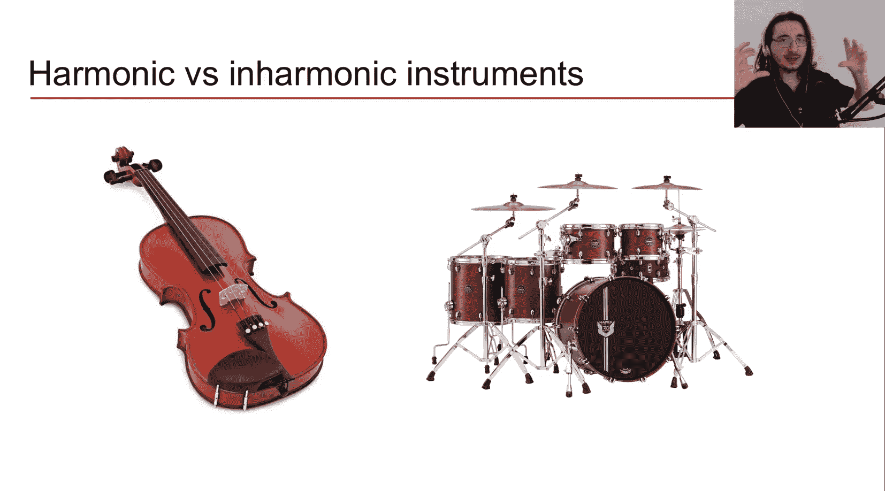

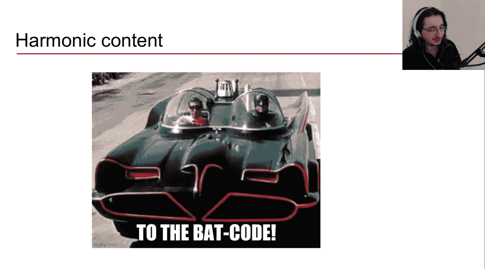

And we can visualize that with a nice plot， which is this one。 Okay。

 so now let's try to listen to a sound。 And so here what I want to show you like is two sounds。

 And we'll start with a violin sound， which a at。I believe at C4， okay。

 so that's middle C and so let's listen to this sound。Okay， yeah， it is， okay。Good。

 so that's C4 on a violin。Okay， so now let's plot the pettrogram for this。 And here you have it。

 Okay， in all of its glory。 basically the idea here is that on the X axis。

 you have time measured usually in seconds on the Y axis you have hurttz。

 and this is like a logarithmic scale。 And here， like each point here has a color and the color tells you like the intensity of a。

😊。

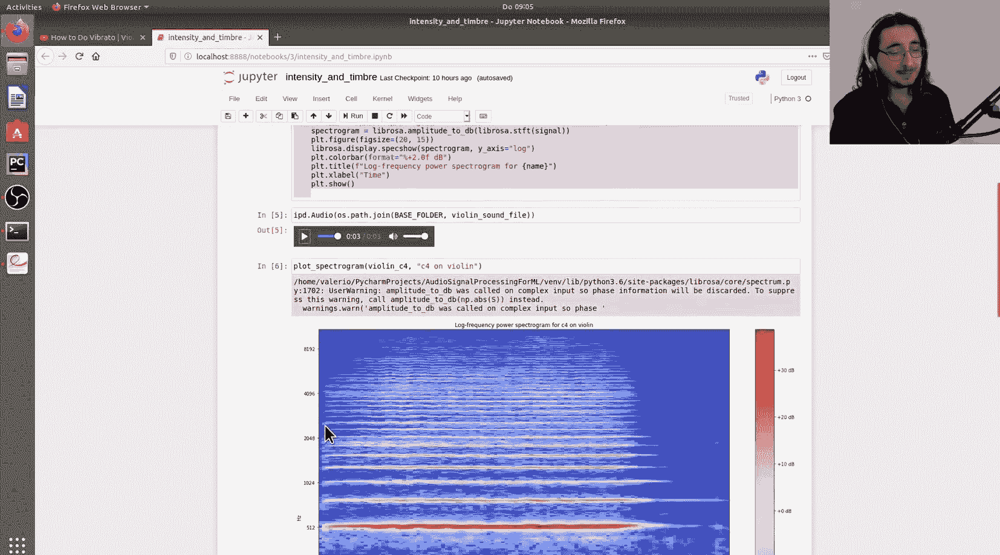

Yeah， of that frequency at that like specific time。 And so here， like。

 you have this color bar that tells you like how to read like the intensity based on color。

 like the redder and the more intense， like the that frequency is。 Okay， so as you can see here。

 So we we have a lot of like energy here in at days， like。😊，Frequency band， which is around 256。

 Presely， this is a 261， which I believe like should be like the Htz for C4， the frequency for C 4。

 And yes， and here we expect a lot of energy。 But then we have like the partial。

 the harmonic partial here。 which is double that frequency， which is a 512。 And as you can see here。

 we have like that coming in。 And then we multiply it 25661 by3。 And we have the third partial。

 And you can see it here， the fourth， the fifth。Cool， it's super cool。

 And you can go up and up and up and up。 and you still get like all of these partials。 Okay。

 and so as you can see， there's not much like in harmononicity here。

 So the partials like are very well defined here。 Okay， so now let's compare this with a piano sound。

 Okay， so now I have， I believe， like it's say， C 5 piano sound。😊。

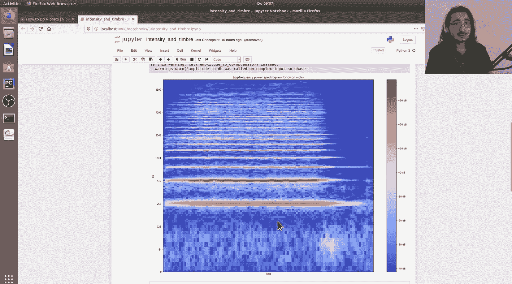

So， let's listen that。Okay， so you heard that。So this is C 5。

 So it's a not of above the violin standard we just heard。 And so let's take a look at the。

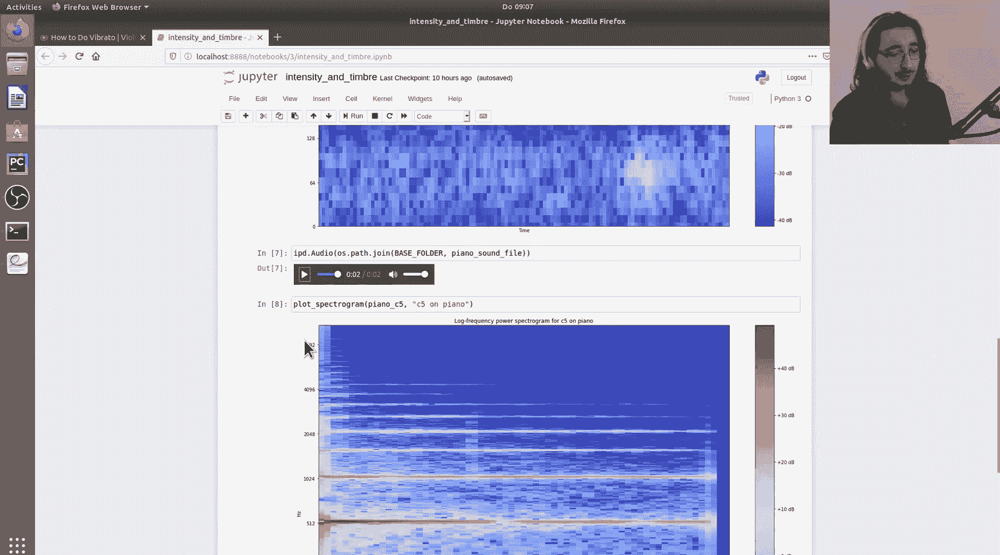

嗯。And the spectrum here。For this piano sound。 And so as you can see here， we have。A lot。

Of activity around 512。 And this is like correct， right。

 because this is like the fundamental frequency that we expect at C5。 and then over here。

 you have like the first like harmonic partial， you go up the second， the third， the fourth。

 But as you can see the the higher you go and the less present， like the partials R。

 And if you compare this like against this right， you see the difference okay。

So this is like way more sustained across so the energy is more spread out across the whole like partials。

 whereas here， like with the piano， like it seems to be like a little bit less so And so by looking at this。

 you can say， okay， so one of the reasons why like this two sounds are different is because of the a distribution of the energy across the different partials being different Co。

 now don't worry， like if you don't have an idea but like what spectrograms are or how we got to to them or anything like that because this is going to be a key topic and we're going to covet this like in a lot of detail because like is all about spectrograms and believe me Spectrograms are the key to underlying sound。

😊。

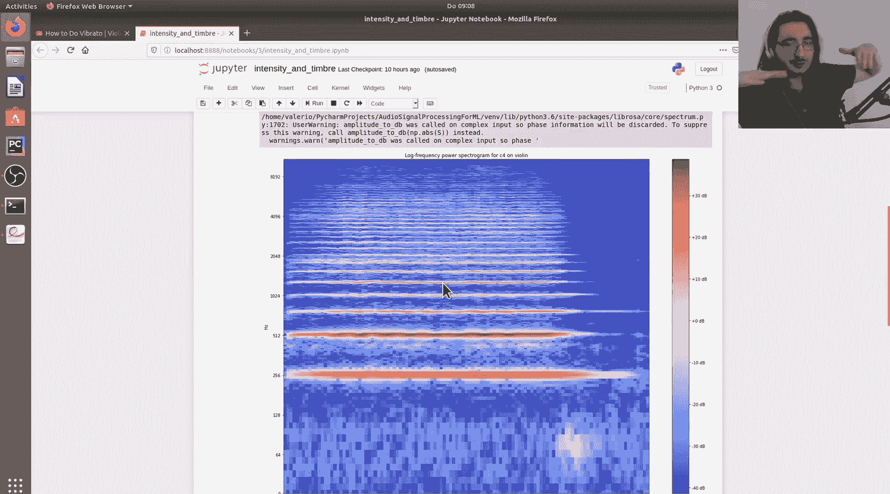

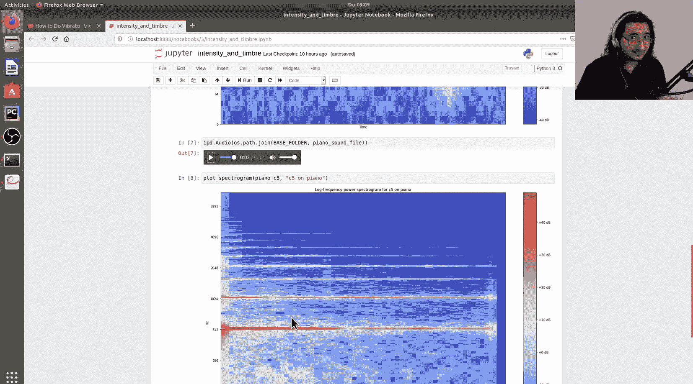

Okay， well I didn't want to go here， I just like spoiled what's coming next， but let's move on Okay。

 so now we have an idea about harmmononic content now we have like one final aspect of Tambra so we said。

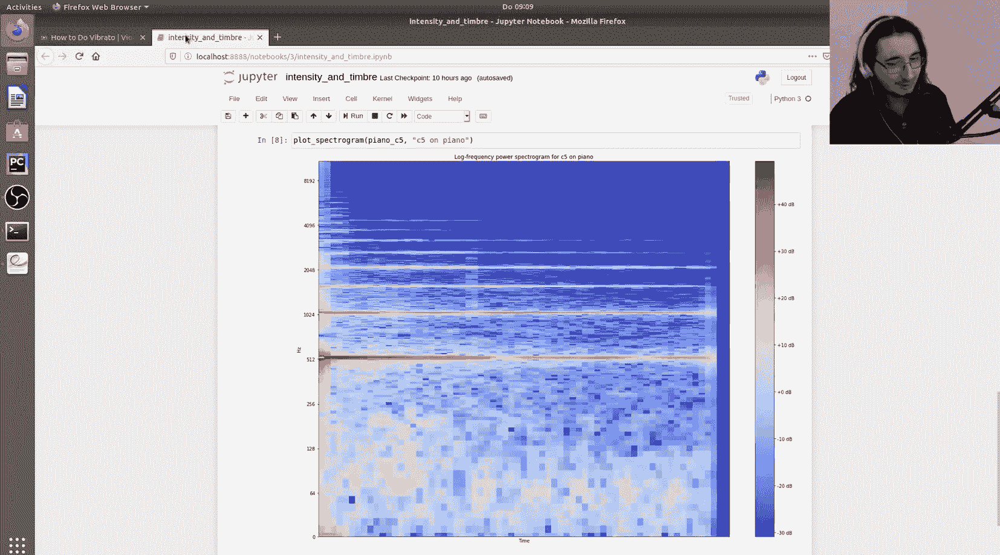

So envelope， harmine constant and now frequency and amplitude modulation。

 So basically modulation in the sound like itself。 So what's frequency modulation。

 So frequency modulation is also called in music circles as vibrato， right。

 and basically here you have periodic variations in frequency， And in music。

 you have this for expressive purposes， But like we can create an effect of vibrato effect by using like frequency modulation。

 And this can be formalized And， but basically the idea behind this is that。😊。

It starts like with a signal that you want to use to modulate the frequency of a a carrier signal。

 which is this one like in blue down in the middle。

 So you apply like this message signal signal on the carrier signal and you get。

These result down below。 And as you can see here， that's a frequency modulation because the frequency starts like this。

 but then the frequency kind of like goes down。😊，Okay。

And then it goes up and then it goes down right And so here we have a frequency modulation。

 So now you may be wondering， but how does like that sound like now， if you're a musician。

 obviously you know what a vibrato is。 But if you're not I'm going to show you。

 and this is where that amazing video comes in。 And so here we have a violinist who explains how to play vibrato on the violin So the first thing you'll hear is like the kind of like alterll turning like two notes right？

 And then after that you'll hear like how that can become a vibrato。😊。

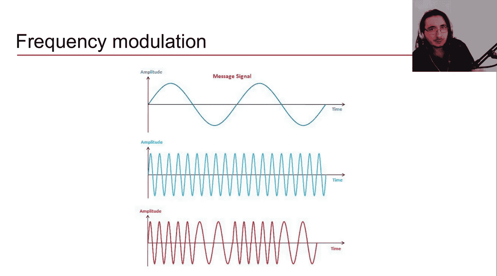

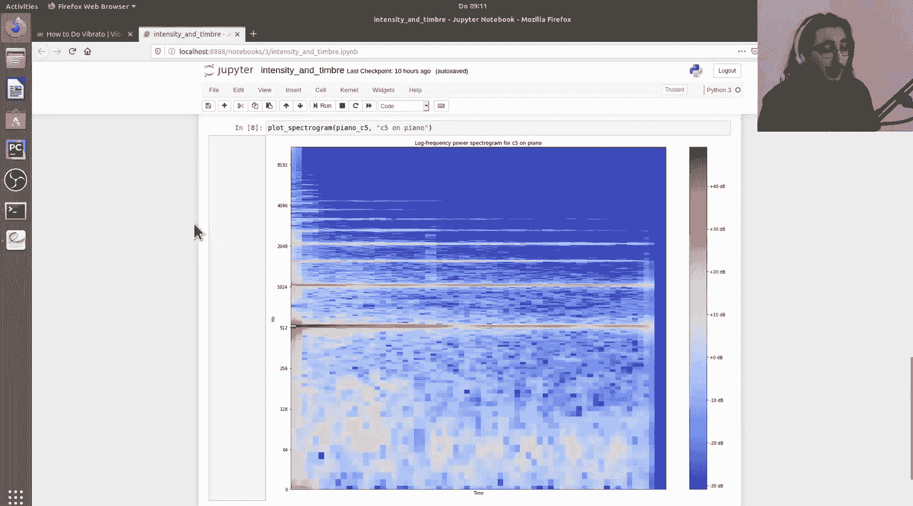

Yeah， that's very dull， right， It's toona very， very dull。 But if you change the speed there。

 you'll hear like the typical violin sound of thebrato sound。 Let's hear。

And until you reach normal vibrato speed。And you need to right， that's super cool。 Now。

 every time like you listen to violins or orchestras。

 like the strings usually use like this we brought to sound quite intensively。😊，Okay。

 so one thing that I wanted to say is like as a keyboard player。

 unfortunately we don't have this luxury of having like vibrato。

 but sometimes like you'll see pianists who like，😊，Kind of like strike a key。 And then after that。

 they kind of try to do a vibra。 Obviously， that doesn't have like any effect on the sound。

 But still they can have that。 So it's， it's like a nice like quirk。 Okay。

 but if you have a Midi keyboard。 Midi keyboards have this thing， which is like after touch。

 Like and after like you strike a key， then you can like vibrate the sound。

 And it's gonna like vibrate， but not on a piano。 I can assure you that。 I've tried， it doesn't work。

Okay， so now the other type of like modulation that we have is called amplitude modulation。

 And in musical terms， this is called tremolo。 And this is still like a periodic variation。

 but it's not in frequency， but in amplitude。 And once again， music。

 we can use this like for expressive purposes。 Okay， so how do we get to amplitude modulation。

 Basically， it's the same idea。 So we have a signal message signal。 we have a carrier signal。

 and we apply the signal on the carrier signal。 But this time not on the frequency。

 but on the amplitude。 And so you， you're gonna have like this effect that does like so like burst and release like of amplitude。

 like at regular intervals。 now， I want to show you this once again。 So so let me just like go here。

 So I have。😊。

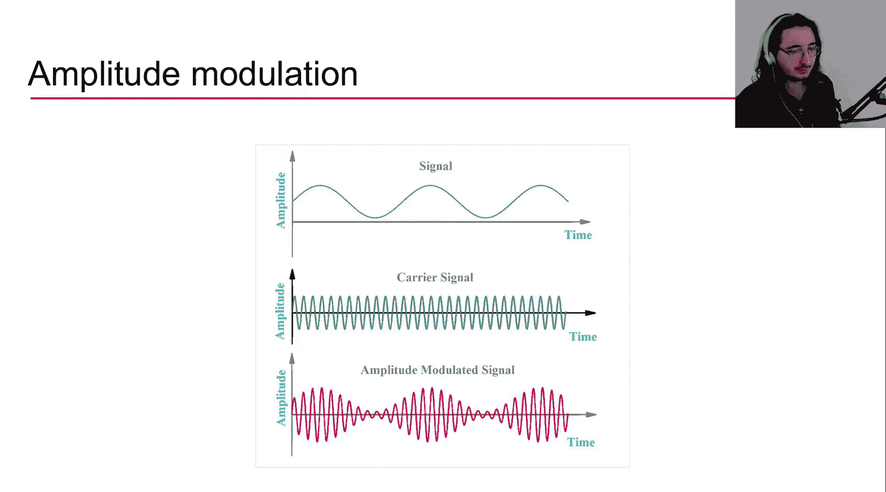

A sound down here that I want to show you with the tremolo right， amplitude modulation。

 So let's hear that。 but yeah， let's go back to0。🎼。🎼Okay， so yeah， you get the idea。

 So there like you have like this tremill effect and probably you are familiar with that because like you've heard it like in many different like musical pieces and whatnot right。

 but basically the idea here is that when we modulate the sound like this both like on the amplitude and frequency like dimensions。

 what happens is that we we change the timer of sound now we don't really change that much like the perception like of the frequency itself like of the amplitude is more like a quirk that changes the timer。

's as if like these things were like localized and had an effects like on timer。

 so here you have it like all the different things like that determine like timer that we kind of like know of or have like reconstructed。

 So timer for sure is a multifual sound like dimension dimension of sound。 and it has like。

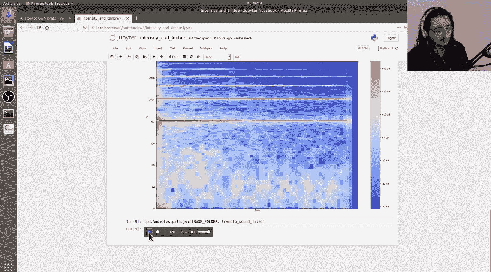

Three main things。 So we already reviewed them。 So amplitude envelope。

 the harmonic content or distribution of energy across different partials。

 and then the signal modulation， both like in frequency and amplitude Okay so by now you should have like a good idea of sound like and all the different aspects of sound。

 So we last time， like we said that sound like as a mechanical wave that propagates through air。

 it is characterized by frequency， like the intensity。

 we can describe it with frequency intensity timbra and obviously like some of these things are also like quite subjective like pitch lab danceance and of course。

 timebra okay so now you have like this very nice introduction and we are now ready to go to the next level which is introducing audio signals and specifically next time we are going。

Tackle two very interesting like topics。 Well， for sure。

 we are going introduce like audio signals and then talk about audio to digital conversion called ADC。

 the acronym and digital to audio conversion or DAC， which is kind of like the inverse process。

 so I hope like you've enjoyed this video if that's the case。

 remember to live like if you haven't subscribed yet。

 please do so if you have any questions or doubt or anything please like just like leave a comment in the section below and talking about questions。

 I just want to remind you if you haven't well， if if you're already here， that's great。

 but if you're not please join the sound of AI Sla community。

 So there you'll find a lot of people interested in like audio processing， machine learning。

 AI music all of this kind of stuff。 you can get feedback and talk with other people So I'll leave you a link to sign up to the slacklack community。

In the description below。 So I hope like you really enjoyed this video it' all for today until the next time cheers。

😊。

