# Valerio Velardo【中英⚡面向机器学习的音频信号处理 Audio Signal Processing for Machine Learning】 p04 p3 Understanding Audio Signals for Machine Learning [BV1ftPLeCEhX_p4]

Hi， everybody and welcome to a new exciting video in the audio processing for machine learning series。

 This time we start looking into audio signals。 and specifically。

 we want to understand how we can take a sound and convert it into a digitalized audio signal that then we can use to manipulate it or to extract features and do whatever we want with it。

 really。 Okay， but first of all， let's understand whats an audio signal。

 So this is a possible representation of a sound and this representation has all the info that we need in order to reproduce the sound once again to reconstruct it。

 but we have to understand that here we have a huge problem。 And the problem is that on the one hand。

 sound is a mechanical wave that's analog in nature。 And on the other， we want to process it with。😊。

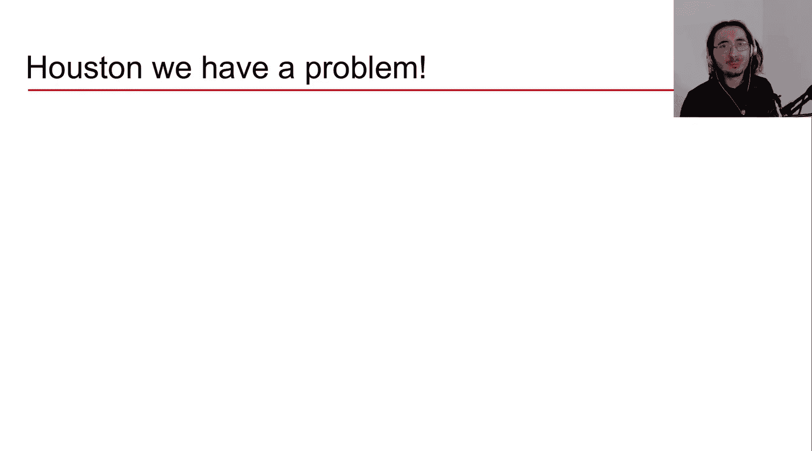

Digital technologies like our computers， for example。

 So how can we convert analog signals into digital signals。 Well， that's the topic of today's video。

 But before we delve into that， I want to just give you a brief overview of what analog and digital signals are。

 So let's start with analog signals。 So here the intuition is that both on the X axis。

 which is time And on the y axis， which is amplitude or sound or air pressure， for example。

 we have continuous values。 So we have real number values。 So here we have an example of a analog。

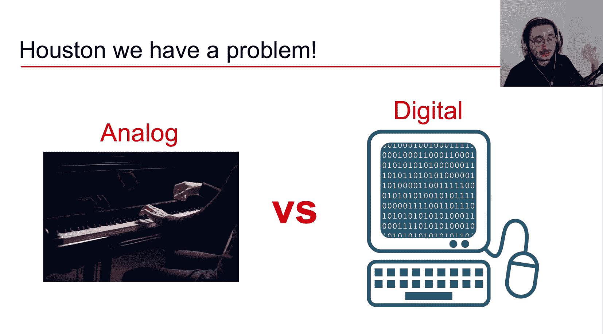

Signal， so as you can see， the curve is continuous。 and we have a problem with an analog signal。

 If we want to store it in a digital format。 and that's basically we have infinite resolution both on the time and on the amplitude axis。

 So no matter what we can always go like at a higher resolution。 So we can look at I don't know。

 seconds， then microseconds， nanoseconds， even peak secondsds。

 and we'll still have a real number value there。 And that's because we have continuous value。

 continuous time， right， and the same problem also appears on the amplitude axis where still we have real numbers。

 So potentially infinite numbers。 And obviously that has the kind of like drawback of requiring infinite memory to storing such a signal in a digital format。

 And obviously we can afford that。 And that's why we need to switch。😊，To digital signal。

 So digital signal basically has a sequence of discrete values。

 It's as if like we were taking snapshots at different times of a continuous signal。

 And this data points can only take on a finite number of values。

 So not all the possible real numbers， but only a tiny subsets of that。 Now。

 how do we move from analog to digital signal。 Well。

 that's a process called analog to digital conversion or its acronym ADC。

 and this process consists of two subsetstep。 So one is sampling， the other one is quantization。 Now。

 before getting into these two things in detail。 I just want to tell you that the result of ADC is audio signal。

 audio digital signal。 and we usually refer to audio digital signal also with another。😊。

That probably you'll hear like if you if you'll delve deeper into audio digital processing and that's called pools code modulation Okay。

 so this is like a term that you want to know because then you know what。😊，Basically。

 like people are talking about， Okay， but now。Regardless of like the jargon that we use。

 let's move on to the real meat here。 So sampling。 So we said there are two steps in ADC。

 The first one is sampling。 Okay， so what's sampling， Basically， well。

 it's kind of like selfexplanatory。 So we just like sample like data points across like a sand wave at specific points in time。

 And these black dots here are all like sample points。 Now， how do we sample， Well。

 we usually the site on a period on a sampling kind of like period。

 and we sample at a equidcent intervals in time。 And this intervals are just like the period。

 which is indicated with capital T And at each period， we sample data points。

 So this is the first one。 This is the second one， the third one and so on and so fourth。Okay。

 now how do we locate samples on the X axis on time？

 So let's say we want to locate the time at which we have sample number n。 So that's T M。

 And we can use this formula。 And given we know that we are sampling points at equidcent time intervals。

Called capital T。 we can just multiply N， which is the sample that we want to like find and multiply that by the period。

 And that will give us like the time at which that sample is appearing in the signal。 Okay。

 so now there's another very interesting characteristic of sampling。

 This is like a feature that we can play around with to obtain different types of like。😊，Sampling。

 and that's called the sampling rate。 We can indicate that with S R。

 And that's basically the inverse of the period。 Okay。

 and this sampling rate is basically a frequency。 and it's measured in Htz。

 and this indicates the kind of number of samples that we have for each second of our digital signal Okay。

 so now we can distinguish between like lower sampling rates and higher sampling rates。 So why。

 why do we butter like about like this distinction and like what's the effect on the overall sampling process。

 Okay， so let's take a look at this sampling low sampling rates here。

 And so here you can see the this like vertical bars and this represent each of these like a represent a sample and these are like wider。

The ones that we have here on the right hand side， because we have like a lower sample rate。

 which means like the period， the sampling period is higher。 Now。

 what happens here is that there's a difference between the area below the continuous curve and the area that is created by this vertical bars。

 And the difference is the sampling error intuitively that is like that difference is the amount of the information that we necessarily loss lose when we are like applying sampling。

 Now， if we compare that sampling error。Between the load sampling rate here on the left hand side and the higher sampling rate。

 you'll notice that obviously having like higher temporal resolution here。

 we're going to have less of an error right So the higher the sampling rate and the lower the sampling error now。

 why is this interesting and what sampling rates should we use Well， this is like an open question。

 and it really depends on what you need to do which like sound。

 an interesting question we can ask is why do we have certain sampling rate， So， for example。

 for the C technology， we have a sampling rate， which is 44。1 kilohertz。

 So why people decided on that specific value， is that arbitrary。 Well。

 obviously does a certain level like I mean， it's。To a certain extent。

 But then there's like some reasoning behind it。 And to understand what the reasoning is。

 we need to introduce another concept， which is the ni frequency that comes from the ni theorem。

 we can indicate this， which are F or n and the liquid frequency is given by half the sampling rates。

 what the liquid frequency tells us is basically the upper bound frequency that we can have in a digital signal that's not going to recreate any artifacts。

 right So basically up until the ni frequency， we can reconstruct a signal okay。

 but if we go above the liquid frequency in our signal， we're going to start to have artifacts。

 and we'll see what those artifacts are in a second。 Now， if we move back to。

The to the C example and we take a look at the ni frequency for the CD that's 44。

1 k divided by 2 which gives us 22050 hertz this is the ni frequency for a CD now this number should ring a bell for you。

😊，So if you watch my previous videos where I was covering the human hearing range。

 you're probably familiar with the upper。Hearing range for humans， which is around 20 k。

 So the ni frequency for C D is kind of like very close to that。 And say， why is that the case， Well。

 that's the case because this means that we can go up to 22 K plus in hertz and still not have any artifacts there。

 And we know that 22 K is likely above the human hearing range。

 And so that means that we can basically appreciate the whole frequency range in a Cd without getting any artifacts。

 Okay， so now we are talking about artifacts。 So if we go above the ni frequency。

 But what are those artifacts well。The artifacts that we inject in a signal。

 if we have frequencies that are above the ni frequencies are determined by a liaising。

 I'm sure you're familiar with the term a liaising。

 but here I want to show you what a liaising really is。

 And so for that we can take a look at this graph。 Now here you have a continuous signal in a red。

 and then we've taken some samples that are like this black dots。

 The interesting thing here is that if we look at the frequency of the original signal in red that's higher than the ni frequency that we have for our sampling process。

 what that entailed is a problem is an artifact。 and that's a liaising。 So and how do we see that。

 Well， let's take a look at the reconstruction of the digital curve here。

 and it's like this curve in blue。 Now as you can see here。😊。

There's a difference between the original signal， which which has quite high frequency and the signal。

 the reconstructed signal in blue， which has a way lower frequency。

 And that like artifact is a liaising。 So what it does basically is it just like shift down all the frequencies that are above the Nick frequency。

 Now， this is kind of like the intuition behind it。 But I feel it's a little bit abstract。

 So let me show you the effect of aliaaating on a piece of music。 Now。

 I mean my digital audio works session， This is audacity， The name of the software， it's open source。

 So you should definitely check that out。 And if you're on Linux is great because you can run it。

 And it's not the case with most DW is really Okay， so here we have like a piece of music。

 So let's listen to it at its original sampling rate of 44。1 kilo。😊。

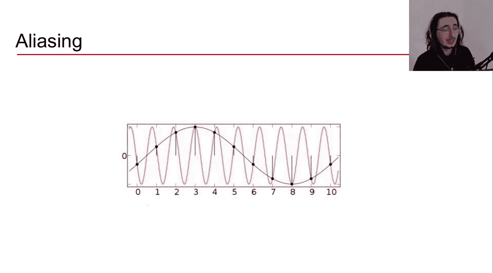

かs？Yeah。🎼The。Okay， so now let me reample that。😊。

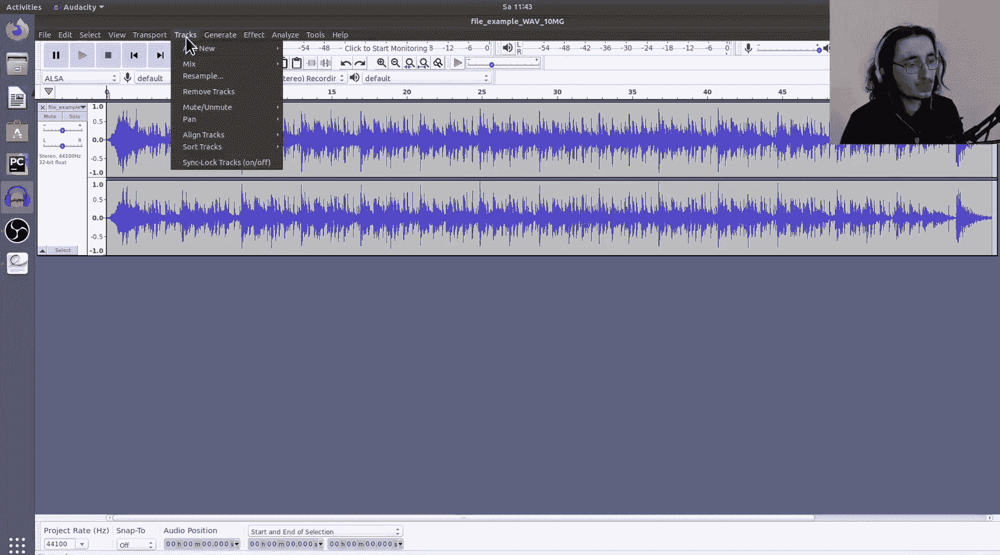

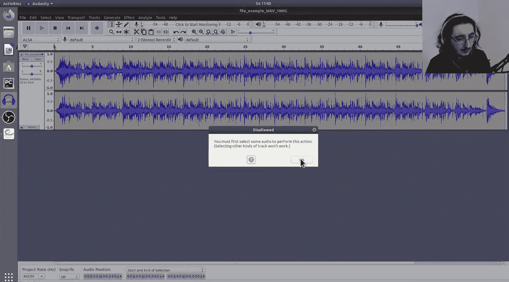

Okay， yeah， let me select this。 So what I want to do here is to resample the audio and put it and use a sampling rate of 1 kHz。

 It's quite dramatic。

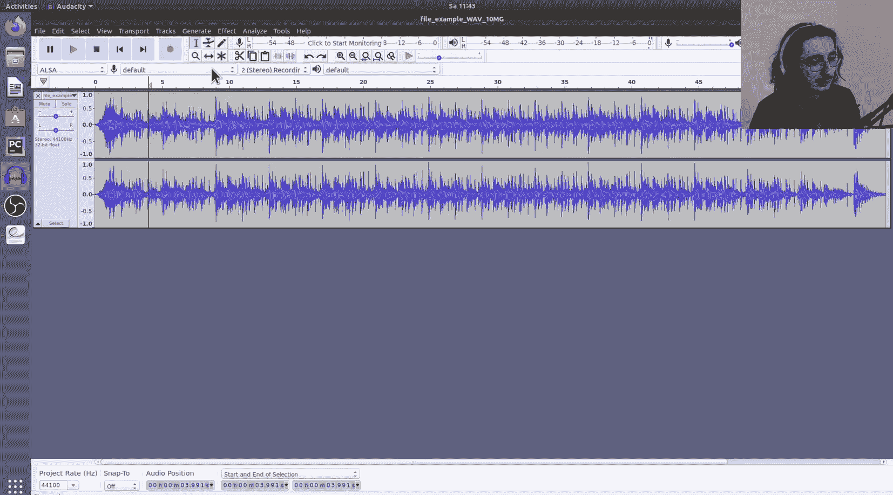

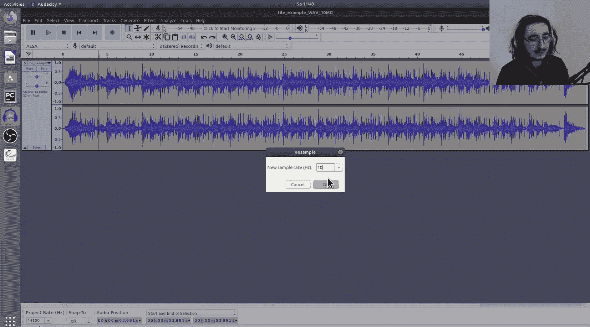

The change， let's listen。😊，Right。The difference is it's just incredible， right。

 And that's because all the frequencies that are above the ni frequency， which in our case is 500 Hz。

 just like。😊，Get allliaed。 And so they just like get moved。

 get artifacts and get moved towards like the like lower frequencies。 Okay。

 so that's the effect of allliaing on sound。 Now we are done with sampling。

 so we should move to the second step in an to digital conversion， which is quantization。😊。

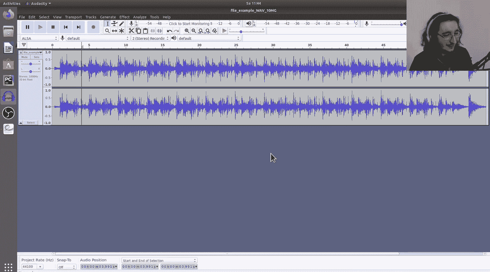

Okay so now that we are familiar with the process of sampling。

 we can apply more or less like the same thinking to quantization the only difference really here is that instead of like sampling on the x axis。

 we are quantizing on the y axis on the amplitude， but basically the idea here is that we have a fixed a discrete number of amplitude values on the y axis and then at each sample we just quantize the value of amplitude to the closest value that we have available here on our y axis。

😊，By applying quantization， we create a quantization error。

 just the way we we did create a sampling error when we were applying sampling to the analog signal。

 Now it's kind of like intuitive that the higher the resolution， the quantization resolution。

 or in other words， the more values we have here on the y axis and the lower the quantization error is going to be。

 Now， if we take a look at the values that we are using here on the y axis。

 you'll see that these are binary values， specifically， we are using four bits。 Now。

 you may be wondering， but why are we using like binary values here。 Well。

 that's because we are dealing with like。😊，Digital computers， right。

 So we are going to store these audio digital signals in digital computers。

 And so it only makes sense just to work with binary values。

 So the resolution of quantization is calculated in number of bits。

 Now you maybe here this other like term bit depth。 And that's kind of like a synonym for resolution。

 So the bit depth resolution for a Cd is 16 Bs。 Okay。

 so if we want to just like have an idea what that is like an inim in decimal numbers。

 So we'll just apply like this conversion here。 So we get like we do a2 to the power of 16。

 which is the bit depth。 And we get this number here， which is 1665。5 k values。

 So these are all the possible amplitude values that we can use when we。😊，An analog signal in a C D。

 An interesting problem is to check the amount of hard disk memory required for storing one minute worth sound。

 that obviously depends on the sampling rate and bid depth that we are applying。

 So now let's assume that we are using like customary like values like the C D values。 So 44。

1 kiloHz for the sampling rate and bit depth are 16。

So this is the like formula that gives us like the amount of a memory that we require for one minute of sound expressed in megabytes。

 Now， let's break this now。 So we start by multiplying the something rate by the well。

 the bit depth by something rate。 And so this gives us the number of bits per second。 Now。

 by dividing that number by 148000 something， we move from number of bits per second to number of megabits per second。

 if we divide that by 8， we move from number of bits by number of bits。

 number of megabits per second to number of megabytes per second。 Okay。

 and so this is like what comes out of all these operations。 Now， if we multiply that by 60。

 we get5 point。49 MBby。 And this is like the amount of memory that we need for storing one minute of sound。

 As you can see， this is a lot of memory。 So this is like a problem because like for storing audio like a as a wave file。

 We need a lot of memory。 That's why you get a lot of lossy format like the MP3。

 which shrink the amount of memory that we need for storing audio data。 Now。😊。

A concept that's connected with with the quantization process is that of dynamic range。

 Now this is an intuitive， quite intuitive concept and basically dynamic range is the difference between the largest and small signal that a system can record in other words。

 we can think of dynamic range as the kind of like the loudness range that we can appreciate from some digital sound and the idea here is that the higher the resolution so the more bits we use and the higher the dynamic range that we have now。

The concept of dynamic range is itself connected with this other concept which is that of signal to quantization noise ratio Now this signal to noise ratio is the relationship between the max signal strength and the quantization error and this signal to quantization noise ratio correlates with with dynamic range so how can we get an idea of the signal to noise ratio like for like some digital signal？

So it's given like by this simple formula here， so SQN R， it's approximately this constant so 6。

02 by capital Q where capital Q is the bit depth now in the case of 16 bit depth。

We have a signal to quantization noise ratio which is 96 decibelts。

 Obviously like this signal to noise ratio is measured in decibelts and in this case it correlates like it's basically like it indicates the dynamic range itself in other words。

 we know that when we are quantizing a analog signal applying a big depth of 16。

 we are going to end up with a dynamic range of 96 decibelts。😊，Okay。Good。

 so this was it like for the process like a digitalization that kind of like has these two steps。

 so sampling and quantization， we sew both of them now the next question like that we can ask is then how do we record sound starting like from a sound and then arriving like a digitalized version of that sound of that audio signal okay so we start with a mechanical wave which is just sound that hits a microphone and this let's just like a diaphrag。

 for example， like starts oscillating and this oscillation create a analog electrical signal and this electrical signal gets packed into a sound card which acts as an ADC device or analog to digital converter and。

😊，Obviously， it applies sampling and quantizations。

 and it also like applies some anti liaising filtering so that it avoids a liaising。

 And so for doing that， what we usually do is we。Have a lowpa filter that cuts off all the frequencies that are above theni frequency。

 So out of like the sound card， we get a digital signal that then we can store on our laptop computer。

 Now， the interesting question is also like the reverse of this one。 So how do we reproduce sound。

 So we start obviously with a digital signal now we pop that into our sound card once again。

 But this time the sound card applies like the inverse of audio to digital analog to digital conversion。

 It does digital to analog conversion and it creates an electrical signal that gets transferred to speakers and this signal stimulates membranes and these membranes converts basically the electrical signal into a mechanical wave。

 which is sound which hits our。😊。

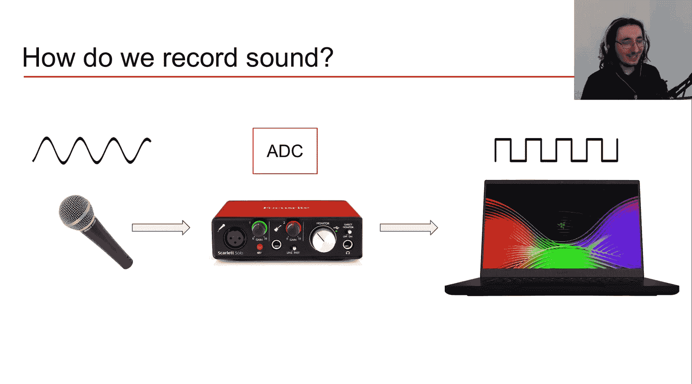

Ear and now we hear sound。Whoa， that was intense， but I hope by now you have an idea of how all of this comes together。

😊，After like these introductory videos， now you should have like a good understanding of like mechanical waves。

 sound， the different features of sound， like frequency。

 loudness and timer and now you should also understand and have a solid background in audio signals。

 So what's coming next well， next we start doing some serious stuff。

 So we'll start to have an overview of different audio features。

 and specifically we're going to look into time domain features in audio and frequency domain features the interesting thing about these features。

 those are the ones that we extract from audio and we can then use them for training our machine learning or deep learning algorithms Okay。

 so stay tuned for that because that's coming before finishing off like this video I just want。😊。

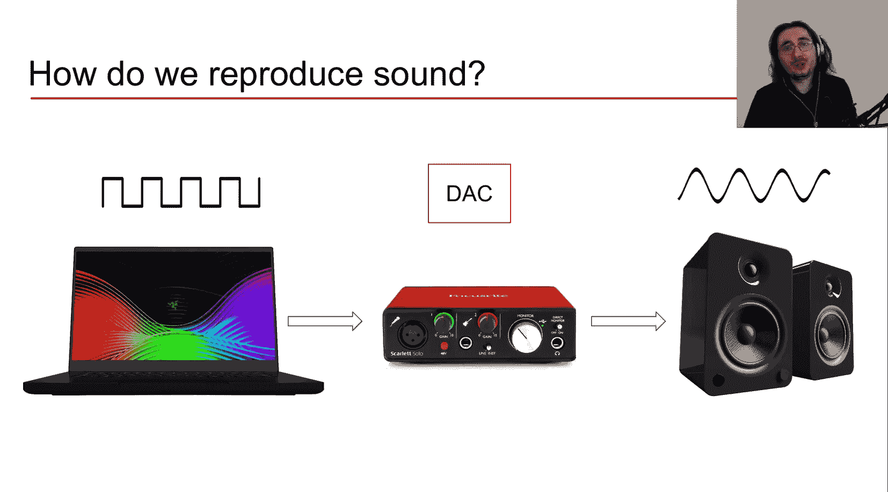

To invite you back to the sound of the eye Slack community so here you have a community of like- mindded people who are interested in all things AI audio。

 music and audio digital signal processing so I strongly invite you like to join this community and I'll leave you a link to sign up to the Slack community in the description below now if you have any questions about this video please feel free like to ask them in the comment section below itself for today I hope you enjoyed the video I'll see you next time cheers。

😊。

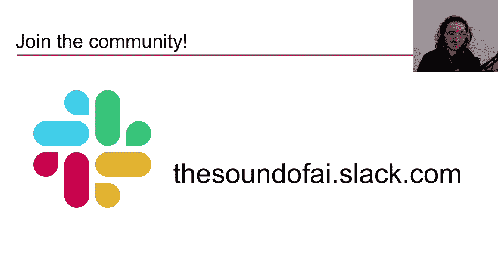