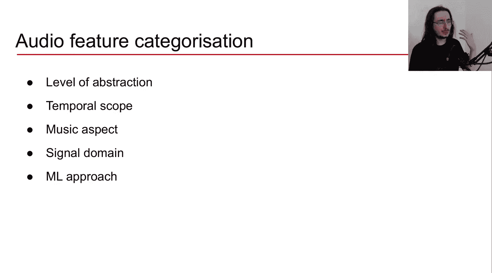
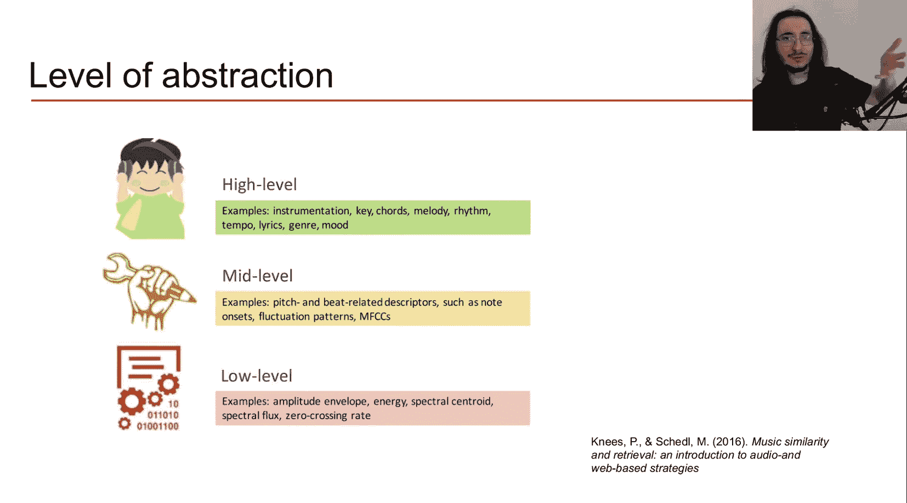
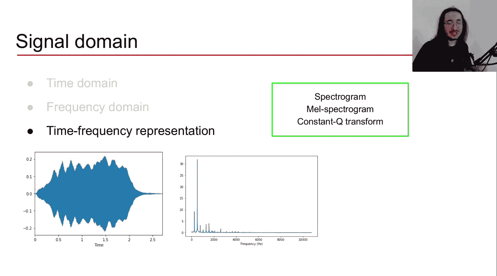
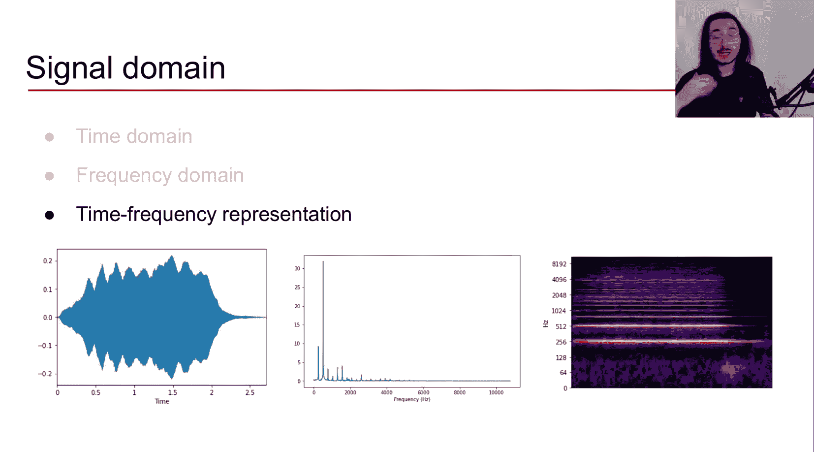
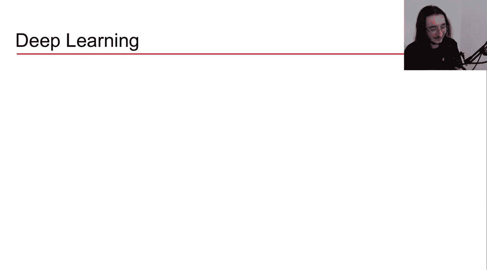
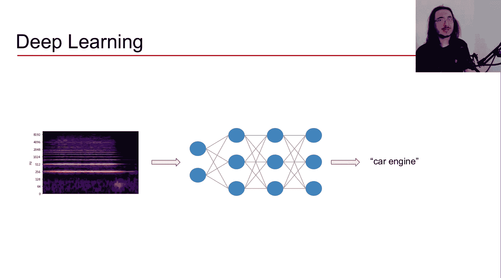
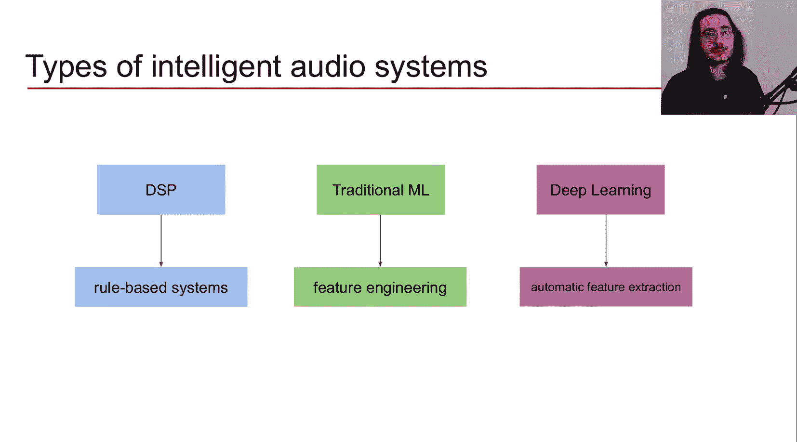
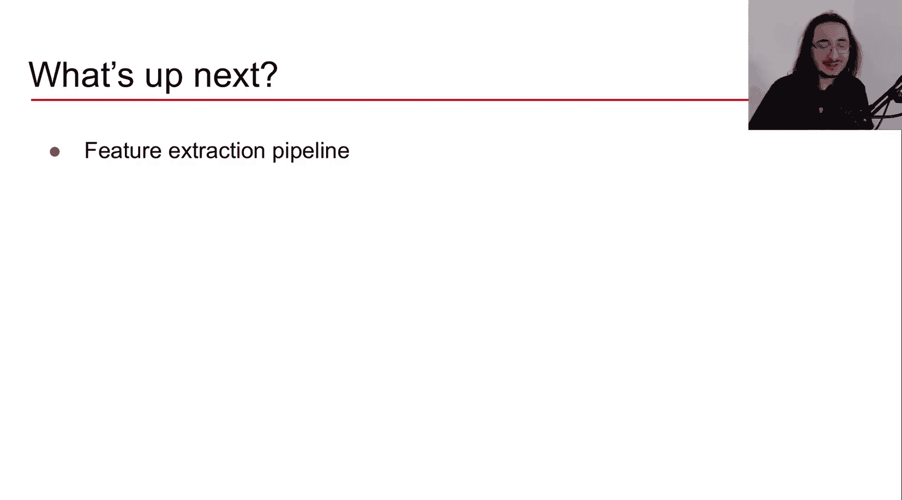
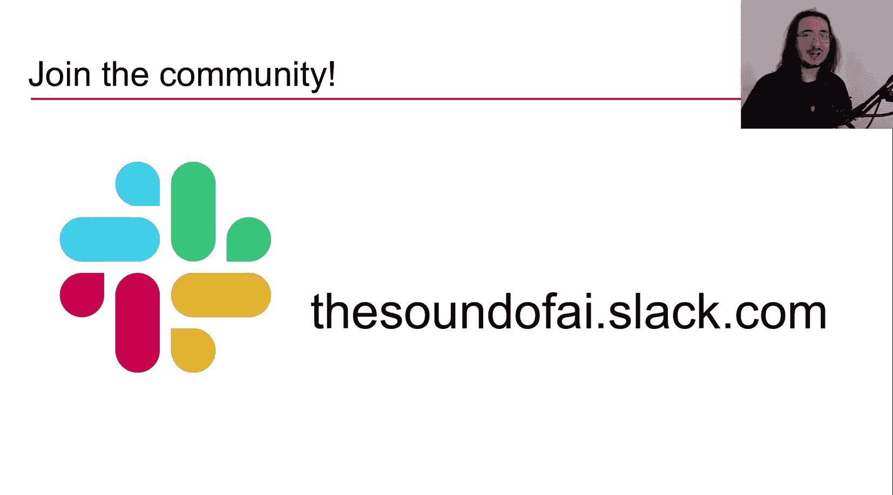

# Valerio Velardo【中英⚡面向机器学习的音频信号处理 Audio Signal Processing for Machine Learning】 p05 p4 Types of Audio Features for Machine Learning [BV1ftPLeCEhX_p5]

Hi， everybody and welcome to a new exciting video in the audio processing for machine learning series。

 This time， we're going to introduce a few audio features。

 but mainly we're going to be focusing on strategies that we can use to categorize these different audio features Before we get into that。

 we should ask a couple very important questions。 One， what are audio features to。

 Why are they important to us。 Well， audio features are thescriptors of sound。

 And the basic idea here is that when we have different audio features。 They will tell us。😊。

Different or that will provide us information about different aspects of sound。😡。

And the catch here is that we can use these audio features for training our intelligent audio systems。

 in other words we should identify a few of these audio features we're interested in and then pass it into onto our machine learning systems so that they'll hopefully like learn patterns and then solve our task or problems。

😊，Okay， so now let's review a few strategies that we can use to categorize these audio features。

 So here I've listed a five。 Now the basic idea here is that I want for these strategies like to be as general as possible and by that I mean that they would be able to deal with any type of sound。

 really， but some of this strategies are specific to music type of signal。 So for example。

 the third one here。 so music aspect and also like the first one here to a certain extent level of abstraction but let's review this So we have level of abstraction。

 temporal scope， music aspect signal domain and machine learning approach for the remaining of the video I'm going to be det diving into each of these strategies for categorization and we'll see what all of this like min okay so let's get started with the first one so level of abstraction now。

😊。

This is one that mainly， I should say。😡，Kind of like covers like music signal more than general sound or audio。

 So and we can divide this like into three level。 So low level audio features。

 mid-level audio features and highle audio features。 Now。

 I've taken like this distinction and also like this picture here from this great book called music similarity and retrieval and introduction to audio and webbased strategies。

 So this is like an incredible book and music information retrieval。

 And I highly suggest you to check that out。 But let's focus on this strategy。

 like for classifying audio features。 So what's low level features。 So what are this。 Well。

 these are features that makes sense for the machine but don't make that much sense for us human beings。

 So basically， these are like any of statistical features that get extracted directly from audio。

 And we。😊，Human beings or I would say like people who are not trained in audio processing can't really understand what all of these things are。

 right now if we go up one level， we are at the mid level。

 So here we have features that start to make sense from a perceptual perspective right and so here we have things that are in features that are like involved with peach and beat attributes。

 So in this category， we have audio features like notes onset。

 which is basically like when note like starts we have fluctuation patterns and NFCCCs Now if we go up another level。

 we arrive at the high level features and these are very abstract features and these kind of like tend to map to。

Musical constructs that we can understand and like perceive when we listen to some music in this case。

 we can。Talk about instrumentation， key chords， melody， rhythm temp， right。 So basically。

 the idea is like the higher you go and the more abstract， this audio features become。 Okay。

 so now this is a way a strategy that we can use to classify audio features。

 But let's review another strategy。 And this is the temporal scope。

 and this strategy applies to any type of sound music or non music。

 And so here we can kind of like divide the audio features into free categories。 So we have。😊。

Audio features that are focused that give us information instantaneous information about the audio signal。

 And basically like this consider very short chunks of audio signal which usually is around like 50 to 100 milliseconds or like 20 to 100 milliseconds like something like that。

 So it's like almost like instantaneous information。

 here is important to like remember that the kind of like minimal resolution。

 temporal resolution that we human beings are capable of appreciating is around 10 milliseconds So we can really go below that threshold because otherwise。

 I mean， it wouldn't make any sense for us on a perceptual level。😊，Okay。

 so then we have the segment level features。 And so these are audio features that we can calculate on segments of audio right。

 And here we're talking about seconds So anywhere from 2 to 5，10，1520 seconds。

 even something like that。 And now I can give you an example again。

 in music because it makes a lot of sense。 So these are features that give us information about for example。

 a bar or a musical phrase And so it's something like that provides us information about something that makes sense from a musical standpoint right。

 and it tends to yeah， just like aggregate something from instantaneous information from like a longer period。

😊，And finally， we have features that provide us information about the whole sound。

 so these are basically like aggregate features。 so we can kind of like aggregate the results from like a lower temporal resolution features like instantaneous or segmental level features and then I don't know we can use some kind of average or more sophisticated ways of like aggregating results。

 and then we would get like a number or like a feature vector whatever that describes the whole sound。

 the whole signal。 So we have only one descriptor for the whole thing right okay so this is another strategy we can use to categorize audio features。

 So what about the third one now this is clearly focused on music only and so here if you remember like the midlevel features and high level features。

 So there they started to like deal with some。😊，To like musical aspects， like， for example。

 note onset kind of like relates to， to， to beat to melody a little bit as well。

 And but something else， like， for example， I don't know。

 like a key could be related with both like harmony and pitch to a certain extent， right。

 So basically， like we can kind of like classify these audio features based on the musical aspects that they give us a glimpse onto。

 Okay， and。😊，Yeah， so as I said， this is like a strategy categorization strategy that we can use mainly for music for obvious reasons。

 right， So what about like audio， like more in general。

 So do we have like also other types of like classifying or categorizing audio features for all sorts of audio。

 Yes， and this is like probably the most important kind of like strategy that you have for categorizing the different audio features。

 and this is based on like the signal domain that we are in Okay， so。😊。

I know like this may sound a little bit weird， but like with a few examples。

 it's going to be super clear to like understand。 Okay。

 so we have certain audio features that are like in the time domain。

So some of these are amplitude envelope， root min square energy or0 crossing rate。

 There are way more than this。 and we're going to cover them in future videos。 But for now。

 I don't really want to get like into the details of these different audio features。

 I just want to give you an idea why they are time domain features， right， Okay。

 and this is because they are extracted from waveforms。 So from the basic row audio。 And so。😊，Here。

 like the time domain。😊，Just like as a definition is captured in a waveform and you should be familiar with this because like we covered this like extensively in previous videos。

 basically in a waveform what you have on the X axis is time and on the Y axis is amplitude。

 and so basically we can take a look at all the events which happen in a sound。😊。

And the time domain audio features extract information from this representation。

 So this is why we call them time domain audio features。 Okay， so now this is all good and well。

 but we have a problem。 and the problem is that sound is kind of characterized by frequency。

 The frequency is an extremely important descriptor of sound， as we've seen in previous videos。

 But with a time domain representation representation， We don't have any of that， right。

 and so there are a bunch of other features， which go。😊。

Under the name of like frequency domain features， which actually focus on the frequency components of sound。

 So some of these features are band energy ratio spectral centroid spectral fluxs spectral spread。

 I mean， you name it。 You have a list which is almost endless once again。

 we're going to cover this in future videos。 But here I just want to give you like the high level idea。

 right， So here we're talking about the frequency domain。 But what's the frequency domain。

 And how do we get to frequency domain。 Well， the basic idea here is that we take the row audio。

 So like we take a signal from its time domain representation， We apply the Fourier transform。

 and we basically translate the signal from the time domain to the frequency domain。 Now。

 Don't be scared。 Like if you are not familiar with the。Fier transform because this is， again。

 something that will cover quite in detail in future videos。

 But basically when we apply the Foururier transform to the time domain representation of signal。

 we get a spectrum which we can visualize like here So as you can see here on the X axis。

 you have frequency and on the y axis you have magnitude。 In other words。

 here we are taking a picture of the sound and analyzing which components frequency components are present in that sound right And so basically here you can see like that there is like a a very like high pick here。

 which should be， I don't know， probably around 250 something Htz right and basically like the idea here is that you have information about all the frequencies that。

Make up a sound in this particular example here， like this spectrum is the kind of like the the I've obtained this by applying the Fourier transform to this waveform here。

 So as you can see， this two。Categories of。All your features give us information。

 complementary information。 So time domain， all your features give us information about like stuff that has has to do with time。

 whereas frequency domain gives us information about stuff that has to do with frequency， right。

 The problem is that we with this representations we don't have both of those things together。

 So information about time and frequency。😊，But wouldn't it be wonderful if we had those type of audio features？

 Well， indeed， we have those。 We have time frequency， domain features。

 and we use the time frequency representation for those some of。😊，These features are spectrograms。

 mouse spectrograms or constant Q transform。 So now let's focus just like on the first one。

 the spectrogram， which is the most famous one， right， So how do we obtain that。 Well。

 we start once again from the time domainmin representation of signal。

 And then we apply a short time Fourier transform。 And we obtain a spectrogram。

 which is this guy down here。 Now， once again， we're gonna to cover the short time Fourier transform in future videos quite in detail。

 So I know I've made a lot of promises。 And I hope I'll deliver like throughout the series。

 But let's focus on the spectrogram for a second。 Now， if I remember correctly。

 we we already you should have already seen spectrograms in previous videos。

 But let's review this once again。 basically， the idea here is that in a spectrogram。

 you have information both about。😊。

Time and frequency on the X axis。 indeed you have time。 whereas on the Y axis， you have frequencies。

 And basically here， what you see is the different frequency component， a different points in time。

 and the amount of contribution that each frequency band has at this particular time is described through a color in this case。

 the brighter the color， the more the contribution。

 that particular frequency band at that specific time。 So and as you can see here。

 we have like a lot of contribution from this frequency of 256 Hz， which is a， I believe。

 like middle C。😊，Okay， and these is like computes correctly because if we go back to the spectrum。

 which is kind of like snapshot for the whole sound， we have a pick here。

 which is most likely around 256 as well。😊，Okay， so now I hope like you have like a good understanding like different types of like audio features。

 So like the time domain， audio features， the frequency domain ones and the time frequency features。

 Now， one last way we can use to classify audio features is based on the machine learning approach that we use obviously like here we can make a quite important distinction between traditional machine learning algorithms。

 like support vector machines， logistic regression or linearar regression and deep learning architectures。

 and we'll see why that's the case in a second。 So for traditional machine learning。

 what we usually do is we just look at all the possible audio features。

 both in the audio domain and sorry， both in the time domain and in the frequency domain and basically what we do is we handpick the ones that we。

😊。

Leave will work the best for the problem that we want to solve。 For example， we could say， yeah。

 we we want to solve like audio classification。 So we we want to pass to machine learning support vector machine。

 for example， some like audio files and then we want to know whether like we have the sound of a car engine of an airplane or a gunshot。

 for example， right， So what we could do is like identify few audio features that makes sense。

 So say， for example， is this three。 So amplitude envelope 0 crossing rate and spectral fluxs。

 We would isolate them， we would extract them from the audio files。

 and then we would feed them into the traditional machine learning algorithm so that we can train like our support vector machine。

 for example， and then at inference time， we would just like feed the these three audio features for the audio that we want to analyze and hopefully we'll get a result which。

 in this case， appears to be car。😊，Eine， good， so how does this differ from deep learning。 Well。

 we know that in deep learning and not just in the audio space， we tend to use unstructured data。

 For example， in image processing， we don't pass any specifically handcraft search like feature。

 like image feature。 we just pass the whole image as a as a pixel， right。

 as a as a as a kind of like collection of pixels。 So in a sense。

 we do a similar thing here in audio processing。 So what we do is we pass a bunch of like unstructured audio representations。

 And by that， I mean， we could just pass the whole row audio。

 and it's basically time domain representation。 or we could pass spectrum room like。😊，Audio features。

 So spectrograms， mouse spectrograms， constant cube transforms。Sorry， or we could pass even MFCCCs。

 But right now， like， I don't see like many paper papers coming out， like which MFCC anymore， right。

 so basically， the idea is that we get like something like this。 So whole whole spectrogram。

 We feed that to a dip neural network。 And then we get back our prediction。 Okay。

 so now let's review。

I think it's important to like to review like the different types of like audio intelligent systems that we can build traditionally before the advent of machine learning。

 we used to use basic digital processing techniques。

 And so we would use like this audio DSP techniques。

 And we would put them together and use whatever like audio features we wanted and use some kind of rules to for example。

 like classify sounds or to identify notes onset or I don't know。

 like to recognize like the beat in in a music piece。

 Okay then with the advent of machine learning and data sets。

 We started to work with a traditional machine learning approaches。 And here we've seen it already。

 right， So we do some kind of like feature engineering。

 we start with the whole audio features in the time frequency domain。 and we just decide。😊。

Which ones of those like are worth experimenting with and using in our application？

Then with the advent and the revolution of deep learning， all of this changed。

 and now we just pass in unstructured spectrograms or even raw audio。

 and the promise of deep learning is that the algorithms will be able to extract。

The features automatically by themselves， without。U。

 the human engineer is doing like human handpicking of features and things like that。 Okay。

 that's it。 So now you should have more or less like an idea of the different types of audio features will be dealing with。

 So if there's one thing that I hope you'll take away from this video is thats like the main categorization that we can use instead of like the signal domain。

 So we， and that's like what we'll be doing in future videos。

 We'll be reviewing time domain audio features。Frequency domain audio features and time frequency features as well。

 Okay， so what's up next， then So now you have a good picture like of the different ingredients that we are going play around with。

 So namely the audio features。 The next step is to understand how we extract them directly from audio。

 So in the next video， we're gonna look at the feature extraction pipeline。

 both for time and frequency domain features。 Okay， so yeah， I hope you enjoyed this video。

 but before dashing off I just want to remind you about the sound of the ice slack community。

 which is a community of people who are interested in audio processing AI music， AI audio。

 So I really suggest you to join that。 if you haven't done so already and all leave you。😊。

The sign up link to the Slack community in the description below。 Okay， so that's it for today。

 I really hope you enjoyed this video and I'll see you next time， cheerers。😊。

