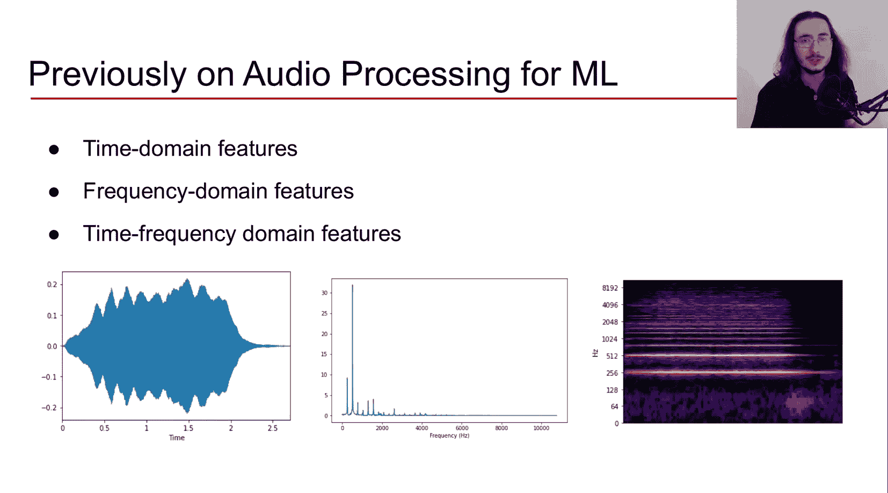
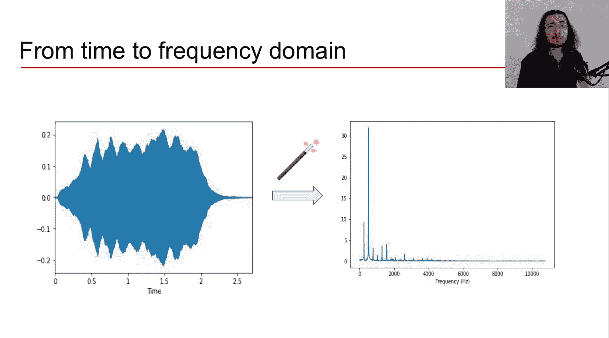
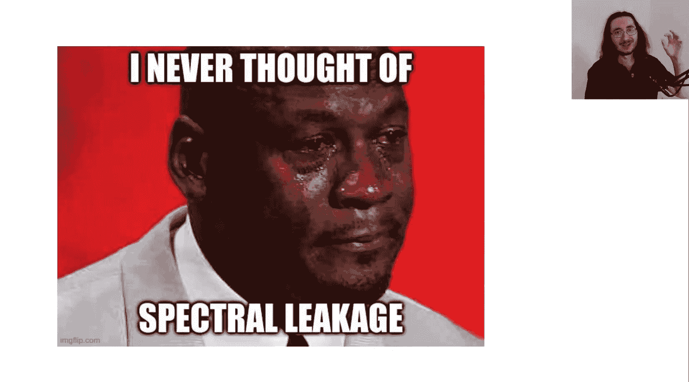
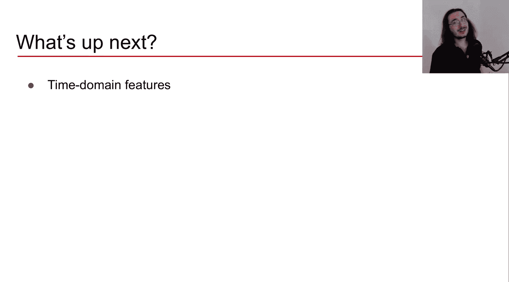

# Valerio Velardo【中英⚡面向机器学习的音频信号处理 Audio Signal Processing for Machine Learning】 p06 p5 How to Extract Audio Features [BV1ftPLeCEhX_p6]

Hi， everybody and welcome to a new video in the audio processingces for machine learning series。

 This time， we'll look at the extraction pipelines that we need to extract both time domain features and frequency domain features before starting looking into this。

 I just want to remind you about the sound of AI Slack community。

 which is a community with people interested in all things。

 AI audio AI music and audio digital signal processing。

 So if you want to improve your skills a network with cool people。

 just consider signing up there and I'll leave you sign up a link to the community in the description below。

 Now let's go back to the cool stuff in the previous video。

 we took a look at a few different types of audio features。

 So time domain features which leave in the time domain。

 frequency domain features which leave in the frequency domain and finally time frequency domain features。

😊。

Wwhich are features that provide us with information both about time and frequency Now we want to take a look at the extraction pipelines that we can use to extract time and frequency domain features so let's start with time domain features first okay so for the extraction pipeline。

 obviously the first step is just to look at an analog sound right so it could be the sound of a violin a noise and then once we get that sound we want to convert that into something that makes sense and we can somehow like edit and manipulate with our computers and for doing that we need to go through the analog digital conversion process in other words we need to sample and quantize the analog sound sound so that we get a digital signal okay so if you are not familiar with this process。

😊。

I suggest you check out my video previous video in this series that covers this like quite in detail。

 you should have it over here。 Okay， so now once you have the digitalized version of the sound。

 the next step that we want to do here is called framing In other words。

 we want to bundle together a bunch of samples And so here you see that for example。

 frame one goes from sample number one to 128 frame2 goes from sample 64 to 192 frame3 from sample 128 to 256 and so on and so forth Now theres like an interesting thing here which is that this frames are somehow overlapped right but I'm not going reveal you this secret right now。

 I'm not going to explain why that's the case now， you'll notice by the end of this video so state。😊。

And for that。 Okay， so now let's understand a little bit better why we use framing before we extract features。

 acoustic features。 Well， so we can think of frames as audio chunks that are perceivable things that we can perceive。

 Now the problem is that if we take a look at a sample， one single sample at a sampling rate of 44。

1 kilohertz， which is the sampling rate for the Cd room。

 we find out that that sample has a duration of null point null 227 millionise seconds。 right。

 this is like very， very short amount of time。 Now， if you're wondering how I got this number， Well。

 that is just like the inverse of the sampling rate。 So it's one divided by in this case， 4400000。

 right， So。😊，Now we know that like one sample its like very。

 very short and we know that the duration of this single sample is way below the threshold of the time resolution for our hearing。

 human hearing， which is around 10 milliseconds， which basically means that all the things that are below 10 milliseconds we can just like we can appreciate them as acoustic events so with frames what we want to do is to have enough time of enough duration of an audio signal so that we can appreciate that and that makes sense from an acoustic perspective because it is like what we can hear and the features that we want to extract are somehow related to what we can experience as human beings so now another things about frames is usually that they have a frame size or in other words。

😊，They have a number of frames which is usually a power of two now why is that the case this sounds really weird right Well that's because usually what we want to do when we move into like the frequency domain is just like apply the Fourier transform and it turns out that when we apply the fast Foururier transform which is a variant of the Fourier transform having a number of samples that that's a power of two is going to speed up the process a lot right so it's just like a matter of like speed here。

😊，Okay， so now typical values for the frames oscillates between 256 to 8192。

 Now let's take a look at the duration of a frame。 and we have this formula down here。

 So we have the duration of a frame that's equal to the inverse。 So one of the sampling rate。

 So one divided by the sampling rate and we have to multiply this by capital K。

 which is the frame size and in other words， this first。

Element here tells us the duration of a single sample and then we multiply that by the total number of samples that we have in a frame this way we get the whole duration of a frame Okay so now let's plug some usual numbers so we can plug 44。

1 kilohertz for the sampling rate which is like a totally normal sampling rate and then we plug in 412 which is a totally normal frame size at this sampling rate and we get the duration of a frame to be around 11。

6 milliseconds which is just above the time resolution the human hearing time resolution which is like around 10 milliseconds let's go back to the fissure extraction pipeline for the time domain。

😊，Okay， so the last process that we saw here was framing Now once we've applied framing。

 the next step is just to compute the features， the time domain features on each of the different frames。

 but now what we want to do after that is to aators results so that we get like a single kind of like feature vector。

 whatever for the whole sound， so it's ascriptor for the whole duration of a sound and we can aggregate that by using statistical means like the main the median。

 the sum or things that are a little bit more sophisticated like gusian mixture models， for example。

 GMs here。And so out of this process， we get a final value。 It could be like a value。

 a feature value。 It could be a vector， a feature vector， or even a matrix， a feature matrix。

 and this basically is a snapshot for the whole duration of the audio signal that we are analyzing。

 Okay so this is the feature so the extraction pipeline for for time domain features。

 Now let's move on to the frequency domain feature。 as you'll see。

 many of the steps are basically the same as just that we found in the time domain feature extraction pipeline。

 So obviously we start from an analog sound， we do some ADC。 So we apply sampling。

 we apply quantization。 we get our digitalized version of of of the sound。

 So we have this audio signal， we frame the。😊，いの？And now we have a bunch of frames。 Now what's next。

 Well， what we want to do here is basically move from the time domain to the frequency domain。

 and we usually do that with a magic tool， which is the Fourier transform。 for now， yeah。

 I'm just like using this like magic wand because for us it's just like a black box for now。

 So it's some kind of like magic that happens and we move from the time representation to the frequency representation。

 but we'll definitely cover like the Fourier transform more in in detail in coming video So stay tuned for that。

 Okay， so just like a little refresher on time domain and frequency domain。 So the time domain。

 we have the sound that's basically like visualized as a。😊。

Alic as a function of time and so we see all the events across time for the sound。

 whereas when we move to the frequency domain here we just look at all the frequency components of a sound and we see how much they contribute to the overall sound and indeed on the X axis we have the frequency the frequency or Htz and on the Y axis we have the magnitude which tells us how much each of the different frequency bands contribute to the overall sound。

Good， okay， now so we would expect that like the next natural step in the extraction pipeline would be to apply the Fourier transform。

 and that would be like just like natural okay so that we can move from 10 domain to frequency domain。

 but unfortunately there's a major issue， which is called spectral leakage。😊。

Okay， so let's see what spectral leakage is and whether we can solve it。 Okay。

 so spectral leakage happens when we are processing a signal。

 So were when we are taking the Fourier transform of a signal that。😊。

Isn't an integer number of periods。 And this basically happens all the time because like。

 you have a certain amount of time worth of audio。 And it's rarely the case that that amount of time has an integer number of periods。

So what usually happens is that' the endpoint of a signal are usually like discontinuous。

 in other words， these guys here are discontinuous because they are not an integer number of periods。

😊，And so。😊，What happens here is that if we have these discontinuities。

 these discontinuities get translated into the spectrum or like the frequency domain as high frequency components。

 but these high frequency components really don't exist in the original signal。

 They are just some kind of artifact that appears because of the discontinuities at the endpoints of the signal that we are processing with the Fourier transform。

😊，So in other words， what happens is that some of these discontinus frequencies at the discontinuities are just like leak into other higher frequencies。

 hence the name spectral leakage。 So now let's try to visualize this。

 So we are here in the time representation。 We apply the Fourier transform。😊。

And we get our spectrum or the frequency domain。 And and here it may we may have like higher frequencies which have like higher high contribution。

 right， and it's like here， like in this red box in the in the spectrum in this slide。 Now。

 this is an example of spectral leakage。 So these components。 Fr components don't really exist。

 They are just an artifact that comes from the discontinuities that we have in the original signal that we've analyzed。

 So when you have spectral leakage， usually you would get like some higher frequencies which have like some substantial contribution to the sound。

 and which indeed。Shouldn't be the case， because these are arts。Okay， now is there a way we can？

Resolve this issue。 We can minimize spectral liquid。 Well， luckily for us， there is one。

 and it's called windowing， right？ Okay， so let's take a look at windowing。

 So the idea behind windowing is that we apply a windowing function to each frame before we feed the frames into the Fourier transform。

And by doing so， we basically eliminate the samples which are at the endpoint of a frame。

 in other words we completely remove the information from the endpoints。😊。

And what that does is it generates a periodic signal which minimizes spectral leakage。

 And we're happy for that。 Okay， so a famous windowing function that you'll use probably 90。

95% of the time。 when you do a Fourier transforms is called the hand window here you have the this function here。

 And so K here， it just represents the sample。 So this。😊。

Function is a function like of the the hand window is a function of the samples。

 And as you can see here， we use like a cosine。 And then we have visualization of the hand window for 50 samples。

 And as you can see here， it creates like this kind of like bell shape curve where the endpoint tend to be go to0。

 right？ Okay， so now let's try to apply that to a signal。 So we start with a signal。

 And so this is just like one frame containing 256 samples here， we have the。😊。

The hand window and now we can apply the hand window to the original signal so that we get a new signal that has been windowed right and this is the math that we run for obtaining the for like applying the hand window to the original。

S， in other words， what we do is we multiply the original signal by the hand window at each correspondent sample。

 right？And what we obtain is something that looks like this。 and as you can see here。

 because we've applied。😊，The hand window now we've completely smoothened the endpoint， right。

 And so we don't have those discontinuities anymore now because the signal just goes naturally to zero thanks to the windowing that we've used。

 Okay， but now we have another problem。We have another big problem。 So now imagine we take。

A number of frames。 and we put them together。 We just like glued them together。

 So here we have like three different frames that I've glued together。 Now， as you can see。

 obviously， what happens here is that at the end points of this frames。

 So at the beginning at at the end， we。Loose signal， right？ And why do we lose signal， Well。

 because we just remove it through the application of a windowing function。 Okay。

 and this is something that we don't want to do。 We don't want to lose signal in when we do a Fourier transfer。

 So how do we solve that， It seems like an impossible conundrum。Now。

 the solution is overlapping frames and we'll see that in a second so that we can solve the initial mystery of overlapping frames that I mentioned at the beginning of this video。

 But before we get there there， let's just like take a look at normal non overlapping frames。

 So what we would usually do like with non overlapping frames is that we just like choose a frame size and we apply that to a signal。

 And so this is like， for example， this vertical red bar represents like the first frame for this signal。

 then we move on to the second the third， fourth， fifth and sixth frames。 And as you can see。

 we don't have any overlaps here。 But if we were to do this after windowing， we would lose signal。

 So how do we solve that which overlapping frames。 And so let's visualize overlapping frames So we start with the。

あん。Frame here。 and then we have the second frame。 And as you can see。

 there's a part there that overlaps。 And yeah， this is like the way we overlap frames。

 And by doing so。 what it means is that we kind of like account for the information that we lose at the endpoint because we are overlapping frames。

 Okay， and so we can continue to and have a third frame over here a fourth and a fifth。 Basically。

 you get the idea。 So we just like overlap this frames every time。 Okay。

 so now let's take a look at a couple of important concepts。 So we already so like the frame size。

 which is。😊，Get this basically， and it's like the number of frames that we consider sorry。

 the number of samples that we consider for each frame。

 and then we have another very important concept， which is called the hop length。

 Sometimes you' will hear this concept referred to as hop size。

 So the hop length is basically tells us the amount of samples that we shift to the right every time we take a new sample Okay now let's move on because now we we are at a point in our feature extraction pipeline for frequency domain features。

 where we can apply the Fourier transform。So indeed， after windowwing。

 we apply the Fourier transform and we get a spectrum hopefully with minimized spectral leakage and then after that we just go back to like the same steps that we used for the time domain feature extraction pipeline so we compute frequency domain features on each frame。

 then we aggregate these results for the whole the enterite of the audio signal using some statistical meanss。

 and finally we would get a frequency feature frequency domain feature， value vector or matrix okay。

Good， so now you have a clear idea of the pipelines that we should use when we are dealing with time domain features and frequency domain features so that we can extract them。

 So what's next。 Well， it's time to start digging into time domain features。

 So next time we'll start looking into time domain features。

 a bunch of these and understand what they are and how we can use them for different applications in machine learning。

 So stay tune for that。 So that's it for today， I hope you've enjoyed this video。 If that's the case。

 please remember to leave a like。 If you have any questions as usual。

 leave them in the comment section below， I'll try to answer those。 And I guess that's all for today。

 and I'll see you next time， cheers。😊。

