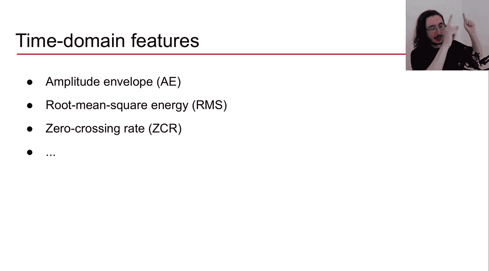
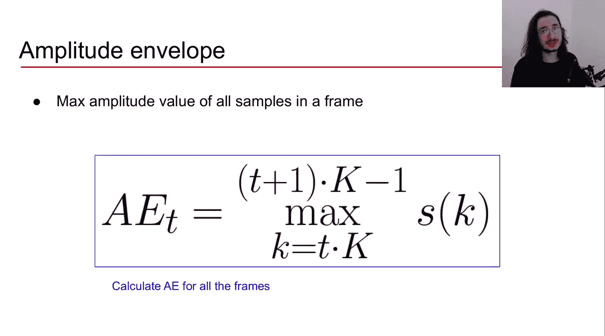
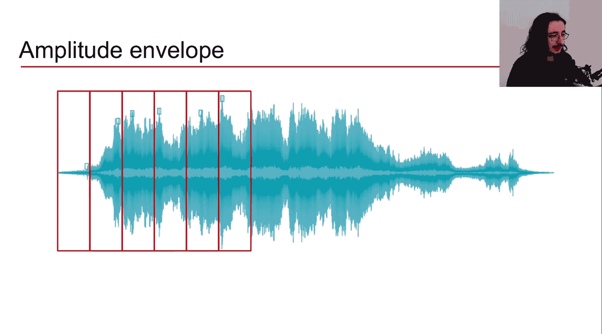
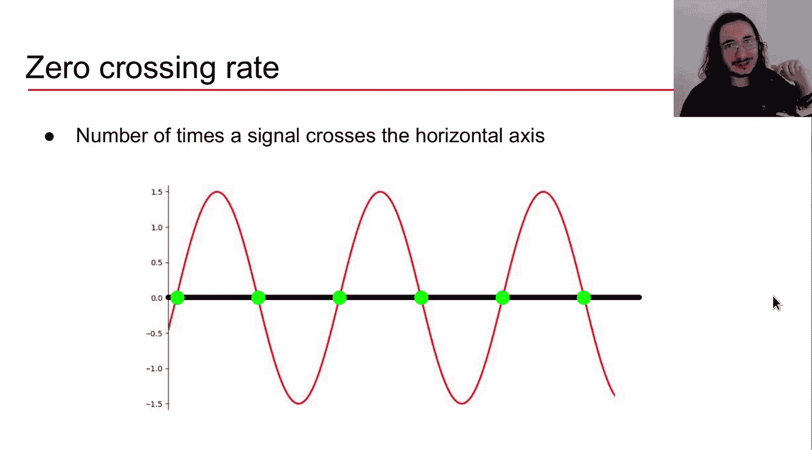
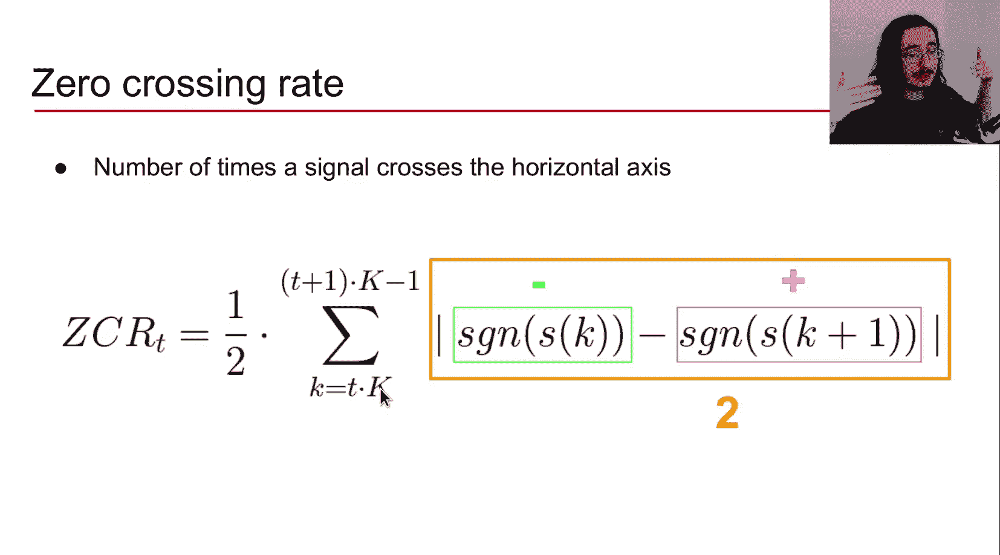
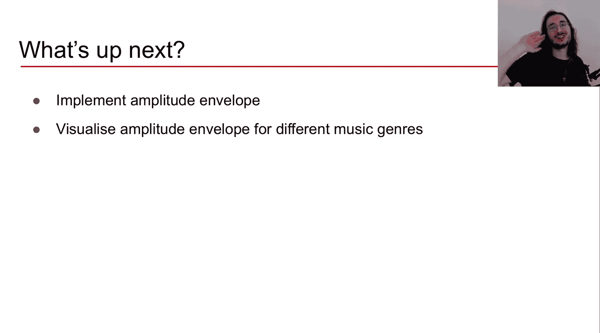

# Valerio Velardo【中英⚡面向机器学习的音频信号处理 Audio Signal Processing for Machine Learning】 p07 p6 Understanding Time Domain Audio Features [BV1ftPLeCEhX_p7]

Hi， everybody， and welcome to a new exciting video in the audio signal processing for machine learning series。

 Last time we introduced the extraction pipelines for both time domain and frequencyency domain features。

 This time， I'm going be introducing time domain audio features， specifically。

 I'm going focus on a few very important time domain audio features。

 and explain the theory behind them。 But before we get started。

 let me recall you once remind you once again， about the sound of AI Slack community。

 This is a community of people interested in all things， AI audio AI music， audio signal processing。

 So if you want to improve your knowledge in the field and network with great people。

 a highly suggest you to go check out the signup link that I've left in the description below。

 Now onto the good stuff。 Okay， so these are the three time domain features that will be。😊。

on today。 So these are amplitude envelope， root mean square energy and zero crossing rate。

 So all of these features are low level acoustic features and they are instantaneous。 In other words。

 we take these features at each frame in an audio signal。

 then obviously we can just like take like all of these values that we have for each frame。

 and then we can aggregate them with some statistical means like mean sum or things that are a little bit more sophisticated like Gasian mixture models。

 And but yeah， so if you don't remember like the definition of a frame or like the categorization of audio features。

 I highly suggest you go check out these video up here that will clarify all of those things for you。

 The first time the main feature that we look into is the amplitude envelope and that's the。😊。

amplitudelic value taken out of all the samples that we have in a frame。

 now I'll show you the math for calculating that don't be scared because I'll break it down piece by piece for you。

😊，What we want to find is the amplitude envelope at frame T。 So it's the specific frame。

 So now let's start with this S of K。 So what's that？ Well。

 that's just like the amplitude calculated at sample K。 Now。

 another ingredient that we want to know about is this capital K。

 which is the frame size or in other words， the number of samples that we have in a given frame。

 Okay， so now we want to take the max amplitude value of all the samples in a frame。

 So we have to define this max between the first sample of frame T。

 and we can access that by multiplying the frame we are at。 So this could be like frame 0。

1 to whatever you want and capital K， which is the frame size。

 and this will give the first sample of frame T and we want to calculate the max， as we said between。

😊，First sample of frame T and obviously the last sample of frame T。And we can calculate this by。

 first of all， accessing the next frame。 and that is like t plus one。

 We want to multiply that by the frame size。 and these will give us the first sample of frame t plus one。

 So we want to go back to the last frame of T。 And so we have to subtract one to t plus one multiplied by K。

 right？ Okay， so this is the amplitude envelope at frame T。

 but we know that we want what we want to do is to calculate the amplitude envelope for all the frames。

 So for each frame in an audio signal， we are gonna use these formula here。😊，Okay。

 I know this can feel a little bit abstract。 So let's try to visualize this to like understand this like a process a little bit better。

 So here we have like our normal audio signal here。

 I'm gonna take like a few like I'm gonna be framing this audio signal。 So this is the first frame。

 second frame， third，4， fifth， sixth， right， and I can continue once again。

 if you don't remember what framing is， what like all of this like yeah things。

 concepts are is like framed， just go back to a couple of videos ago in this series Ca therere。

 like explain this like very in depth。 Okay， so now how do get the amplitude envelope here。 Well。

 what we do like what we did mathematically Now we can do visually In other words。

 we want to take for each frame。 the highest value， the max value of the amplitude and。😊。

This guy， little guy here in green。 Now， if we move to the second frame， we have like this guy here。

 that's the max value here。 we have like this max value that's over here here for the fourth。😊。

5ifth frame， we go here。 and I expect for the sixth frame to have the max amplitude over here。 Okay。

 so this is like visually what we are， what we did earlier like with a mathematical formula。 Okay。

 I hope like this is clear。 It's quite like simple to grasp。

 like once you understand the intuition behind it。 Okay， now。

The question is， so what does like amplitude envelope tell us about the audio signal。 Well。

 it gives us like a rough idea of the loudness of the signal。

 And that's obviously because the amplitude is related with intensity and for loudness。 Okay。

 so the problem with the amplitude envelope is that it is like very sensitive toliers。

 And that's because you're just like getting one value one sample。

 the amplitude for one sample out of all the samples that you have in a frame。

 And so you may have like an outlier。 So in other words。

 you may have like a frame like that has like all， let's say， almost like0 amplitude for all samples。

 and then you have a spike。And then you get that spike。

 But that spike isn't really that representative of the whole frame， right。

 that's the basic idea why amplitude envelope is sensitive to our layerss。 Now。

 where do we use amplitude envelope。 Well， it can be used in a bunch of different applications。

 But a few like important ones or like onset detection， In other words。

 like onset detection is basically。 So if you have like a notes。

 you want to just like understand when that note， like start， it could be a musical note。

 It could be like the utterance of a word or a phoneium。And so which amplitude envelope。

 you can kind of like guess where that like event acoustic event starts。

 And that's because amplitude envelope gives us information about amplitude。

 and you would expect that at an onset。 you have like a burst of energy。 So a spike in the amplitude。

 and we can also use amplitude envelope for higher level classification problems like music genre classification。

 for example， now I'm not going to show you like graphs or visualizations like of amplitude envelope here like in this video。

 but in the next we'll be looking at the comparison like of amplitude envelope taken for like different pieces of music from different genres。

 And we'll see if indeed there is difference there。 Okay， so stay tuned for that。

 But now let's move on to the second time domain audio feature that's cool。😊，Root mean square energy。

 So what we do here is basically we took the root mean square of all the samples in a frame。 Okay。

 so I know like if you're not familiar with like statistics and math like this once again can sound like very scary。

 and indeed， this formula doesn't have much。 but once again， I'm going break this down。

 So you can understand that。 So here what we are doing is we are taking the root min square energy at。

😊，Frame T。 once again， as we said， all of these audio features are instantaneously。

 we take the values for each frame。 Okay， so here， the new thing。

 which shouldn't mean like too new for you is the as this S of K which is the amplitude at the sample K。

 but it's squared this time。 So if we have like the square of the amplitude。

 basically we have the energy。 So this guy is the energy of the k sample。 So what we do here。

 is we sum the energy for all the samples in frame T。 once again。

 like this is just like the sum symbol and we are like adding up like all the energy for all the samples in frame T。

 And then once we have like this sum， what we want to do is we want to take the min。😊。

Of the sum of the energy。 And we'll achieve that by dividing the sum of the energy by the frame size。

 which is the number of samples that we have in the given frame。 And after we've done that。

 we just apply the the root over here。 And that's it。 So basically。

 we have the root min square energy。 Now， once again。

 the rootmin square energy is an indicator of loudness because energy is strictly related to loudness。

 And the great thing about rootmin square energy。 And one of the reasons why like it is like overwhelmingly used at least like in traditional like digital signal audio digital signal processing is that it is less sensitive toli than the amplitude envelope。

 And this is because we're not just like sampling。😊，Single sample value for a frame。

 but rather we're just like。Getting information from all the samples。

 And then we take like the root Min square for that's calculated across like all the samples。

 And so in this way， we are less sensitive to outliers like spikes in amplitude in one sample in all of the frames。

 Okay， so now what are the applications for rootmin square energy。 once again， there are many。

 many applications here。 I want to talk about a couple of these。

 So we can use gridmin square energy for identifying new segments in an audio signal。

 And that's because the RMS tends to like change quite a lot when you have like new segments。

 new like events。 And so we can use， we can leverage rootmin square energy for all things like in audio segmentation。

 It could be done like for。😊，For example， like for deciding like whether like someone is talking or it's not talking and you have like this change and you want to segment who's talking and things like that and obviously we can also use RMS for music genre classification and we'll see some of this like over the next few videos in action The third time domain audio feature that I want to introduce in this video it's called zero crossing rate This is a quite popular acoustic feature use both in speech recognition and in music information retrieval。

😊，And it's a quite intuitive one because it provides us information about the number of times that a signal crosses the horizontal axis。

 So before getting into the math， let's visualize this。 so here we have a signal。

 simple signal worth of a frame， we can assume and then the zero crossing rate is equal to the count of like this green dots。

 Okay， so for each of these green dots， we have a crossing of the horizontal axis。 In other words。

 like for this signal， the zero crossing rate is equal to 1，2，3，4，5，6。 okay。😊，Now the question is。

 how do we calculate the zero crossing rate mathematically Well here you have the formula for that。

 once again， don't be scared about this will just like break it down Okay the basic intuition here is that we compare the the amplitude value for consecutive pairs of samples and we look at whether like there are differences like in the sign of those amplitude for those consecutive samples。

 Okay， so first of all， you should or we should familiarize with this sine function if you're not familiar with that already。

 basically what the sine function， which is indicated by this SGN what it does it gives us a back the sign of a given value。

 So in this case， for example is the amplitude is greater than zero。😊。

sine function gives us back plus one。 That's because the amplitude is positive。

 If the amplitude is negative， we get back minus-1， if the amplitude is equal to0， we get back0。

 Now how do we calculate the the zero crossing rate like for each pair of samples。 Well。

 what we do is we take the sign for the amplitude at sample K。

 and then we subtract to that the s for the amplitude at sample K plus1。

 So we are basically comparing the two consecutive samples here。

 Now the cool thing about this is that if we have both amplitude values that have like the same sign。

 So if they're both plus or minus， what happens here is that we get。😊，Out of this。Just like 0。

 So we don't get like any information regarding。 Well。

 we don't get any value that's going to increase the zero crossing rate。

But if we have alternate opposite signs。 So say， for example， like。Sample K。

 we have like a negative amplitude and at sample K plus one， we have a positive sample。😊。

So what happens is that we get a value of two here。 And that's because， yeah， let's just like。

 take a look at this。 So if we have like minus here， it means like that we have like-1-1 minus。

Plus 1 gives us like minus-2。 We have to take the absolute value of that。 So that's equal to 2。

 But now we are。 so this is gonna give us information only for10 crossing， not to。

 So we have to divide this two by2。 and it's given over here so that we're gonna have just like a value of one here。

 Now， what we do is we kind of like some over all the samples that we have in a in a frame。

 And so that we are gonna to get like the values for all the0 crossings that we have in a frame。

 Okay， so that's like a simple， like mathematical formula that's very elegant for defining0 crossing rate。

 Now， let's take a look at some applications。 As I said。

 this is like like 0 crossing rate is extensively used in speech recognition。😊。

As well as like in music processing。 So we can use zero crossing rate for recognizing percussive versus like pitched sounds。

 And that's because percussive sounds usually tend to have like quite random。

 like zero crossing rate。 So like they tend to change like the zero crossing rate， like quite a lot。

 whereas like pitch sounds tend to be like way more stable in the zero crossing rates。

 And we can also use zero crossing rate as a very regimendiary like monophonic pitch estimation algorithm。

 In other words， there's a kind of like relationship between like the number of zero crossings like end the pitch。

 And if we have like a monophonic pitch。 Basically， the idea is that that the higher the0。

 the number of zero crossings that we have and the higher the pitch is gonna be。 Now。

 this is not bulletproof and now we have like way more sophisticated like。😊。

Mophononic pitch estimators， but zero crossing rate still like is a basic idea that we can use like to get monophononic pitch estimation。

 And finally， if we want to look at the speech recognition like space。

 we can use zero crossing rate for distinguishing between signals which contain like voice and signals that are like usually that are unvoiced and that's because when we are like dealing with like voice。

😊，A voice signal。 We usually have like a zero crossing rate like that is like lower than what we have like an unvoiced like pieces of signals and that probably has to do with the fact that like those somevoiced parts are like noisier and yeah and that's the case in the next few videos well get our hands dirty and implement this time domain main audio features and use sometimes alter libsa for extracting them directly from audio signals specifically that the next video well implement the amplitude envelope from scratch and then will visualize the amplitude envelope for pieces of music which come from different music genres so that we can appreciate if there is any difference of amplitude envelope for different genres。

 Okay that's all for today I hope you enjoyed this video if that's the case。

 please remember to live a like。😊，If you have any questions as usual。

 feel free to leave a comment in the comment section below and I'll see you next time， cheers。😊。

