# Valerio Velardo【中英⚡面向机器学习的音频信号处理 Audio Signal Processing for Machine Learning】 p08 p7 Extracting the amplitude envelope feature from scratch in Python [BV1ftPLeCEhX_p8]

Hi， everybody， and welcome to a new video in the audio signal processing for machine learning series。

 This time will implement the amplitude envelope feature from scratch。

 And in the process will also get familiar with Libbrosa。

 which is the audio processing library that well use throughout this course。

 and well also plot waveforms and the amplitude envelope itself。 Before getting started。

 I wanted show you the libbrosa documentation here。 So you can check this out。

 I'll leave you the link in the description below。 Inter thing is that a libbrosa doesn't have an extractor for amplitude envelope。

 And so we' build one from scratch。 Okay， so now let's get started。

 And so the first thing that we want to do is to yeah let's start by importing Libbrosa。😊。

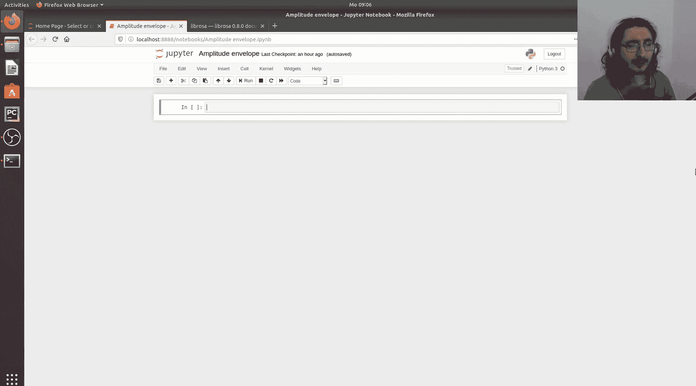

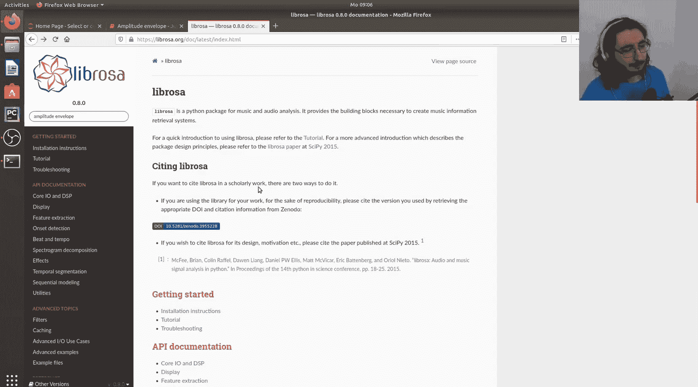

And we want to also import a Lib browsersa dot display that has utilities for plots。

 for plotting stuff。 Okay， so now what we want to do is to load。Audio files。

Okay and so what audio files are we using today Well I have here in the audio signal processing information learning codeb here at in the folder8 which is the one for this current video have a subfolder called audio here we have three audio files so one it's called abui and it's a 30 seconds passage of a orchestral piece by called abuid and we have 30 seconds by Duke Elllington。

 the jazz musician and 30 seconds from a song by the Red Hot Sheli Pepper so we have a little bit of rock classical music and jazz music in there okay so now let's。

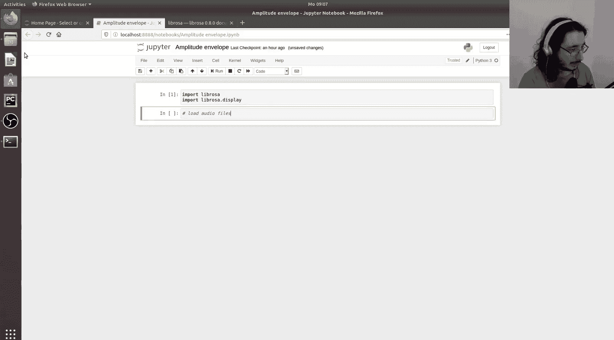

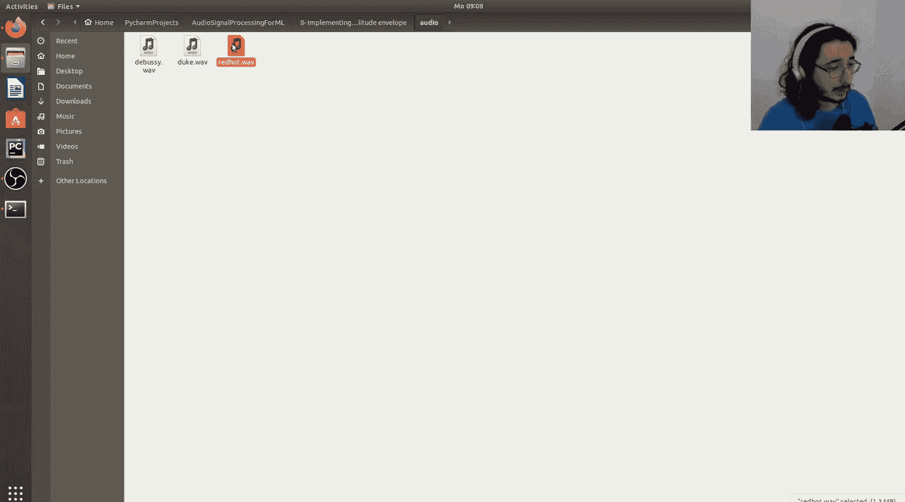

Create， let's get the paths。 So we'll have thebuC。 we'll call this thebuC file and。

This I can get from audio and then over here。BC， love。

And then I can do the same thing for the red hot chili peppers。

So I'll do audio and then I'll say red dot W and same thing for the Duke Ellington file audio and then I'll say Duke。

Okay， perfect。 so these are the the paths Now I can do this because I started Jupiter or notebook in。

😊。

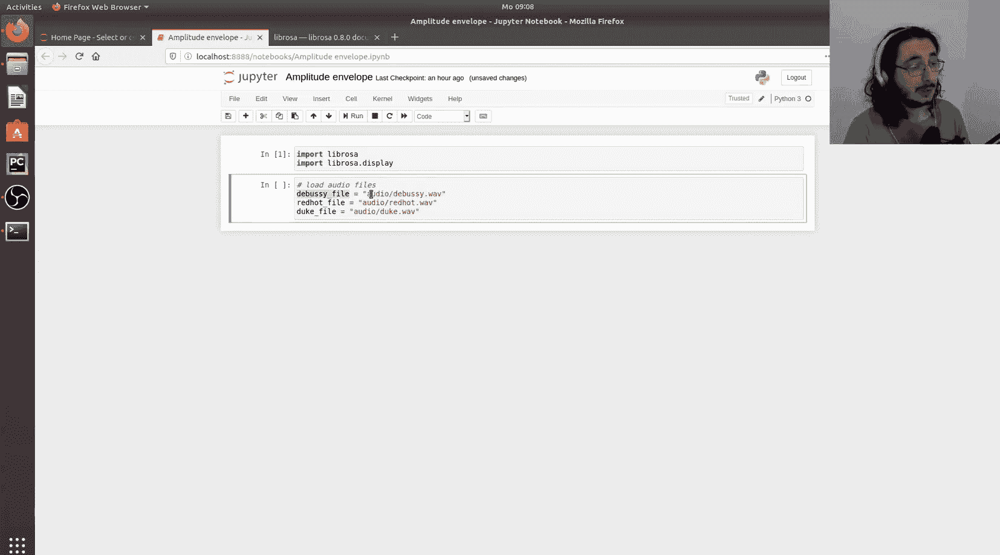

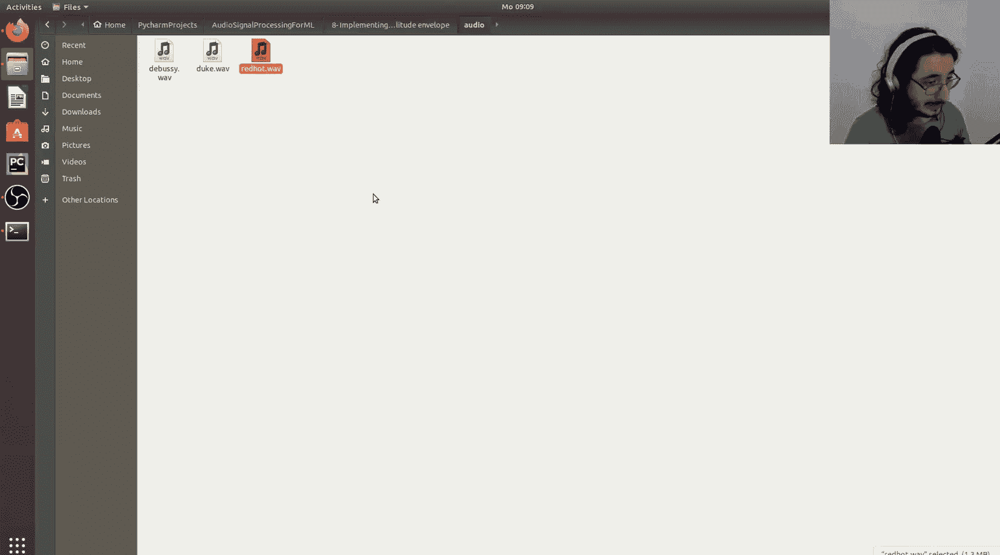

Here， so at this level here。 So basically， I then can access the audio folder and then obviously the file itself。

 Okay， so the first thing that we want to do here is to import。3。I Python display play。As IPD。

 And so this has， this package has some interesting utilities that we can use to just like listen to some music here in a Jo turn notebook。

 So you'll let。😊，Let's take a look at this， so we'll do IPD。

au and then we'll pass in the DBC file over here。And all of a sudden， we have are amazing。

Audio player here， and we can listen to like this music， but let's load the other music first。

 so we'll load a red dot file。Are we here？And then we'll load the。Jke Ellington file。 Okay。

 so let's listen to this music。🎼Okay， so this is a orchestral piece by Col andbuive。

🎼There loads of strings here。🎼And as you will see。🎼There is a climax here， the intensity rises up。

🎼And then it just fades away。Okay。🎼Nice。🎼Okay， you get the idea and then we have some music by Duke Eington。

 Barry。🎼Bunce jazz。🎼Okay， cool。So you have an idea of what we are dealing with in terms of like music or like audio。

Acus over here。 Okay， so now we actually want to load these way files using a Lib browsers and for then that we can use a method。

 basic method from Lib browsers that's called load not surprisingly okay so。

Here this method gives us back the signal itself， which in this case we'll call just like the BC and then it gives us back the sample range and so we'll do a libresa dot load and then we here we should pass the。

The file okay so now there are a few a bunch， actually a parameters optional parameters that we have。

 One is， for example， sample rate， we could specify a sample rate that we want Lib browsersa to load our audio file with and the basic case that we have here or I mean the default value that Libbrosa uses is 22050 which is a totally fine sampling rate for like our needs and so I'm not going to change that and then we have also like another option which is called mono which is a bull parameters so this mono could be equal to true or faults and basically deals tell Lib browsersa whether we want to load the audio file as as is for example。

 it could be a stereo file so with two channels or like as mono the default behavior of load is to load。

The audio fileless mono and this is like totally fine and we usually work with mono signals because you really don't lose that much information when you're dealing like with mono audio compared to like your stereo audio for example。

😊，Obviously， this can change from problem to problem。 But for today。

 we're just going use the default or mono。 Okay， so now let's load。Also the red hott。

 And here I'll use the underscore because we'll have like the sample rage here。

 and it's gonna be the same。 So we don't want， we don't care about that variable now。 Okay。

 so here this the B C file becomes the red hott file。 and then we'll do a duke。And。

We'll do once again， Libbroa。 load， and here we'll pass in the Duke。File， okay。Good， okay。

 so now we've loaded all of these guys。 For timing being， I'll just be working with debui。

 one of these to show you like a few like things about like what we've loaded。

 But then when I want to compare this， obviously， I lose all of these three different signals。

 If you're wondering how many samples， we have in the signal。 So we can just do a debui dot size。

 and you'll see that we have this many samples， Almost 700。😊，Peasant。Samples okay。

 so now let's take a look at the duration of one sample。Okay， so this。

 let's call the sample duration， and this is equal to the inverse of the sampling page。And。

Let's print this so that it's nicer to see and we'll say that duration of one sample is and here we'll pass in the sample duration and then we want to specify that we only want six decimal values and this is in seconds。

 Okay， so let's take a look at this。 and so the duration of one sample is 0。000045 seconds。

 So this is like a very， very short duration So now why do we want the sample duration。 Well。

 because I want to calculate the duration of the audio signal。In seconds， okay， and so for that。

 we should do a duration。And here we should do duration is equal to the sample duration。

 So the duration for one sample and multiply that by the total number of samples that we have in。

The signal， right？And let me grab days。So the duration of signal。

I and here will pass any the duration。O， I had aty over here， okay。

And the duration of the signal as expected is 30 seconds。

 So this is the length of the audio files that we are dealing with right now Okay。

 so let me just make out a few this。Boxes here， because otherwise， a little bit too。

Cluuttered the whole thing。 Okay， so now we know the duration of the signal。

 Let's say what what what I want to do really here is just like to visualize the waveforms。 Okay。

 so how do we do that， Well， given we want to do something a little bit of elaborate。

 I want to import match plot leap dot pi plot S P L T。 Okay。So。I have another type in here Okay。

 so we'll create a figure and so we'll do plot dots figure and we'll pass in a parameter called fig size and this is going to be equal yeah。

 we'll put 15 for the width and 17 for the height。And now we're going to have three different subplots。

 and we want to stack the waveforms for all the different audio signals vertically。 Okay。

 so we'll do a plot dot sub。Ploots in here we'll see that we want three rows， one column。

 and this plot is at index one。And so here so here what we can do is do a Lib browsersa dot display and we'll do a wave plot。

Okay， and so here we need to pass the signal and the signal in this case is thebuy。

 So we'll have thebu first then we'll do a plot dot title and the title in this case it's going to be thebuy。

 and given I know that this。Wyforms are going to be normalized between 1 and 1。

 I want to set a range on the。On the way axis。 And I'll set that to。Should be  -1 and one。Okay。

So we repeat this。A couple of times， but now this is going to be for。Red hots。

 And so we'll call this red chili peppers。And then we'll do the same thing for Duke Eington and we'll call this GO。

Duke Eling tone Okay， and finally here we'll do a plot dot show。 Now， let's take a look at this。

 If I haven't messed up， we should see the result。 and indeed I've messed up a little bit。

 So here you have like all of the he different。

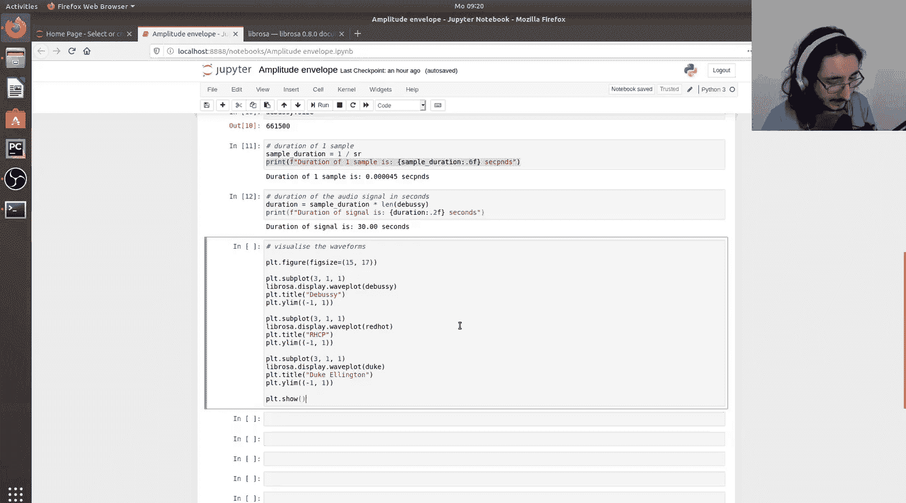

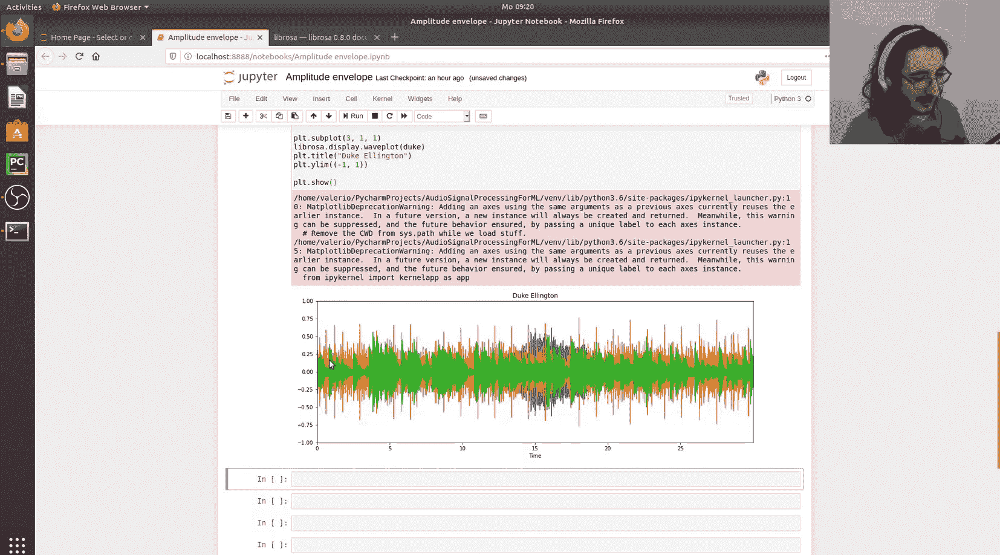

Wave plots like in the same graph， right？ Okay， so we want to change that。

 and that's why we had this subplot。 So here we put this at index 2 and here at index 3。

 Also another thing that I want to do is add a little bit of transparency here because it's going to just like look nicer So in this web plots。

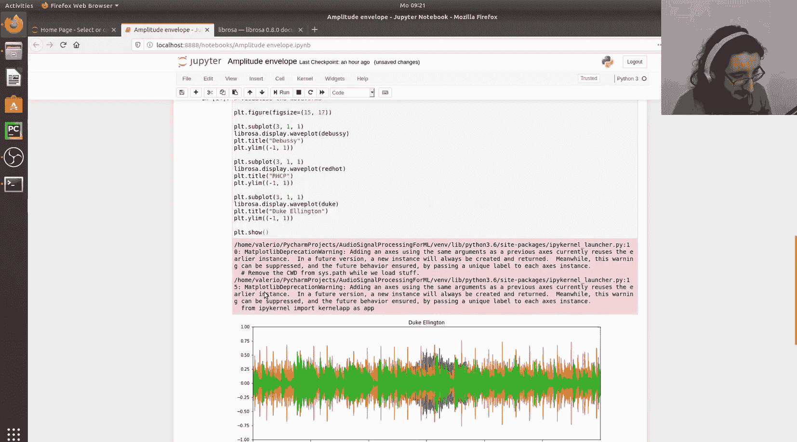

ことです。Do this。 Okay， let's go。 Let's see。 Okay， here we go。 Okay。

 so here we have the different wave plots for debuy。

 the Red hot chili peppers song andkeington's piece。 Okay。

 so we can draw conclusions like already like by comparing these guys here。

 So as you can see overall， the debuy wave plot is kind of like a very fluid in its like envelope。

 right， So it is like fairly like stable down here。

 then you have like a huge rise of tension and and and rise of energy right over here。

 here you have the clax。 And then it goes back down if we compared that with the Red hott chili pepper song。

 It's quite different， right， because here， the the overall envelope tends to remain the same。

 right And that's a feature that you'll always you'll often find in popular music and here。😊。

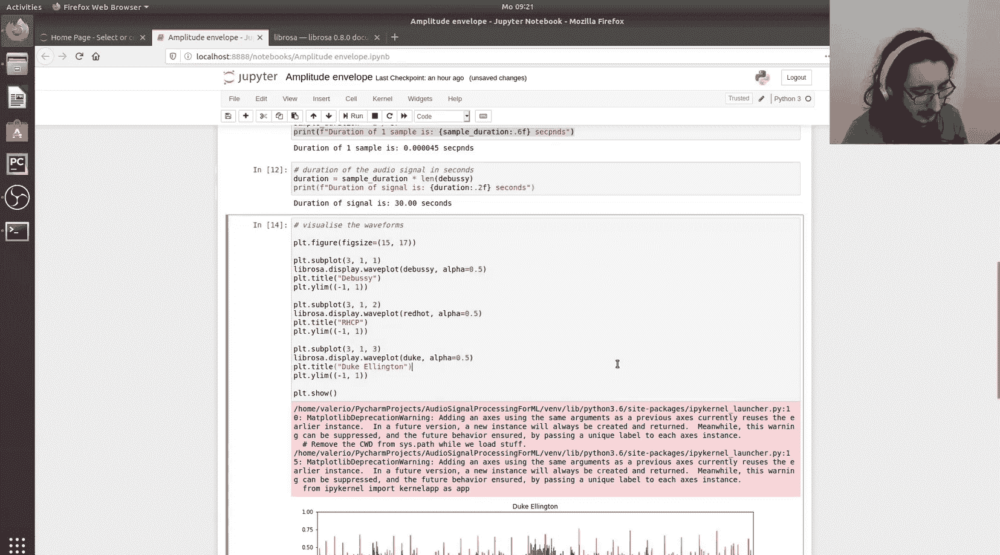

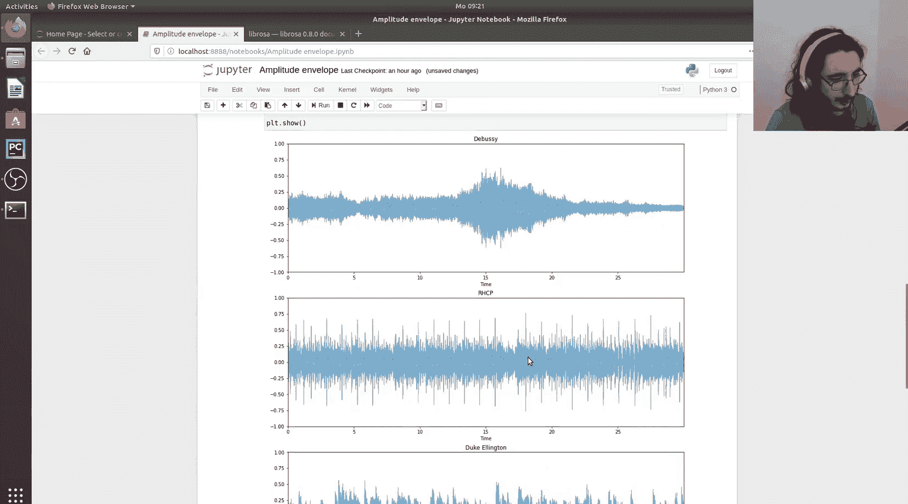

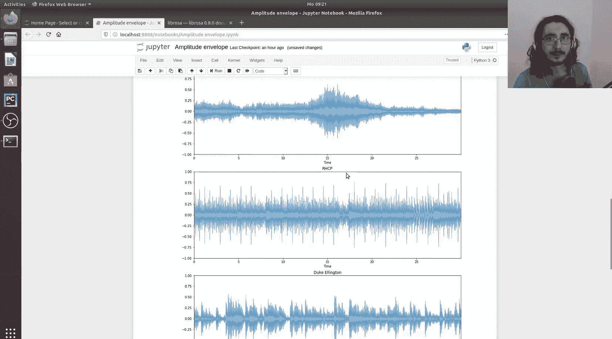

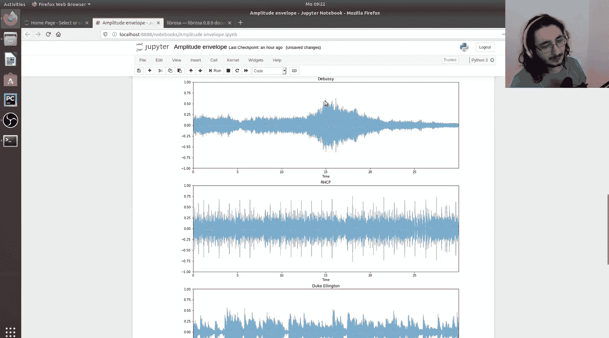

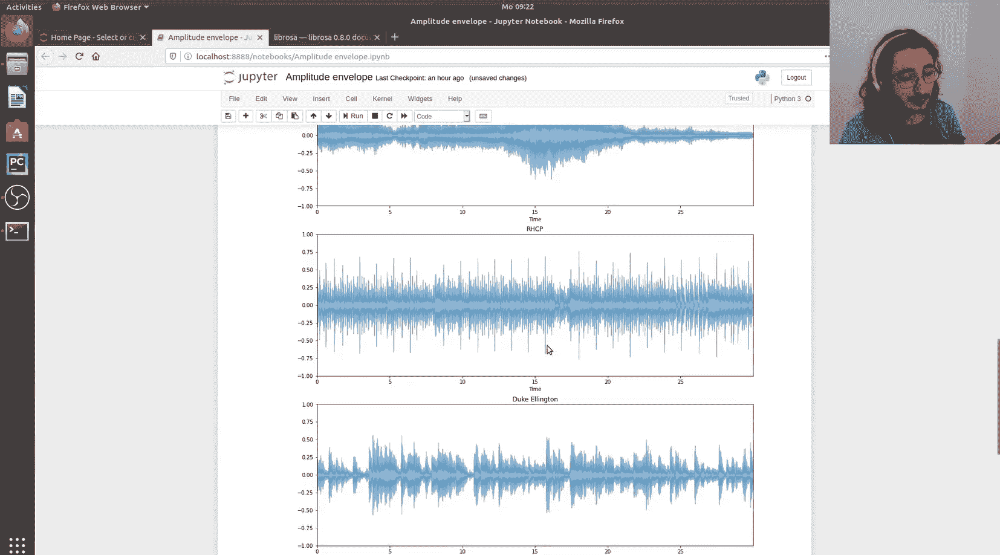

We can talk about like rock music， pop music， or EDM， for example。

AndHere you'll notice also certain spikes in the waveform and these spikes， as you can see。

 are like a regular point in time and as you get it。

 these are like the kicknare so the drunket like come in in and if we compare this like with theketon。

 you have like a little bit like the two worlds here the classical music and the rock music so there's quite a lot of variability like in in intensity but it's more like micro is not like the macro level and so basically the point the takeaway point here is that when you're dealing with classical music which uses obviously a lot of like actic mainly acoustic instruments。

 then you'll have like a lot of variability in the waveform， whereas like with popular music。

 which more like electronicic electric instruments then。

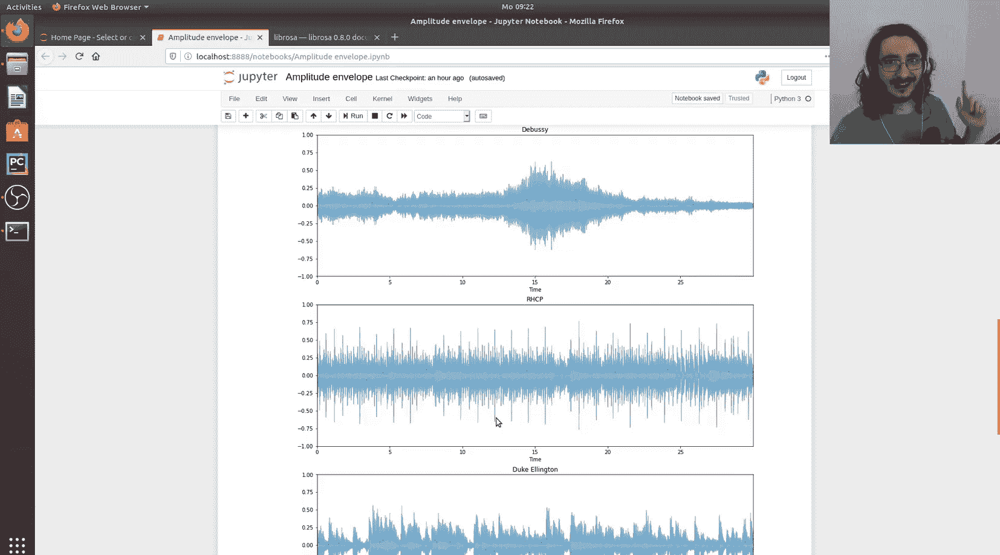

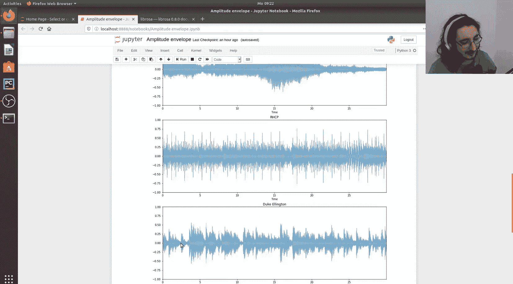

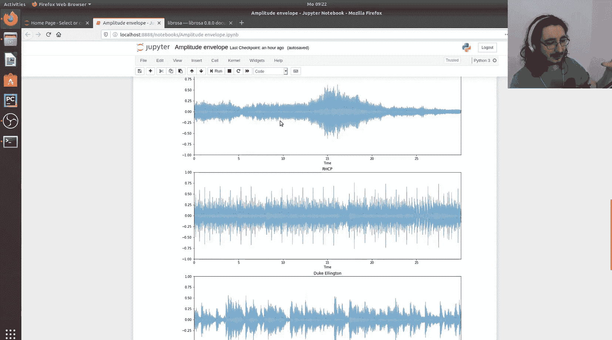

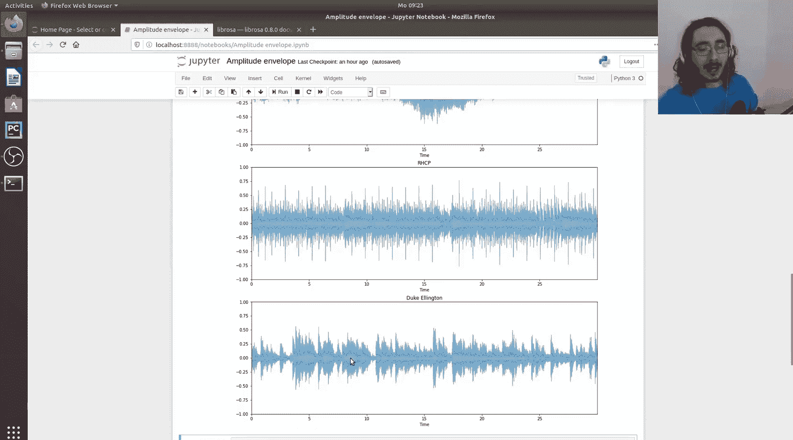

Like the， the waveform tends to be a little bit like more stable。 obviously。

 like this can change a lot depending on the sun。 But like this is like a general rule of thumb。

 Okay， so now the next step that we want to do is to actually calculate the。

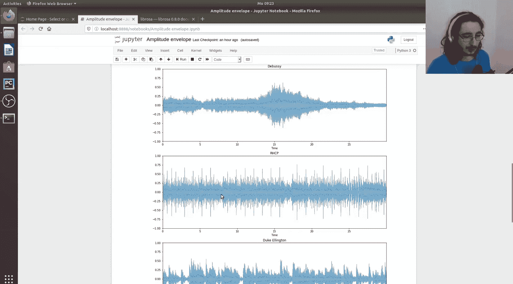

Aamplicage。Envelope， okay？And so I'm going create a function for doing that actually I'm going to create two function。

 So one like is going to be like a little bit easier to understand in some stuff like Python code。

 The other one is a little bit fancier， but the algorithm is the same the only thing that changes is the the python code Okay so let's start with with the simple one。

 the most the more intuitive the amplitude envelope。😊。

And here this function takes a signal and it takes a frame size， okay？So。amplitude envelope。

 and we're gonna set this equal to a list。 If you guys remember from the previous video for calculating the amplitude envelope at a specific frame。

 what we want to do is just like take the maximum value of the amplitude calculated across all the samples in that given frame and for getting the amplitude envelope for the whole signal。

 we take the the max amplitude for each frame and yeah。

 we just like a pen that like to get like a value for each frame right Now if you're don't remember that I went into quite details about like the mathematics of the amplitude envelope in the previous video so you should definitely check that out and it should be over here just like。

Go check that out， okay。So。Here we want to calculate， calculate the amplitude envelope for each。

Frame， so， and for doing that， we'll do a4。I in。Range。And here we'll start from0。

 Then we'll stop at the length of the signal。 But here we don't want to just have this I that goes like 1 to 3 at each iterations。

 Now， we wanted to jump， and we wanted to jump by the frame size。

 So like this third like argument here in the range function is the step size in this case。

 So let's assume the frame size is equal to 100。 So we'll start at the first iteration I is going to be equal to0。

 and it's going to be second iteration iss going be equal to 100 then 200，300。 You get the idea。

 Where do we do that。 Well， we do that because in this way。

 I is always going be the first sample in a frame， okay。And that's something that we definitely。Need。

 And so now。We could say current。Fralame。A please huge。Envelope。And they look。

And so this is equal to the max of the slice of signal that just considers the all the frames in the current all the samples in the current frame。

 and so this is given by the slice of signal calculated between I and I plus。Frame size， okay。

 so we are slicing the signal considering only the samples for a given frame。Okay。

 so and here we take the。Amitude envelope， and we want to append。

The current frame amplitudelic envelope， okay。So we'll do this。

 And here we can return the amplitudeliced envelope， but we'll return that as an N array。

 So we'll do this。 Okay， so this should work， but let me。Just create a constant up here。

So we'll put the frame size equal to 1024， which is totally legit number for frame size。Okay。

 so now let's try to calculate the amperage envelope for。It abu signal。 And so we'll do I。

APute envelope will pass in the bus signal and we'll pass in the frame size。 Now。

 what I want to do is show you the length of this guy。And obviously we have an error here。

 which is NP because I didn't import Nie， and so let me import that， so we'll do import NI as MP。

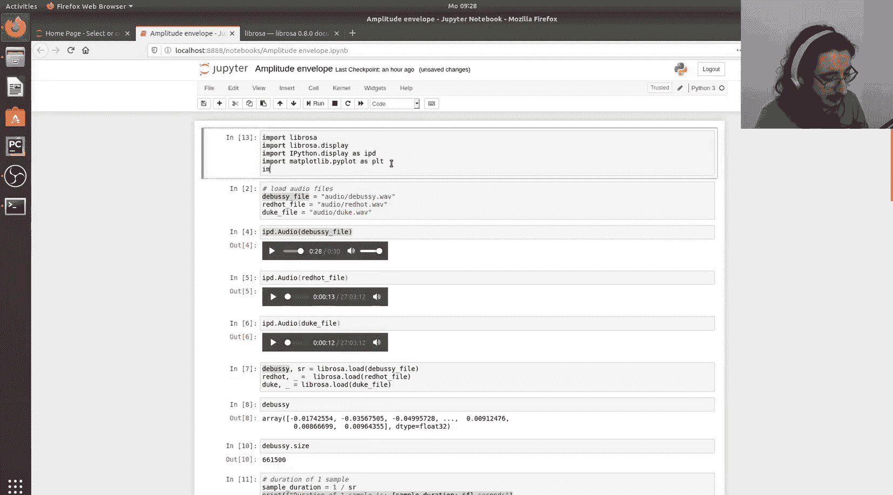

Okay， now let's go back down here。 And hopefully this should work。 Okay， here we go。

 So here we have the the size of this array is 646。

 So this is the number of frames that we have in the thebu signal。 Now， if I change the frame size。

 let's say I have it。 So I put it at 512。 So now the number of frames should like double or the number of like the the the size of the amplitudeute envelope also it should double。

 right， let's see。

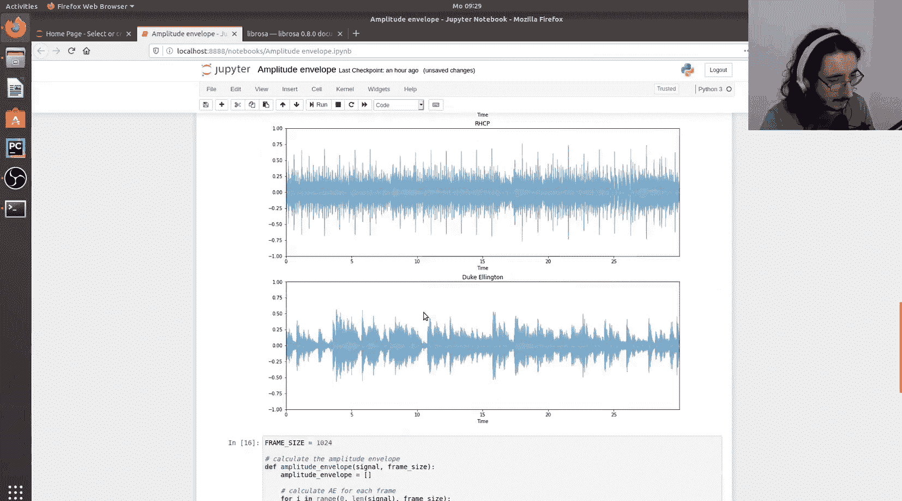

Yeah， but I should rerun this。 And here we go。 So we have double the number of frames over here。

 Okay， now this is all good and well， but it only consider the the case these amplitude envelope function where we have non overlapping frames if we had overlapping frames。

 we would have we would need to change like this function。

 And now if you don't remember what like overlapping and nonoverping frames are。

 I suggest you to go check out this video to just like refresh or like learn that。

 But basically when we have overlapping frames， we will still have like the frame size。

 which in this case we'll put equal to 2024。 but then we have a another。嗯。Important。

 like parameter that's called the hop length that tells us。So given like the current frame。

 how many samples were shift to the right for calculating the max frame and in this case we'll put 512 which again is a totally legit hop length。

And here we want to change this function so that it accepts also a new parameter called hop length。

 so how do we change this Well， well the only thing that we need to change here is that instead of like jumping。

At each iteration by the frame size， we want jumped by the hop lengthth， right？

So if if we change that， now we should have like the whole。Thank。Working， okay， so let's retry this。

Okay， so here I'll have to pass the hop length。I'll do that and as you can see here。

We have 1292 samples over here which is expected because we have a whole length of 512。

Wwhich is like the same like jumping into the right at each frame that we used before when we had the frame size at 512 there's also a nicer way to calculate the amplitude envelope and then the algorithm is the same it just like the python code that's a little bit fancier。

I guess they which showed up to you， Okay， so let's call this fancy Bluetoo。Envelope。

And we'll pass in the very same parameters over here。And this is going to be just a one liner。

 so we'll do a Nmpie array， and here we'll have a list a comprehension。

 and here we'll take the maximum of the signal。 Once again， this is going to be between I and I plus。

Hoop length。And then we'll take this for IN。呃。Well， this is not top length， this is frame size。

 and then we'll take the4IN range。And here is's going to be between0 of the signal。

Dot size and the step that we'll use。 Now this is the hop length once again。Op length， okay。So y。

SoThis should work。 Okay， so now let me calculate yeah。Let's put it down here。 So we'll do fancy。

 We'll call this fancy amplitude envelope for thebu C。And we'll do a fancy， oops， fancy。

Uplechar envelope。And we'll pass in these parameterss。Okay。Here we go。 T to work fine。 Now。

 what we want to show is that's the。The amplitude envelope calculated with this function。

 The amplitude envelope function with the fancy amplitude envelope function are。The same。

 So if we doing that， we could do I A。A E， I'm pretty sure envelope。 Well， let's do this。

 Well do A E W C is equal to fancy。A amplitudeage envelope to BC for all the values。

So let's see if this works。 Okay， yeah， that's true。 So basically。

 what I've done here is compare like all the items in the array1 by one with the current sponge like item in the other array。

 And then I， I want like， I wanted to have like that all of those values must be equal for all of them。

 And if that's the case， then we would get a true， which is like what we got。

 And so basically the two values are the same。 In other words， we wrote like the same algorithms。

 like in two different versions with Python code。 Okay， so this is nice。

 Now the final thing that I want to do is to visualize。I want to visualize the amplitude envelope。

For。Or the audio files， okay？So how do we do that Well， it's quite simple and。

And it really relies on the code that we've already。A writtenri。Over here。

For like visualizing like the the waveform。 So now the only difference here that we need is to add another plot。

 like in each of these like sub plots。 And so we'll do a。Ploots dot， beauty dot plot。Here we'll do T。

 and here we'll pass the A， the B C。 and then the color is going be equal to red。 Now。

 if you're wondering about this T， we haven't defined it and that yet。

 And so I'll define that in a second。 but before doing that， I just want to repeat this。

Down here for redhos。And。Down here for Duke Eton。Let's take this。Okay， now， as you know。

SoYou probably notice that I haven't defined the amplitudeputate envelope。For the red hots yet。

 And so we'll do that。Over here and so here I'll do a amplitudeude envelope and here I'll pass the red hot signal in then the frame size。

Ho length and I'll do the same for Duke。Ellington。Yeah， let me just grab this and。Passing here， Duke。

 Okay， this should work。 Now， the one thing that is's still missing here that I said is the this T。

 right。Okay， so this is basically like the X axis for the plots and here we have like the y axis and here we want time。

And so for doing that， what we need to do is first of all。

 get the frames and the frames is going to be equal to a range between a0 and。啊。

The size of the amplitude envelope。And so this is equal to awC dot size。

 I could have used also a amplitude envelope for like Duke Ellington or red hotch peppers because it's like the same in terms of like its length。

 its size so now I want to calculate T and here for passing from frames to time we can use a very nice function by Lib browserser and it's called frames to time over here And so here we need to specify the frames and we need to also specify the hop length and the hop length in this case is equal to hop length over here Okay so here we've basically got the time。

And along with the time we we've also， we also plot the amplitude envelope for each of the different audio files。

 Okay， so if I haven't made any mistakes， so this should work， let's see。

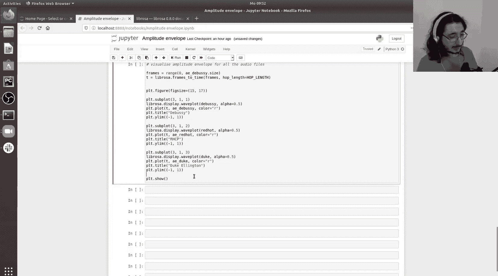

And here he goes and we have it in dread。

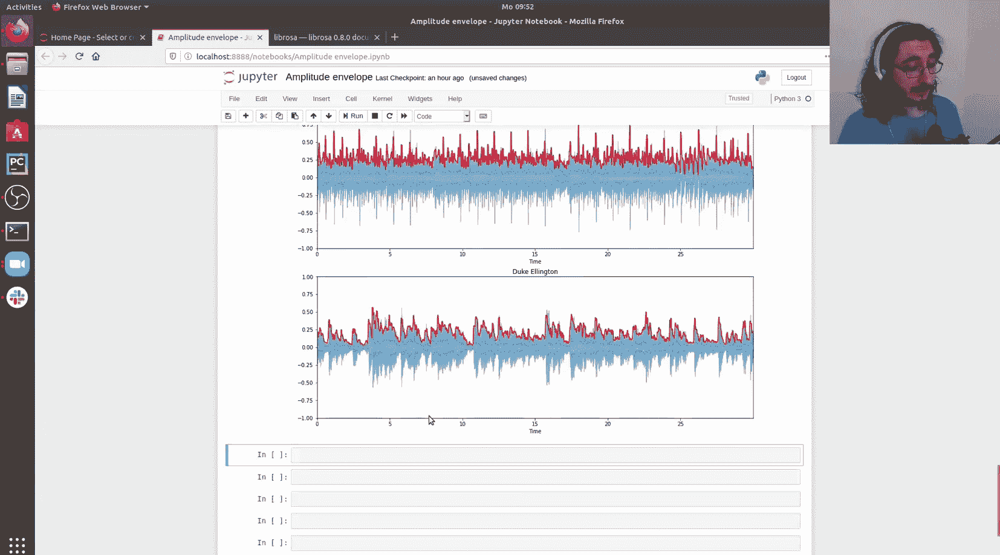

And yeah， not surprisingly， the amplitude envelope just like follows like the envelope like of the wafer and you can say it here like in red for thebui for the Red Hot show pepper song and for Duke Ellington okay so now one thing like that's obvious once again is that they usually you have like this spikes like in rock music or like popular music more in general。

 which are determined by like the drumet like kick in。

 and then usually you also have like the amplitude envelope。

 the mean amplitude envelope for music that's in a rock genre pop popular genre that's usually higher than that for like classical music or jazz music。

😊。

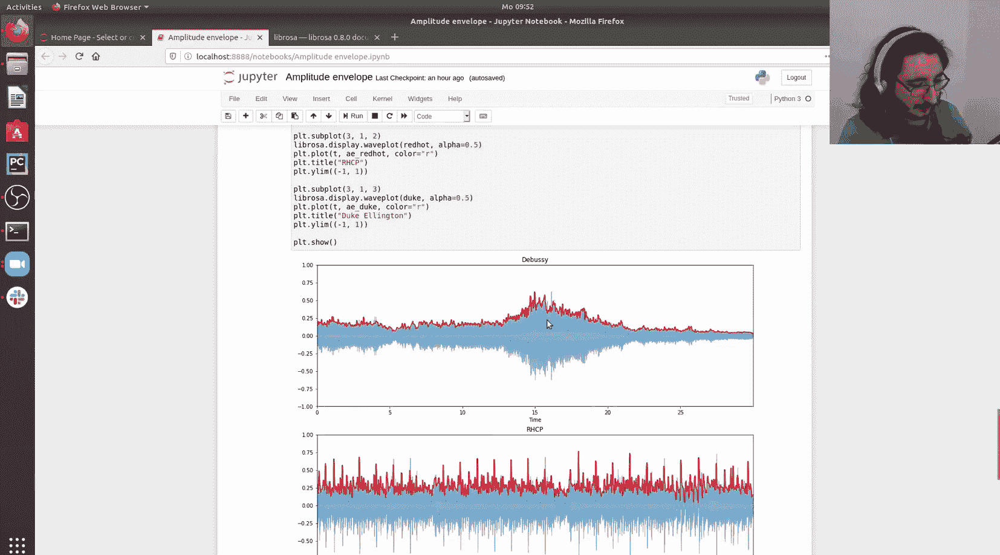

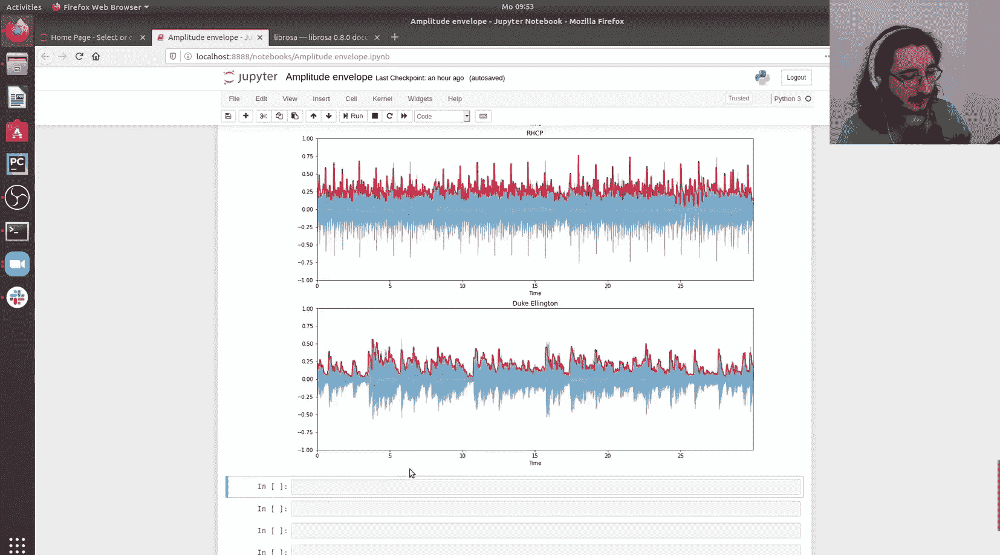

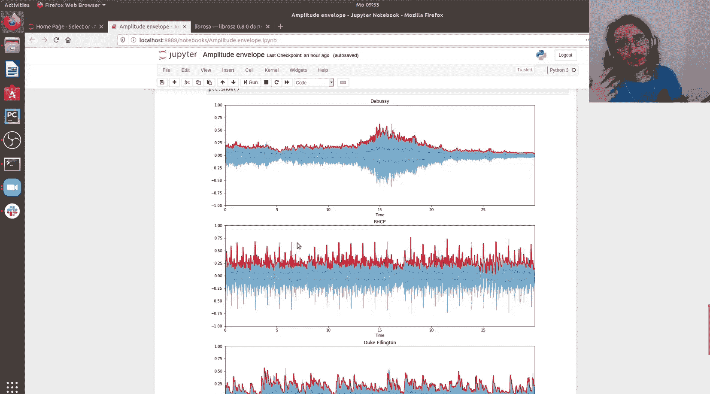

Okay but here you have it， I hope like you've enjoyed this video now you know how to create how to calculate the amplitude envelope。

 how to visualize waveform， the amplitude envelope and play around which basic processing features in the browser so that's all for today so if you like the video please consider like living a like if you haven't subscribed yet please consider subscribing if you have any questions。

 leave them in the comment section below and I guess I'll see you next time cheers。

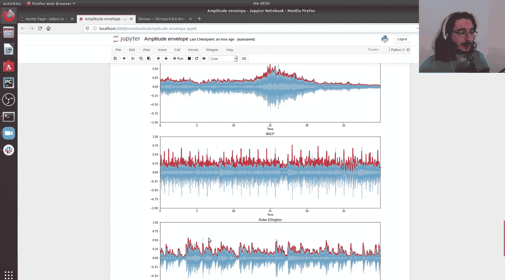