# Valerio Velardo【中英⚡面向机器学习的音频信号处理 Audio Signal Processing for Machine Learning】 p09 p8 How to Extract Root-Mean Square Energy and Zero-Crossing Rate from Audio [BV1ftPLeCEhX_p9]

Hi， everybody。 and welcome to a new exciting video in the audio signal processing for machine learning series。

 This time we'll continue our quest into the10 domain audio features。

 And specifically well be extracting the root main squared energy and zero crossing rate features using Libbrasa。

 Okay， so let's get started。 But before that， I yeah。

 just wanted to tell you that we are gonna be rehashing a lot of the code that I used in my previous video where I was extracting amplitude envelope。

 So， yeah， let's just like grab some of this code from here。 Okay。

 so the first thing that I want to grab is just like this imports here。😊。

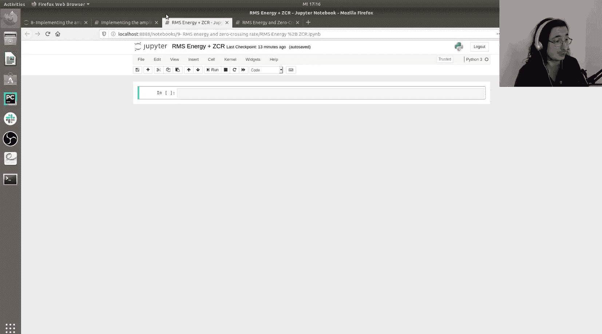

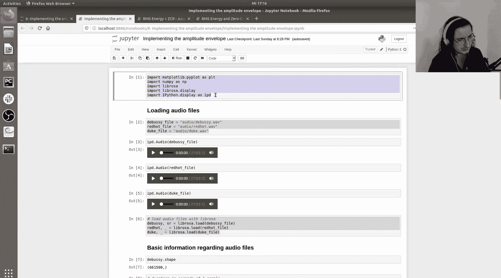

So as you can see， I'm importing map lip Pilo， nuonp Lib browsera Lib browsersa display for just displaying the waveforms。

 And then I Python display for playing audio directly in the Jupyter notebook。 Okay。

 so the next thing that I want to do is just load some audio。 And today。

 just like in the previous video， we're gonna to be using three audio files that are like three music passages。

 One is by debuy and orchestral piece。 another one is a jazz piece by Allington。

 and the third one is a rockxon from the Red hotio peppers。 Okay。

 so let me just grab the path to this files。 And then as the next thing， I just want to load them。

 And again， I'm just going be reusing this code。😊。

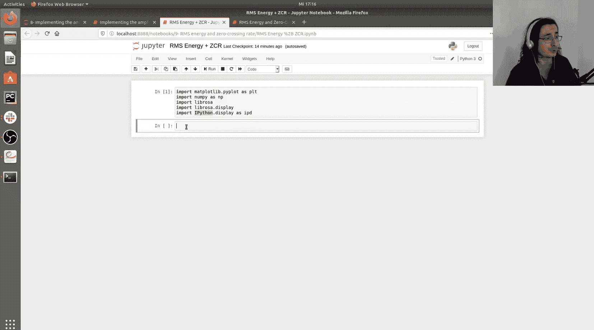

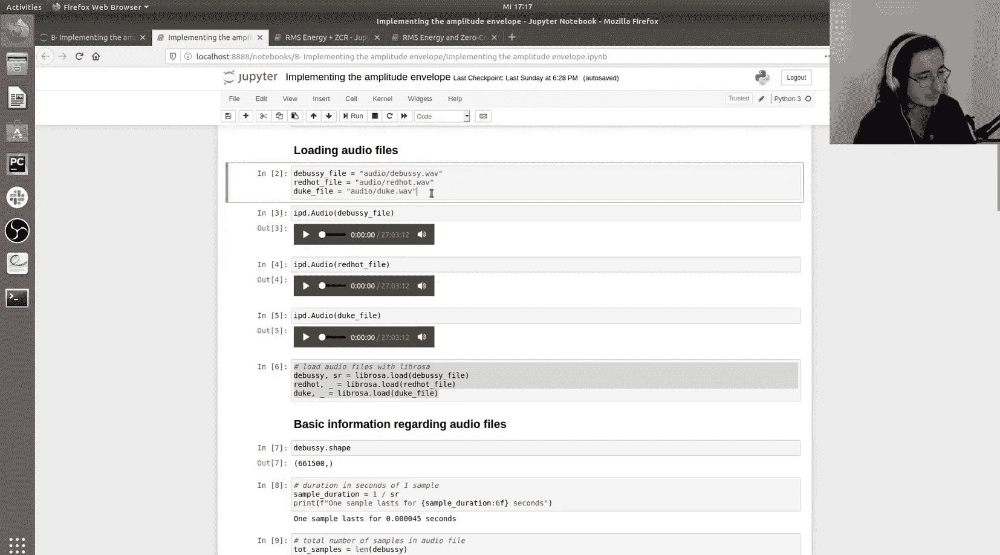

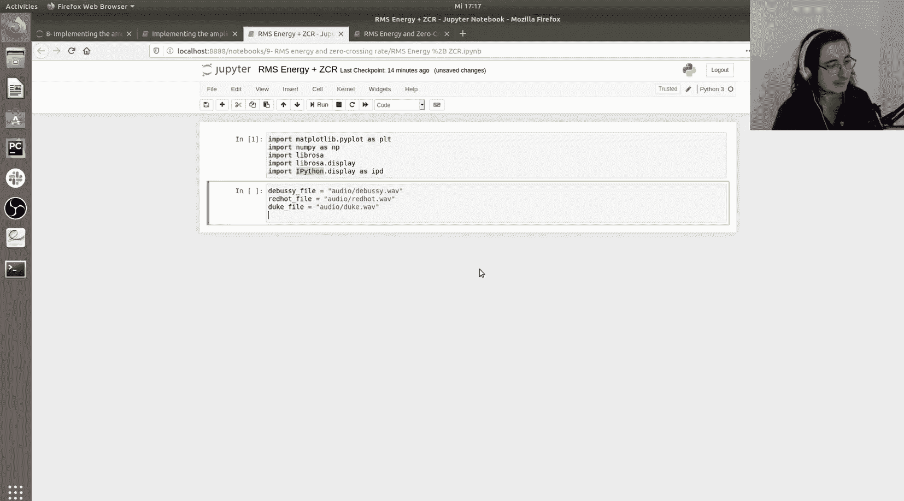

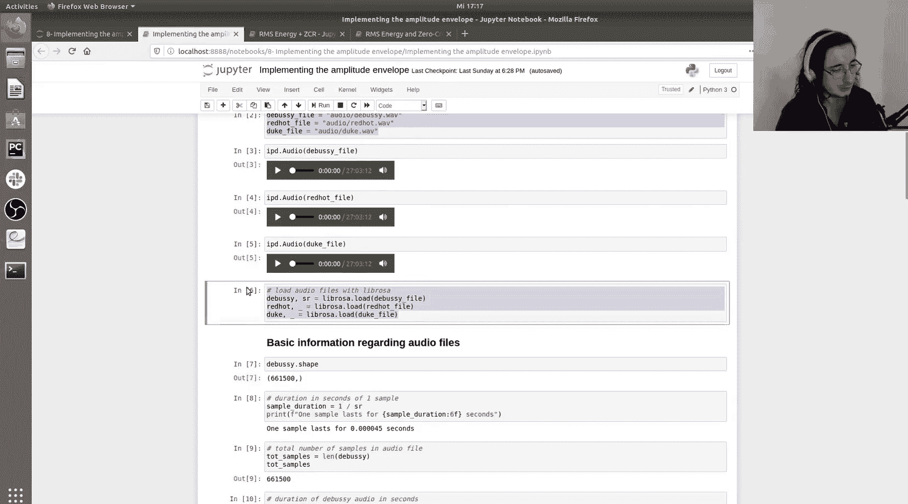

Just to keep things quicker。 Okay， so here， the only thing that I want to change is I'm like replacing that IR sampling rate。

 which underscore because we don't really need the sampling rate this time around。I believe。Okay。

 so now we should have the signals loaded for debuy Rahot Raarttail preferences and Duke Ellington as the first thing。

 we want to extract the Rimin squared energy using Libbrosa。

 So let me write that down So extract RMS E with Libbrosa。 So how do we do that。 Well。

 we can use a simple function coming from Libbrosa in the featured module， So before we do that。

 let's just create a couple of constants or variables。

 So the first one is frame length and I'll put this equal to a thousand24 samples。

 So I'll use the same one that we used in the previous video and same thing for hop length。😊，Yep。

 and this should be equal to 512。 Okay， so now let's extract the RMS for the and for doing this。

 we'll do I browsersa dot feature。Dot RMS， and we should pass in the signal for the BC。

 and then we should pass a couple of parameters。 The first one being the frame length and we'll set this equal to our frame length variable and then we have the hop length and we'll set this equal to hop length。

 Once again， let me remind you that we can alternatively use both like hop length and hop size or frame length and frame size。

 we're referring to the very same concept。 Okay， so now let me do the same thing for the red hot song red hot shield of pepper sun。

 So I'll do a RMS red hots and I should pass in the signal for red hot in here and here let me pass the signal for Duke Ellington。

 Yeah this was end of way or the cursor and here I should put in。Okay， so let me。Yeah， run Dutch。

 it seems like it works fine。 So now what do we get back from the ArMS function。 Well。

 you can guess it。 We get a nup array， but let's take a look at the shape of this empire array。

 So we'll do an RMSs wbu dot shape。 Okay， And so as you can see， we have a couple of dimensions。

 So the first one is just like one。 And then we have like1292 values。Right， and so if you remember。

 and yeah， this might be like a little bit like hard to remember， because it's just a number。

 But this is the very same number that we got when we extracted the amplitude envelope in the previous video。

 And that's because we were using the very same hop length。

512 samples and we had the same duration for the audio signal。 Now， what we want is this guy here。

 So in order to get just this。 So what we can do here is just take the。😊，Index。

 so we'll just like take this guy here at index 0。And now， if we rerun this。

 this is just like equal to this， which is like what we wanted。 Now， why did。

 why did I want that Well， Because now we are going plots。So we want to plot the RMS E。

For all the music pieces。 Okay， so now I'm not going rewrite the code like for like the plot。

 but I'm just gonna still it from my previous video。

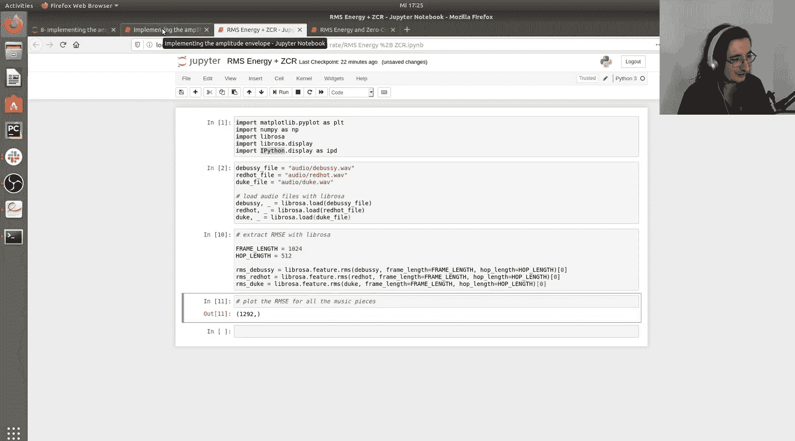

So not here。 I'm going to steal the one down here。

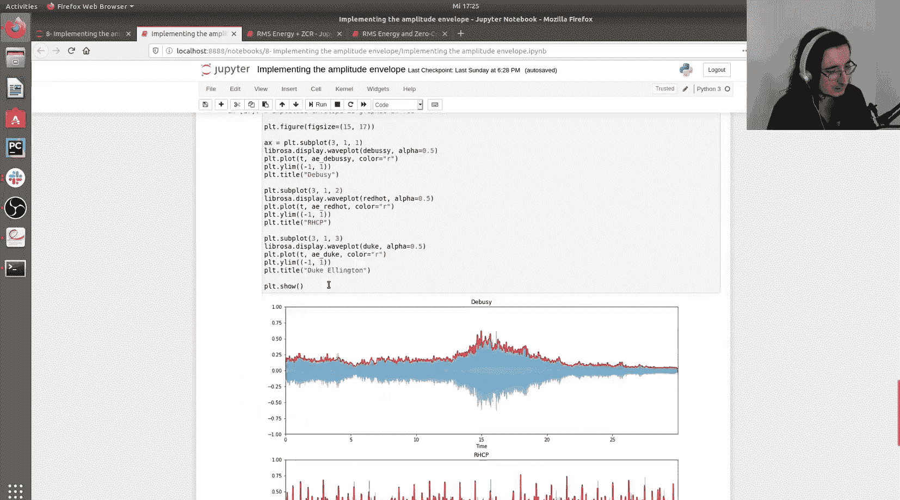

Okay。

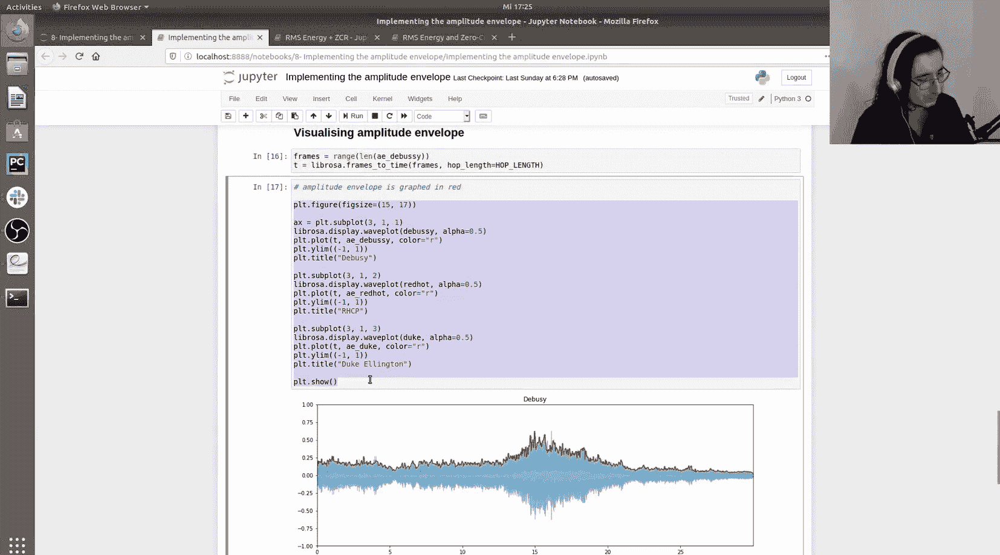

So let me go back here。And so， let's。Do this， okay。So let's see what we should change away here。

 so we have like our figure we create a subplot， we create like three stats vertically stats subplots。

 and we want to display the wave plotots for debuC for Redhart and for Duke and here we want to display not the amplitude envelope for WbuC。

 but rather the RMS for thebuC here we want to。Yeah。

 visualize the RMS for red hot shield peppers and down here for Jake Ellington。

 So now that's one thing missing。 So it is's just like this T value。 And again。

 I'm going just grab it over here。

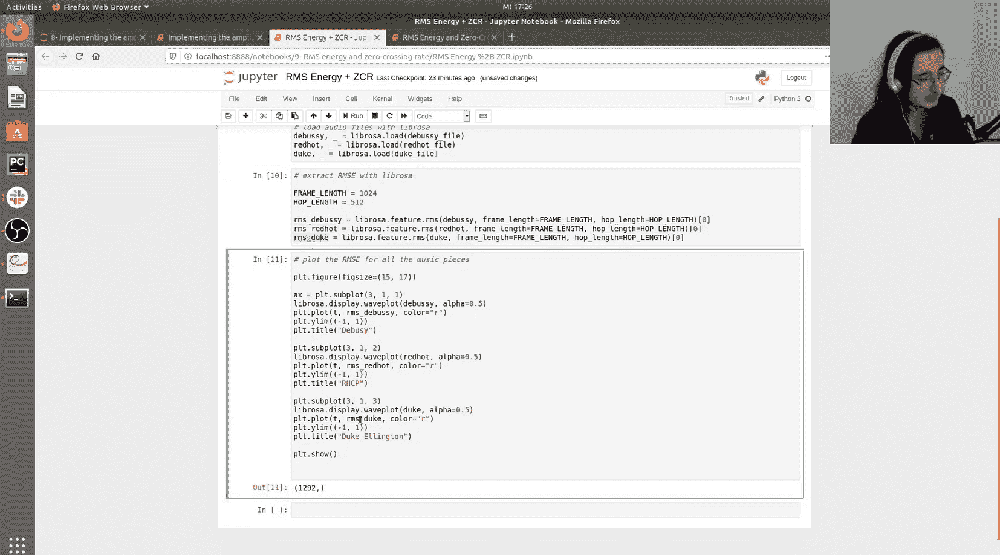

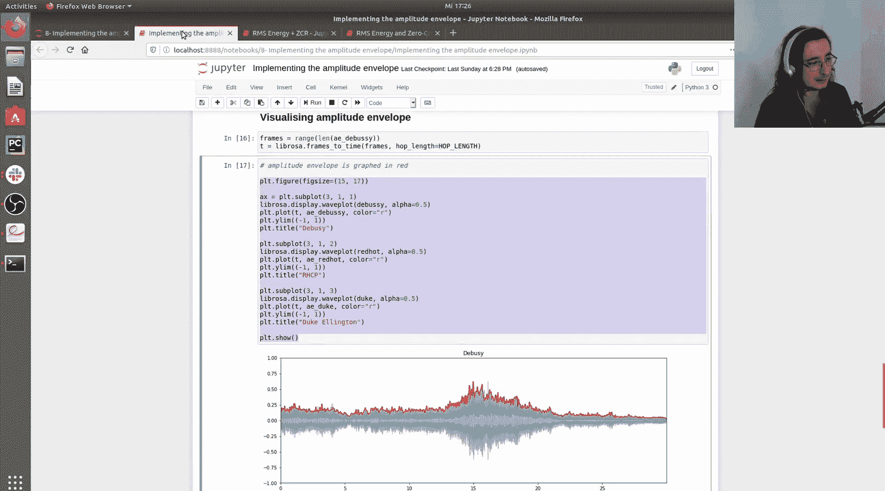

Sa。

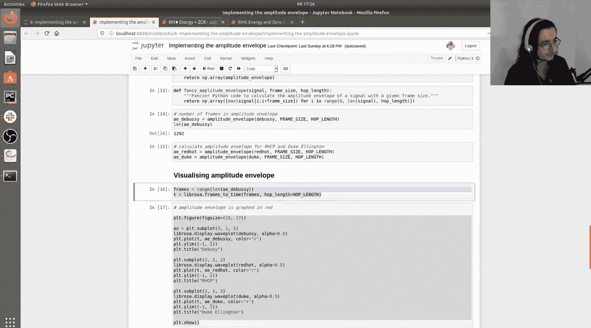

Basically， like this is the X。The value for all the value is like on the X axis that you have like down here。

 And here this the R S red hot， for example， is the values for the Y axis for our。

A plot and obviously what we want to do is just like move from frames like to time and we can do this like usingD frames to time function that I introduced in my previous video。

Okay， so now this should do the trick unless I maed off something like in the code。

 so let's see if it works。😊，And indeed， I messed up something。And that's oh， yeah right。

 that's because it was passing the amplitudelic envelope for debui， but we don't have that。

 We have that in the previous video。 So let me just grab RMS S for debui。 Now。

 the length for RMS S debui RMS S red hot and RMS S Duke is going to be the same because we have the these files that have the very same duration。

30 seconds。😊，Okay， so now let's rerun this and it's。

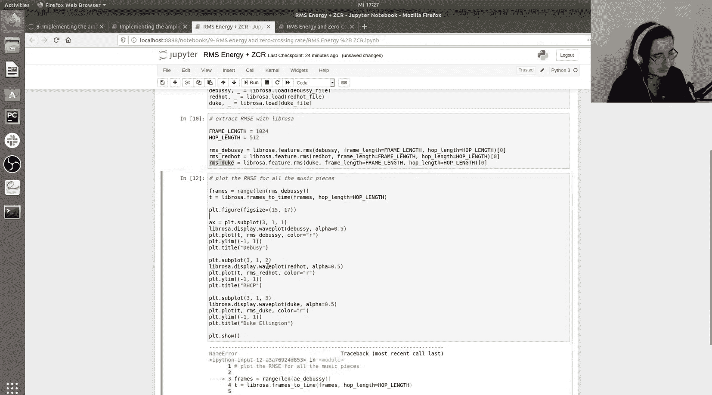

Here we have it so in red you can see the RMS energy in this case for thebua here。

 for the red hot shape peppers and here for Dukeke Ellington okay so as you can see。

 we still have like ideas that are like more or less comparable to watch like we discourage in the previous video which the amplitude envelope。

 But the cool thing here is that we have like way less like variability and outliarers and that's because for the RMS。

 we are considering all the samples in a frame we're not just like taking the max value of the amplitude for a given sample inside like the a frame right？

😊。

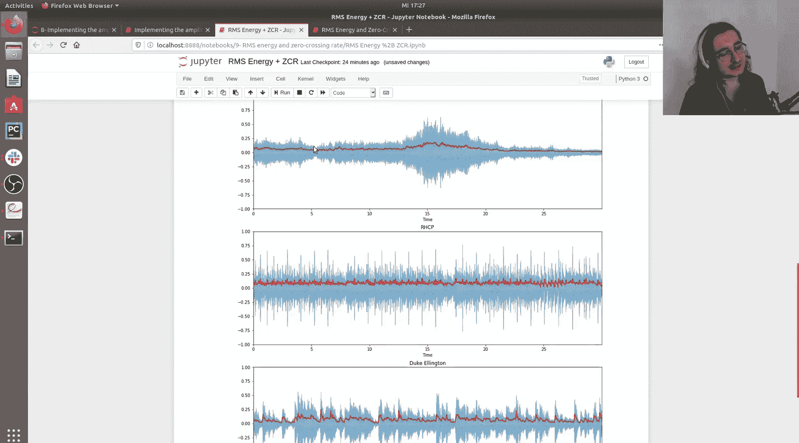

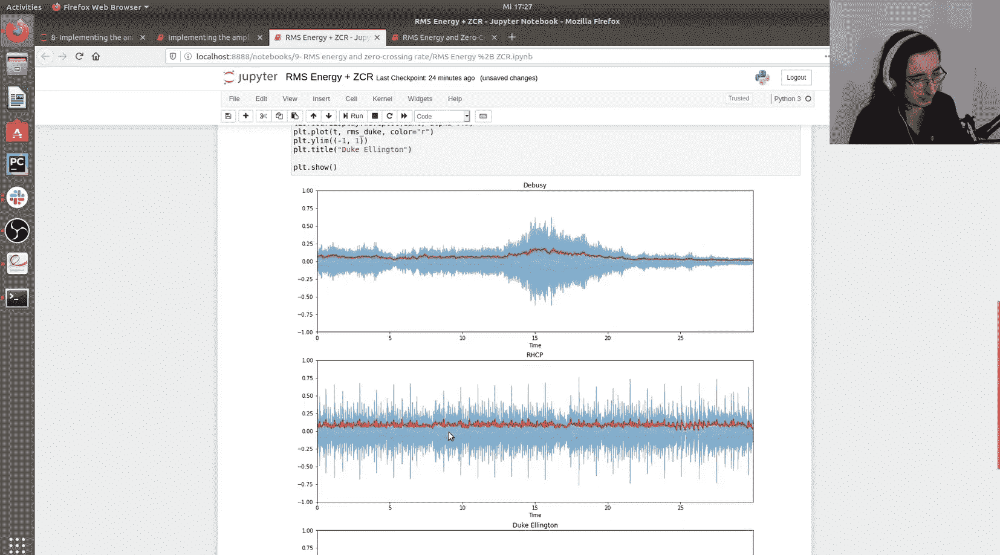

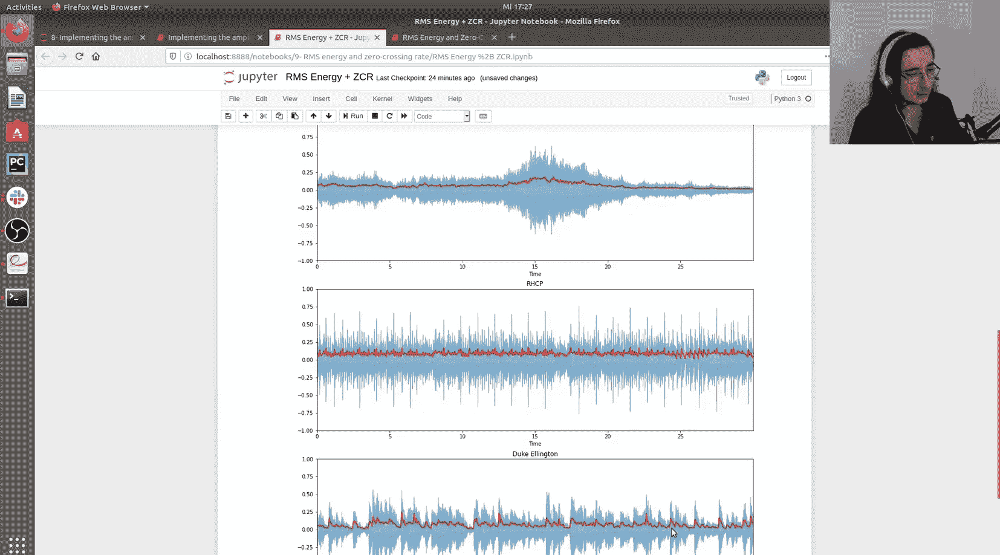

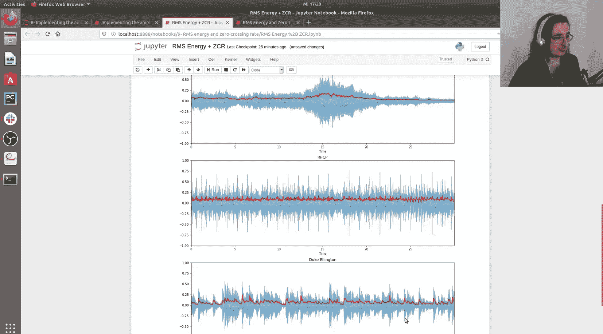

And now， just like for the sake of comparison， let's just compare the amplitude envelope。

 So this is the amplitude envelope for thebu for red hot chi peppers and Calington。

 as we extract it like last time and compared that against this， the RMS。 and as you can see。😊。

As I was mentioning。 So here like this， this just like go。It goes crazy， right。

 We have like a lot of spikes and it's just like follows like the upper part of the envelopelop。

 obviously。But here everything like is turned down and again。

 this is like because we are considering。Advocating the results for all the samples in a frame。

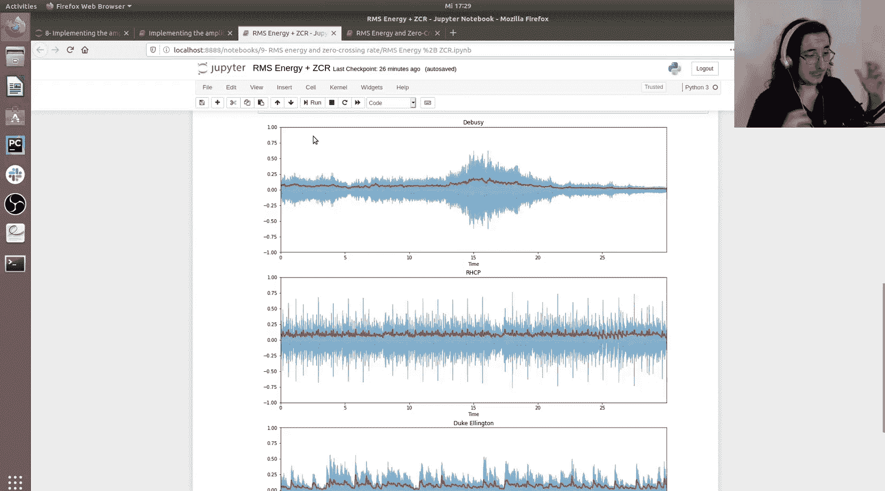

Okay。But okay， so here now you know how you can extract the Rm S energy with browser。

 But wouldn't it be nice if we try to extract the Rm energy from scratch。 Yes， it will be nice。

 So let's do that。 Okay， so let's create a function that will call Rm。

 So what does this function get as an input， It gets the signal。😊。

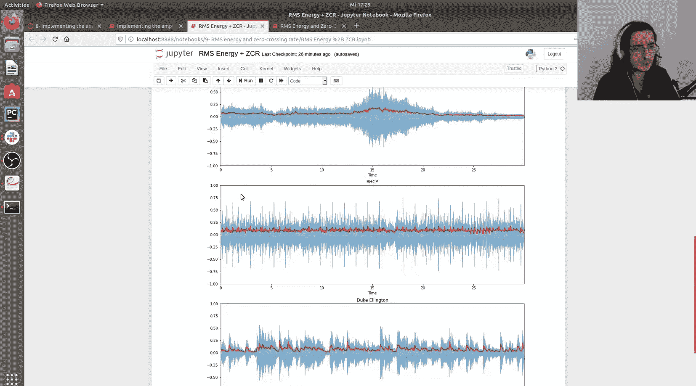

It also gets the frame length。😊，And it gets the holet。

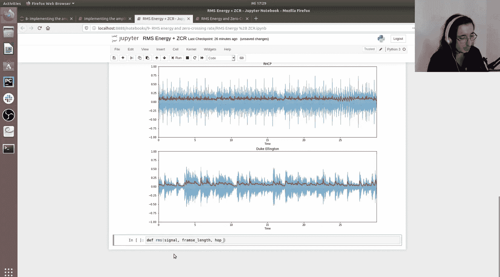

Again， this function is going to be like quite similar to the function that we built we built last time for the amplitude envelope。

😊，So。But before we get in here， so what I want to do is just like show you the RMS。

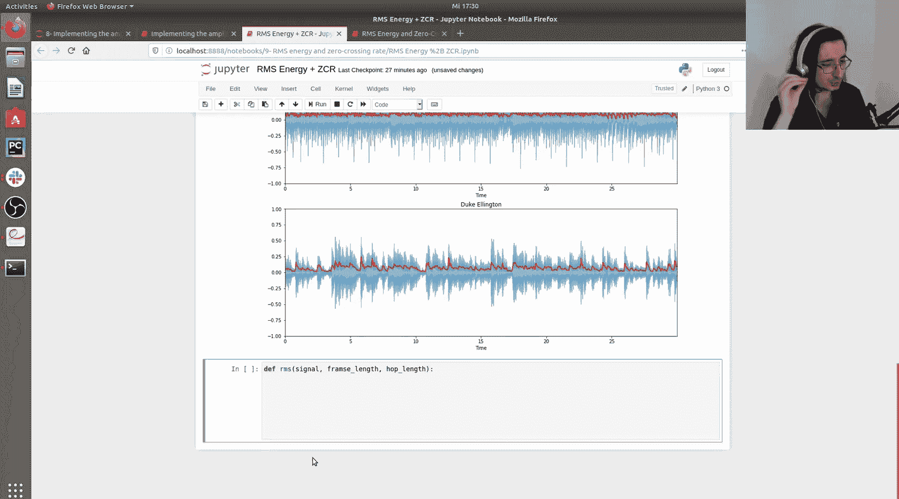

Okay let me show you that， so this is like the formula that we use for getting the rootm square energy and so we do we take the RMS of all the samples like in a frame。

And so here you have like the RMSMS calculated at frame T and as you can see what we should do here is basically just calculating the energy first。

 then we should like sum the energy of all the samples in a frame and then once we've done that we want to divide by the number of samples that we have in a frame or the frame size and then we just take the square root out of that so we should convert this into code。

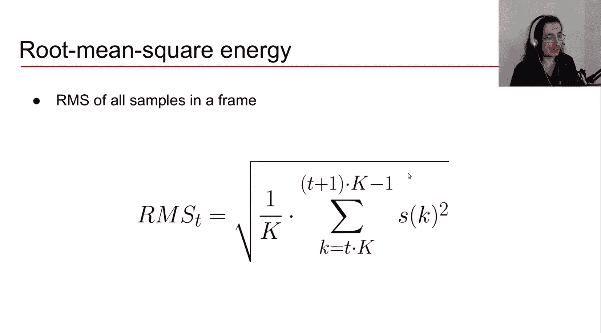

Let's do that。 Okay， so the first thing that we want to do is just create an empty。

A list and and this is going to contain the RMS for each frame。😊，Okay。

 and now we want to just a loop through all the frames in the audio signal。

 And so if we're doing that， we can say for I in range。 And here we start from 0。

 we should stop at the length of the signal and the step that we should use is the。😊，Hop length。

 right？So at every step we are moving。The number of samples in the hop length。

 like to the right to start like a new frame。 Now， if you want to get like the details about this。

 I suggest you just like go check out my previous video on the amplitude envelope where I explain this like in detail。

 Okay， now what we should do here is basically calculating the R mass for the current。

Frame and the R S for the current frame is given by this formula here。 So yeah。

 let's try like to to put this like in in place。 So what should we do here， Well， first of all。

 let's take the。Noun pie sum， and we should take the sum of the signal。

And the out of the signal we want to slice only the samples in the current frame and for doing that we should do we should like slice it between I and I plus frame length and I've just discovered I have atypo seal let me。

Correct that Okay， frame length over here。Which is cool。 And okay， so once we've done this。

 we should。😊。

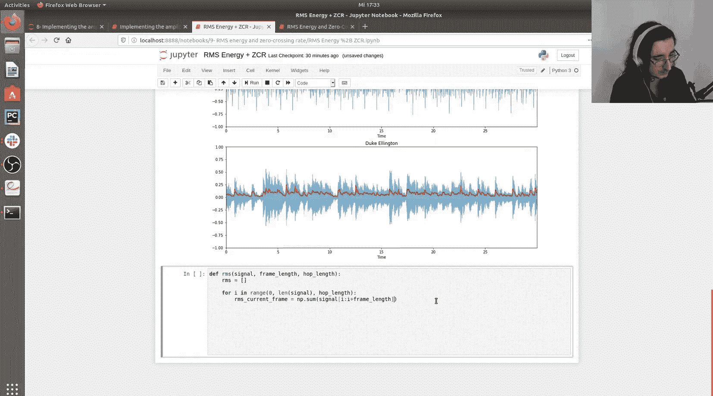

Square。This volume。So basically I'm just doing this I'm taking this guy here。

And I'm taking like the the sum。Of all of this of the energy and once we've done that。

 the next step that we want to do is divide by the frame length。

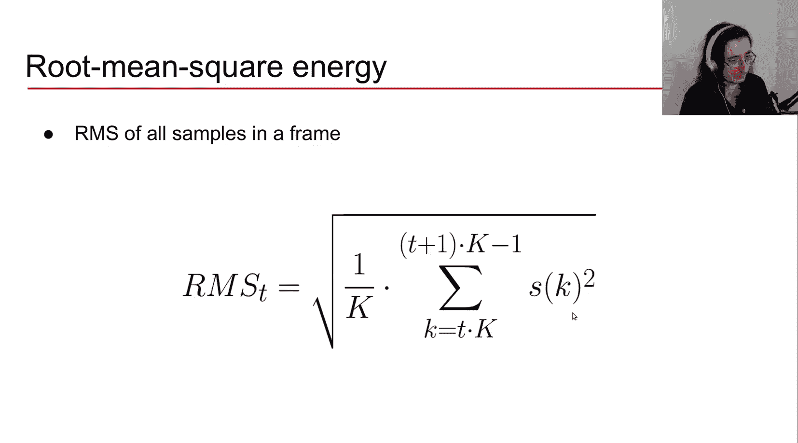

And finally。We should。Do a nu pie dots。Qu root Okay， so this should work。

 And out of like all of this guy， we should get the Rms for the current frame and we want to appendice to the Rms list So we'll do an RMS dot append and we'll pass in the Rm current frame。

Great， so now we can return RMS， but before doing that we'll convert this bad boy to be a Nmpie array。

Sir。Done this。 Okay， so this should work。 So now let's see if it actually works。

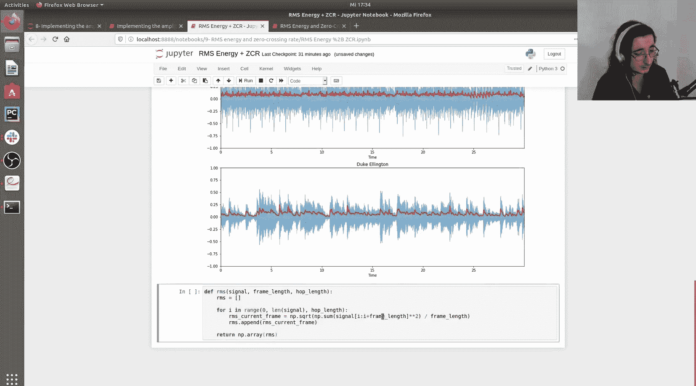

So we'll do I， yeah， let me just like wrap this。Here's this guy down here。Over here。

 So let's say Rm S 1， RMS S 1， red Ho and Rm S1 Dukeke。 So now obviously。

 we're not using the liberals implementation of Rm S， but our own。The homemade。

The sound of AI are a mass implementation。 And I think like the， the arguments are the same。

 The only thing is， we don't want to take like the。The element0 here。And yeah， this seems to work。

 But now let's see if this actually works by comparing like our implementation to the。

 the browsers one。 So how do we do that， Well， we just like get this guy here。

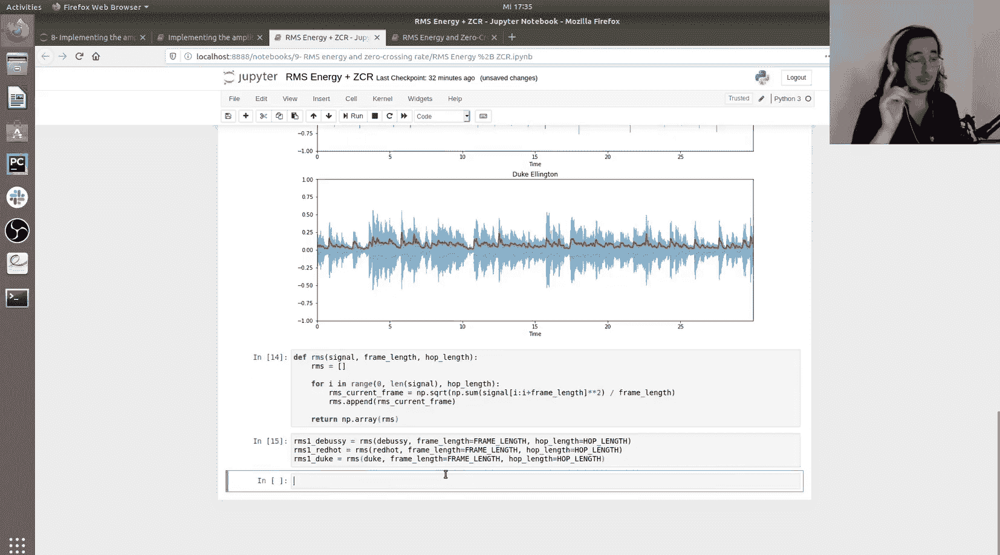

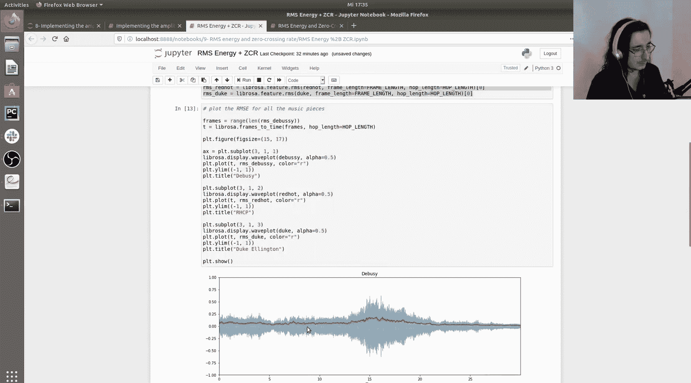

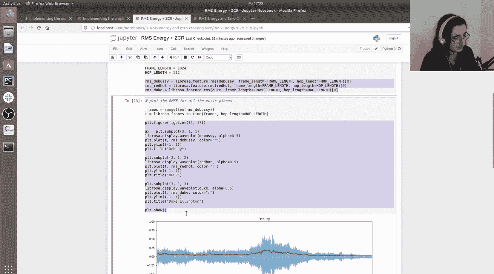

And we'll just like reloot everything， but adding。Our implementation。As well。

So we'll do a plot dot plot and we'll pass in T then Rns1 thebu。

 but we want to change the color and yeah let's put it to yellow， for example here。Yeah。

 we'll do the same thing with the red hots。ちちち。ピーace。

And then we'll do the same thing for Duke Ellington。 Okay， so now let's plot this and obviously。

 I have an issue。Here。And yeah。Yeah， this typos。So I was just missing this equal sign over here。

 okay？😊，Let's go and see。 Yeah。 And as you can see， basically， like， you can kind of like see， D red。

Hello， like just like the load the yellow， like RMS， like R RMS。

 So basically this means that the two implementations like gave us the very same result。

 which is nice and it seems like Dutch like our implementation is working。 Great。 Okay。

 so now we want to move on to another thing， which is the zero crossing。😊。

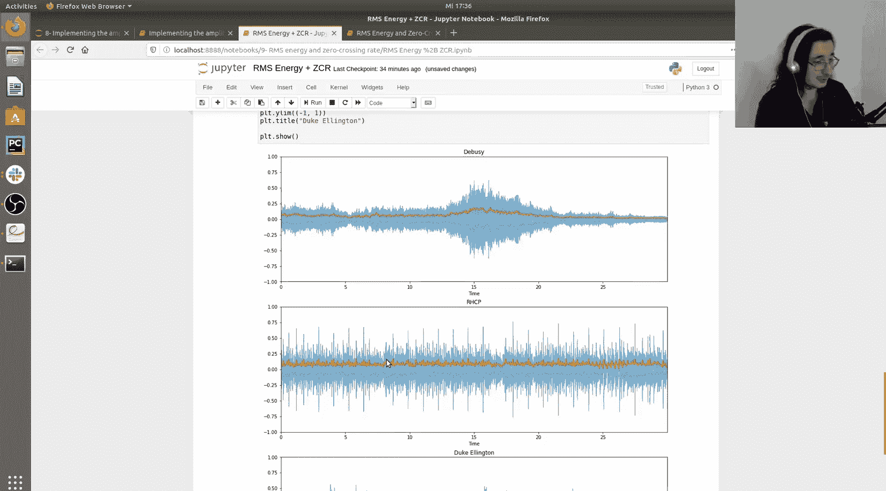

Crossing。Rates， okay， so how do we extract the zero crossing rate？ Well， again。

 this is really a piece of cake because of Libbraa。 So now I'm just going grab this。

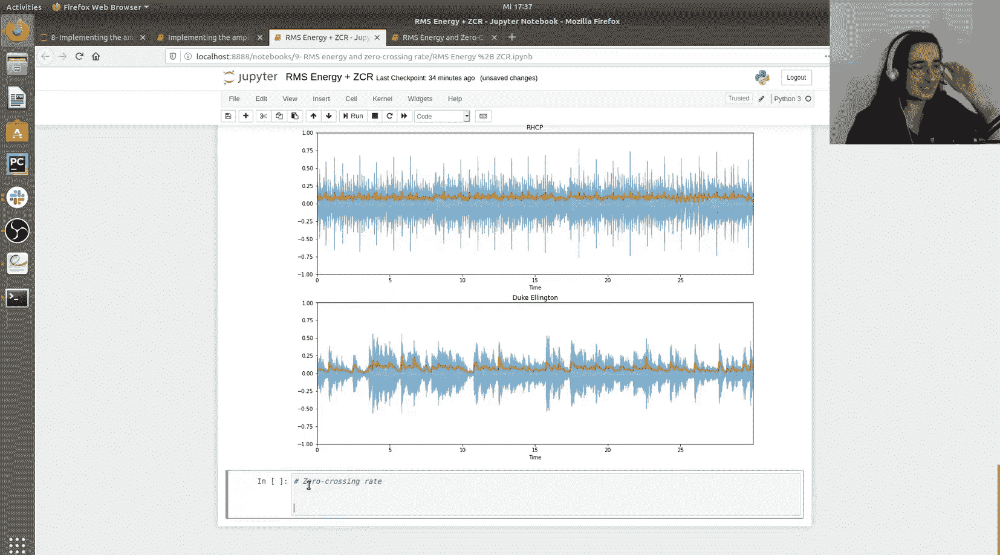

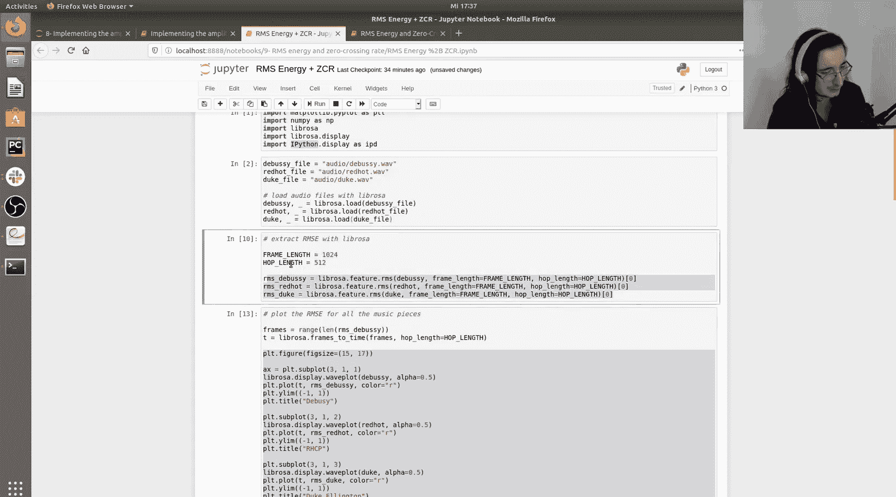

And instead of having like RMSMS， we'll say Z R C， so z C， So this is the or well。

 I should say Z C R， so0 crossing rate。Okay。So we are getting the zero crossing range。

 obviously what we should change here is we don't want to take the RMS from the feature module。

 but rather the zero crossing range。Okay。Let me replace this here and then the。

The arguments are the very， very same arguments， okay。

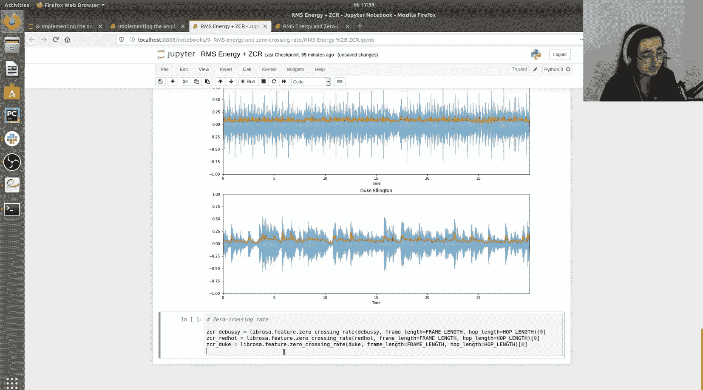

So now we can take this， Okay， so now what I want to do is just plot these guys， so let's visualize。

The zero crossing rate for。Allld music pieces。

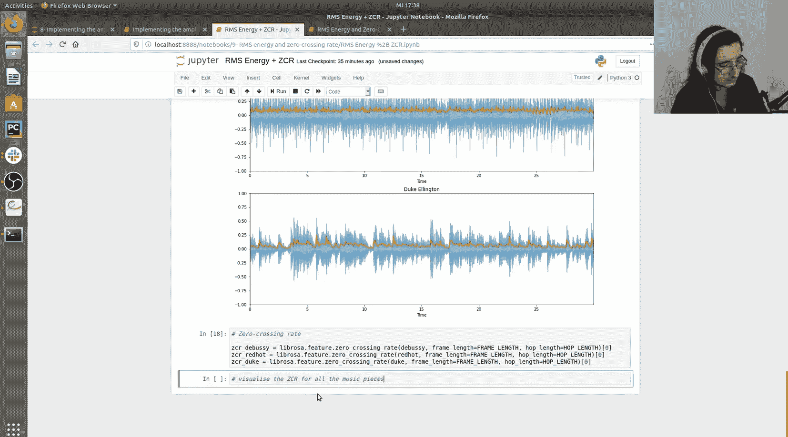

Okay。So how do we do that， Well， we can do。 We can always use like the， the same。

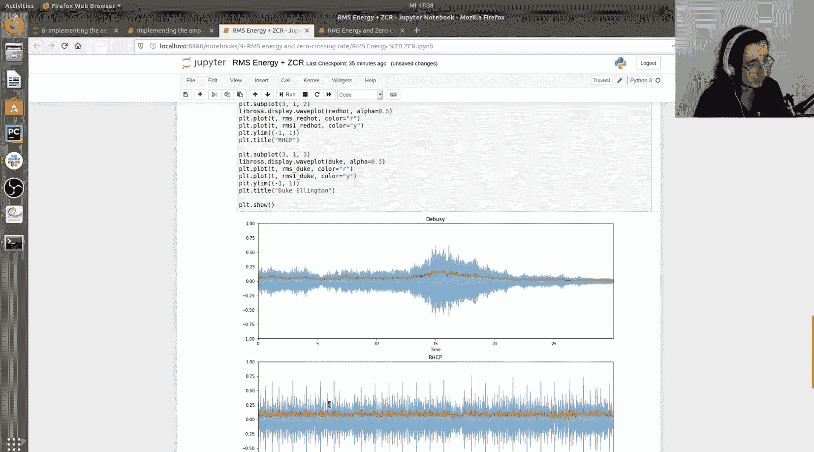

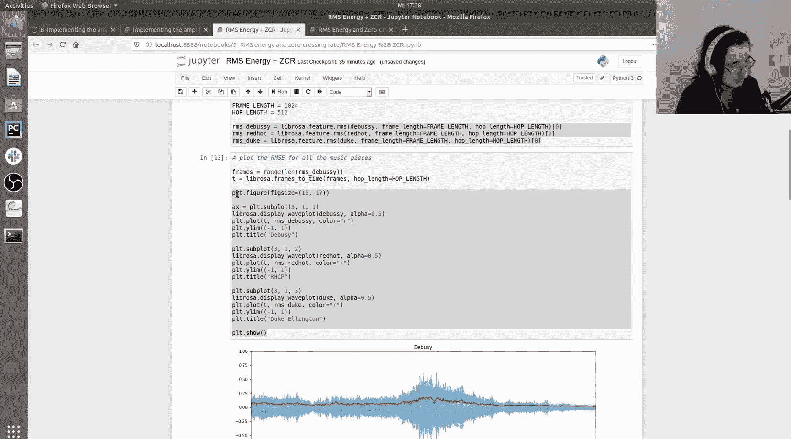

I have like templates that we've been using so far。Well， yeah。 but perhaps yeah。

 I want to change it like this time。 So， yeah。 So what I want to do here is only have a single。

Like a figure So nurse up plots and then have all the different。 Yeah， the graphs for the different。

 like zero crossing rates for like the different pieces inside the same thing。

 so that we can compare it。 Okay， so let me do that。 So I'll do。 I。Ploots dot plot T here。

 it's not RMS debu C。 It's ZR the。 Hey， we want this。Then we yeah。

 I'll just copy this down here and I'll say ZcrR and here we want the redho and hereR for Duke Eington。

Okay。So， now。I know。Because I already tried it。That we can。

So we are going to get basically like the values for the zero crossing rate are going to be normalized by the number of samples that we have in a frame。

 so they're normalized by the frame size so that we can get as a maximum a value of one。

 which would be like changing like sign at every value， okay。But so will。So I because of that。

 I will put the range on the way axis between 0 and1。Okay， so I don't want a title here。

 I just want to do a plot show down here。 So let's see if this works。Here we go。 Yes。

 but there's a problem right， so now all of them are in red。

 so now we could put the WC1 in yellow rat hot shield peppers。

You guess what color I'm going to use that。 I'm just going keep red there here and here for J El and I'm going to put blue。

 okay。So let's see。And here you have it。So。As we said in yellow， we have debuy。

 the zero crossing rate for debui in blue， we have the one full j Ellington and red the one for the red hot chilled peppers。

 Now， is it a surprise that the red hot chill peppers have kind of like the highest zero crossing rate no。

 and that's because like they are using a lot of like percussive instruments。

 And usually rock music has a ZCR that's kind of like higher than classical music。😊，And here indeed。

 you have like for the the zero crossing range over time， that's like quite low， it goes up。😊。

Probably when we have like the climates in the music。

And perhaps because we are getting also like higher liquid pitch and that determines a higher like zero crossing rate。

 and the blue zero crossing rate for Duke Ellington is a little bit like all over the place。

 and it seems to be a little bit like in between the one from the for the classical music and for the rock music。

 Now， if you want the actual values of the zero crossing rate and not just the normalized ones。

 So what you could do is take this guy and multiply it by the frame length。Okay。So， we are gonna。

Multiply the vector by the frame length。 And now， if I remember correctly， like a。

We could put like between0 and 300 the range and it should be fine like this， yes。

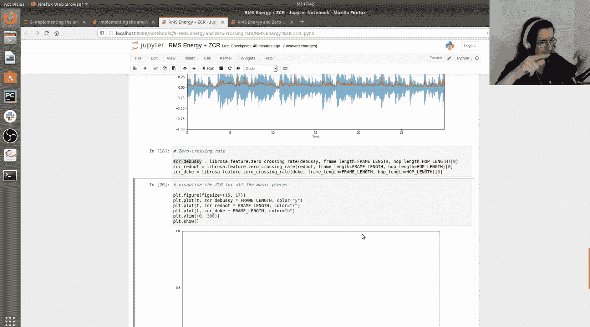

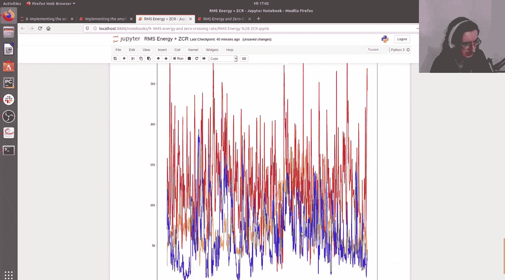

Yellow me。Put a little bit more， oops。

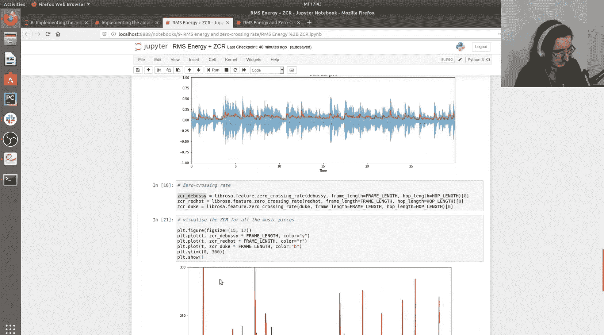

I here， let's try 500， yes。Looks good。 Okay， so and this is the actual number of zero crossing rates。

 the absolute number of zero crossings that you have like in these different signals。😊。

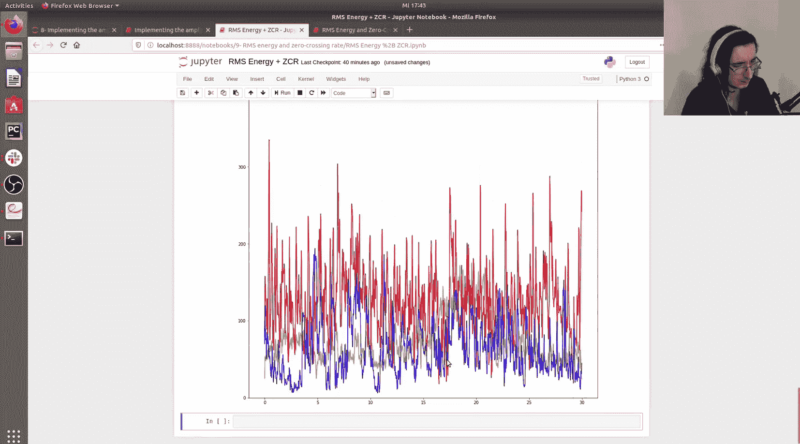

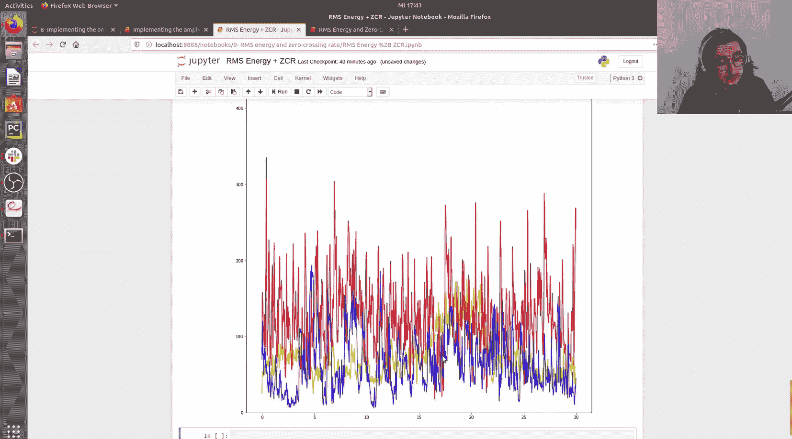

Okay， so now I'm not done yet because another thing that I want to try is to see the zero crossing rate on some voice and compare that against an audio signal that only has a white noise Okay。

 so let's try that So for train that we should just like load。

A couple of things， and so we'll do a voice。File。And this。If I remember correctly。

 I should have stored it in audio inside the current like folder for like video 9。

And it's called voice dot W。 Okay， And then we have the noise file。 And this is called sorry。

 it's in the audio folder。 and then it's noise dot W。 Okay， so now let's try to。

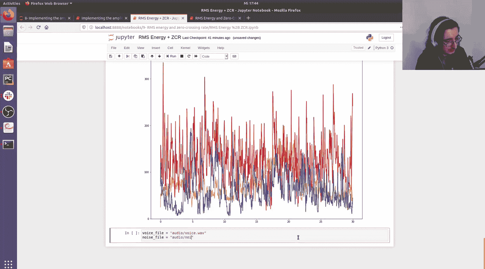

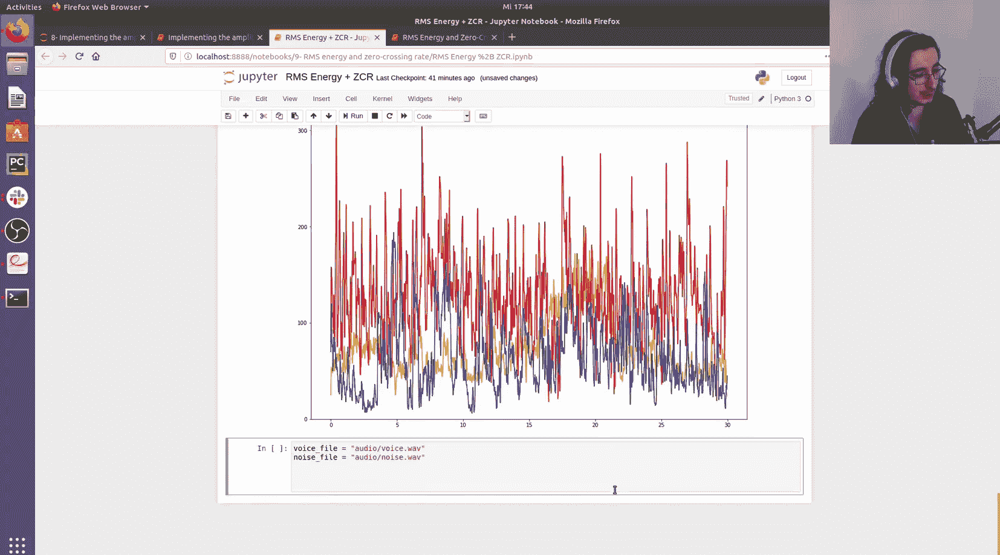

Actually。

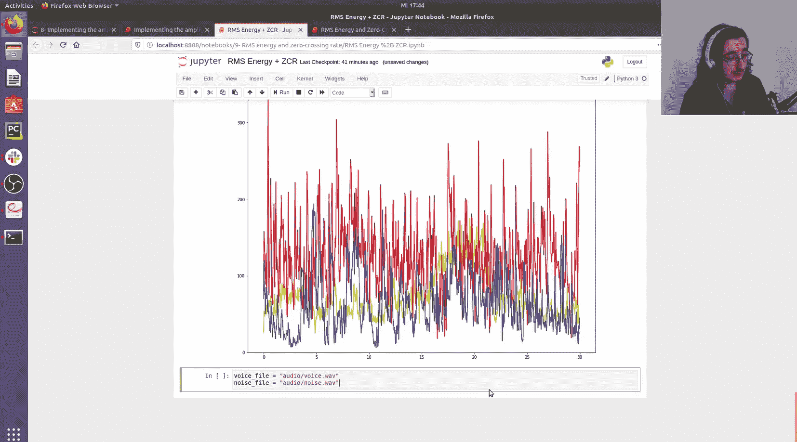

Loge these guys first， so I'll do a vice。And then for underscore， and we'll use again， Libbraa。 load。

 and I'll pass in the voice file。And here I'm going to be using another really cool feature or argument that you can pass to Libbrasa load。

 which is the duration。 So you can by passing like this argument。

 you actually tell Libsa how much in terms of seconds you want of the audio yeah file。 Okay。

 so it will say， yeah，15 seconds。 Okay， and I'll do the same for a noise。😊。

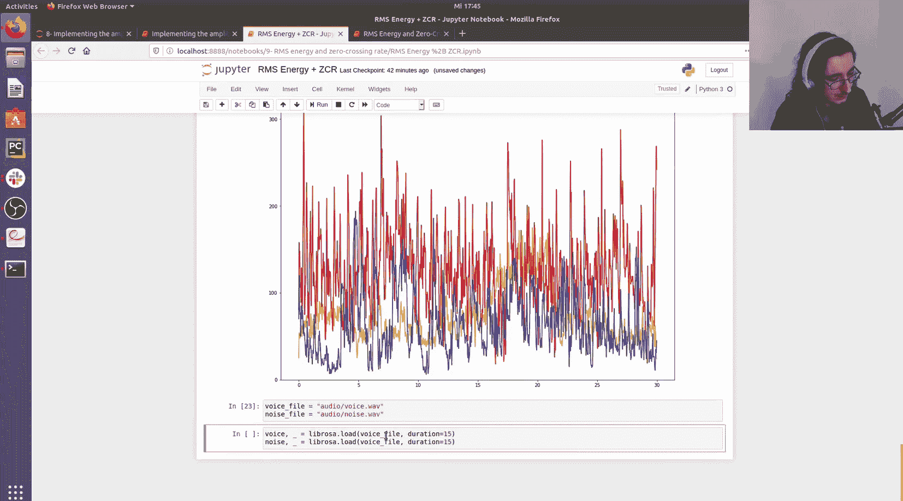

And here it's not the voice file， but it's the noise file。 Matts thing。

 We want to listen to these audio files directly in the Jupiter notebook。 So for doing that。

 we can easily use IPD dot audio， and then we'll pass in the voice file。

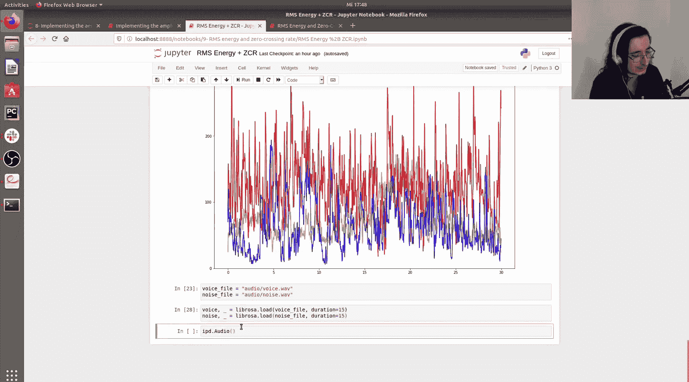

Here we go。 and here we have like our nice little player and I'll pass in the noise file。

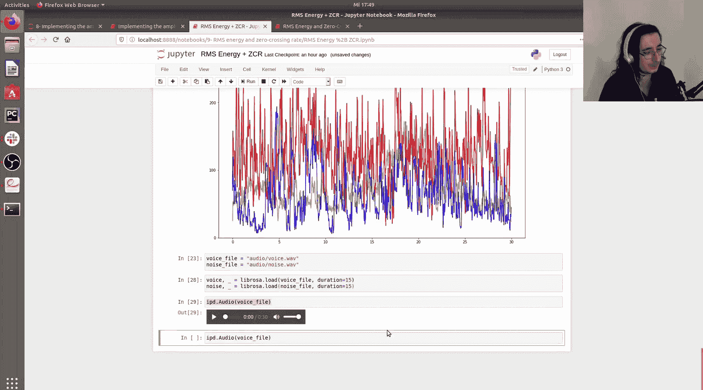

Over here。

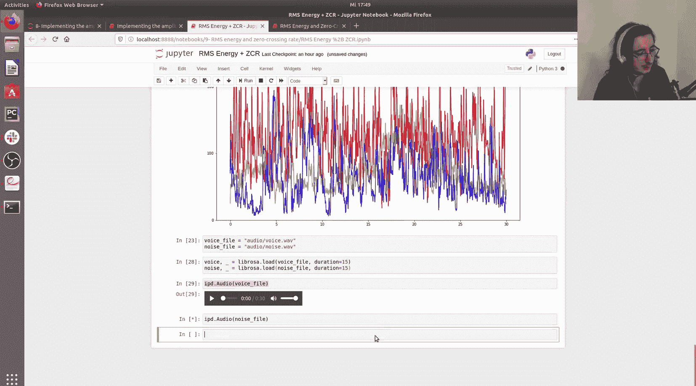

It should go。 Okay， so let's listen to the first 15 seconds of the voice Jack Pepsi Let's just check What do you think about thatin。

 I like the Td Pepsi logo Yeah Yeah， it's like a Pepsi logo。 but it says Td instead of Pepsi。 Yeah。

 it's pretty。 Yeah， so you get it a highly philosophical discussion about Pepsi logos。

 And here we have some white noise。Delightful isn' in it。Okay。

Let's get the zero crossing rate for this， two。So we'll do a ZR voice and once again we'll do a Lib browsera dot feature dot a0 crossing rate and here we pass in the signal。

 so it voice and then the frame length and I'll pass our frame length and the hop length。

And let me pass the hop length over here and now I'll just copy paste this because I'm too lazy to rewrite that the ZcrR noise and here we want to pass noise。

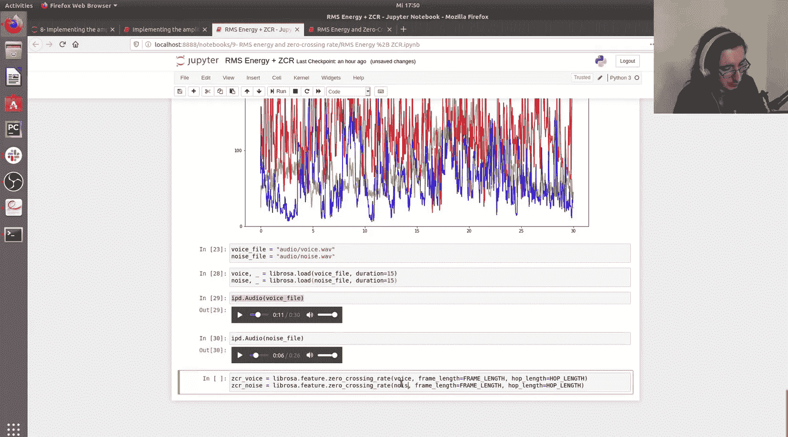

Okay， looks good now let's grab this going over here。

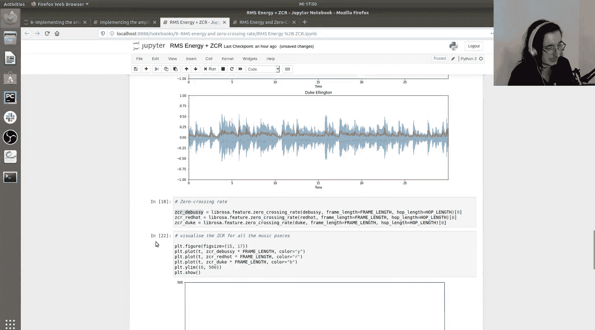

Just to visualize the voice and the noise in the same。Graph。Okay。let me just。

Copy this your voice and paste it here and then。Do the same thing for noise and now we'll just like keep the normalized version of this so I'll just yeah get rid of these guys。

And this should be in range 01。 So now yeah， let me just like。

Put this letter 12 because before like it was like too， too high， wasn't it Okay， yeah。

 we have an issue here。

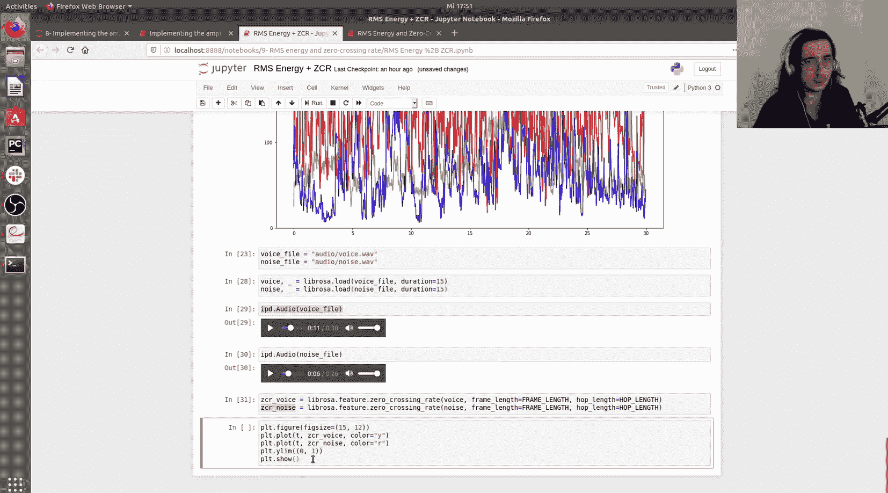

Yes。😊，That's a good one， right？ So like the music here is basically I passed like this T， right。

 but this T was calculated on the number of frames that we had for the the previous for the music passages。

 And that was like 30 seconds worth of audio。 here， we only have like 15 seconds worth of audio。

 So we'll have to recalculates this of a T value。 Okay， so for doing that， we'll do a frames。

 And here we should do a range between0 and the length of Z C R。😊，Voice。Okay。

And then the next thing that we need to do is yeah， just like get this value here and for that。

 we should。Use。Where is it over here， yes， here it good。Its function。From Libreza。Okay。

 so frames to time and we should pass in framed。 Now there's another mistake that are noticed。

 So here we should take the value at index0。 Okay， so now let me redo this。

 And hopefully this time it should work。 and indeed， it does。 Okay， so in a yellow。

 you should have the voice and in a red， the noise。 and as expected。

 usually the white noise has a0 a number of crossing rates that's higher than voice。 and。That's it。

 Okay， so you now get the idea of how to extract zero crossing rate using Libbrasia。

 And we've also seen how like zero crossing rate like changes in different music styles as well。

 when we compare it for voice and noise audio files。 So yeah， that's it。

 So we are basically done with the temporal audio features。

 So next time we'll start looking into frequency domain features。 And specifically。

 we're going be starting looking into the Fourier transfer transform。

 which is going be like our kind of like very important tool that will need for getting any information in the frequency domain。

 Okay， so I hope youve really enjoyed this video if that's the case， please give give it a thumb up。

😊，Then if you have any questions as usual， just post them like in the comment section below。

 one thing that I want to remind you of is the sound of the eye Slack community。

 which is a community where you'll find。😊，Very interesting people who are like interested in all things。

 AI， audio， AI music， digital signal processing。 So if you want to grow your skills。

 grow your network as well， I suggest you to go and join this community。

 I'll leave you the link to the community in this description section。 Okay， it's all for today。

 I hope I'll see you next time。 cheerers。😊。

