# Valerio Velardo【中英⚡面向机器学习的音频信号处理 Audio Signal Processing for Machine Learning】 p10 p9 Demystifying the Fourier Transform： The Intuition [BV1ftPLeCEhX_p10]

Hi， everybody， and welcome to a new video in the audio signal processing for machine learning series。

 This time， I'll be introducing the Fourier transform。😊，Now， when I was planning this video。

 I thought what's the best way of introducing the Fourier transform， And I thought， well。

 perhaps I should just give you a little bit of intuition there and then go straight into implementation or even just use browser for extracting a spectrum through Fourier transform。

 but then I thought well， the Fourier transform is at the core of signal processing。

 so just sprinkling a little bit of math here and there an intuition is not going to be enough for you。

 So you really want to have a deep understanding of the Fourier transform and all of its implications。

 This is why I've decided to divide this topic into a number of videos and this first video is going to give you an introduction and the high level of intuition of the Fourier transform。

 but towards the end I'll just be giving you a little bit of math to formalize what we'll be discussing throughout the video。

So stay tuned for more about the Fourier transform。

 but before we get started I want to invite you once again to the sound of the Ila community if you don't know it this is a community where we are a bunch of people interested in AI music。

 signal processing AI audio， all of these kind of things and there you can ask for feedback。

 improve your skills， share research and talk with very cool people so if you're interested in that just go check out the signup link in the description below okay now onto the real stuff。

To introduce the concept of that are behind the Fourier transform。 I want to use an analogy here。

 And for that， I'm gonna use one of the most iconic cover ever created in the rock world。

 And from one of the bands that I love the most。 P Floyd。

 So this is the cover for dark side of the moon。 So what does this。

Have to do with the Fourier transform。 Well， it's the analogy here that counts a lot。

 So here we have a beam， a light beam， right， So this is a complex waveform， It goes through a prism。

 and then out of the prism， we get the different like spectral bands， the different colors divided。

 right， so the basic idea is complex waveform。 We have kind of like a machine or an algorithm which in this case is the prism。

 And then we get all the different components which make up light。 Okay。

 so with the Fourier transform。 we do something that's very， very similar to this。

 so the high level intuition here is that we have a complex sound。

 And then using the Fourier transform， which in our analogy is the prism。

 we decompose the complex sound into its frequency。😊。

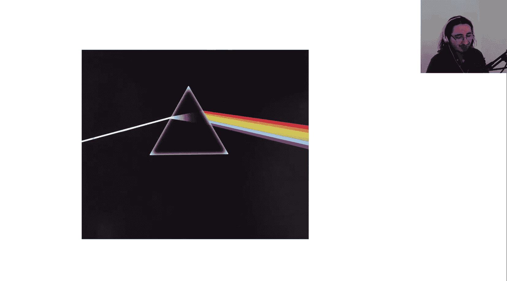

PosBecause if you remember from one of my initial videos。

 complex sounds are made up of many different pur terms。 added up superimposed together。 Okay。

 so this is like basically the first intuition that you have。 Now， when we we do this。

 when we use the Fourier transform。 What we do really is a journey from the time domain to the frequency domain。

 So probably if you followed along this series， you've seen like this type of like slide time and again。

 But let me repeat that for， yeah， the sake of yeah， understanding everything very deeply。 Okay。

 so here we have like a sound in a wave plot。 And here we have time on the X axis， right。😊。

Then we use the Fourier transform。 So magic happens， and we get the same sound。

 but this time plotted in the frequency domain， So we have a frequency analysis of the very same sound。

 And in other words， on the X axis， we have frequency。 And where you see this spike。

 It means that the relative frequencies at that specific hertz are an important component of that original sound。

 Now， the question is， how do we do this。 So how do we go from the time domain to the frequency domain。

 Well， that's the topic of today's video at an intuition level。😊，Okay。

 now let's go one level of resolution further down and get like a better intuition of what's going on with the Fourier transform。

 So when we apply the Fourier transform。 we do a bunch of things。

 So the first thing that we do is we compare the original signal with a bunch of sinusoids with various frequencies。

 right， So we have the original signal。 and then we have a bunch of sine waves。

 and we want to compare the original signal to those sine waves。

 which are going to have different frequencies。 And so out of that comparison。

 what we get is a magnitude and a phase。 Now， what does the magnitude tells us。 Well。

 the magnitude tells us how。😊，How similar the original signal and the pureton or the sine tone are。

 So the higher the magnitude， the higher the similarity between the original signal and the sinusoid with that specific frequency。

 Now， we'll take a look at the phase in a few minutes。But here。

 this is kind of like the deeper intuition， but still it may feel a little bit abstract。

 So now let's go to check out some code that I've read in a Jopyter notebook and see how this applies specifically and just like visualize some of these intuitions。

 Okay， so now it's not important to look at the code here and many of the stuff that I've like many of like these lines of code that I've read here。

 I already explained to you like in previous videos。

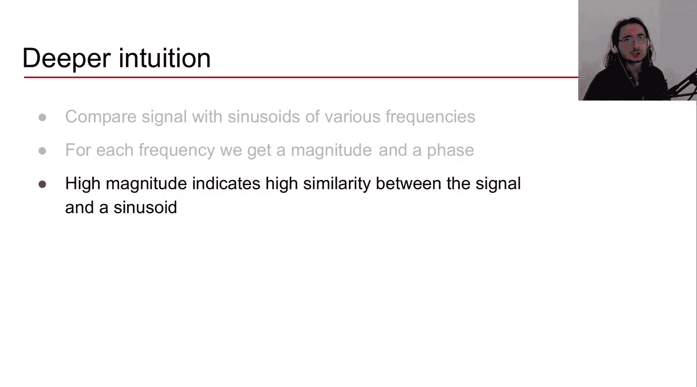

But what's important is to look at the results of these things。 Okay， so now let me get started。

 So I'll import all of these libraries， which will need to plot and analyze sounds。

 so the first thing that I want to do is to actually show you the sound that will be analyzing。

 So let's listen to this。Okay， it's just a piano key。 specifically， it's C 5 Note C 5。 Okay。

 and it's held for almost like a second gen half。Okay。

 so here we'll just load the audio file with Libbrosa as I search。

 you've seen how to do this in previous video if you followed the series， if you haven't。

 just like check that out。Okay， so the next step is to actually plot the waveform。And yeah。

 here we have like our nice little waveform。 So once again， here we are in the time domain。

 So X axis is time。 Y axis is amplitude。 And as you can see。 So we have the attack of the sound。

 And then we have a little bit of the decay。 and then yeah， the sound ends towards like 1。4 seconds。

😊，Okay， so the next step is the crucial one is the one that we use for deriving the freeier transform。

And we do that by using sci pi， specifically the FFT module， and we use the FftT。

 which stands for fast Foururier transform function in the FFT module。

 So we pass it in the signal and we get the Fourier transform。 Now。

 I'm not going to show you what that result actually is。

 because you need to have like a deeper understanding of math complex numbers and things that that which you'll have in a few videos。

 But for now， the important thing to understand is that if we do the absolute。

 if we take the absolute value of the Fourier transform。 we actually get the magnitudes。

 And this is the y of our spectrum whereas on the X axis， obviously， we have the frequencies。 Now。

 how should we like distribute the frequencies on the X axis。 So the frequency。

are going to be between 0 Htz and the sampling rate。 Okay。

 and then we'll divide this in in a number of steps that's equal to the length of the of the magnitude array。

 Okay， so which all of this in mind。 We can now plot the spectrum。And here we go。

 So here we have the spectrum。 And as you can see， we can see a peak in the magnitude around 523 Hz。

 And this is more or less the frequency， the specific frequency for the nut C 5。😊。

And so this is the socalled fundamental of the of the sound that we've heard。

 and then we have a few spikes。 So here around 1004 1040 hertz something and here。😊。

And a fourth one here and a little bit of a fifth down here。 But it's almost like unnoticeable。

 That one。 Okay， so the， this profile is quite specific， right， And， and it feels like there。

 there's some leimetry， like natural thing to it。 And it's the fact that this is a harmonic sound。

 In other words， these guys over here are harmonic or overturnes of the fundamental frequency。

 In other words， this frequency is just twice the frequency of the fundamental。

 The frequency associated with this third spike is three times the frequency of the fundamental。

 And here it's。😊，Four times， that's okay。Good， now if you don't remember what overturns are like or partials or these things。

 I have a video about that is one of the initial videos and should be linked up here。Okay。

 so now we've seen how we can move basically from the time domain to the frequency domain。

 but still the Fourier transform is a completely black box for us。

 Now I want to start unravel it for you guys and give you an understanding of how this process and the Fourier transform works。

 But for that， what I want to do is zoom into the waveform and actually be at a resolution where we can actually see like all the cycles in the wave associated with this sound。

😊，Okay， so for that before we do that， yeah， let's， let's take a look at at a few numbers。

 So the length of the signal。 or in other words， the number of samples that we have。

 it's around 34000 samples。 The sampling rate。 if I remember correctly here should be a 2250 Hz。

 and the duration of each sample is the inverse of that which is4 times1 to the power of-5。

 So it's a very， very short amount of time for each sample。 Now。

 let's take a look at the duration of a cycle for our fundamental frequency。 So 523 Hz。

 And so obviously， this is one divided by 523。 And if you take a look at this result。

 So this is almost2 milliseconds。 So we have a cycle every。2 milliseconds。

 So now what I want to do is just like zoom in and to into the waveform and only consider 400 samples because 400 samples are gonna to give us 0。

02 seconds。 And this is this will enable us to see more or less like 10 cycles of our waveforms。😊。

And that is something like that we can definitely visualize。 Okay。

 so all of that to say that I have like this new plus where we zoom into the waveform。 And here。

 I'm only considering 400 samples， in other words。😊，I'm slicing the signal， which is on the Y axis。

 and I'm only considering the the samples between like 10000 and 100 400。 Okay。

 so let's take a look at this。 And here you have the results。

 So now we are at a resolution where we can actually see the all the cycles。 Okay。

 so now what's the point of all of this。 Well， the point is that what we want to do is to actually compare this signal against sinusoids with different frequencies。

 Okay， and see the similarity there。 So and I want to show you how we can do that visually。Okay。

 so now let me just go back here and I want to remind you of the equation for a sine wave。

 which is given like by this formula here。 So it's like the sine of2 pi， which multiplies F。

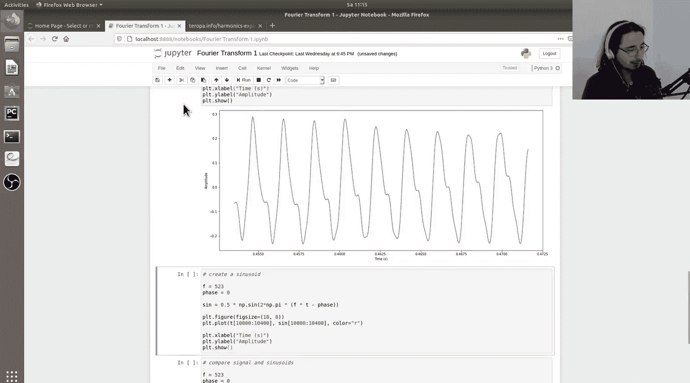

time T， where F is the frequency。 T is just time minus p， where p is the face。

 And we'll see what the face does in a second。 Okay， so yeah， let's just go back here。

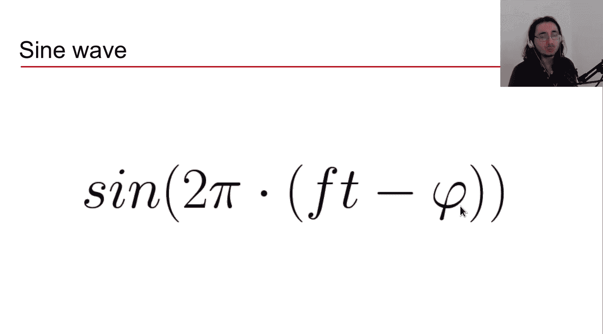

So the thing that we want to do here is just create a sinusoid and here I'll put the frequency equal to 523。

 which is our fundamental frequency for the time being we'll have a phase of0 and here we have our function。

 our sine wave over here。Okay， and then I'm just gonna plot that once again between 10000 samples and 10000 of 400 samples。

 So just 400 samples so that we can kind of like superimpose this。

To the original signal in a few minutes， okay。So here we have our nice sinoid at 523。Hs now。

 let's take a look at the face。 So what does the face do， Well， for that。

 what I suggest doing is just create another。Another cinooid， which will call。Over here。

 it's a little bit difficult to work。With this extra big cursor。So over here。 So this is phase 2。

 Everything else will be like the same。 So we willll just like change the face here。 And obviously。

 I need to。Ploots sign to as well over here。 it's not there。 It's down here。 and I'll use， say。

 I don't know， like a yellow color color for this。Okay， so now let's use the same face。

 And so if we use the same face， so we have a mistake here。Oh， yes， because this this face do， okay？

So let's go， yeah， and obviously like the two coids are completely aligned on top of each other。

 but now if I change the phase， say like I go 0。2 forus the yellowest coid。You'll see that the。

Seemless though I is now shifting shifting towards the right。 If I get to no。5。

The cicoids are completely like in opposite phase。 So in other words。

 when we have a pick with the red sinicoid， we have a deep with the yellow sinusoid and vice versa and the closer I get to 1 and the closer I'm just like realigning them。

 And so once we are back at one So they are aligned once again。

 So what this means is that if I continue giving like higher numbers for phase two。

 we'll just like start again the circle because yeah。

 I mean we are like using a periodic function in the end。 so 1。5。

 it's basically equal to we get like the same function of the same sine wave that we had for 0。

5 And if we go to we change the phase to 2 well once again we are just back to to being aligned once again。

With the initial sine wave。 Okay， so all of this say that we can assume that the phase moves between 0 and  one just because the。

 the function is periodic。Okay。So now what's the big deal with this sine waves， right？

 So the point is that we want to compare the signal and the sinusoid。

 if you guys remember what is said with the deeper intuition。

 So in order to to move from the frequency from the time domain to the frequency domain。

 we compare the signal with coid at various frequencies。 And then for each frequency。

 we get a magnitude and the face and and high magnitude indicates high similarity between the signal and a sinusoid。

 Now let's see how this actually applies here visually。

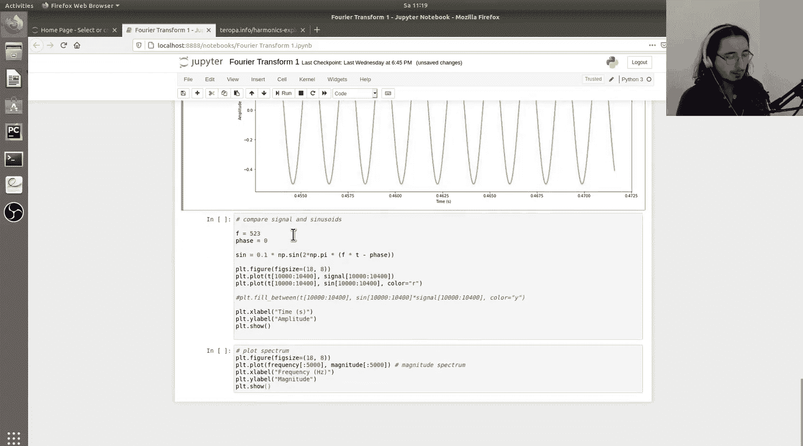

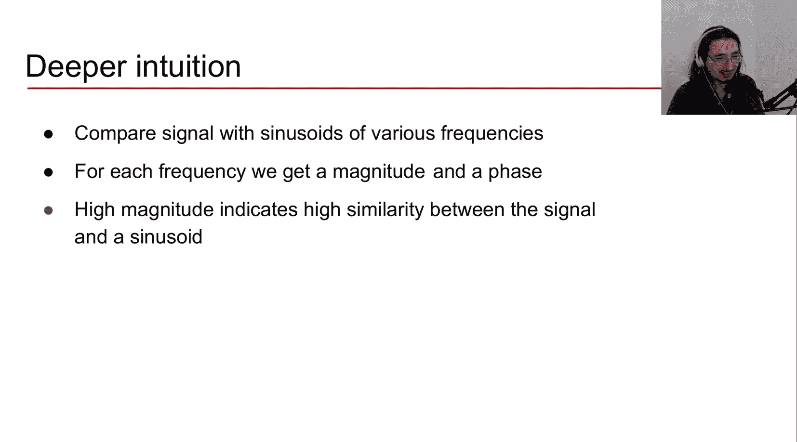

Okay， so what I'm doing here is I'm ploting both the original signal， as well as a sinusoid here。

 And the sinoid is going to be shown in red。 Okay， and here for the sinusoid。

 I'm using the fundamental frequency。 So  I023。 and the phase is set at 0。 Okay。

 so let's take a look at this。 Okay。That's really cool。But as you can see， we I mean。

 like the two waveforms like more or less like seem to have like a similar like cycle， right。

 So a similar frequency。 And that's because obviously the original signal has the fundamental which is at 523。

But there are somewhat out of phase so we want to align those so how do we do that Well。

 we can just increase the face and see what happens。

 so let me redo this as you can see now we are kind of a lion the2 and I know because I've tried it before that we have a very good alignment when we use a face which is equal to 0。

5555。And here we go， so as you can see now the two signals are quite like aligned。

 they're quite similar。But here we are talking about similarities。

 So how do we calculate similarity well。We have many ways of calculating similarities for two functions。

 But one that's like very intuitive and simple is to combine the two signals by multiplying them。

 And in this case， it would be a multiplication sample by sample to a point by point we multiply the two signals。

 and then we just look at the area。 So we add all the positive area。

 So we feel like the the area below the the new combined signal。

 and we add the positive area and we subtract the negative area。 So let me explain what that is。

 And for doing that we just add。This line of code here， which I already had prepared。 So。

 and as you can see here on the Y axis， we are now multiplying the sign signal with the original signal。

And we'll have the color of this combined signal in yellow。 So， let's see。What happens here。 Okay。

 and you can see this。 Now I'm taking the area。 In other words。

 I'm filling up the area below the waveform。 and as you can see here。

 we have basically it's all like positive area。 and the intuition here is that the higher， the area。

 the positive area that we have for the combined signal and the higher。

 the similarity are between the two original， the two signal。

 So the sinooid as well as the original signal。 and the intuition behind this is that if I when I multiply both of this。

 and they have the same sign。 So they're both So the signal and the sinooid have both like positive sign or both negative sign。

 then they're going end up with。like a positive value， right。

 whereas if they have alternate opposite science， then well end up like with negative values。

 And so when we add like that positive area to the negative area。

 we just end up with a value that tells us how much similar these two signals really are。Okay。

 but one thing that I want to show you here is that if I change the phase here。

 so let's assume we go down to0。 so phase is equal to 0 now all of a sudden we have all negative areas right and so there's no similarity at all。

 even if we have the same sine wave。 So with the same frequency and amplitude。

 but still the phase is extremely important， but because in this case is just there's no similarity whatsoever。

 so we only have like negative。Areas here， negative values for the combined sine wave。

Not sgu wave for the combined signal。 Okay， so if we go and say， take an no。2， for example。Yeah。

 still， this is mostly like negative。 But now let's try 0。4。 Okay， yeah， this is a good example。

 So which face at 0。4， we have a bit of negative areas as well as a bit of positive areas。 So， yeah。

 it's a little bit of mixed bag。 There's some level of like similarity between the two signals。

 but it's not perfect， okay。So this is the intuition that we can use to understand how we move from the time domain to the frequency domain。

 and it's just。

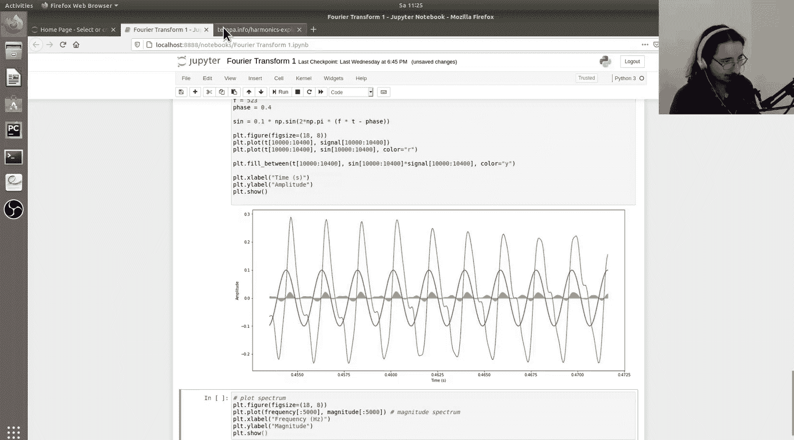

As simple as。Doing a bunch of things。 So we choose a frequency first。

 and then we create a sine wave out of like that frequency。

 Then the next step is we want to optimize for the face so that we know that we've chosen the face that gives the maximum similarity。

 So the maximum area possible。 And finally， we calculate the magnitude。

 And the magnitude is basically the similarity。 or in other words。

 the positive area of the combined signal。 minus the negative area。 okay。😊。

But this is just for one single frequency。 in a Fourier transform。

 we have to try and do this for all possible frequencies in the real set。 Okay。

 so we start with the frequency。 Then we we continue and do like the same steps for the next frequency and we move on and on and on and on。

😊，And by doing so， we are able to see which frequencies have a an important component of the original signals。

 And those will be kind of indicated by， because they have a high value for the magnitude。

 And this is like what happens here。 So if we go back。😊。

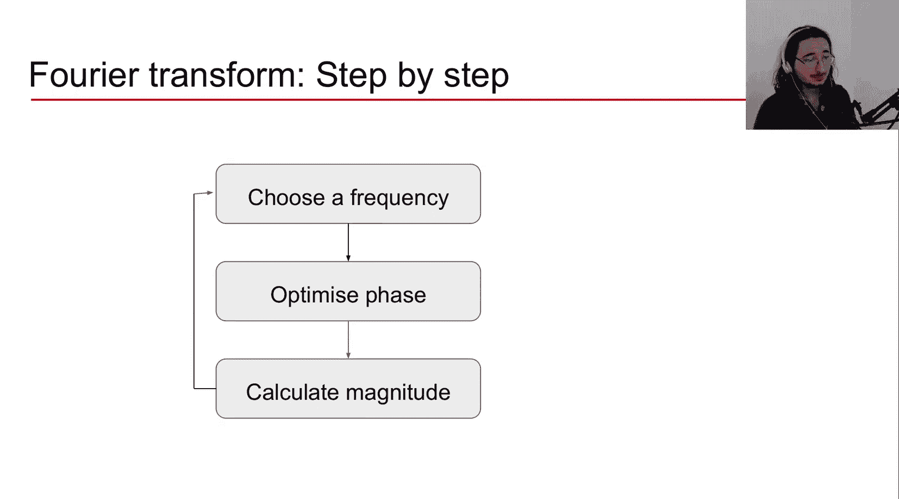

Here。So here we see like the spectrum once again， so yeah let me just find like just go back to the best phase that I could find so 0。

55。So as you can see here， the fact that we have like this nice alignment between the frequency at the sinusoid at 523 Hertz and the original signal is reflected in the power spectrum here。

And that's because we have this peak in the magnitude which is around 523 Htz。

 So that tells us that we have this high level of similarity between the s wave at the pure tone at 523 hertz and the original signal。

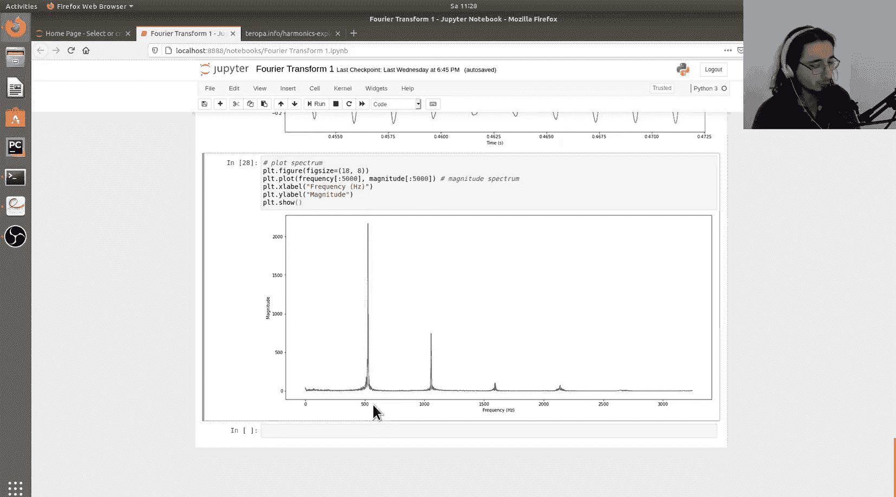

Okay， so this is interesting。 So now I hope like you。

 you get the understanding and the intuition behind the Fourier transform。 Now。

 the next step is to take a look at a little bit of mathematical formalization of what we've said so far。

 and can't be scared about like this massive equation here。 So I'll just like break it down for you。

 But in in a nutshell。 This is what we've just set。

 So what we are looking for here is the face for like the optimized face for a given frequency F。

 okay。😊，So。These two things that we have in here is just the multiplication of the signal and the coid。

 So S of T is just our original signal。 And here we have our sinoid， and we multiply those。Now。

 the next step is to calculate the。Area and we do that with this integral symbol。

 Now you don't need to understand calculus。 but the intuition here is that we are basically calculating the positive area of the combined signal and then subtract to that the negative area。

 and that's what we are doing with the integral which is across time So it's basically we take like all the time throughout like the a given signal。

 And finally， what we do is we take the arc marks。 In other words。

 we want to select the phase in the interval 01 and we say why we only consider01。

 and so we want to take like this phase that maximizes the area。 And in other words。

 what we are doing here is what I was doing manually before。

In the face in order to find the face that would actually maximize the positive area that we have when we combine the two signals。

 Okay， so it's this is simple。Intuition to understand。Okay。

 the next step that we want to do is to actually。Take the magnitude。

 And so how do we take the magnitude。 Well， it's basically the same thing， right？

 So we are once again calculating the combining the two signals。

 And then we calculate the area that we have once we multiply the original signal with the cnooid。

 And finally， this is only the only step that's different from the the previous one that we saw。

 we just want to select the max area and for selecting that we are going to try like all the possible like values for a phase between0 and one。

 But if we have that value already because we've optimized before。

 we'll just use that value and plug it in here。😊，Directly。

It's important to say that the calculations that we've carried out here are in a continuous space。

 in other words because we use this integral here， we' are basically assuming that time is continuous or in other words。

 like time is a real number， it changes as a real number okay， so time is continuous。

 but frequency is continuous as well right so while this is the case for the theory。 Well。

 what we've done already， for example， with our code doesn't use like continuous representation just because computer is kept these continuous representation we have to sample a continuous function and use a discrete version of that Now if you want to know more about continuous versus discrete signals。

 I suggest you to go check out。one of my first videos on this topic。

 but the whole point here that I want to make is that the theory that we're going to study at least like over the next couple of videos is going to be about continuous Fourier transform。

 but then we'll move on and take a look at the discrete Fourier transform and there the math is going to be slightly different and that is going to be the math that we' actually be using for understanding how to implement an algorithm that can extract the Fourier transform in the case of discrete signals。

Okay， so。Up until now， you've learned how to move from the time domain to the frequency domain。

 but you may be wondering， is there a way of going the other way around。

 So the roundtri So we go from time to frequency domain。

 But then can we go to frequency domain to time domain， And this would be the equivalent of saying。

 okay， so now we start with these different like color bands， we put them into the prism。

 this fantastic algorithm， and we end up with with a complex light wave can we do that with the Fourier transform。

 And the answer is yes， we can reconstruct a signal by superimosing all the sinoids。

 all the frequency components that with extracted out of the original signal。

 So we superimose the sinoids and we。

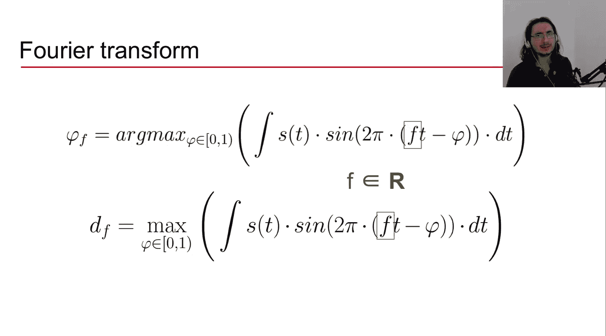

With them by their relative magnitude。So the ones that have a higher magnitude are going to have like a higher impact in making the original signal。

 And then obviously we want to use the the original， the face that we extracted as well。

 And the point here is that the original signal and the Fourier transform have the same information。

 and we can go back and forth from time to frequency domain as we please。

 So the process of going back from frequency domain to time domain is called inverse Fourier transform。

 So we start from the frequency domain we apply an inverse Fourier transform。

 and we go all the way back to the original signal and the time domain。 Okay， so。

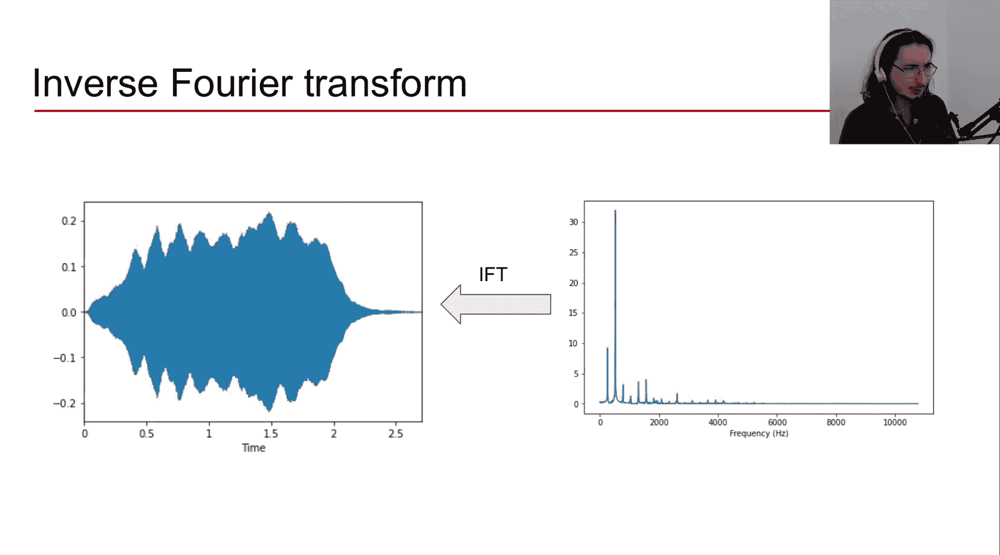

This is like an idea that's not exactly the same as that of adjective synthesis。

 but it's kind of like similar。 So in adjective synthesis。

 you have synthesizers which basically use different sinusoids and you can superimpose them。

 So combine them by adding them up in order to create complex sound and if you think about it。

 this is somewhat similar to what we were saying with the inverse Fourier transform。

 So let me show you these in an example。 So I found like this very cool website。

 So where you can try out adjective synthesis。 So here you have a bunch of different frequencies So here this is like C4 So 261 Hz。

 then we have 523 Htz which is C5， which is the fundamental frequency of R sound and then you go up So basically here。

😊。

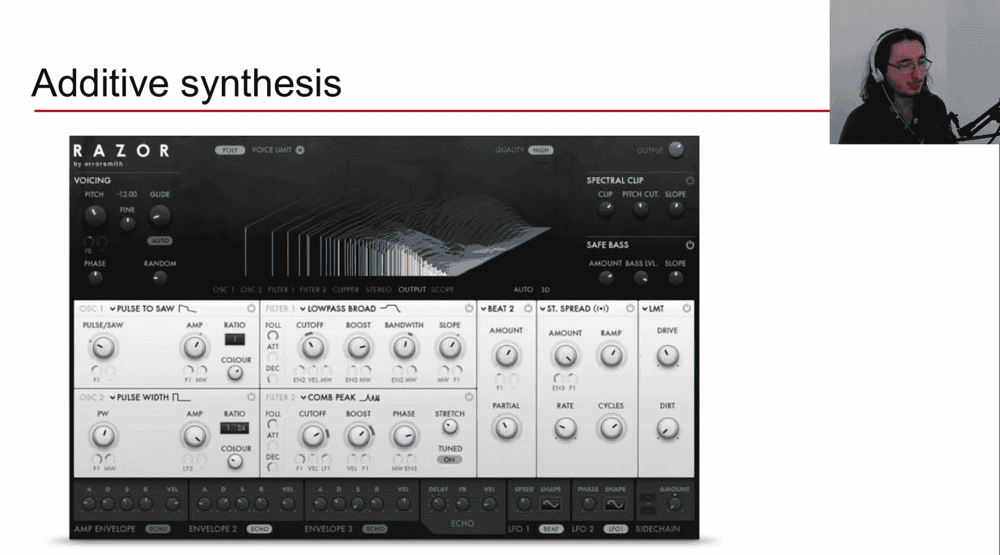

You have like all the overturns of these C4 fundamental frequency Okay。

 so let's unmute this so you should be able to yeah let me。Put this down a little bit Okay。

 so you should be able to to hear this C4 right， So now let me add。

🎼The first overturn and take a look at how the main signal is going to be modified right Okay。

 so let me add some other overturns。🎼Yeah， let's just go down a little。🎼Okay， that's cool。

 isn't it cool so this is like a really cool example of how we can superimpose purins or sininooids and get a complex waveform like this one。

 okay？So yeah， I guess like this was it for this introductory session on a Fourier transform。

 So now where do we go from here？ Well， we want to start looking into the math。

 the real math behind the Fourier transform。 And for doing that。

 we are gonna need to get familiar with another type of numbers that perhaps you've heard or you're familiar with。

 but if you're not， I suggest you check out my next video， which is going to be on complex numbers。

 And as we'll see in a few videos， complex numbers are going to be very important for working with Fourier transforms because they're very handy for representing what we're doing here。

 Okay， so that's all for today， I hope you enjoyed this video and you've found it useful。

 if that's the case， please remember to live a like。 And if you haven't subscribed to the channel。

 please consider doing so。 if you have any。😊。

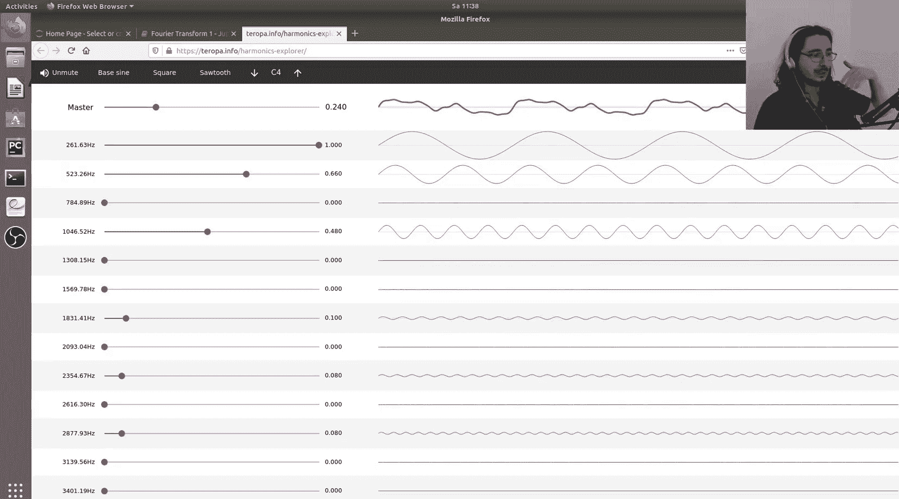

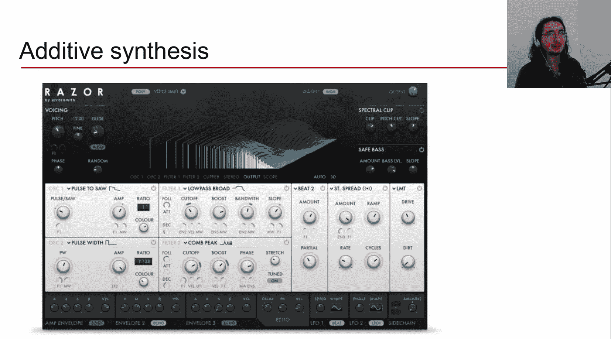

Any questions or doubts in your mind about what I've coveredd today。

 please don't hesitate to leave a comment in the comment section below。

 I guess I'll see you next time cheers。

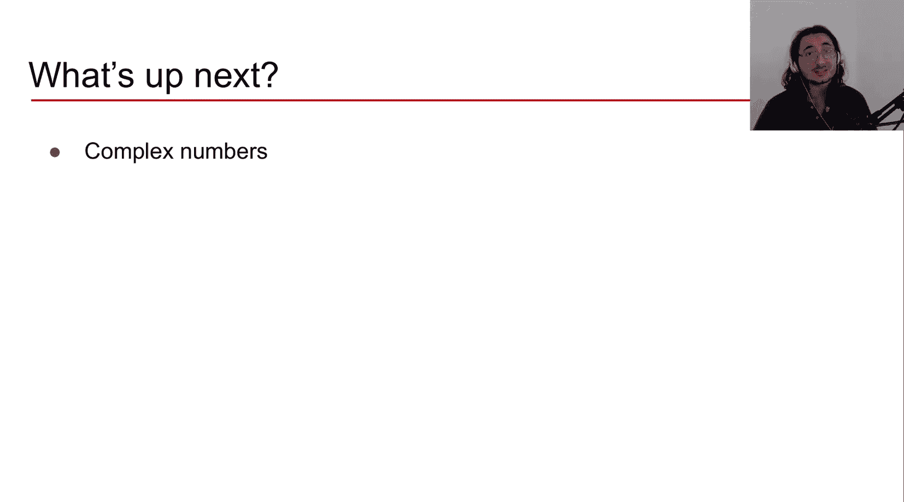