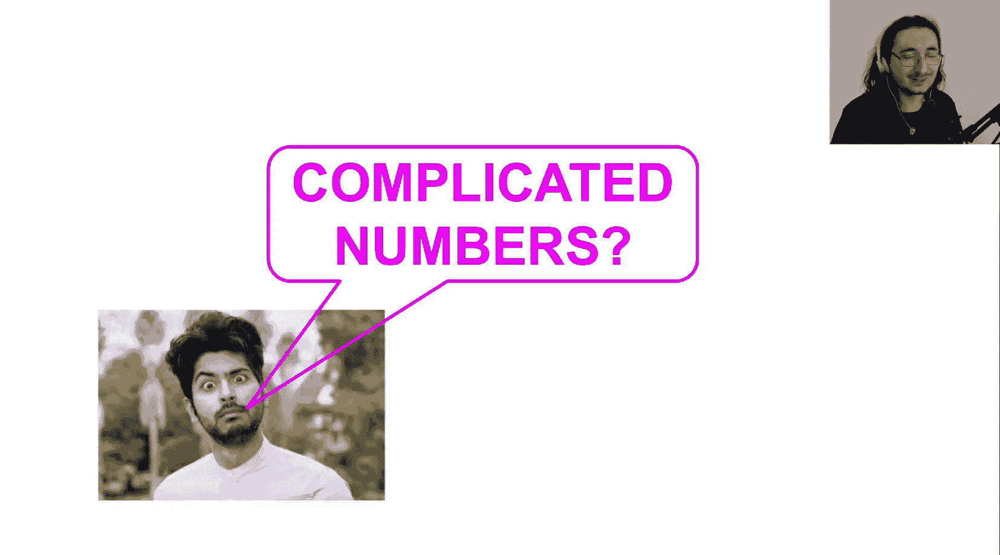
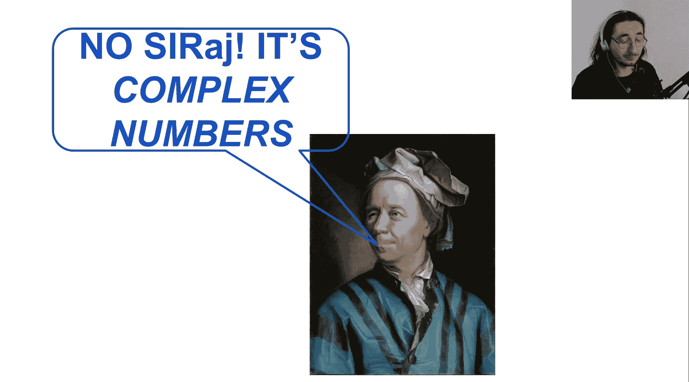
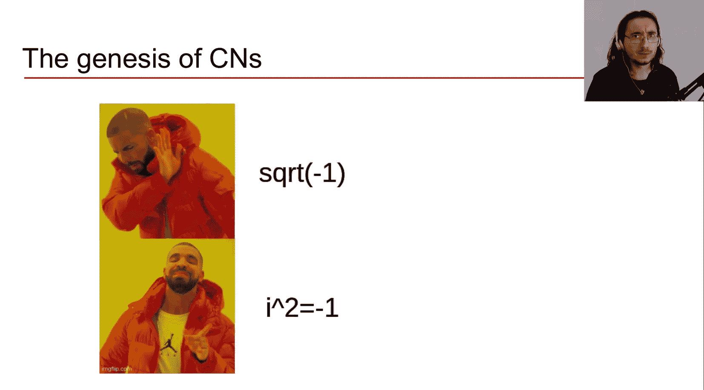
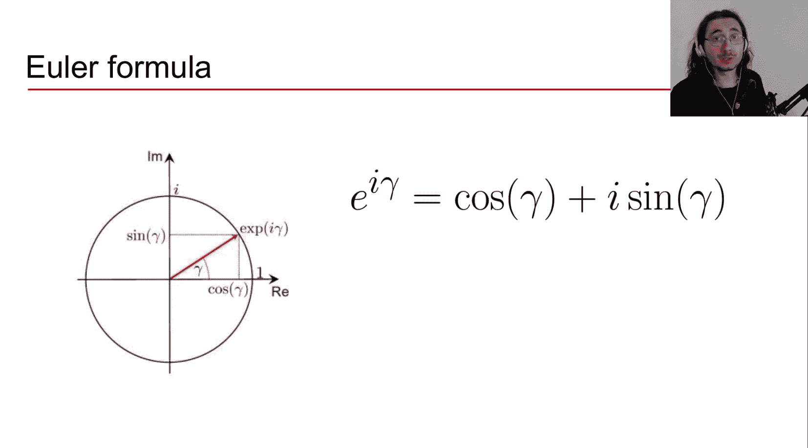
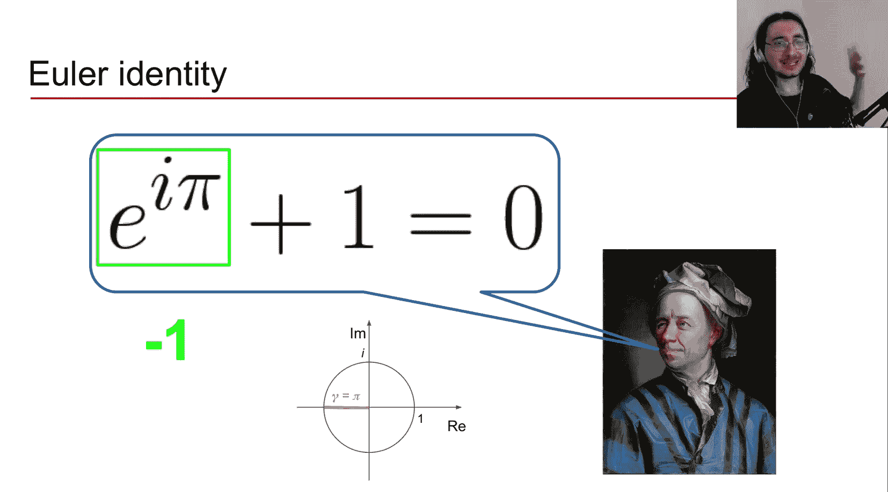
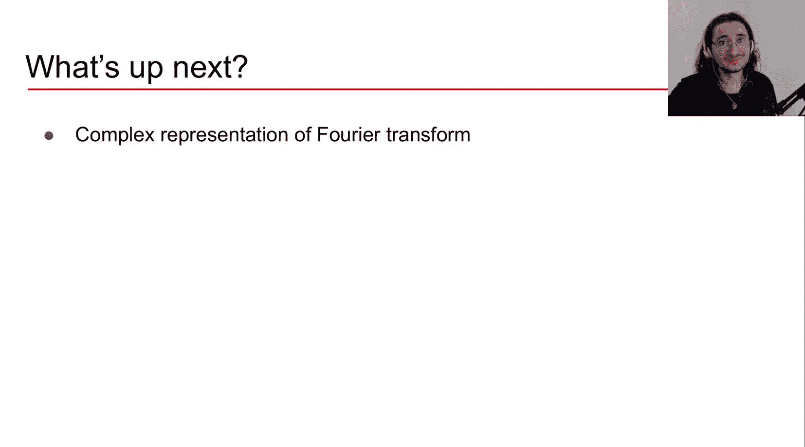

# Valerio Velardo【中英⚡面向机器学习的音频信号处理 Audio Signal Processing for Machine Learning】 p11 p10 Complex Numbers for Audio Signal Processing [BV1ftPLeCEhX_p11]

Hi， everybody and welcome to a new video in the audio signal processing information machine Learn series。

 This time will pick up where we left the last time where we talked about Fourier transform and arrived at the point where we said。

 well， we need to know about complex numbers for moving forward and understand Fourier transform even better than just like the intuition level。

 So this time we look into the fundamental concepts behind complex numbers and all of this information is going to be very useful for you to understand the deeper concepts behind audio signal processing。

 But before we get started， I want to remind you once again about the sound of the eyela community。

 which is a community with people interested in all things eye music。

 audio and audio signal processing。 So you can go there hang out with very interesting people and network with them。

 ask for feedback and just share your ideas。😊，So if you're interested and you're not signed up yet。

 just go check out the signup link to the workspace Sla workspace in the description below。

 But now let's move on to the topic of today's video。

 the complex numbers So why should we better with complex numbers in the first place。

 Well aren't real numbers are good enough well， it it turns out that when we are dealing with the Fourier transform。

 if you remember from my previous video， we usually get a couple of parameters for each of the pure terms。

 pure frequencies that we decompose a complex sound into and these two parameters are the magnitude and face now magnitude is a real number and if we are just interested into looking at the magnitude spectrum of a。

😊，Complex sounds。 Well， we really don't need complex numbers at all。

 But if we are interested to have like a deeper understanding of the full Fourier transform and we want to factor in alter the face。

 Now we have a problem。 And that's because we don't have a complex way of dealing with these two parameters at once。

 So magnitude and face。 And so wouldn't be itd been wonderful if we had something that we could use to deal in a handy way。

 both with magnitude and face with both of this like parameters at once。 Well。

 it turns out that we have that that math can provide it with that。 And it's。😊，Complicating yeah。 no。

 it's not really complicated numbers。 Well， it could be complicated the topic in itself。

 but it's not complicated in numbers。 It's actually complex numbers。 And as I said。

 this topic can be a little bit complicated， but I'll try to make it as easy and accessible as possible for you in today's video。

 Okay， so。

What's the genesis of complex numbers？ So why do we need them？ Well， for a long time。

 mathematicians have been scared of a very simple thing。

And that's square root of -1 or more in general， the square root of negative numbers。

 So with real numbers， there's no way we can solve like this very simple thing。

 like the square root of a negative numbers。 So basically math is broken in in terms of like real numbers。

 if we want to deal with this type of things。 So how do we deal with these guys。 Well。

 mathematicians are quite creative people， sometimes quite nuts。

 And they came out with something completely made up and it was so made up that they called it the imaginary units。

 The famous I symbol。 And I has the wonderful property that when it is squared。

 it is equal to minus one， So now all of a sudden we have a way of working with square roots with negative arguments using complex norm。

😊，And isn't that fantastic Yeah， I guess you be that's fantastic now this may feel somewhat like cheating or like weird and in a sense it is。

 but I can assure you that complex numbers work for real and for example。

 in audio processing in signal processing they are used ubiquitously so。😊，Now。

 let's just get familiar with the definition of a complex number or like just see a complex number。

 even if it's just like a generic complex number for the time being， So we define it as C。

 which is equal to A plus I times B。 Now A and B are both real numbers and this I is the imaginary unit right and so the cool thing about this it's like that this complex number can be divided into like two parts。

 the real part that provides us information about the real domain of this complex number。

 and the so-called imaginary part that provides us information。

 about the imaginary part Now given mathematicians love visualizing stuff quite a lot。

 So they thought that we could just take this complex numbers and put them on a plane because if you think of this the real part and imaginary。

😊。

Part has two separate axis。 Why don't you put them on a plane。 And that's what they do。

 And so they can end up plotting complex numbers onto the complex plane。 So in the complex plane。

 the X axis is the real axis， whereas the y axis is the imaginary axis。 Now。

 let's try to pinpoint a complex number。 For example， this three plus2 I。 So for that， basically。

 both three and 2 can be thought of as Cartesian coordinates。

 So3 is the Cartesian coordinate for the X axis for the real part。 And it's over here。

 And then two is the Cartesian coordinate for the imaginary axis。

 And so when we just connects this two points to two coordinates， we get like this point over here。

 which is three plus2 I。 Now， here we have another example， which is1-1 plus。4 I。 And as you can see。

 we go down to minus-1 on the real axis and 4 I on the imaginary axis。 And here we have this point。

 Okay， so this is like all good and well， but now we are interested in another way of representing complex numbers using the socalled polar coordinates。

 And now you'll see why this is like very handy for us in the context of audio signal processing。

 Okay， so here from moving from the Cartesian coordinate representation onto the polar representation。

 we need a couple of parameters。 The first of which is this absolute value of C。

 which visually represents the distance of the complex number from the origin and visually you can visual you can say it like as a red line here。

 Now this is one。😊，Prameter that we need。 The second parameter is the angle called gamma。

 So what's gamma。 Well， gamma is the angle between the。

Positive real axis and the line that connects the origin with the complex number。 So in other words。

 is this angle over here。 Now， the moment we have these two parameters。

 we can move easily from the from the Cartesian coordinate representation to the polar coordinate representation。

 But before we do that， we need to calculate both absolute value of C and gamma。

 Let's start with absolute value of C。 And here we can use like some very basic math。

 something that probably you've done like in high school。 if not elementary score。 So here we。

 I just like revert this and added like these colors， color lines for clarity。

 So the purple line here is I here we have B， which is represented by this yellow line。

 And obviously， we have the hypotenus of this triangle， which is absolute value of。😊，C now。

 as you can see， this is a right angled triangle because we have a right angle here。

 And given we know I given we know B because these are like the this is like the。

The real coordinate for the yeah， the real part A and B is the coordinate for the imaginary part of the number。

 Then we can easily get the hypotenus of the triangle by using pagorean theorem here。

 and so you should be familiar with this， but basically if we square the absolute value of C。

 this is equal to a squared plus B squared。 Now we're not interested in the square of absolute volume of C。

 So we want to take the absolute value of C。 So we have to square。Well。

 we have to use the square root， sorry， and apply that to a squared plus b squared。

 so this way we can easily get the absolute value of C。😊，Great， so what about the gamma value。

 the gamma angle。 So now for calculating that we need to brush off on some trigonometry。

 So basic cosine and sine functions。 Okay， so let's get started。 So here。

 the cosine of gamma is equal to this side a divided by the hypotenous absolute value of C。

 and the sine of gamma is equal to B divided by the hypotenus of this triangle， once again。

 the absolute value of C。 Okay， now we are interested in gamma。

 So we want to get gamma and get rid of this absolute value of C。 So how can we do that。 Well。

 we can， for example， divided the sine with the cosine of gamma and then obviously divide this guy by this guy。

 And if we do so， we end up with this。😊，Forula here。

 so we have sine of gamma divided by cosine of gamma。

 which is equal to B divided by a and the absolute value of c has been canceled out right now if you are familiar with trigonometry。

 I'm sure you've recognized that this signine divided by cosine is indeed the tangent of gamma。Now。

 obviously we're not interested in the tangent of gamma， Were interested in gamma。

 So we how do we get gamma， Well， we need to apply the inverse function of the tangent to be divided by a in other words。

 what we do to get gamma， we have to apply the arc tangent to B divided by a good。

 so this way we can get gamma or yeah the gamma angle directly from the Cartesian coordinates。

 So now I'll store this couple of parameters here， and this is like the way we can get both the angle gamma and the absolute value C starting from the Cartesian coordinates and information about a and B。

That's great， but we haven't learned yet about the polar coordinates。

 So now how do we move the polar coordinates。 Well， once again。

 we have to go back to some trigonometry。 And here so you see that the side A is equal to the hypotenase。

 the absolute value of C multiplied by the sine of gamma。 and it's this guy here。 And then B。

 the side B is equal to the hypotenase multiplied by the sine of gamma right。

 Now here we have the Cartesian representation of a complex number。

 So what we can do next is get a and substituted a with this formula over here。

 because it's the same thing as we've seen And then substitute B with this other formula here。

 And so here basically we are getting rid of the Cartesian coordinate A and。😊。

And we are using instead the absolute value C and gamma， which is our angle。

 So if we do that substitution， we end up with this nice formula down here。

 which is a complex number of C in polar coordinates。

 can be expressed as the absolute value of that number multiplied by cosine of gamma plus I times sine gamma。

 nice， Okay， so but now you may be wondering， well。

 we are doing all of this like mental gymnastics and mathematical gymnastics。

 but how does this apply to our Fourier transform Well， I'm not going give you like the mapping。

 the one to one mapping here because you need to know more about complex numbers。

 but I want to give you a little bit of a h so。With the Fourier transform。

 we are dealing with sine waves， right？And here you have a hint that still we're dealing with cosine and s。

 so that is somewhat like close in a sense right and so that is a little hint that perhaps this representation can be useful for the Fourier transform。

 but more than that。With a Fourier transform， when we decompose a sound into a single frequency。

 pure tone， well we get two values， an absolute value and an angle， a face， right？😊。

The the hint here is that the magnitude can be somewhat mapped onto the absolute value here and the face onto this gamma angle。

 So now probably you start to see here。 what's happening right？

 So we have all of these different elements and like both in the Fourier transform。

 And here in this the polar coordinate representation of color of complex numbers。

 and they somewhat align。 and that's great。 And we can use this to our own advantage to make sense of the Fourier transform with complex numbers。

 But this is not today's topic。 We aren't done yet with complex numbers， though。

 So there are a few other concepts that we use and that are super useful for representing in a nicer handy way are Fourier transform。

 So let's just take a look at them。 So one of this is the U formula。 Basically。

 what we are looking at here is E to。😊，The I times gamma。

 which is equal to cosine of gamma plus I signine gamma。 Now， if you're wondering about E。

 this is the base of the natural logarithm。 Now， this is like a very， very nice formula。

 and it's kind of like similar to what we are looking at at our。

polar representation of the complex numbers。 But let's try to visualize and understand what。

This is on a plot。 What this exponential is on a plot。And so as you can see here。

 so what the exponential does， it basically it traces the unit circle。

 So what's the unit circle is circle that has radius one and it traces it。

 counter clockwise and in order to like just trace the circle。

 what we do is we just increase the angle gamma。 The Uer formula is going to be very useful to rewrite our polar code and it' for the complex numbers。

 But before we get there， I want to take a little deter to show you one of the beauty。

 one of the duals in mathematics。 and that's the Uer identity。 So mathematicians physicists。

 even engineers look at this formula and they say， well it's wonderful， is's just perfect。😊。

So let's take a look at this。 So it's E to the I times pi plus1 is equal to 0。

 So why is it so wonderful， Well， because it has all the fundamental elements of mathematics and symbols。

 It has0。 It has one。 It has pi， which is so omnipresent in mathematics。 It has I。

 this made of imaginary unit， and it has E。 So this is just wonderful， But for this to work。

 We need for this exponential， right， to be equal to -1。 So。😊，Let's check out。 Let's see like。

 if this actually is the case。 Let's start from the Ueller formula here。 And here we can see that。

So if we plug pi into like this formula， we'll see that cosine of pi is equal to one。

Plus equal to it。 sorry， minus-1 plus I times sine of pi and sine of pi is equal to 0。

 In other words， we are adding up -1 plus I。Times 0， which is 0。 So all of this guy gives us back -1。

 So it checks out。 That's great。 But let's try to visualize this and see if it works。 And for that。

 we should go back to the complex plane。 And now we want to see E to the I times pi and that is at this point here。

 So it's basically the value that we are tracing on the unit circle is the one that is resting on the negative real axis。

 And so this is equal to -1。 And again， visually it checks out。 So Ueller。

 you are a great man and you are right。 By the way。

 this chap is leonard Ueller one of the most brilliant mathematicians to ever live on planet Earth。

 Okay， but now let's go back to our polar coordinate。😊。

For the complex numbers。 Okay， so the top equation here gives us the protocol units as we come to noum。

 And here we have the U formula。 Do you notice something interesting there that we could use to our advantage。

 Well， yes， So this guy here is basically our exponential here。

 So what we can do is take this exponential and plug it in here。

RightAnd so we can rewrite our polar coordinates like this。

 So a complex number C is equal to the absolute value of C times E to the I times gamma， great。😊。

So isn't this wonderful， It's wonderful because it's a very。

 very complex way of indicating representing a complex number。

 So obviously here we have to parts of this complex number。

 So we obviously have the exponential and we have the absolute value Now the last exercise that I want to do today is to just visualize what these two components contribute to the overall complex number in a visual way。

 Now this is a suggestion for you guys。 So if you're learning some math or anything。

 really even like in engineering I really suggest you to go deep and try to visualize all of this weird like formulas and things because that is going to give you like such an understanding a deep understanding and it's going go well beyond just like memorizing like a formula without really understanding。

😊，What's going on there。 And this is what I'm trying to do like with my videos in general。

 and yeah and this like formula in particular right now。 But yeah， without like further ado。

 let me just jump into this because it's so wonderful。 So this exponential component。

 we already know it's basically like traces the unit circle in the complex plane counterclockwise。

 And so what this component gives us to the complex number。

 is the direction all the number in the complex plane on the unit circle。 And here we have it。

 for example， this is like for gamma， which is equal to pi divided by4 in other words。

 for 4 45 degrees right Now， if we change a gamma and we go to gamma equal to pi。 Well。

 we are just changing the direction of the number， which now rests on the negative real axis。 Now。

 if we change gamma。😊，Once again， we change the direction， for example， at minus pi divided by two。

 we are resting on the negative imaginary axis and the value of our exponential here is going be equal to minus I a minus the imaginary unit。

 Okay， so you get the idea of what this exponential does to our number。

 it just gives it the direction， then what about absolute value of C。 Well， this acts as a scalar。

 basically scaled the distance from the origin of our number， So if we start with a with the unit。

 So basically the absolute value of c is equal to one。 Well， we are just resting on the unit circle。

 obviously， but if the absolute value of C was equal to two， for example， Well。

 what would happen is that we double the distance of the。Number from the origin。

 but we stay on the same line， on the same direction。But when I say that the absolute value C。

 So this component is a scalar， it can obviously stretch things， but it can also strengthen them。

 So if we had， for example， C equal to0。5， what we would get is half。

The distance from the origin calculated with respect to the unit circle over here。That's great。

 So yeah， this is like so fascinating， like and interesting。

 And I and I think like it's going to be like very useful moving forward。

 definitely it's going to be very useful to like understand how to map the Fourier transform onto like the complex rear presentation。

 And now， once again， I want to give you a hint into that so。😊。

Now we have a very complex way of representing complex numbers and we are going to be using this absolute value as a way of mapping our magnitude that we have like in our Fourier transform and we're going to be using this exponential and specifically this gamma to talk about the face that we get out of a Fourier transform for a given pure tone and so this is the type of like of like mental exercise that we' use in the next video where we are actually going to put into place all of the knowledge that we've acquired today about complex numbers in order to create a complex representation of the Fourier transform and you'll be delighted by that because it's going to look like so wonderful and so simple。

Good， so this was like a quite intense video feel， but I hope like you've enjoyed it。

 because now you should have a good understanding and operational understanding of complex numbers their representation in Cartesian coordinates in polar coordinates the Uer formula。

 the exponential and all of this like nice things here。 So， yeah， that's it for it today。

 I hope you've enjoyed the video。 if that's the case， please remember to leave a like。

 And if you haven't subscribed， please consider doing。 So and。😊，As usual。

 if you have any questions please leave them in the comment section below I'll try to answer to those and I guess that's it。

 I'll see you next time， cheer。

