# Valerio Velardo【中英⚡面向机器学习的音频信号处理 Audio Signal Processing for Machine Learning】 p12 p11 Defining the Fourier Transform with Complex Numbers [BV1ftPLeCEhX_p12]

Hi， everybody。 and welcome to a new video in the audio signal processing for machine learning series。

 Last time we introduced complex numbers， and we said that we would need this to introduce many aspects of audio signal processing。

 And so this time， we'll just build on top of that knowledge and we'll use complex numbers to define the Fourier transform in complex terms。

 And as you'll see， this is gonna be super compact and super elegant。 But before we get started。

 I just want to remind you about the sound of AI Slack community here。

 you can talk with a lot of like cool people who are interested in A audio and AI music and you can also get feedback。

 So I really suggest you to check this out。 I'll leave you the sign up link in the description below。

 Now， onto the cool stuff。 So I want to remind you about like a couple of things that I introduce some math stuff that I introduced over the last couple of leaders。

 And the first。😊，Coup of formulas are these two。 And this is the formula on top over here for getting like the face as a parameter of the Fourier transform。

 And then we have the magnitude。 And as you can see here。

 we have just like the way we can extract that。 Now I'm not gonna to get into the details here。

 because I coveredd this in a couple of videos ago when I gave you an introduction and in the intuition of the Fourier transform。

 So I definitely suggest you to check it out if you haven't。

 And so you should have the video over here。 Cool， but now what are like the face and magnitude on a very high level where these are like the two parameters that we extract when we decompose a complex sound using the Fourier transform。

 So we have a decompose same wave frequency and for that frequency， we extract a face and a，😊。

magnitude and the magnitude tells us how much of that purton we have in the original signal。 Good。

 So the next thing that I want to remind you about is this nice formula for for a complex number。

 So here we have a complex number， that's that's defined as the absolute value of the complex number multiplied by E to the I times gamma where I is the imaginary unit。

 So this is the polar definition of a complex number using the exponential here。 once again。

 if you don't know this or if you haven't checked out my previous video Coax numbers definitely do check this out because all of these video will build on top of my previous two videos。

 Okay， So now let's move on。 So what's the intuition that we use to define。

The Fourier transform using complex numbers。 Well， the idea here is that whenever we apply a Fourier transform。

 what we end up with for each frequency for each pure turn is a pair of parameters。

 So one is magnitude as we saw it and the other one is phase and the idea is that we can use this magnitude and phase as polar coordinates of a complex number in other words。

 we can encourage both of these coefficients。 So the magnitude and phase in a single complex number。

 So yeah， but let's see how that looks like in in empirically like applied。

So let's start like with the mathematical equations that I introduced earlier。

 So here we have like our phase。 once again， the magnitude。

 And here we have the definition of a complex number in polar coordinates， Okay。

 so how do we get the Fourier transform coefficients。 Well， this is the formula， right， So basically。

 we can encode both the magnitude as well as the phase in a single。😊，Complex number。

 And this is called the complex Fourier transform coefficient。

 And we have one of this for each of the frequencies we decompose our original signal intake。Okay。

 so now let's take a look at a closer look at this。Basically， as you can see， this is。

 we can just like map this complex coefficient to this complex definition of a， well。

 polar representation of a complex number。 So the absolute value of C gets mapped to the magnitude divided by square root of two。

 Now， if you're wondering why we use the square root of two here is just because of like some normalization reasons。

 I'm not going to get into the details there。 but it really doesn't matter that much because it's just divided by a concept。

 It's all it is， right？ Then the other thing that we have is gamma。 the angle over here。

 And as you can see， gamma over here is equal to two pi phi。And where phi is basically the face。

 And we also take like D minus。Here， and so in other words。

 like gamma here has this minus as well in it over here。 Cool， Okay。

 so now let's go back to kind of like visual representation of like this Fourier transform coefficients。

 So you should be familiar with this already from my previous video。 But if you're not。

 I'll just like give you like an overview here about how we can interpret a complex number visually。

 And in this case， the complex number is our Fourier transform coefficient for frequency F。😊。

So this guy here is nothing more than a point in the complex plane in the complex plane。

 obviously we have the horizontal axis where we have like the real part of the complex number and the vertical axis where we have the imaginary parts of the complex number。

 So Cf are for a transform coefficient for frequency F is equal to like a point in this a complex plane。

 and now if we want to map like the different parts to like this number so we can see that。

The distance of our complex number from the origin is given by the absolute value of the coefficient itself。

 So this guy over here， right？So it's the magnetter divided by a square root of2 and then we have gamma and gamma is the angle between the positive real axis and the line that connects are coefficient complex number with the origin and gamma once again is given by this two pi multiplied by the face。

Okay， and the face here I should remind you is between0 and1 and being bin and b between0 and1 it means that we can't go and just like design or just like trace the whole staircle here。

Cool。Okay， so what does this minus？😡，Do。Right， so the cool thing about this minus is that when we increase the the phase。

 what happens is that we are rotating clockwise。 So if we increase increase the phase here。

 we just go down here， then we go down here。 Okay， So usually we the complex number definition。

 you just like rotate counterclockwise as we so in the previous video。

 But here we add a minus in this。😊，Definition so that we can rotate clockwise when the phase increases。

Cool。Okay， so now I want to show you how we actually get to the Fourier transform and what the definition of the Fourier transform mathematically。

 And but for doing that， I just want to start from a continuous audio signal。

 So our continuous audio signal is G of T。 and this is a function and mathematically。

 this function G does this thing。 So it gets a real number as an input。

 and it outputs another real number。 and this is as simple as a as having like this part here， right。

s we should be familiar by now with this。 It's a it's a waveform。 Okay， So and on the a axis。

 we have time。😊，And for each time we get back an amplitude or intensity value。

 and this is why we this function G， which is our continuous audio signal， gets a real number。

 time as input and it provides us it outputs another real number， sorry about that。

 Another real number which is the actual sound pressure， intensity or amplitude。Okay， cool。

 this is in stark contrast with the actual complex Fourier transform。

 So the complex Fourier transform we can indicate with G hat。Of this。

And the output of this is our coefficient， the Fourier transferal coefficients that we saw a couple of minutes ago。

 right， and we have one of those coefficients。😊，In other words。

 one of those complex numbers for each frequency。😊，Cool， okay。

 but how does like this Fourier transform like look like。 So this this function。 Well。

 this is slightly different from the original signal。

 And that's because this function takes as input。 a real number， which is the frequency， right。

 and the frequency is expressed in hertz。 But then it doesn't output a real number， but rather。

 it outputs a complex number and the complex number that it outputs is the Fourier transform coefficient。

😊，Cool。So let's take a look at this in the complex plane。 So we already see this like。

 so for frequency F1， for example， the output of the complex Fourier transform is a point can be visualized as a point in the complex plane。

 Co， this is really， really interesting。 So now probably you start to understand why we are using a complex representation for the Fourier transform。

 The great thing about this is that given the Fourier transform comes out with two different parameters。

 So magnitude and phase。 We can just like package them up into a handy tool。

 which is a complex number and then easily visualize that on a complex plane。

 Isn't that like fascinating how like math works so well when we describe like natural。😊，Physical。

Things in nature， right？Cool okay， so this is another example of an output that we get from the comp Fourier transform and perhaps this is at F2 right and then if we go to F3。

 we may have still another coefficients that's over here cool。😊，Okay。

 now you have a little bit of an understanding of how like this complex Fourier transform like works。

 But what about its mathematical definition。 So how do we get to this C F to the Fourier transform coefficient。

 Well， once again， let's start from the original stuff that we looked at a couple of videos ago。

 So here we have the formula for both the magnitude and the face come out from a Fourier transform。

 And here。We have the definition of the complex Fourier transform。Cool。

 so I know this can look a little bit scary here， but bear with me because were going to look into a visual interpretation of this and you'll see that this is actually quite simple to grasp okay。

😊，As we said before， So the output of this Ghat at a specific fee is nothing more than a complex number on the complex plane。

 And it's our4 a transform coefficient， right？ But now。

 how do we actually get this guy starting from this beast。

Of an integral here that has this exponential which like some kind of weird。

 like complex values and things like that。 Okay， so the first thing， like we， we。

 we will do here is look into the different parts of this formula。 So the the。

 the first one that we'll look into。 And by now， you should be familiar with this is this exponential over here。

 So the exponential here。Basically， it traces the unit circle in the complex plane。 So S increases。

 We just go through we just like trace the whole unit circle。

 But now we are tracing the unit circle going clockwise。

 and why is that because we have this minus symbol over here。

 Now the other thing to keep in mind here。 is that the speed at which we can complete a circle。

 depends on this F value， which is the frequency。 So， for example。

 let's assume that frequency is equal to one is1 Htz。

 Then it'll take us one second to go through to just complete one full circle。 Now。

 if the frequency is equal to2。 It'll take us half a second。And that's because the period。

 if you remember， is always like the inverse of frequency。 So it will be like one divided by2。

 which is no。5 seconds。 Okay， so here you get the idea of how we can。

Kind of like represent a semicoidal， a sine wave。Using like complex numbers here。

 And this is going to be like the pure turn that we use for decomposing the original signal right And basically the idea is that we are going to be using many different frequencies for decomposing the original complex signal。

 which is like this G ofT。 and into its different frequency component。

 The next component that we need to check out in our complex Fourier transform formula is the signal G ofT。

 Now I've created a custom signal because obviously I want to show you how the complex Fourier transform works visually and how we can interpret that visually。

 So I've created a Jupyter notebook and here I have a bunch of different functions。

 I'm not going to go through them line by line just because yeah， that's not like whats like this。

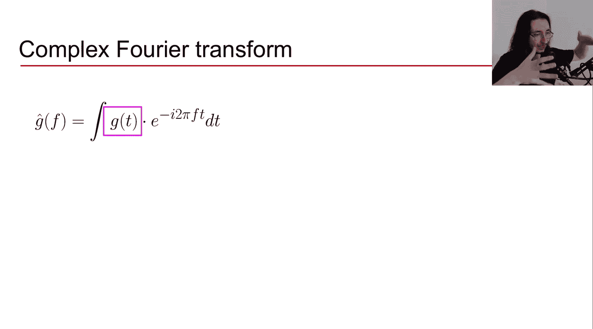

is about but even want to just begin to like this notebook feel free to do it I'll just leave you the link to the GitHub where core is the code is stored in my description below but now let's take a look at this signal so what I've done here you can quickly take a look at this so I take in like a frequency and I use that like as a fundamental frequency and so I have like a signine waves and I superimposed and a couple of other sine waves so signine 2 and signine3 and these have double the original the fundamental frequency and triple the fundamental frequency。

Cool， okay， so now let's take a look at the results for that。

 And so I have like this nice utility function that I define So plot signal。

 So I'm passing in the time。 So the time is between like 0 and 10 seconds。 and I have a 10000 steps。

 And then I passing the signal。 And as you can see， we have our signal， which is time。😊。

Against intensity over here。 The next thing we want to check in our complex Fourier transform is the multiplication between our original signal and the pureitton。

 What does that look like visually， So let's check that out。 Okay。

 so we're back in the Jupyter notebook And so here I have a function that's called plot Fourier transform。

 So here I can pass a pure turn frequency and I'll put this equal to 1htz for the time being。

 And this is basically it's going to build a sine wave and that's going to be like our exponential over here and then we're going to have the signal frequency。

 and we need to pass that in and I'll pass in that equal to one。

 and what that will do behind the scene is that it will create this signal。

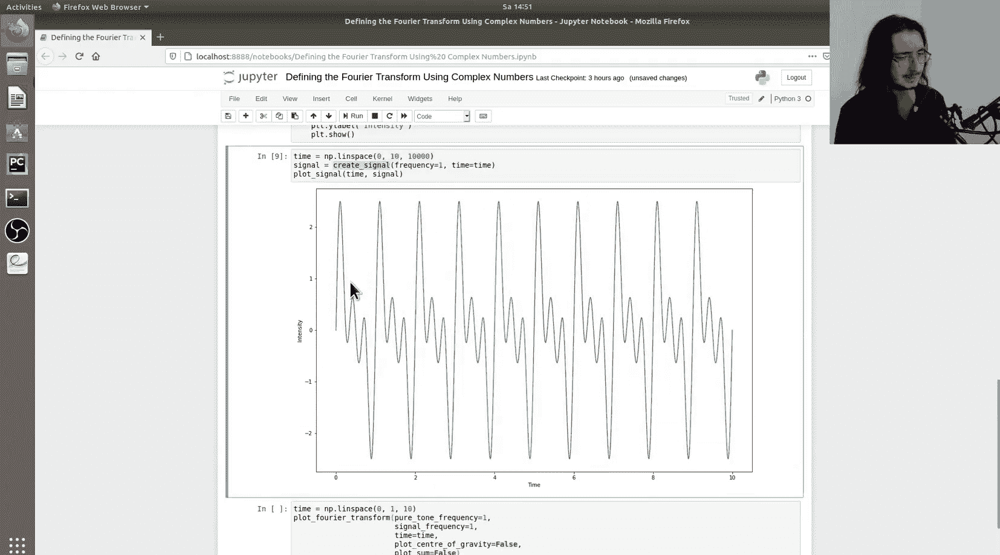

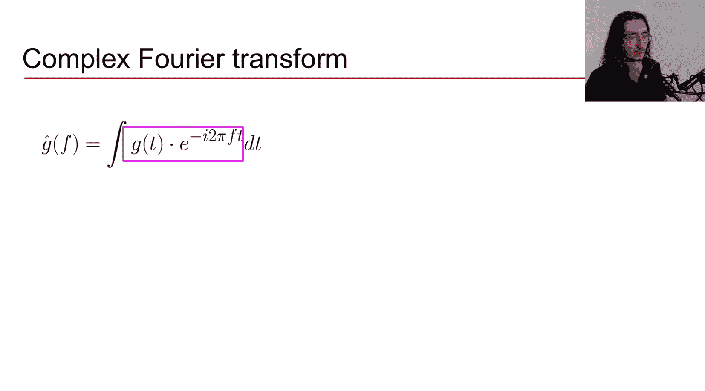

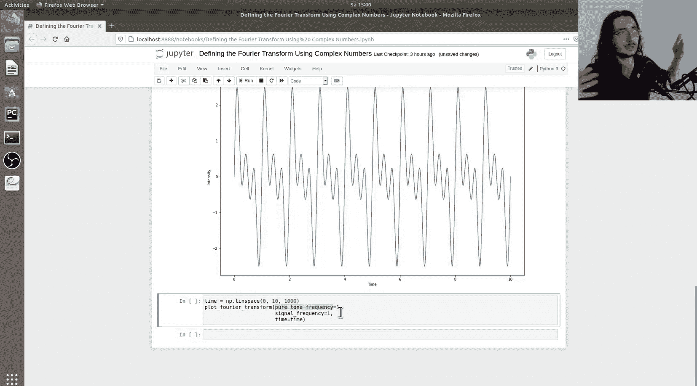

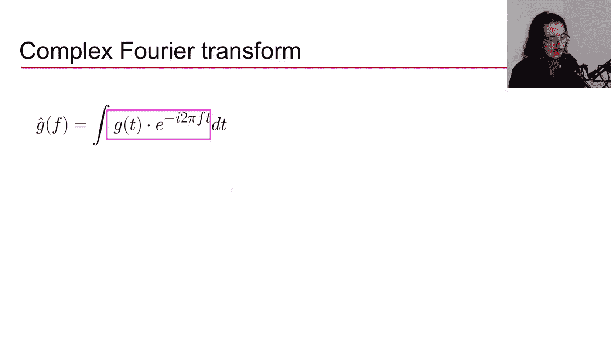

And now when we plot the Fourier transform， what we are doing is basically multiplying our signal by the sine wave of frequency 1 Htz Okay。

 so now the next thing that once you pass in obviously like is time and so we'll take once again like 10 seconds and I'll have like 1000 steps between those 10 seconds。

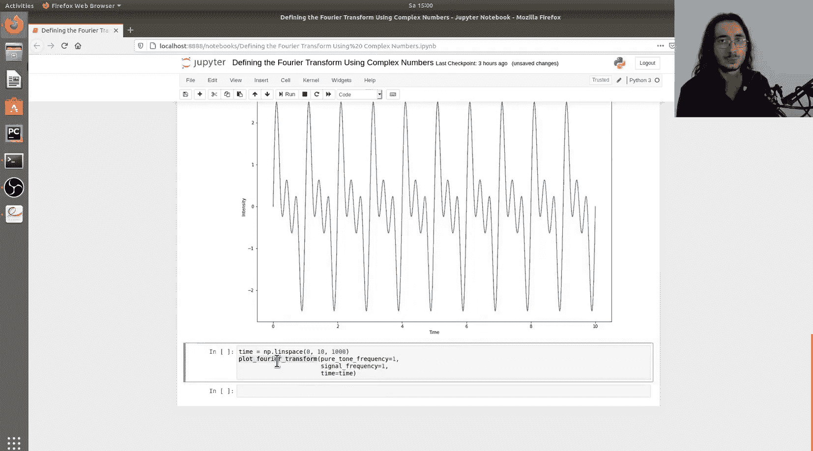

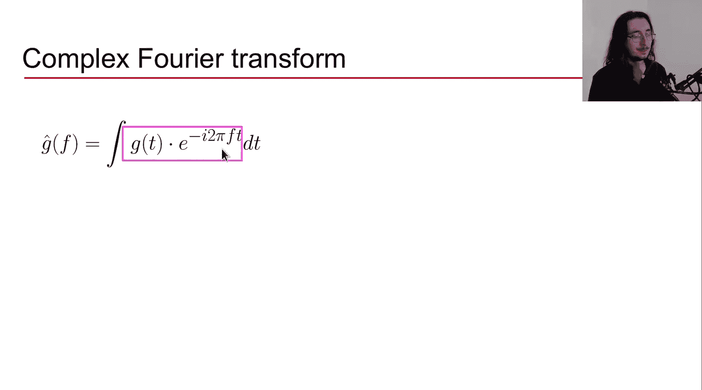

Okay， so here we go。😊，Isn't this beautiful。 So this is the complex plane。

 And this is the horizontal axis is the real axis and the vertical axis is the imaginary axis。

 And here， what we see， this shape is the multiplication of the original signal with the sine wave at frequency one。

 So the Pwter， cool， okay， but。😊。

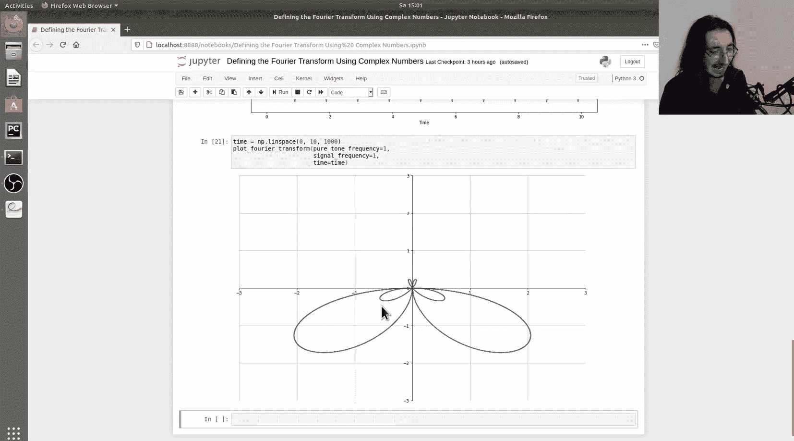

How can we interpret this？ So what's happening。What's happening is that we are taking the original signal。

 and we are wrapping that around the complex plane。

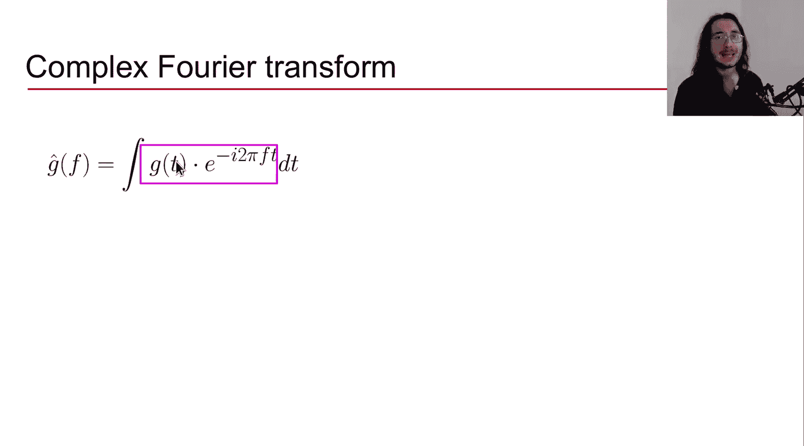

Isn't that really， really cool。Okay， so now if I change the pure turn frequency slightly。

 say instead of 1 Htz， I have 1。1 Hz。 what happens here is this crazy thing。 Wow。

 So that tiny difference and I mean， that tiny difference。

 like in frequency caused all of this difference in it in its output。 So how can we interpret this。

 Well， to see how to interpret this。 We need to just like zoom into like the time domain。

 So I'll just like take a look at one second。 So well。

 we'll just consider a time between 0 and 1 and see what happens。😊，Here， and as you can see。

 we have like this shape over here now if we move to two seconds。

The next step is like drawing this otherer shape。 Now， if I continue at each step， you' will see。

That we continue drawing more stuff。Until we get to 10， where we basically like rotated。Oops。

 we rotated all the way around。Cool， okay， so now another thing that I want to show you is that if we go to say。

2。You can see that once again， we have like quite stable shape， right？

 And the same thing also happens with three。Okay。But if I do 3。1， for example。

 we have like once again， this crazy thing in。Why is that the case？Well， is' that the case。

 because if you take a look at our signal。 So we have like the fundamental frequency is a one。

And then we have like the harmonics that are like a frequency equal to equals to Htz and three Htz。

 And so in those points， So it means on an intuitive level， what's happening there。

 it basically means that whenever we have like frequencies that are represented that are present in the original sound。

 then we have a more stable output like this。Isn't that cool， Okay。

 but now we have like this kind of like interpretation of the multiplication between our signal and the pure sound。

 But what about this beast， What about the integral。😊。

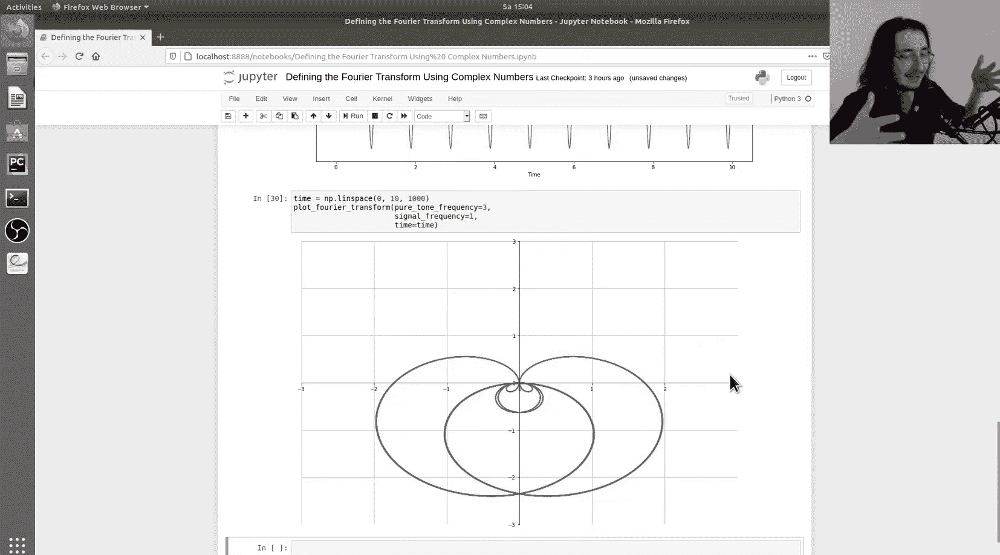

What does that look like？So I'm going to show you that。

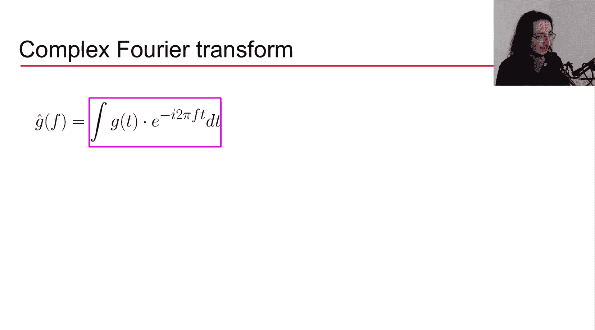

So， and for showing showing you dash， I need another flag in here that's called。Ploots center。

Of gravity。 And I'll put this equal to true。Now， intuitively。What I want to do here。Is basically。

Take all of the different points and average it all。And if we do that， what happens is basically。

 so if we were dealing with some kind of like physical system。

 this would be the same as taking the center of gravity of that system， right。

 so we take all the points and then we average them。😊。

And now I want to plot this center of gravity here。 and as you can see is this red dot over here。

Cool， now we are passing in the。 We are decomposing using the a puritan frequency of 3 Hz。 Now。

 let's go back to the fundamentals So 1 Hz。Over here， and it's the same， right？

 So we have this center of gravity that's here。 Okay。

 now what happens if we take the center of gravity of1。1， for example， right？

 so we want to decompise our signal with a sine wave that has frequency1。

1 and the result is the origin。Is that somewhat unexpected， Well， I'd say no， is that， Why is not。

 Why is not that thing unexpected？ Well， that's because we are averaging across all the different points。

 And here， as you can see， we have like full symmetry。 And when we average everything。

 we just end up with 0， because all the different points are canceling out， okay。Cool。

So this seems to like resonate with with the intuitive like understanding that we had of the Fourier transform。

 right， So whenever we have a frequency component that's represented。

 we have a magnitude that's different from0 necessarily。 Okay。

 whereas when we are dealing with frequency components that are not present in the original signal。

 then we end up with magnitudes that are equal to0， right。

 because we don't have any traits of that in the original signal now。

The thing here is that say now let's go back to one here。

The cool thing here is that we can think of the complex Fourier transform coefficient as this point in the complex plane。

Right， and so now you get a。Kind of like idea of how we get to that single point taking the foreign transform and basically going through the hassle of calculating all of this beast。

 right。

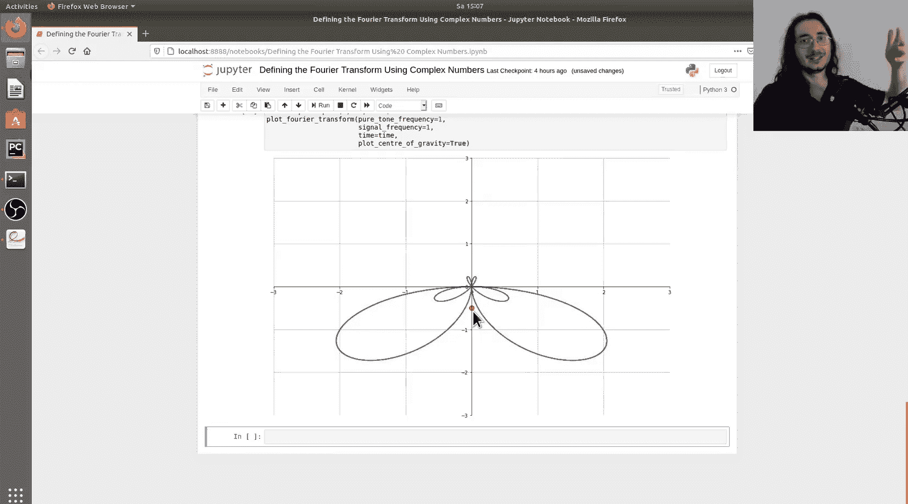

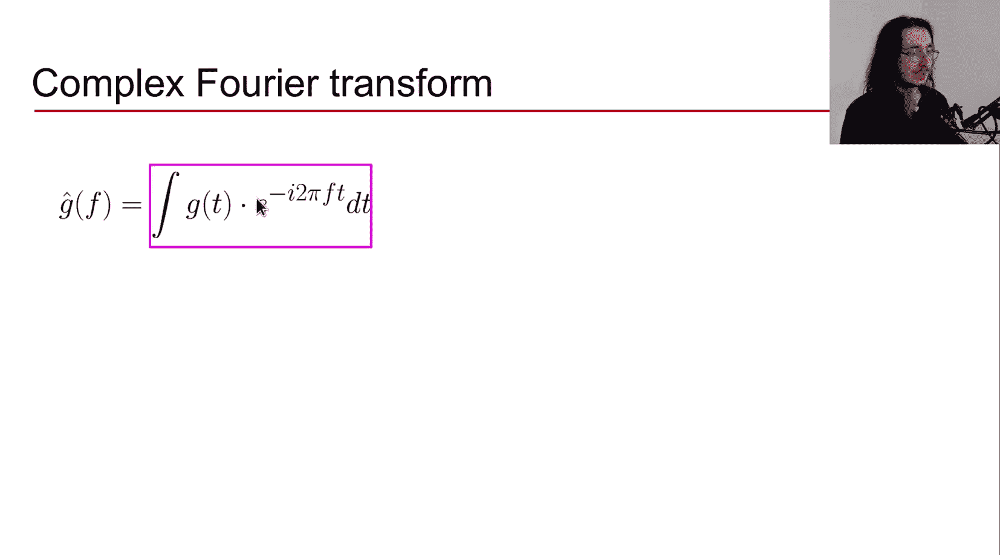

So what we do is we wrap around as the first step everything， the signal around the complex plane。

 and then we take the average or the center of gravity of this and that is going to be a complex number。

 and that is the coefficient to the Fourier transform transform coefficient that has information about the face as well as about magnitude and the magnitude is given by the distance of this dot from the center of gravity dot from the origin and the face is given by the angle。

😊，From the positive real axis。Okay。But I was just cheating a little bit because this is not really what's happening with the Fourier transform。

 There's still another tiny thing that we are missing here。

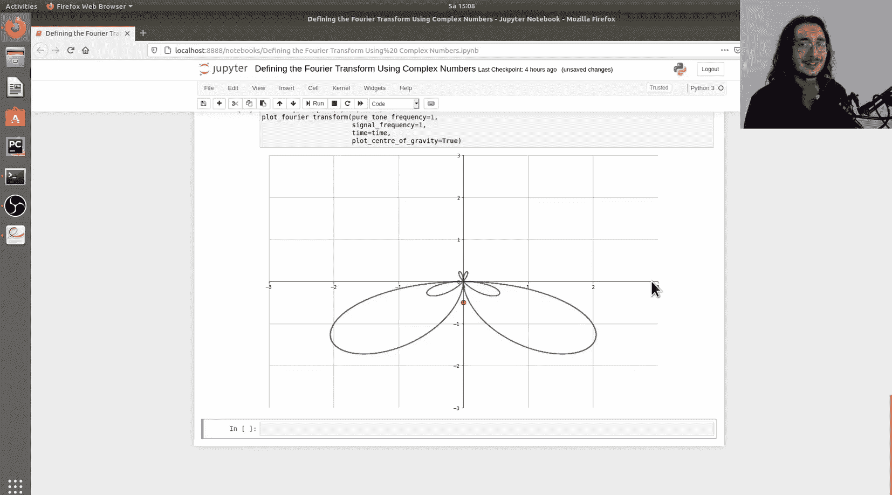

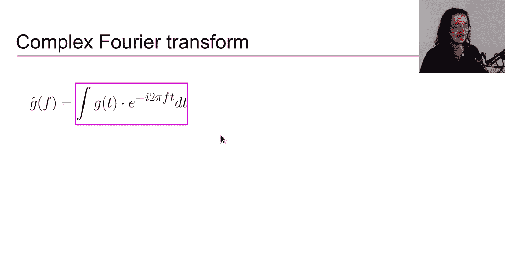

Here I said that we are taking the。The center of gravity。 So the average。

 but this is not really what we are doing here。 So we are not averaging all these values across time。

 right， but rather what we are doing is summming them up。

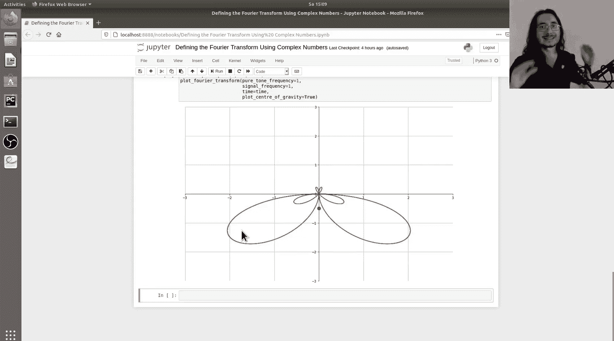

And the integral basically tells us to sum them up。

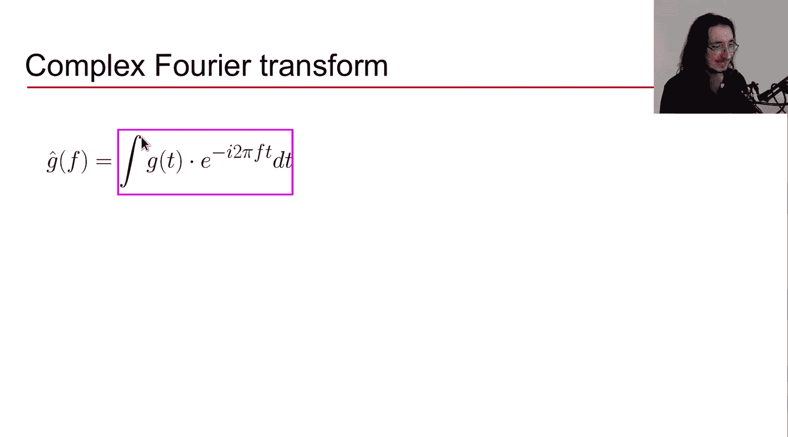

So now let's see what happens if I plot the sum of all of these guys。 So once again。

 I have another flag here that I can easily call and I'll say plot some is equal to true。

 Now let's do this and see what happens。😊，Whoa， that's weird。What's going on there？Right。Okay。

 so why do we have-500 for this green dot， which is our sum。 And this is actually the coefficient。

The Fourier transform coefficient。😊，So why is it minus-500？ Well。

 that's because we are actually summing all of the values here。And now， across time。

 now we have like a thousand stats here that we are suming。Now， if instead of like。

1 thousand steps here。 we only took 100 steps。What we would end up with。Is this guy here？

Around more or less minus 50 on the imaginary axis。Right？And why is that the case， Well。

 Because here we are only summing。100 steps， not 1000。

And do you see any sort of connection with the center of gravity here？

So probably this is going to show you this。Easier。So the center of gravity is around like minus 0。

5 on the imaginary axis， whereas the sum in this case is equal to 5。

 So what we are doing here is we are taking the center of gravity and then we are multiplying that by the numbers of times steps that we have in this case is equal to 10。

 So it's minus 0。5 times 10 and we get minus 5。 okay so you get the idea here。 So in other words。

 like what we do is basically conceptually is we take the center of gravity and then we multiply that by the number of steps that we have that we are considering and so the higher the number of steps that we are considering and then the higher the number of times we are multiplying the center of gravity4 cool but。

Good， but what happens if we， we have like that one dot one frequency instead。

 which like the whole lacksymmetrical really cool shape。 So now let's go back to say。

 between0 and 10。 and here we'll do1 thousand0 steps。So what's your guess， What are we going to see。

 Where is the green， Where does like the green dot land。And as you can see。

 it lands just right in the center。 And why is that's the case， Well。

 because once again we are summing all the different points at different times。

 but they're just like canceling out。😊，And so this is how we end up with those picks on the frequencies that are actually。

😊，Present in the original sound。Now you should have a visual understanding of how we get to the Fourier transform coefficient。

😊。

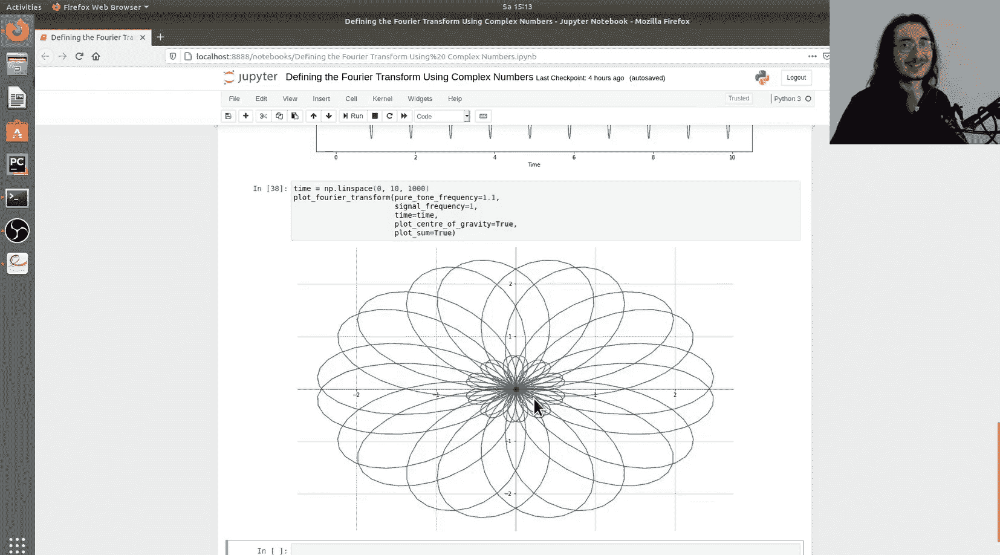

Just like to wrap this up。 So we start with a signal。

 Then we wrap the signal around the complex plane by multiplying the signal by a pure turn。

 And then what we do， we sum all the results for each time step。 Okay， cool。

 but why do we have an integral sign here。 Shouldn't we use like a sum kind of thing？ Well。

 this really depends on the fact that we are using like a continuous representation。

 So let me show you what it meant here。

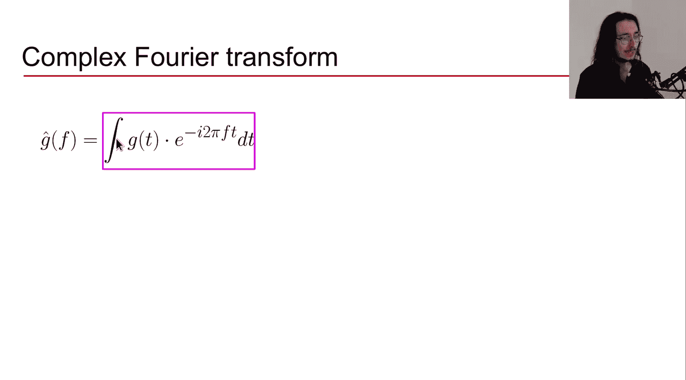

So first of all， let me， I don't want to see all of these guys， I'll put false here and false here。

So now let's I don't want the lines to be plot， I just want points， so I'll do this。Okay。

So now let me start with only sayi。Between zero and one second， and we'll only take 10 steps。

And so here we have like 10 set。 Or by the way， I have to rerun this。 Otherwise。

 I'm gonna get these lines。 So let me rerun this。 And now I have like all of these points。 Okay。

 so now I'm just like taking 10 points。For in this like one second interval。 now。

 if I take 100 points， now， this is gonna look a little bit more， yeah， continuous， like in a sense。

 now， if I continue like this， I'll get to 1000， then I can get 10000。 and we can continue。

 like however we want。 But basically， the idea is that。If we end up like with infinity here。

 so we have like as many steps as we want， then we are like in continuous we are like dealing with a continuous variable because time is continuous and then the sum symbol becomes the integral So yeah。

 this is the mystery of the integral explained for you Okay。

 so I hope that he really got the visual understanding of the complex Fourier transform because I know you can feel like a lot but once you think of this in visual terms。

 it all becomes like easier。 Okay， so now going back to this definition if you remember from the previous video。

 we had this formula And so what we can do here is just like plug this guy inside of here。

 And so what happens is。😊。

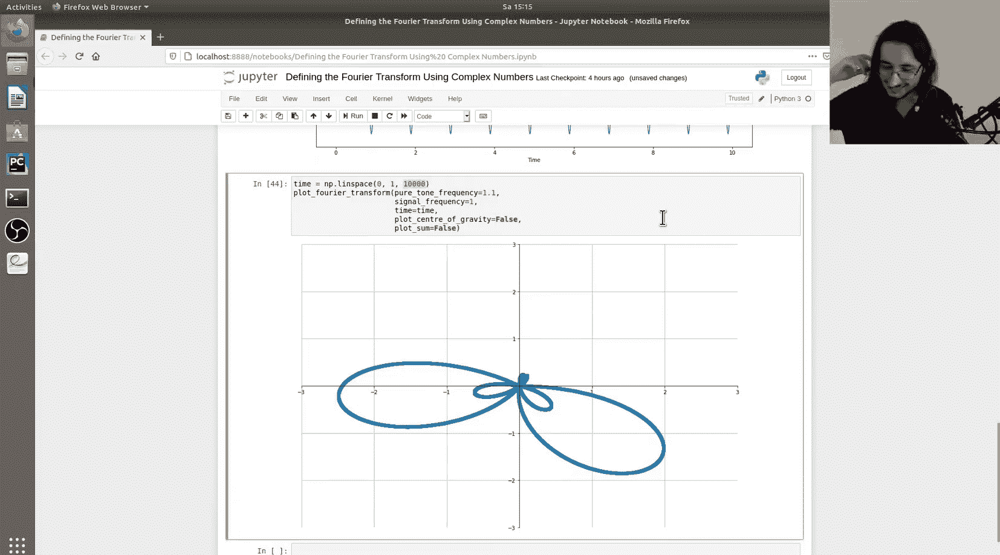

we can rewrite this initial complex Fourier transform like this。

 and this has the advantage of having like a real part in an imaginary part because as we know G hat of F is going to be a complex number and that is going to be the complex Fourier transform coefficient cool Okay。

 so moving on。😊，So we can take the magnitude of the Fourier transform。 and for doing that。

 what we do is basically we just like take the absolute value of this function。

 And now if we go back to the complex Fourier transform coefficient， we see that we。

 we can take like this coefficients or the magnitude of D of F。

 it's basically equal to the absolute value of the Fourier transform of F multiplied by。

mIt's quite rootive too， and this is because we know that u like。This guy here。

 So the absolute value of the Four rate transform is equal to this guy。 Once again。

 this square root of two is a normalization constant。 So yeah。

 let's not butter about that because it's not really that important at all。 Now。

 in terms of the phase， the face we can define by taking the。A gamma。

 So the angle of the at frequency F divided by two pi and take the minus there。

 And now we have like that gamma is equal to this guy here。 So two pi multiplied by times the。Face。

 cool。That's great。 So now you should have like a real good。

 deep understanding of the Fourier transform。 Now， you know what the magnitude is， what the face is。

 how we can encode the magnitude and the phase into a complex number。

 which we call the Fourier transform coefficient efficient。

 and now we also know the mathematical formula for getting the Fourier transform。

 And we definitely understand the visual interpretation of that， which is great。

 So what's missing there。 Well， what's missing is the inverse Fourier transform。

 But I promise this is going to be like super quick compared to what we've gone through so far。

 So we saw this a couple of videos ago already。 But basically。

 we know that it's possible to go back from the frequency domain to the time domain。😊。

Using the inverse Fourier transform。 And we saw this also in practice。

 doing some a simplified version of this， doing some adddjectitive synthesis a couple of videos ago。

 where I took different cide sine waves。 And I just like added them up。

 And I could recreate a create a complex sound。 And basically。

 that's what we actually do with the inverse Fourier transform。 But there's a。😊。

Representation for this。 So there's an actual mathematical representation for this。

 And it's given by this otherer integral over here。

 And now the kind of like high level intuition here is that we just take all the different frequency component。

 We just multiply them by the magnitude and we add the phase。

 And then we add them all up and we reconstruct the original signal G of T。

 And the point here is that the original signal and the Fourier transform do have the same data。

 So we can go from one to the other back and forth。 However。

 how many times we want and then we never lose any information。 Now， I know once again。

 this can feel a little bit f。 but let's take a look at this visually very quick。 So here， this guy。

 once again， we should be familiar with this by now， this is the pure。😊，Tone of a frequency F。

 So in other words， we can visualize this like a simple sine wave like this。

 And then when the next step is to actually multiply the Fourier transform coefficient So the comp Fourier transform coefficient by the pure turn。

 And when we do this， what we actually do is we weight the pure turn with the magnitude and add the face。

 And so we basically move from this original pure turn signal to this new signal that has potentially a different phase and a different amplitude because of the magnitude。

 Co。 So now what's the last step。 Well， we have to integrate。 By now。

 we should know that integrating basically means adding up。😊，Okay， a series of like infinite terms。

 and in this case， we're not integrating across time， but rather across frequency。

 And in other words， what we are doing here is we add up all the weighted sinusoids and we get to the original sound。

 so we take， for example， this first sine wave， the second sine wave， the third sine wave。

 we reconstruct them weighting them with the magnitude and add interface。

 then we add them all up and we get this original signal。😊，Cool， so this is really。

 really cool stuff and now we are ready to look at the Fourier round trip。😊。

So here we have like this couple of formulas here， the top one now we know is the Fourier transform。

 The bottom one is the inverse Fourier transform。 Let's take a look at them like wonder at them。

 they are fantastic。 They are basically the same more or less function。

 the only thing that changes really， is that here， in the case of the Fourier transform。

 we are integrating over time whereas in the case of the inverse Fourier transform。

 we are integrating over frequency， So isn't this beautiful。

 So all of that complexity captured in an elegant way with a very straightforward and minimal formula and also this idea of like getting back and forth from the time domain to the frequency domain and from the frequency plane of the time domain is just wonderful。

😊，And now I hope you understand why we went through the hassle of introducing complex numbers because now we have a super compact definition of the Fourier transform and its inverse just by relying on this mathematical construct。

Okay， so this was a long one， wasn't it， But I hope like it was like really worth for you。

 Now I can finally go back to this pinklo， iconic cover for the dark side of the moon。

 So now we're really cracked。😊。

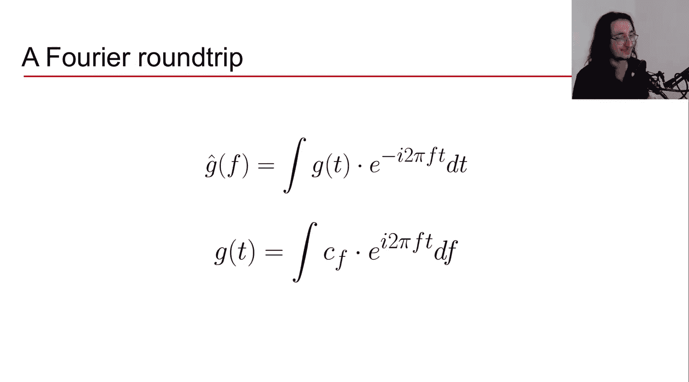

The magic that happens in this algorithm down here。

 So we are now know how we can get a complex sound and divide that into its frequency components。

 and vice versa。 get all of the frequency components and put them back into a complex sound。

 We now know about the Fourier transform。 I hope like this was like a worth journey for you for me。

 it's been really， really cool。 just like to cover all of these things in detail。 Now， so。😊。

What should we do next， Well， we have a problem and the problem is that so far we've treated everything in all the theory for the Fourier transform in which continuous mathematics。

 basically we assumed that we were dealing with analog or continuous signals， but in reality。

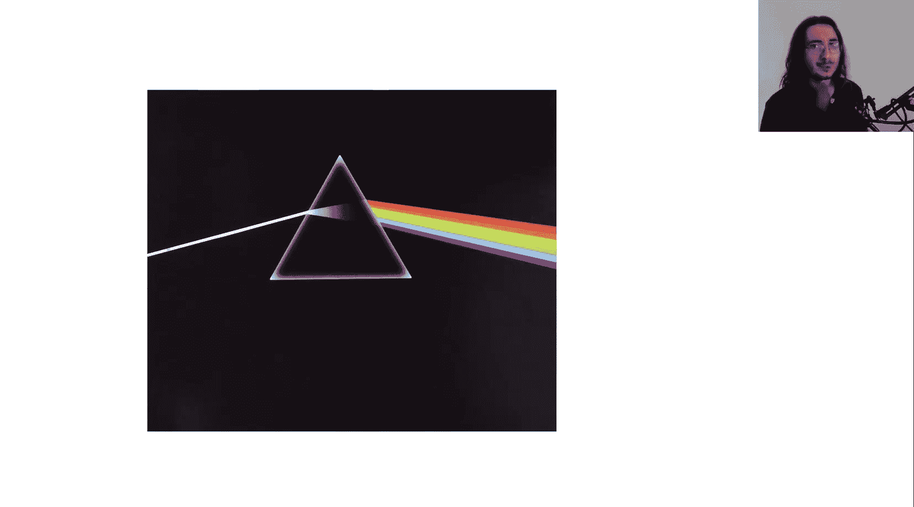

Whenever we are actually applying a for transform， we are dealing with digital signals。

 discrete signals， and so what we do is we start from a analog signal and then we sample that we digitalize that and if you want to know how to do that you can check out this video。

😊，Bush。So what's remaining to do regarding the Fourier transform is understanding how we can adapt the theory that we've studied so far to the discrete world and that's the world of our digital computers and that's the world that we'll use for actually extracting information from a signal Co so next time we'll look into the discrete Fourier transform。

Cool， that's really it for today。 I know it was a long one。

 I hope like it was worth for you going through all of this。

 but now you should have a very deep understanding of the Fourier transform。

 So if you have any questions and I know that there's a lot to ingest for you today just like feel free to leave a comment in the comment section below and I'll hope I'll see you next time。

 cheers。