# Valerio Velardo【中英⚡面向机器学习的音频信号处理 Audio Signal Processing for Machine Learning】 p13 p12 Discrete Fourier Transform Explained Easily [BV1ftPLeCEhX_p13]

Hi， everybody and welcome to yet another video in the audio signal processing for machine learning series。

 This time we continue our quest， our journey into the wonderful world of the Fourier transform。

 specifically we'll look at the discrete Fourier transform。

 But before getting like our heads down into the Dft or disc Fourier transform。

 I want to remind you once again about the sound of A eyes like community。

 which is a community where you can just learn a lot of stuff about our audio processing and AI music in general and you can network with very cool people。

 So if you're interested in joining I'll leave you the sign up link in the description below。

 But now let's move on to the cool stuff。 last time if you guys remember。

 we defined this beast of an equation here， which in other words is simply the Fourier transform express。

😊。

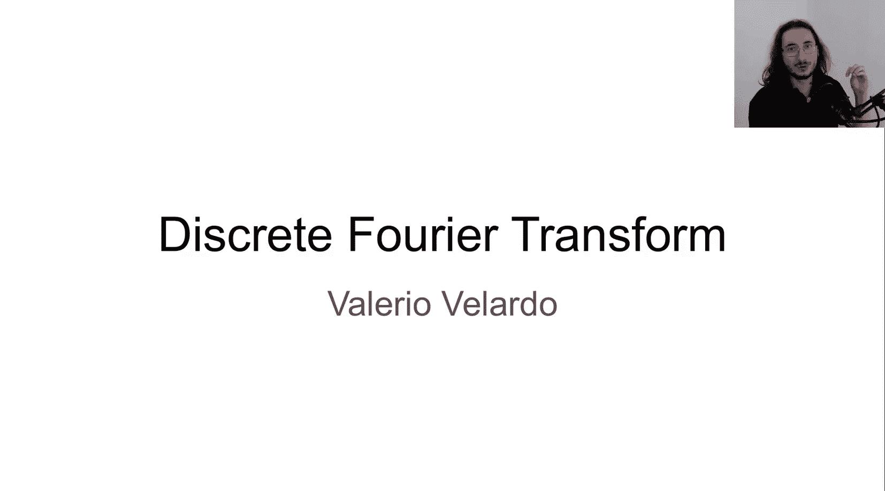

Through complex numbers。 Now I'm not gonna get into the details here。

 and I take for granted that you already know that。 But if that's not the case。

 I suggest you to check out this video， which by the way， my last video， Okay。

 so this formula works for analog signals， or in other words， signals that are continuous in time。

 But the reality is that when we deal like which audio signals or just like any type of signal in general in today's world。

 we actually deal with a discrete signals。 And this discrete signals are the ones that we use and we manipulate with digital machines like our computers or like edge devices。

 whatever you want， really， So how do we move from our G of T。

 our continuous signal to digital signal。 Well， we go through the process of digitalization In other words。

 like we。😊。

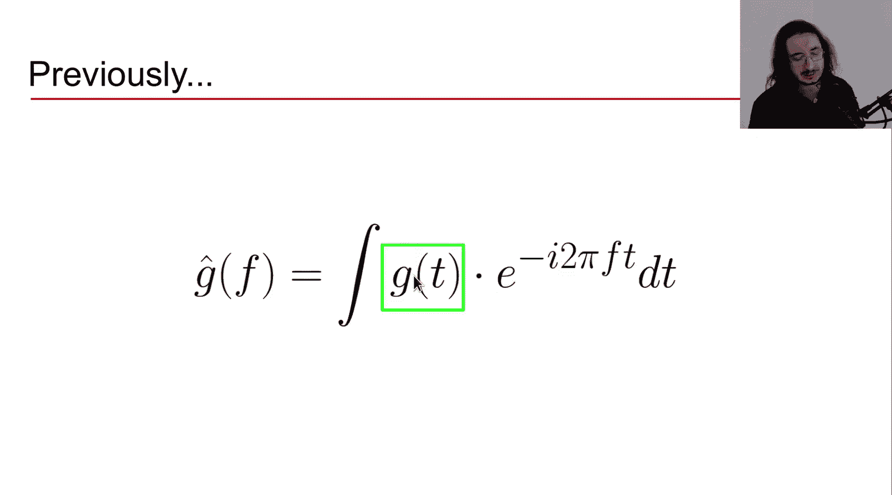

Sample an analog signal， which is like the one that you see here in red and we just like takes certain points which which we can called sample points。

 And so here we take like the first sample point and we use like capital T which is a sampling period which basically tells us after how much time we actually take a sample。

 So here we have like the first sample point then the second and the third you get the idea now if you want to know more about the digitalization process which has both sampling and quantization。

 I suggest you to go check out a previous video that I had on this topic and it should be like up here but I hope like you've already watched that and because like we know some of those ideas for moving forward so when we digitalize the signal。

 So what happens is basically like our original like analog。

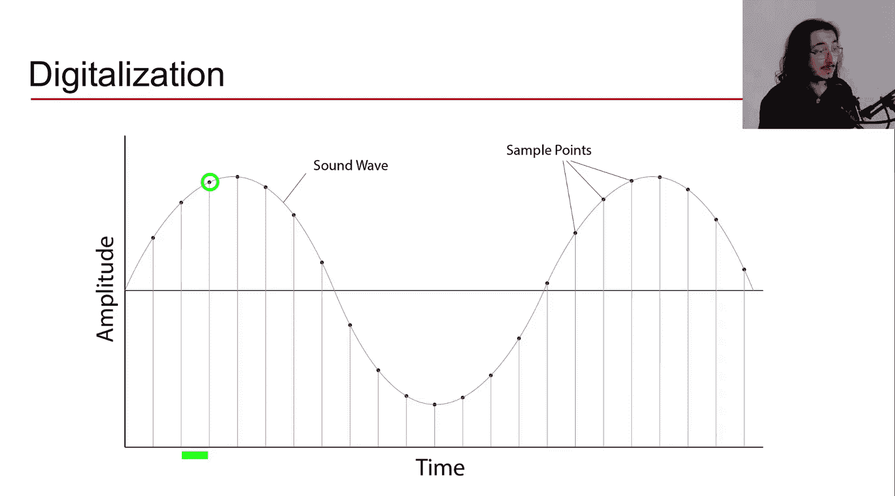

S called G of T which is continuous in time that's kind of like transformed into this x of n and x of n。

 the convention for saying that we are taking a sample the point here is that we have like a discrete so this ns differently like from this T like are discrete so we have like n0 or n1 and2 and3 and x of n is a sample taken at a particular time。

 but what that particular time Well if we want to know like the point so the time T at which we've taken the sample we have to multiply n which is the current sample we are n could be one to3 by the sampling period。

😊，Okay， so this gives you like an idea of the type of like transformation that we will need from moving from continuous Fourier transform to discrete Fourier transform。

 But now let's try to build the DFT or discrete Fourier transform starting from the continuous Fourier transform。

 And so here we'll see how each of the elements in the Fourier transform get not onto their like discrete counterparts。

 Okay， we start from the definition of the Fourier transform itself。 And so in the continuous case。

 we call this like G hat of F。 and in the discrete case， we call it x hat of F。

 And obviously this is the convention that we were using before to say that here we are dealing with samples。

 not with an analog signal。 Okay， so let's move on to the juicy stuff。 Okay， so in the。😊。

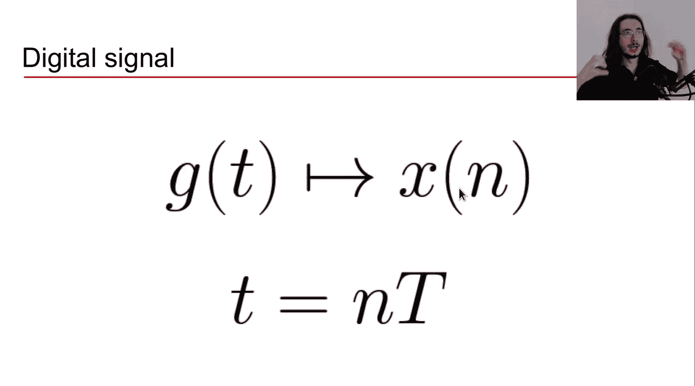

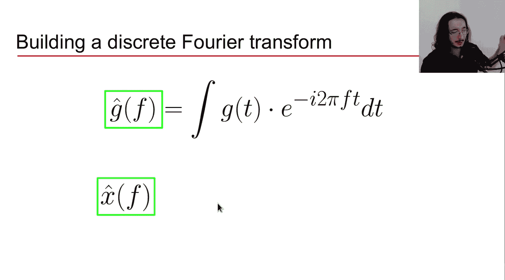

tinous case in the top equation。 you see that we are using integral here。

 So we are integrating over time。 and that's because we have like a time is continuous。

 So we have like infinite points in time。 And when you sum something like that's infinite like this continues。

 you use like an integral right but in our case， the idea is that we have like discrete points。

 discrete samples。 And so what we do is we use a sum which basically tells us that we should sum over n which are like the different points where we take the samples Okay so let's move on now this one is quite easy and we already soage right。

 so we don't want to deal with G of T anymore。 but rather we want to deal with the sample to X n and the next one which is like。

😊。

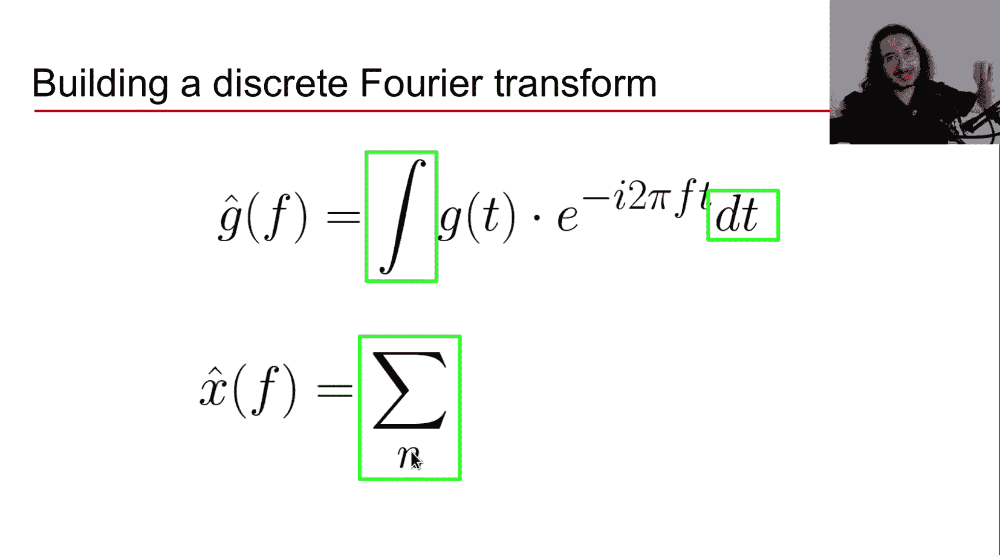

This exponential here more or less stays the same， right you can see。

 and this is like the if you remember from my previous video。

 this is like the the kind of like pure turn we decompose our original signal into and now the point is that we only have like one little modification instead of having t。

 we have n over here。 So this like should just like let you understand that from a very high level like conceptual point。

 what we are doing here is that instead of dealing with T time as a continuous variable。

 we are taking this snapshots at n right and these are like snapshots that take like discrete points in time。

 So all in all what we do instead of using T， we use like these snapshots N Okay this is great because。

😊，We have like a first version of the discrete Fourier transform。

 but we need to took that around a little bit okay now let's take a look at the visual interpretation of this first version of the discrete Fourier transform if you remember what we said back in like in our previous videos is that like when we visualize the Fourier transform when we we take the visual interpretation of that what we do actually is we are just like taking the area that's below a our like a signal。

 our analog signal in that case right and now what we do like we do discrete Fourier transform is something like conceptually similar and you can see it here right so here like on the Y axis you have like amplitude on the X axis you have like time and here。

😊。

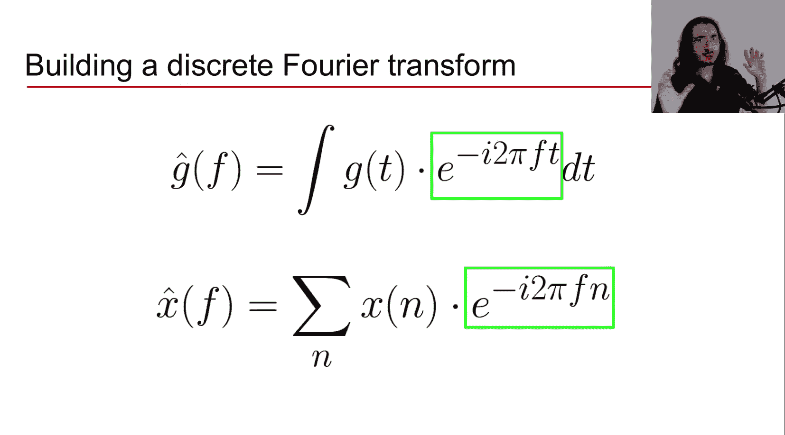

Like in blue， you have like this abstract， let's call it like it's our original analog signal And now like we sample that at certain points in time and what we do with the Fourier transform basically it just like we take like the areas like of this rectangled and the rectangled approximate the overall area that stays below the blue curve。

 which is our original analog signal and as you can see here， when we take this rectangles here。

 we have like certain errors because we are only approximating the actual area below the signal but the point is like we still have like errors。

 obviously if you make like this mental exercise and you think that we take like a smaller sampling period we would have like way more like vertical bars like this rectangles like this and which basically would lead to like a small。

😊，Mmaller error overall。 Okay， but that's basically like the idea。 So we take this。

 the area that's given by something like all of these rectangles。

 Each of this rectangle obviously like represents like a sample。Right， okay。

 so now let's move on and see that we still have a problem with our definition of the discrete Fourier transform。

 And that's why I said this is like the first definition that needs to be tweaked a little bit to be perfect for our purposes。

 And so we have a couple of problems here。 So problem number one is that we' are still dealing with a continuous frequency and problem number two is that we are dealing potentially like with an infinite number of samples。

 or at least like this is what the Fourier transform is supposed to be。

 It's supposed to some over like infinite time in in our case。

 this translate into an infinite number of samples。 So yeah。

 let's take a look at the formula for the discrete Fourier transform and try to explain what I'm mean by those two issues。

 so。😊。

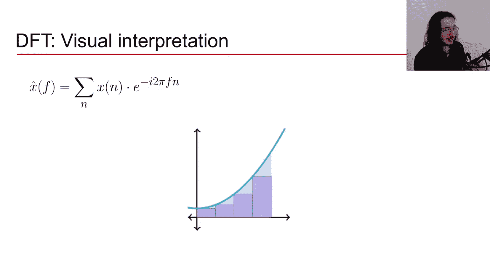

Regarding the frequency， I'm basically saying that this frequency is in a Fourier transform is supposed to be like infinite or like actually continuous。

 right？ So and that's just like something that we can't do like with our digital machines because like everything that sounds or sound similar to like infinite doesn't work with our machines for computational memory problems。

 right okay， so we have to sort that out。 but first， we have to sort out these other issue。

 which is basically that with the original continuous Fourier transform。

 we want to integrate across infinite time。 possible like time that goes like the age of the universe and beyond because it's infinite。

 In other words， we would need to create like an infinite number of samples for that。

 but that's not really like what we can do either like with our digital machines。

 So how do we solve this too big problem。😊，Well we hack around them right so hack number one is for time so what we do here is quite sensible and it makes sense basically what we do is we consider the frequencies we want to decompelse our original signal into to be non zero only in a finite time interval。

😊。

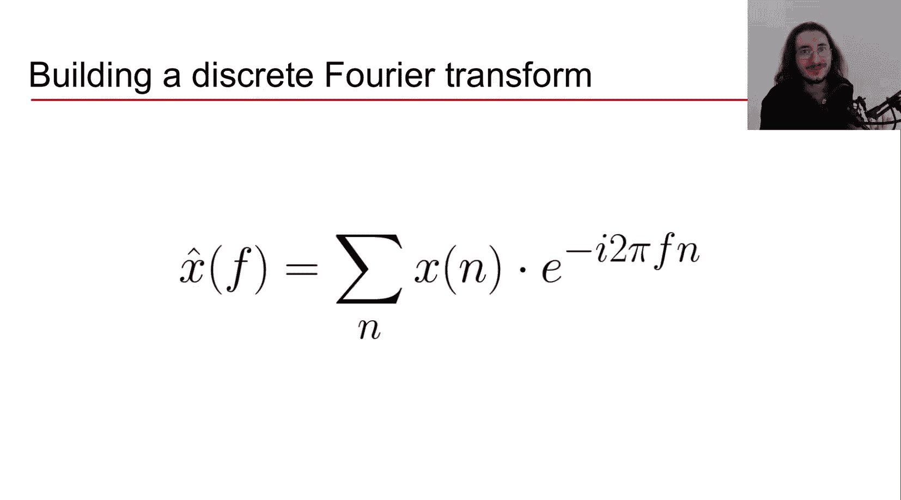

Does this make sense。 Yes， Why is that？ Well， let's take like as an example， like a song。

 So we have a song that's three minutes long。 Well， it makes sense to only take into consideration。

 those three minute worth of samples。 not the infinite number of samples that comes like with infinite time。

 right， And that's because we assume that those three minutes of song are the ones that will provide us the information about like the the frequency。

 we want to decompose that song into。 Okay， and so what that basically means is that instead of considering an infinite number of samples。

 we can only focus on a finite number of samples。 And this is like definitely something that we can then handle with our machines。

 Okay， all good for time。 Let's move on to frequency。😊，Well， here there is hack number two。

 So instead of like taking all possible frequencies。

 an infinite number of frequencies because we treat frequency as a continuous variable。

 What we do is we compute the transform for only a finite number of frequencies。

 And now you may be wondering but how many frequencies we want to consider when we actually calculate the discrete Fourier transform。

 Well， we have like a nice little hack here and basically the number of frequencies and that we consider is equal to the number of samples and that we have in the signal that we want to take the discrete Fourier transform of。

😊，Okay， but why M should be equal to N for a couple of reasons。 reason number one is very important。

 and it's the it's something that we've seen like in a previous video。

 And it's basically this idea that we can do we can have like a round trip from the frequency domain to the time domain and or I should say we start from the time domain。

 we move to the frequency domain。 But then using an inverse Fourier transform。

 we can go back to the a time domain。 And if we have like M， which is equal to N。

 we basically can move like quite easily from the frequency from the time domain to the frequency domain and then from the frequency domain back to the time domain。

 a second reason is because having M equal to N is very is efficient from a computational standpoint。

 So these are the two reasons why we use the same number of frequencies as the number of。

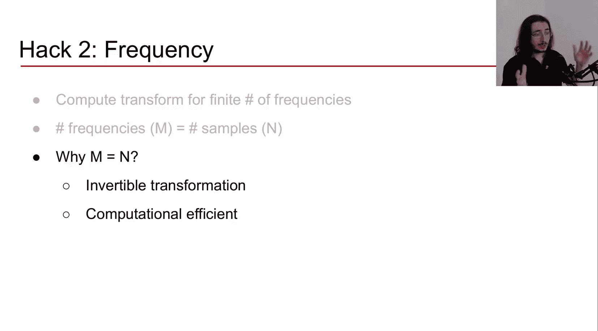

That we have。 Now， let's put into context what we've just said with words and take a look at the math at what happens at the actual with the actual formulas here。

 So we start with our original definition of the discrete Fourier transform。

 And here we have like this two problems， right， problem number one。

 we have like an infinite number of summons in this sum。

 because we have an infinite number of samples， problem number two， We have like frequency。

 which is continues。 So we work our first hack。😊。

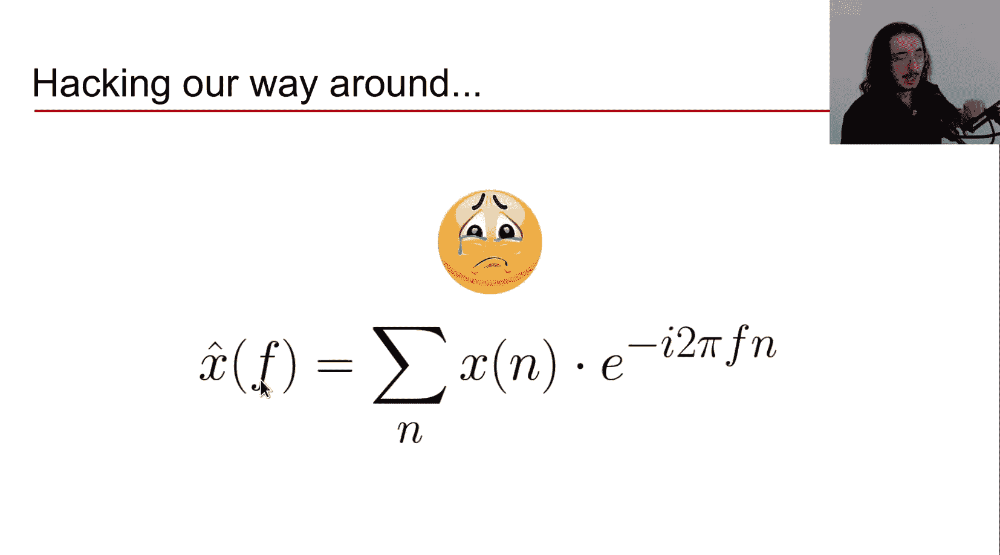

And what happens is that we get this guy over here。

 So now we're not summing an infinite number of samples， but rather， we contrain。

 We consider only an N number of samples。 And this is great。 Now。

 we wave our magic one once once again， and we finally get to the。😊。

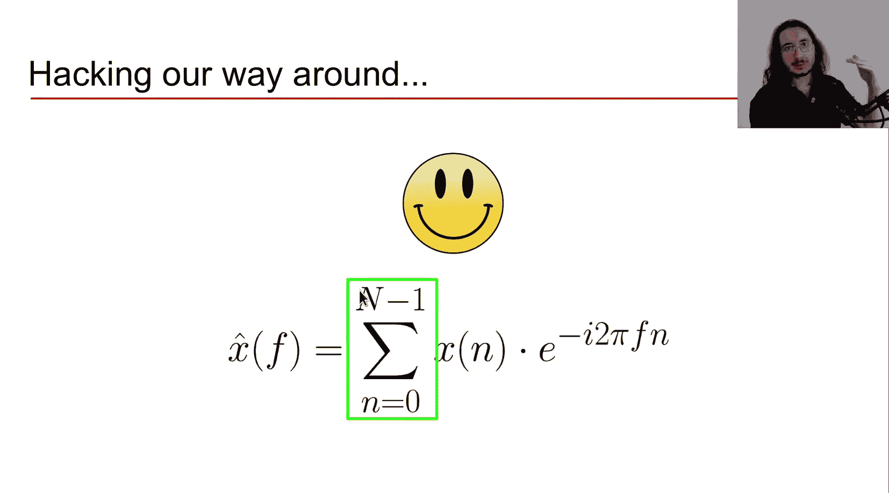

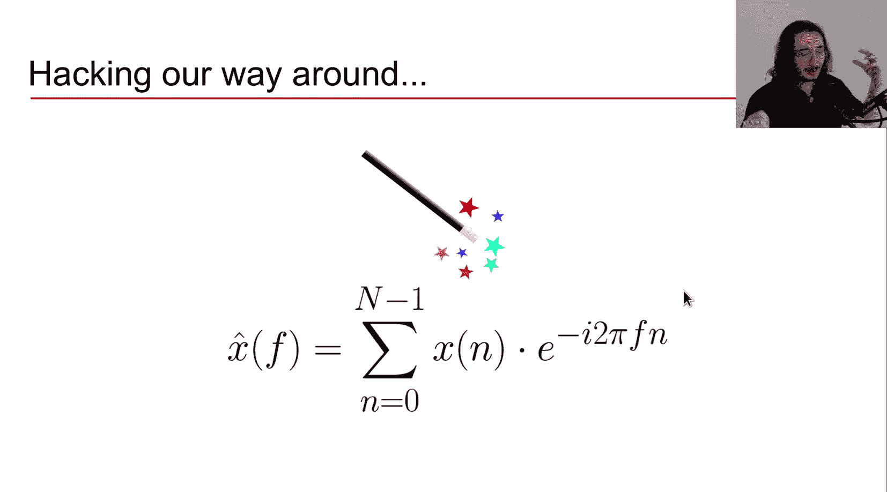

Definition of the discrete Fourier transform as is used， like throughout the world。

 and perhaps the universe。 And it's this one over here。 And as you can see。

 like the last bit that we changed was this。 instead of having the frequency F。

 we have this K divided by n or capital N。 Now， we changed it here and we obviously changed it here as well。

 because we had F here previously。 Okay， but what is this K thing。 Well， to understand what is K。😊。

We should understand like where like k the range of k and K ranges from 0 to n minus1 or in other words。

 from 0 to n minus-1。 So we have n capital n numbers。

 capital n values right and this is in other words， like K has the same the range as n has right。

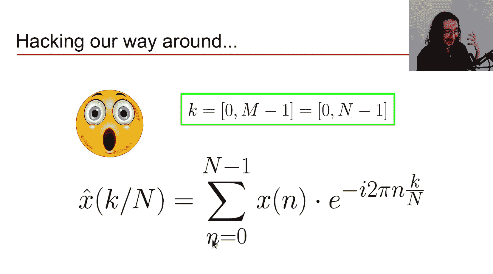

So， but let's try to understand what this means， like frequency wise， so。

The frequency of a given value K， and this frequency。

 obviously is expressed in Htz is given by this formula here。 So it's K divided by and。

Times T capital T， where T is the sampling period。If you guys remember from a previous video in this series。

 the sampling period is the inverse of the sampling rate。 In other words。

 what we can do is reroute this formula like this。 So K divided by capital N and all of these guys multiplied by the sampling rate Now。

 what does this tell us。 Well， this tell us that In other words。

 like the range of the frequency that we have as an output from the Fourier transform is between0 when K is 0。

 and basically the sampling sampling rate。 So this is like the kind of like frequency range that we consider when we apply a Fourier transform。

 And at the same time。😊，We take。A number of divisions like of this range between zero and sampling rate that's equal to the number of samples that we have in the original signal and that's given by capital N okay so now I want to show something really really cool and so we' are going take a look at the magnitude spectrum that comes out from a digital Fourier transform。

 So if you guys remember， so the output of a Fourier transform is the Fourier coefficients。

 which provide information for each at each frequency they give us two parameters。 one is the face。

 the other one is the magnitude and the magnitude is the one that we are the most interested in when we are analyzing audio data。

 and that's because it tells us how much present a certain frequency is。😊。

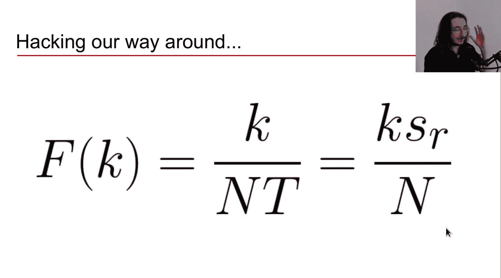

In an original signal， right？Okay， so what what what I've done here is basically I've just plotted the magnitude coefficient that comes out from a digital Fourier discrete Fourier transform And as you can see here。

 we have like something that's really， really interesting。 And on the exact says。

 obviously we have like the frequency as expressed in Htz。

 And here you can see that the original sampling rate was probably around 22000 Htz。

 I know what that was。 and it was like 22050 Htz to be precise。 but what's happening here。

 It seems like there's something crazy。 So we have like a nice like little like distribution of energy。

 like in the lower frequencies。 and then all of a sudden in the higher frequencies we have。😊，Again。

 like a lot of energy here。 these higher frequencies。

 Is this something real or is is this some kind of artifact。 Well。

 if we inspect this like more closely， we see that like this two。😊。

Like energy like distributions are like the same， but they' are mirrored， in other words。

 there's a central point of symmetry and what's happening like on the right of this symmetry is the mirrored version of the what what's happening like on the left hand side In other words。

 we have redundancies and if we take a look at this like very careful。

 we discover that this happens when K is equal to n divided by2 in other words。

 at the central frequency， which is basically the sampling rate divided by two。

 So this is like kind of like a central symmetry and what this means like for our purposes is that we only need to consider the lefthand side of this plot。

 So in other words， we are only interested like an up to sampling rates divided by。😊。

To frequency right what happens like above that is just like a repetition of what we saw below that frequency So this is like something to keep in mind when we are dealing with like Fourier transform or even like spectrograms as we'll see coming in the few in next videos Okay。

 but we've seen this particular frequency that's the sampling rate divided by two。😊。

Already in a previous video and that's called the niist frequency and that's the frequency。

 the kind of like a threshold above which we're not capable of reconstructing a digital signal into like its original analog signal without injecting some form of like a liaising Now if you want to like just like brush up a little bit like watch like a liaising is and the ni frequency。

 I suggest you to go check out this video up here。 One last thing that I want to cover is a particular algorithm that's very handy for calculating the discrete great Fourier transform and not surprisingly because of how it works。

 it's called the fast Fourier transform。😊。

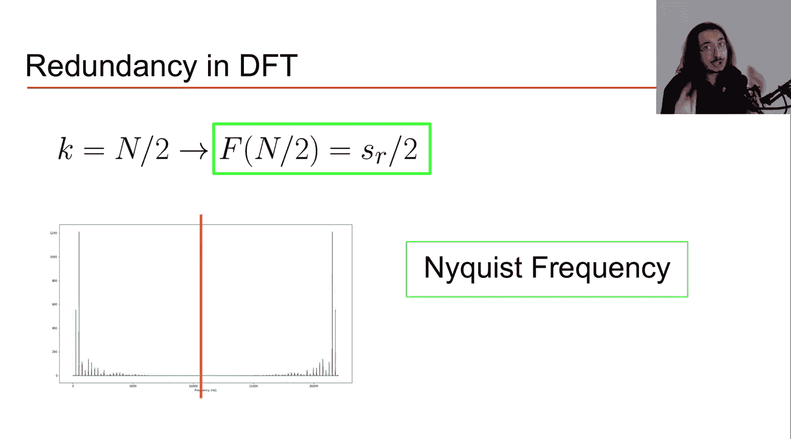

And this algorithm was discovered by Gauss and Fourier， almost like at the same time。

 So the problem is that with the discrete Fourier transform， we have like a way of like， computing。

 like this Fourier coefficients， that's quite expensive。

 The number of operations that we need to carry out is。Capital n squared。

 which is quite a lot if you have like a lot of samples。

 So the great thing about the fast Fourier transform is that it is way more efficient。😊。

And the number of operations that we need to calculate here is given by n multiplied by log2 of n。

 So how do we have like this the fast Fourreier transform。 Well。

 I'm not going get into the details here， but the kind of like high level intuition is that the fast Fourreier transform exploits like redundancies which happen across sinoids。

 So in other words， you calculate like certain things only like once or like just like a few times because then you can reapply them in other like situations。

 And by doing so you can save a lot of computation， but。There is no free lunch like in this universe。

 right， And so because of that， we have like certain constraints。

 And so if we want for the FFT to work， then we should choose like an n wisely。

 and N should be a power of two。 thats when we have n as a power of two that's where like kind of like the stars online。

 and then we can kind of unleash the power of the FFT algorithm。 Now。

 this is a very important algorithm and all the stuff that will see an implementation that we' use。

 for example， the Fourier transform when we calculate the dash language noin pi or si pi or evenly browsers actually rely on the fast Fourier transform algorithm。

 Okay， So that's it like for this video， now you should have like a very good understanding of the Fourier transform。

😊，So we started with the annottuation of the Fourier transform。

 we moved to like complex numbers and understood how we can actually use complex numbers for defining the Fourier transform in a continuous context now you know about the discrete version of the Fourier transform so you may be wondering。

😊，Should we still be and hear and talk more about the Fourier transform And the answer is yes。

 definitely so next time we'll leave like all of this theory behind us and we'll just like do a little bit like of implementation and play around and extract the magnitude spectrum from a bunch of sounds and kind of like understand what they mean from a semantic viewpoint and understand how they differ among themselves Okay so I hope you enjoyed this video if that's the case please leave a like if you haven't subscribed to the channel please consider doing so if you have any questions as usual leave them in the comment section below that's all for today I'll see you next time cheers。

😊。

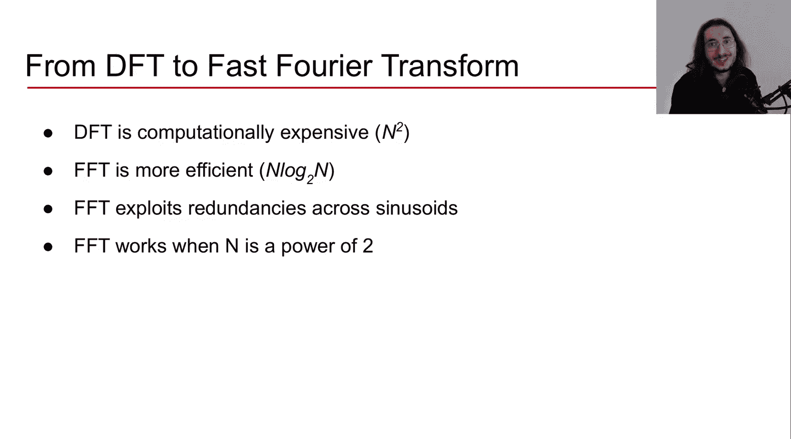

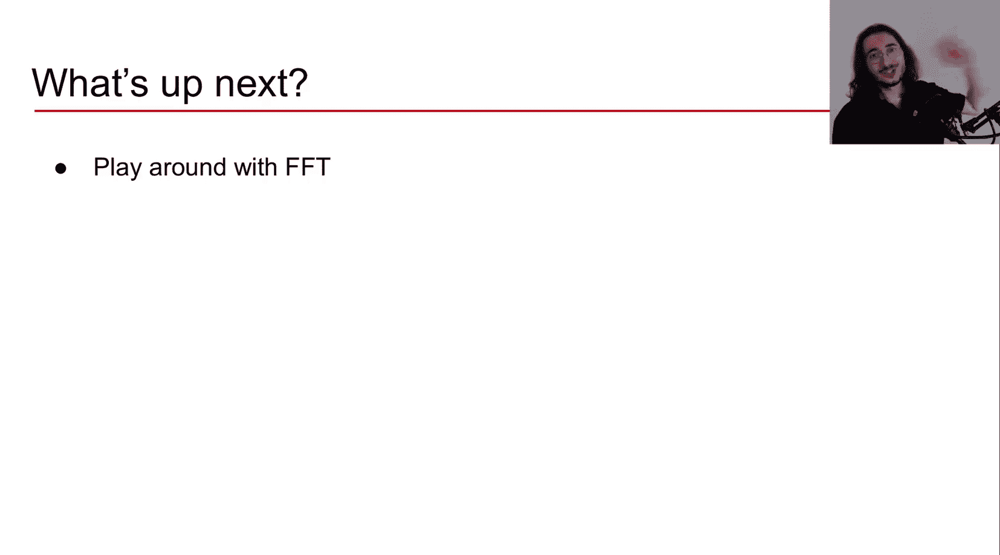